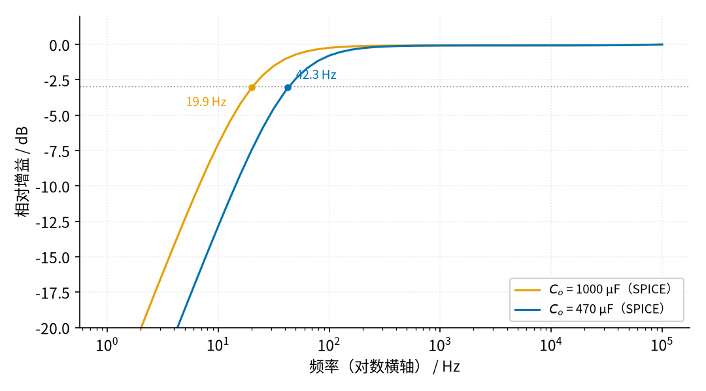
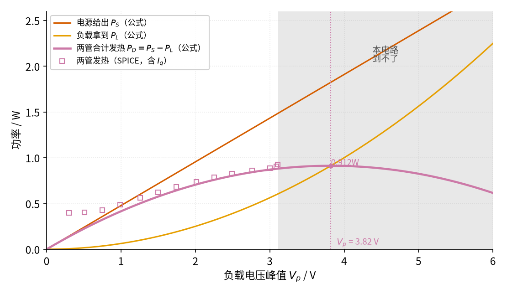
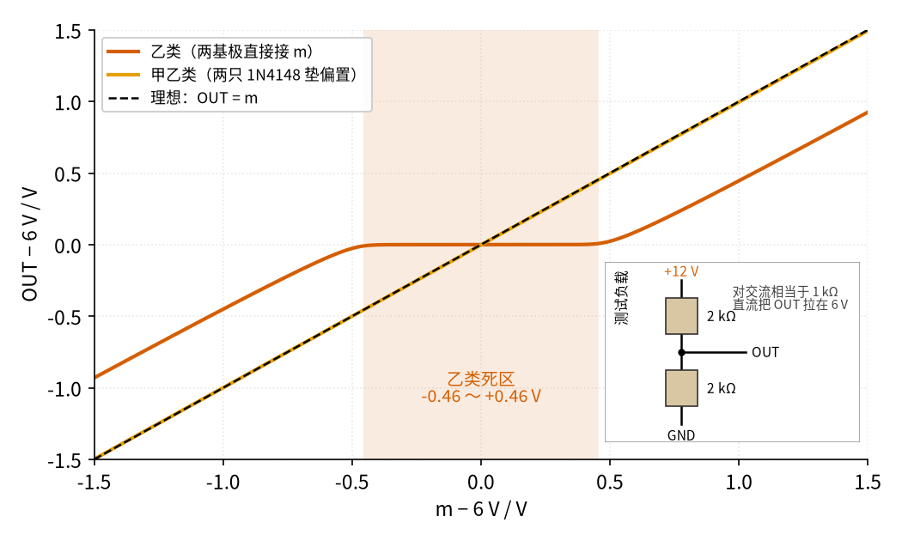
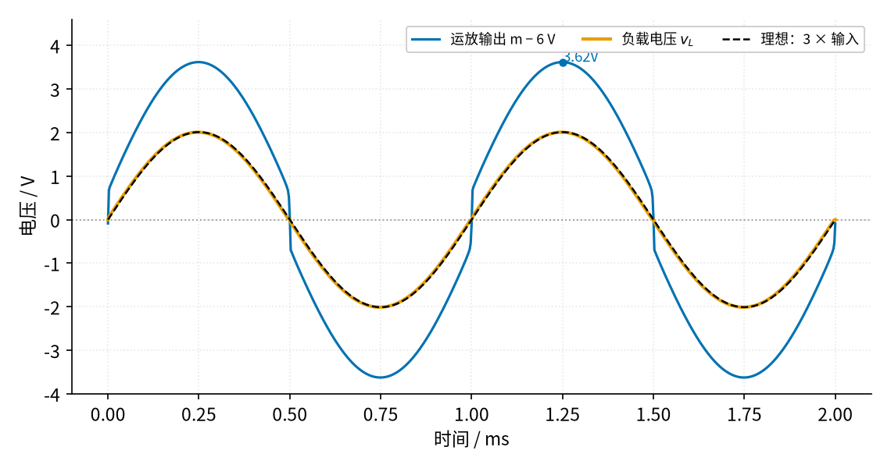

# 43 推挽功放：甲、乙、甲乙类 · 原理与实现篇

[上一页：直觉篇](page1.md) · [直觉篇](page1.md) · 本页：原理与实现篇 · [参数与调试篇](page3.md) · [动手实验篇](page4.md) · [下一页：参数与调试篇](page3.md) · 前置节点：[19 射极跟随器 · 直觉篇](../19-emitter-follower/page1.md)、[08 同相放大 · 直觉篇](../08-noninverting-amp/page1.md)、[12 电压跟随器 · 直觉篇](../12-voltage-follower/page1.md)、[17 稳压管稳压 · 直觉篇](../17-zener-regulator/page1.md)

## 最小知识

- **射极跟随器**（19 节）：NPN 管发射极电压 ≈ 基极电压 − 0.65 V，发射极电流约为基极电流的 $h_{FE}$ 倍（ $h_{FE}$ 叫电流放大倍数，BD139 在 150 mA 时为 40～250）。PNP 管是镜像：发射极 ≈ 基极 **+** 0.65 V，电流方向反过来。
- **同相放大**（08 节）：增益 $1 + R_F / R_G$ 。
- **有效值**：正弦峰值 $V_p$ 的有效值是 $V_p / \sqrt{2}$ ，万用表交流挡读的就是它；电阻上的平均功率 $P = V_{rms}^2 / R = V_p^2 / (2R)$ 。
- **电容隔直**：串联电容挡住直流，只让交流过去；电容和电阻构成的高通拐点 $f_c = 1 / (2\pi R C)$ 。

> **最小补充：「中点参考」V_MID 和 05 节的「虚地」不是一回事**
>
> 本节只用一个 12 V 电源，信号要能往上、往下摆，就得找一个「中间」当静止点。我们用两只 10 kΩ 把 12 V 分成 6 V，再接一个运放跟随器（12 节）输出，叫**中点参考**，记作 $V_{MID}$ 。它只给运放输入定静止点，电流只有零点几毫安。05 节里的「虚地」说的是负反馈下运放反相端被「拉」到和同相端相等的现象，两者名字别混。最重要的一点：**喇叭电流不能走 $V_{MID}$** ，它的输出能力只有几十毫安，喇叭要经输出电容回到真正的地（GND）。

## 一、完整电路，逐个元件看

![本节完整电路：左边信号源经 10 µF 输入电容（正极朝同相端）接 TL072 B 的同相端，同相端经 100 kΩ 接中点参考 V_MID 6 V，反相端经 10 kΩ 接 V_MID、经 20 kΩ 反馈电阻接 OUT；运放输出 m 点夹在两只 1N4148 之间，上面由一个约 24 mA 的恒流源从 +12 V 往下送电流，下面由另一个约 24 mA 的恒流源把电流抽到地，两只 1N4148 标注贴在散热片上；两个基极各串 22 Ω 接 BD139 和 BD140，两管发射极各串 3.3 Ω 汇成 OUT，Q1 集电极经电流表接 +12 V，Q2 集电极接地；OUT 经 1000 µF 电容接 8 Ω 负载到真地，OUT 到地还挂着 10 Ω 加 100 nF 的 Zobel 网络；灰色小字标出 TL072 B 的 5 脚（+）、6 脚（−）、7 脚（输出）和 Q1、Q2 的 B、C、E。左下是中点参考电路：+12 V 经 R1 10 kΩ、R2 10 kΩ 分压到地，分压点（6 V）并 Cd 10 µF（正极朝分压点）到地，并接 TL072 A 的 3 脚（+）；A 半的 1 脚（输出）和 2 脚（−）短接成跟随器，1 脚输出就是 V_MID，向上接到 Rbias、RG 下端的 V_MID 线；TL072 的 8 脚接 +12 V、4 脚接地](img/43_p2_1_full_circuit.png)

*图 43-p2-1　本节完整电路：单 12 V、增益 3、甲乙类推挽*

按信号走的顺序看图 43-p2-1：

1. **输入电容 Cin 10 µF + Rbias 100 kΩ**：手机耳机口的信号是围绕 0 V 摆的，Cin 挡掉直流，Rbias 把运放同相端的静止电压拉到 $V_{MID} = 6\ \text{V}$ 。所以 Cin 的正极朝 5 脚（6 V 一侧），负极朝信号源（0 V 一侧）。图左下就是产生 $V_{MID}$ 的 TL072 A：R1、R2 两只 10 kΩ 把 12 V 分成 6 V，Cd 10 µF 滤掉电源纹波，3 脚接分压点，1 脚和 2 脚短接成跟随器，1 脚输出 $V_{MID}$ 。
2. **TL072 B，增益 3**：同相放大， $1 + 20\ \text{k} / 10\ \text{k} = 3$ 。注意反馈电阻 RF 接的是**推挽输出 OUT**，不是运放输出 m。这样两只三极管被「包」进了反馈环，第四节会讲它的大好处。RG 下端接 $V_{MID}$ ，所以直流时 OUT 也被拉到 6 V。
3. **偏置串：上恒流源 + D1 + D2 + 下恒流源**：上面的恒流源从 12 V 往 b1 点送约 24 mA，穿过两只二极管，再由下面的恒流源从 b2 点抽走。两只二极管在两个基极之间垫出约 1.56 V（SPICE 结果），正好让两只管子都「微微导通」。恒流源为什么必须要有，下面单独讲。
4. **基极电阻 22 Ω**：BD139 这类管子在面包板长线和电容负载下容易在 MHz 级自激（参考资料里的 StackExchange 讨论和 Feucht 的振荡讲义），基极串 22～47 Ω 能把它压下去，本节取 22 Ω，而且要**焊在管子的基极脚上**，离管脚越近越管用。音频频率下它几乎不影响。
5. **发射极电阻 RE 3.3 Ω**：稳住静止电流，第三节细讲。
6. **Zobel 网络 10 Ω + 100 nF**：喇叭在高频时像电感，阻抗往上升；Zobel 让 OUT 在高频时也看到一个约 10 Ω 的电阻性负载，防止输出级振荡。
7. **输出电容 Co 1000 µF/25 V**：挡住 OUT 的 6 V 直流，正极接 OUT，负极经负载到地。

### 偏置电流为什么要 ≥ 22 mA，为什么用恒流源

声音最大时，Q1 要给 8 Ω 送峰值约 $3\ \text{V} / 8\ \Omega \approx 0.375\ \text{A}$ 的电流。ST 的 BD139 手册只保证：0.5 A 时 $h_{FE}$ **不小于 25**。设计要按最差的管子、并且按手册给保证的 0.5 A 来算（顺便给以后换喇叭、加大音量留出余量）：

$$I_B = \frac{I_C}{h_{FE}} = \frac{0.5\ \text{A}}{25} = 20\ \text{mA}$$

再给两只偏置二极管留约 2 mA，让它们任何时候都保持导通，合计**偏置电流至少 22 mA**。否则声音一大，基极「喂不饱」，波形顶部被削平。

老办法是用两只 470 Ω 电阻代替恒流源。它在静止时能送约 11 mA，但声音大时 b1 点跟着往上走，电阻两端电压变小，电流反而越来越少，偏偏这时最需要电流。参数与调试篇用 $h_{FE}$ 约 25 的「最差管子」模型做了 SPICE 对比：用 470 Ω 时负载峰值卡在 1.64 V，运放被迫补上 20 mA 以上的电流；换成恒流源，同样的最差管子能推到 2.89 V，运放只出 12.8 mA。


*图 43-p2-6　两个约 24 mA 的恒流源：偏置电流不随音量变小*

> **最小补充：恒流源**
>
> 「恒流源」就是一个不管两端电压怎么变、电流都基本不变的小电路。图 43-p2-6 上半部分：D5、D6 两只二极管把 Q3 的基极钉在 +12 V 下面约 1.30 V（SPICE）；Q3 的发射结又「吃掉」约 0.65 V，所以 27 Ω 两端剩约 0.64 V（SPICE：1.295 − 0.654 ≈ 0.641 V，各数四舍五入后差 0.01 V），电流约 $0.64\ \text{V} / 27\ \Omega \approx 23.7\ \text{mA}$ 。二极管和发射结的压降差不多大，一只二极管正好「抵消」一个发射结，所以 27 Ω 上大约就是一只二极管的压降。动手实验篇里量 27 Ω 两端，读到的也应该是 0.64 V 左右。b1 点电压往上走、往下走，27 Ω 上的电压不变，电流也就不变。下半部分是镜像，用 NPN 管 BD139 从 b2 往地抽电流。

图 43-p2-6 里的 Q3、Q4 自己也会发热：Q3 静止时管耗约 0.11 W（SPICE），最坏情况也不超过 $12\ \text{V} \times 24\ \text{mA} \approx 0.29\ \text{W}$ ，远低于手册给的不加散热片 1.25 W，所以它们直接插在面包板上，不用散热片。

输出电容和 8 Ω 组成一个高通，拐点 $f_c = 1 / (2\pi \times 8 \times 1000\ \mu\text{F}) = 19.9\ \text{Hz}$ 。如果手边只有 470 µF，拐点升到 42.3 Hz，低音少一些但能用。



*图 43-p2-3　输出电容决定低音能下到多低*

图 43-p2-3 是 SPICE 的交流扫描，幅频曲线（对数横轴）。中频增益 SPICE 算出 2.999，和 3 只差 0.03%。在图 43-p2-3 里，100 Hz 以上两条曲线几乎重合，动手实验篇用 400 Hz 测试音，电容带来的衰减只有约 0.12%。

## 二、推导：功率、效率、发热

先看理想的乙类（不管偏置电流和管压降）。设负载电压是峰值 $V_p$ 的正弦，负载 $R_L = 8\ \Omega$ 。

**负载功率**：

$$P_L = \frac{V_p^2}{2 R_L}$$

**电源功率**：正半周 Q1 导通，电流从 +12 V 经 Q1 流进电容和负载；负半周 Q2 导通，电容通过 Q2 向地放电，**这半周 12 V 电源不出电流**。所以电源电流是「半波」的正弦，峰值 $V_p / R_L$ ，一个周期的平均值是峰值除以 $\pi$ ：

$$P_S = 12\ \text{V} \times \frac{V_p}{\pi R_L}$$

**效率**：

$$\eta = \frac{P_L}{P_S} = \frac{\pi V_p}{4 \times 6\ \text{V}}$$

这里的 6 V 就是电源的一半，单电源推挽相当于 ±6 V 双电源的推挽（但本节绝不真去接 ±6 V 双电源，全程单 12 V）。 $V_p$ 顶到 6 V 时效率 78.5%，这就是直觉篇效率图里蓝线的终点。

**两管的发热**：

$$P_D = P_S - P_L$$

它不是越大声越热。把 $R_L = 8\ \Omega$ 代进去：

$$P_D = \frac{12}{8\pi} V_p - \frac{V_p^2}{16}$$

这是一条开口向下的抛物线（二次函数）。用顶点公式 $x = -b / (2a)$ ，得 $V_p = 12 / \pi \approx 3.82\ \text{V}$ 时管耗最大，两管合计 0.912 W。



*图 43-p2-2　管子最热的时候不是最大声的时候*

图 43-p2-2 告诉我们一个反直觉的事实：中等音量时管子最热。下面的程序把这些公式算一遍：

```python
import math

RL, VH = 8.0, 6.0                                  # 负载 8 Ω；单 12 V 电源的一半
def powers(vp):
    pl = vp**2 / (2 * RL)                          # 负载功率
    ps = 12.0 * vp / (math.pi * RL)                # 电源功率（只有正半周取电）
    return pl, ps, ps - pl, pl / ps                # 负载、电源、两管发热、效率

for vp in (2.0, 3.0, 2 * VH / math.pi, 6.0):
    pl, ps, pd, eta = powers(vp)
    print(f"V_p = {vp:4.2f} V：P_L = {pl:.3f} W，P_S = {ps:.3f} W，"
          f"两管发热 {pd:.3f} W，效率 {eta*100:.1f}%")
```

输出的四行依次是：

- $V_p = 2\ \text{V}$ ：负载 0.25 W，电源 0.955 W，效率 26.2%。
- $V_p = 3\ \text{V}$ ：效率 39.3%。
- $V_p = 3.82\ \text{V}$ ：发热最大 0.912 W。
- $V_p = 6\ \text{V}$ ：负载 2.25 W，效率 78.5%。

真实电路（SPICE，含静止电流）在 $V_p = 2\ \text{V}$ 时电源功率是 0.99 W，比理想的 0.955 W 多出的部分，主要来自约 33 mA 的静止电流。注意这里算的是**功放管**这一路（电流表测的那一路）；两个恒流源另外还从 12 V 取约 24 mA，它不经过喇叭，也算损耗。

## 三、甲乙类偏置：垫多少、怎么稳住

**偏置电压从哪来。** 恒流源把约 24 mA 送进两只 1N4148，两只二极管合计压降约 1.56 V（SPICE），刚好对着两只管子的两个 $V_{BE}$ 。SPICE 算出静止时 Q1 集电极电流 $I_q = 33.0\ \text{mA}$ ，每只 RE 上约 $33\ \text{mA} \times 3.3\ \Omega \approx 109\ \text{mV}$ 。m 和 OUT 静止时都约 6 V。

**静止时的代价。** 功放管这一路电源付出 $12 \times 33\ \text{mA} = 0.396\ \text{W}$ ，每只管子上的电压约 6 V，各发热 $6 \times 33\ \text{mA} = 0.198\ \text{W}$ 。BD139 手册写着：不加散热片、空气 25 °C 时最多只能耗 1.25 W，结到空气的热阻约 100 °C/W，所以没声音时每只管子就比室温高约 20 °C。大声时更热，所以本节要求两只功放管都装散热片。



*图 43-p2-4　直流慢慢扫：乙类有死区，甲乙类没有*

图 43-p2-4 是把 m 缓慢地从 4.5 V 扫到 7.5 V、OUT 接 1 kΩ 测试负载（两只 2 kΩ 分别接 +12 V 和地）时 SPICE 得到的曲线，动手实验篇没有示波器时就用这个办法。乙类（两基极直接接在 m 上）的死区是 ±0.46 V，比直觉篇里接 8 Ω 时的约 ±0.6 V 窄，因为这里负载电流小，三极管刚开一点就够用， $V_{BE}$ 小一些。甲乙类的曲线在图 43-p2-4 里和理想直线几乎重合，整段只有约 0.02 V 的「死区」，基本消失。

**为什么要 RE。** 三极管的 $V_{BE}$ 有一个讨厌的性质：温度每升 1 °C，同样的电流下 $V_{BE}$ 大约小 2 mV（17 节讲稳压管温度系数时见过这个数量级）。管子热了， $V_{BE}$ 变小，可二极管垫的电压没跟着变，等于偏置「多垫了」，电流增大，管子更热……这个正反馈叫**热失控**。RE 是刹车：电流增大，RE 上的压降也增大，把多出来的偏置「吃掉」。参数与调试篇用 SPICE 比较 3.3 Ω 和 1 Ω 时刹车的效果。

> **最小补充：为什么用二极管垫偏置，而不是用电阻**
>
> 二极管的正向压降也是每度约 −2 mV，和三极管的 $V_{BE}$ 同方向变化。如果把二极管贴在功放管的散热片上（叫**热耦合**），管子热、二极管也热，偏置自动变小，正好抵消。所以本节**一定要**把 D1 用导热胶贴在 Q1 的散热片上、D2 贴在 Q2 的散热片上，再从散热片引线回面包板。二极管插在面包板上、离管子很远，就等于没有热耦合，只剩 RE 一道刹车。

## 四、放进反馈环：交越失真小了几百倍

乙类推挽有死区，但如果把它包进运放的负反馈环里，运放会发现「OUT 没跟上」，于是把 m 猛地往上或往下推，直到越过死区。



*图 43-p2-5　反馈环里的运放「跳过」死区*

图 43-p2-5 是乙类（没有偏置）放进反馈环后的 SPICE 波形。负载电压峰值 2.0 V，和理想几乎重合；运放输出 m 却每次过零都「跳」一下，最高到 9.62 V，也就是比 6 V 高 3.62 V，比负载峰值多出的部分是 $V_{BE}$ 和 RE 上的压降。图 43-p2-5 里那个跳变就是运放在替三极管「补」死区。

SPICE 用 1 kHz 正弦算了总谐波失真（THD，参数与调试篇的最小补充有解释）：乙类开环约 21%，放进环里降到 0.071%；甲乙类开环 1.84%，放进环里 0.0086%。反馈和偏置一起用，效果最好。但反馈不是万能的：运放跳变需要时间，频率越高越跟不上，参数与调试篇会给出 10 kHz 的结果。

## 五、本节电路实际能做多大

- **输入**：手机耳机口的输出幅度和机型、音量都有关，这里不给具体数字。增益 3 意味着负载峰值 $V_p = 3 \times$ 输入峰值。动手实验篇不依赖手机幅度：调音量直到负载上的交流读数到目标值即可。
- **输出上限**：SPICE 里输入加到 1.0 V 峰值时 $V_p = 3.0\ \text{V}$ ，这时负载功率 0.56 W，效率 38.9%，两管合计发热 0.88 W。再加大到 1.2 V，输出也只到 3.11 V：b1 点已经升到离 +12 V 只剩一点点，上面的恒流源没有电压余量了，三极管基极还要多 0.7 V。
- **运放负担**：基极电流主要由恒流源供，运放只补差额。典型管子在 $V_p = 2\ \text{V}$ 时运放输出电流峰值只有约 1.9 mA，削顶时也只有 3.19 mA；换成 $h_{FE}$ 约 25 的最差管子、 $V_p$ 约 3 V 时是 12.8 mA，仍低于 TL072 短路电流典型值 26 mA。

## 例题

三道题难度一级级加：例 1 全程示范，例 2 只给框架、留空让你填，例 3 自己做。

**例 1（看示范）**：本节电路在 $V_p = 3\ \text{V}$ 时两管合计发热多少？每只管子不加散热片会比室温高多少？

1. 理想公式：电源功率 $P_S = 12 \times 3 / (8\pi) = 1.43\ \text{W}$ ，负载功率 $P_L = 9 / 16 = 0.5625\ \text{W}$ ，两管合计 $P_D = 0.87\ \text{W}$ 。SPICE 算出 0.88 W，几乎一样。
2. 每只管子约 0.44 W。
3. 乘以结到空气的热阻 100 °C/W，约高 44 °C。室温 25 °C 时管子约 69 °C，摸上去会烫手，所以动手实验篇要求每只管子单独装散热片，并且用测温探头盯着。

**例 2（填空）**：换成 $V_p = 2\ \text{V}$ ，照例 1 的三步填空：

1. $P_S = 12 \times 2 / (8\pi) =$ ___ W， $P_L = 4 / 16 =$ ___ W，两管合计 $P_D =$ ___ W。
2. 每只管子约 ___ W。
3. 不加散热片，比室温高约 ___ °C。

<details><summary>答案</summary>

1. P_S ≈ 0.955 W，P_L = 0.25 W，P_D ≈ 0.705 W。
2. 每只约 0.35 W。
3. 0.35 × 100 ≈ 35 °C。峰值从 3 V 降到 2 V，音量小了三分之一，每只管子的发热却只从约 0.44 W 降到约 0.35 W，温升也只从约 44 °C 降到约 35 °C：音量变小，管子并没有跟着凉多少。这就是图 43-p2-2 里管耗曲线在中间鼓起来的原因。

</details>

**例 3（自己做）**：静止电流从 33 mA 涨到 50 mA，RE 上的电压是多少？每只管子静止发热多少？

<details><summary>答案</summary>

50 mA × 3.3 Ω = 165 mV。每只管子约 6 V × 50 mA = 0.3 W，不装散热片就高约 30 °C。动手实验篇把 RE 上 165 mV 当作「立即断电」的红线。

</details>

## 参考资料

- 运放 + 推挽输出级（TI 应用笔记 AN-272）：<https://www.ti.com/lit/an/snoa600b/snoa600b.pdf>
- BD139 数据手册（ST）：<https://www.st.com/resource/en/datasheet/bd139.pdf>
- BD135～BD140 数据手册（Distrelec 镜像）：<https://media.distrelec.com/Web/Downloads/_t/ds/BD135-136-139-140_eng_tds.pdf>
- TL072 数据手册（TI）：<https://www.ti.com/lit/ds/symlink/tl072.pdf>
- 射极跟随器寄生振荡与基极电阻（Electronics StackExchange）：<https://electronics.stackexchange.com/questions/476679>
- 基极阻尼电阻与射极跟随器振荡（Feucht，*Why Circuits Oscillate Spuriously*）：<https://audioworkshop.org/downloads/AMPLIFIERS_OSCILLATION_BJT_CIRCUITS.pdf>
- 偏置二极管与功率管的热耦合（Electronics StackExchange）：<https://electronics.stackexchange.com/questions/324215>
- 本节 SPICE 网表和脚本：仓库里的 `spice/43/` 目录
