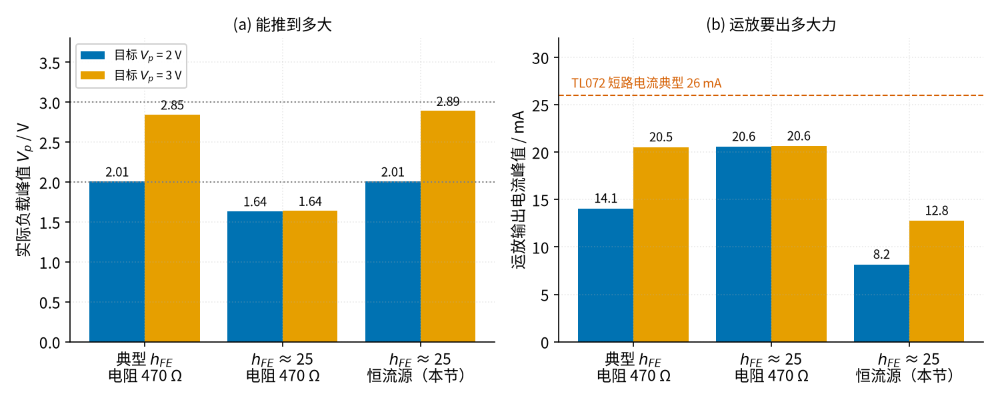
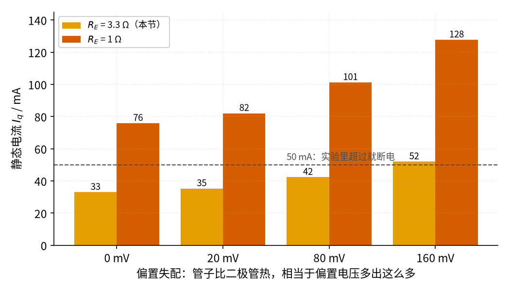
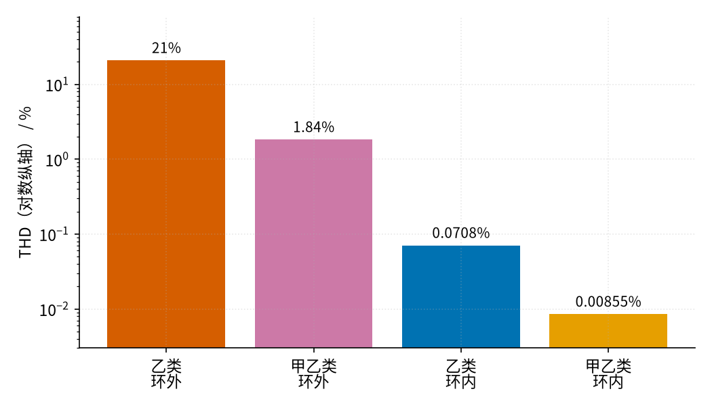
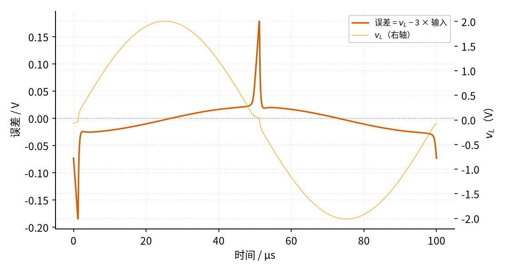

# 43 推挽功放：甲、乙、甲乙类 · 参数与调试篇

[上一页：原理与实现篇](page2.md) · [直觉篇](page1.md) · [原理与实现篇](page2.md) · 本页：参数与调试篇 · [动手实验篇](page4.md) · [下一页：动手实验篇](page4.md) · 前置节点：[19 射极跟随器 · 参数与调试篇](../19-emitter-follower/page3.md)、[17 稳压管稳压 · 参数与调试篇](../17-zener-regulator/page3.md)、[08 同相放大 · 直觉篇](../08-noninverting-amp/page1.md)

## 参数一览

原理与实现篇把电路搭了出来，这一页回答「每个元件取多大、改了会怎样、出了毛病怎么查」。表里的数字都来自 `spice/43/run.py` 的仿真或页面上的手算。

表里提到的元件都在下面两张图上：图 43-p3-1 是完整电路，图 43-p3-2 是图中两个「恒流源」的内部。

![完整电路：左边信号源经 Cin 10 µF（正极朝 5 脚）接 TL072 B 的同相端（5 脚），同相端经 Rbias 100 kΩ 接中点参考 V_MID 6 V；反相端（6 脚）经 RG 10 kΩ 接 V_MID、经蓝绿色的 RF 20 kΩ 接 OUT；运放输出（7 脚）就是 m 点，夹在 D1、D2 两只 1N4148（贴在散热片上）之间；D1 上端由「恒流源 约 24 mA」从 +12 V 往下送电流，D2 下端由另一个约 24 mA 的恒流源把电流抽到地；两个基极各串 22 Ω 接 Q1 BD139 和 Q2 BD140 的 B；Q1 的 C 经电流表（10 A 插孔、A 档）接 +12 V，Q2 的 C 接真地；两管 E 各串 RE1、RE2 3.3 Ω 汇成 OUT；OUT 经 C_o 1000 µF / 25 V（正极接 OUT）接 R_L 8 Ω 到真地，OUT 到地还挂着 Rz 10 Ω + Cz 100 nF。左下是中点参考电路：+12 V 经 R1 10 kΩ、R2 10 kΩ 分压到地，分压点（6 V）并 Cd 10 µF（正极朝分压点）到地，并接 TL072 A 的 3 脚（+）；A 半的 1 脚（输出）和 2 脚（−）短接成跟随器，1 脚输出就是 V_MID，向上接到 Rbias、RG 下端的 V_MID 线；TL072 的 8 脚接 +12 V、4 脚接地。图下两行注：参数表里两只恒流源 = 偏置电流，22 Ω = 基极阻尼电阻，RE1、RE2 = 发射极电阻 R_E，Rz + Cz = Zobel 网络；排错表里喇叭经 C_o 回到真地、不接 V_MID，C_o 正极接 OUT，静态电流看 RE1 两端的 mV（÷ 3.3 Ω）](img/43_p3_1_full_schem.png)

*图 43-p3-1　参数篇对照用的完整电路（TL072 A 标 1、2、3、4、8 脚，B 标 5、6、7 脚，Q1、Q2 标 B、C、E）*

**对照看**：表里的「基极阻尼电阻 22 Ω」是 b1、b2 到 Q1、Q2 基极的两只小电阻，实物要焊在基极脚上。「发射极电阻 $R_E$ 」是 RE1、RE2，量 RE1 两端的 mV 再除以 3.3 Ω 就是静止电流 $I_q$ ，33 mA 时约 109 mV。「输出电容 $C_o$ 」的正极朝 OUT，因为 OUT 静止时是 6 V，喇叭那端是 0 V；输入的 Cin 也一样，正极朝 5 脚（6 V），负极朝信号源（0 V）。排错表里的「 $V_{MID}$ 」来自图左下的 TL072 A 跟随器：R1、R2 各 10 kΩ 分压，Cd 10 µF 滤波，3 脚进、1 脚出，1 脚和 2 脚短接。「Zobel 网络」是 OUT 到地的 Rz + Cz。排错表第一行说的"喇叭回线接到了 $V_{MID}$"，在图上就是把 $R_L$ 下端从真地改接到左下角那条绿色的 $V_{MID}$ 线，这是错的。

![恒流源内部原理图：上面 +12 V 经 D5、D6 两只二极管到 Q3 BD140 的基极 B，基极再经 Rk3 4.7 kΩ 接地；+12 V 经 Rx3 27 Ω 到 Q3 的发射极 E，Q3 的集电极 C 向下就是 b1 点（→ 22 Ω → Q1 基极），往下经 D1 到 m 点（← 运放输出），再经 D2 到 b2 点（→ 22 Ω → Q2 基极）；b2 接 Q4 BD139 的集电极 C，Q4 的发射极 E 经 Rx4 27 Ω 接地；Q4 的基极 B 经 Rk4 4.7 kΩ 接 +12 V，再经 D7、D8 接地。右侧蓝字：上恒流源 D5 + D6 把 Q3 基极钉在 +12 V 下面约 1.30 V，Rx3 两端约 0.64 V，电流约 23.7 mA；下恒流源是镜像，约 23.6 mA。图下两行注：参数表的恒流源 R_X 就是 Rx3、Rx4（各 27 Ω），电流约 0.64 V ÷ R_X，改成 33 Ω 约 19 mA，低于 22 mA 的要求；排错表里量 Rx3、Rx4 两端应约 0.64 V，为 0 先查 Q3、Q4 的 E、C、B 有没有插错，再查 D5～D8 的方向](img/43_p3_2_ccs.png)

*图 43-p3-2　参数篇对照用的恒流源内部（Q3、Q4 标 B、C、E）*

**对照看**：表里「恒流源 $R_X$ 」那一行就是 Rx3 和 Rx4。D5 + D6 两端约 1.30 V，减去 Q3 发射结的约 0.65 V，Rx3 上剩约 0.64 V，所以电流 ≈ 0.64 V ÷ 27 Ω ≈ 23.7 mA。下面的 Q4、D7、D8、Rx4 是上下镜像。排错表「两边不对称」那一行要量的就是 Rx3、Rx4 两端：BD139 / BD140 正面朝自己时管脚从左到右是 E、C、B，插错一只，那一路的电流就是 0。

| 参数 | 本节取值 | 改大会怎样 | 改小会怎样 | 怎么选 |
|---|---|---|---|---|
| 电源 | 单 12 V，限流 0.5 A | 输出能摆得更大，但管子更热；本教程实验只用 ≤ 12 V | 输出上限变小 | 12 V；第一次上电一定先限流 |
| 偏置电流（恒流源） | 约 23.7 mA（SPICE） | 恒流源管子更热，静止耗电变多 | 低于 22 mA 时，最差的管子大音量会「喂不饱」而削顶 | 按 $h_{FE}$ 最差 25 算： $0.5\ \text{A} / 25 = 20\ \text{mA}$ ，再加二极管的 2 mA |
| 恒流源 $R_X$ | 27 Ω | 电流变小，可能低于 22 mA 的要求（见练习 2） | 电流变大 | $R_X \approx 0.64\ \text{V} / I$ |
| 发射极电阻 $R_E$ | 3.3 Ω | 静止电流更稳，但大电流时多吃电压、多发热 | 静止电流对温度、失配更敏感 | 本节 3.3 Ω（下文对比 1 Ω） |
| 基极阻尼电阻 | 22 Ω，焊在基极脚上 | 太大时（几百欧）会限制大电流时的基极驱动 | 太小或离管脚远，压不住 MHz 级寄生振荡 | 22～47 Ω；仍振荡再加到 100 Ω |
| 静止电流 $I_q$ | 33.0 mA（SPICE） | 更热，效率更低 | 交越失真变大 | 几十毫安；实验中超过 50 mA 就断电 |
| 输出电容 $C_o$ | 1000 µF / 16 V 以上 | 低音更足，开机「嘭」更大 | 低音变薄（见练习 5） | ≥ 470 µF；正极接推挽输出 |
| Zobel 网络 | 10 Ω + 100 nF | — | 不装时高频负载不确定，更容易自激 | 照抄即可 |
| 功放管散热 | 必须装散热片 | — | 不装时满音量每管约 0.44 W，温升约 44 °C | 见本页练习 3 |

> **最小补充：电流放大倍数 hFE 的「保证值」**
>
> 三极管的电流放大倍数 $h_{FE}$ 每只都不一样。ST 的 BD139 手册写的是：150 mA 时 40～250，0.5 A 时**不小于** 25。设计时只能信「保证值」，也就是最差的那只。买来的管子多半比 25 好得多，但不能指望。

## 一、偏置电流：恒流源 vs 两只 470 Ω

原理与实现篇讲过：大音量时基极电流要从偏置串里「借」。图 43-p3-3 用 SPICE 比较了三种情况：典型管子配 470 Ω、最差管子（ $h_{FE}$ 约 25）配 470 Ω、最差管子配本节的恒流源。目标分别是让负载峰值达到 2 V 和 3 V。

*图 43-p3-3　偏置方式对比：最差管子配 470 Ω 时输出卡在约 1.64 V*

看图 43-p3-3 的中间一组：最差管子配 470 Ω，不管输入多大，负载峰值都只有 1.64 V，运放输出电流顶在约 20.6 mA，已经被拽到极限。换成恒流源（右边一组），同样的最差管子能推到 2.89 V，运放只出 12.8 mA。这就是本节不用 470 Ω、改用恒流源的原因。

## 二、发射极电阻 $R_E$ 取多大

管子比二极管热，相当于偏置电压「多出来」一些（每热 1 °C 约多 2 mV）。图 43-p3-4 用 SPICE 在偏置里人为多加 20、80、160 mV，看静止电流怎么变。

*图 43-p3-4　发射极电阻越大，静止电流越不怕失配*

从图 43-p3-4 读出：失配 80 mV 时，3.3 Ω 的静止电流从 33.0 涨到 42.3 mA（多 28.4%），1 Ω 从 75.8 涨到 101 mA（多 33.5%）。1 Ω 不光涨得多，起点也高一倍多。80 mV 大约相当于管子比二极管热 40 °C（按每度 2 mV 估算）。所以本节两手都要：

1. $R_E$ 用 3.3 Ω，刹车更有力；
2. 二极管贴在散热片上（热耦合），让「多出来」的那部分本来就小。

代价是 3.3 Ω 在大电流时也要分走电压：峰值 0.375 A 时约 1.24 V（ $0.375 \times 3.3$ ），这也是输出摆不满的原因之一。

## 三、失真度：数字怎么读

> **最小补充：THD（总谐波失真）**
>
> 一个被「压扁」的正弦，可以拆成原来频率的正弦（基波）加上 2 倍、3 倍……频率的小正弦（谐波）。THD 就是「所有谐波加起来的大小 ÷ 基波的大小」，用百分数表示。0.1% 以下人耳一般已经很难分辨；交越失真的谐波集中在高次，听感更刺耳。

图 43-p3-5 是 SPICE 在 1 kHz、负载峰值约 2 V 时算的四个 THD。

*图 43-p3-5　四种接法的失真度：偏置和反馈环各降一大截*

图 43-p3-5 告诉我们两件事：

- **偏置**把开环失真从约 21% 降到 1.84%；
- **反馈环**再把它降到约 0.0086%。两样都做，才是本节的甲乙类加反馈环。

### 只靠反馈环的乙类，高频会露馅

乙类放进环里，1 kHz 时 THD 只有 0.071%，看起来已经很好。可是到了 10 kHz，SPICE 算出 THD 约 0.70%，大了约十倍。

*图 43-p3-6　10 kHz 乙类环内：每次过零都有一个尖刺*

图 43-p3-6 里的尖刺就是死区留下的痕迹：过零时运放要在极短时间里把输出跳过约 1.2 V 的「两个 $V_{BE}$ 」，频率越高，留给它跳的时间越短，跳不过去的部分就漏到输出上。误差最大约 185 mV（SPICE），其中尖刺之外的慢变化部分是环路在 10 kHz 的相位滞后。结论：反馈环能补救，但不能替代偏置。图 43-p3-6 也说明为什么听感上乙类的「沙沙」声在高音更明显。

## 排错表

| 现象 | 原因 | 怎么查 | 怎么改 |
|---|---|---|---|
| 一放声音，输出就严重失真，中点参考 $V_{MID}$ 跟着晃 | 喇叭回线接到了 $V_{MID}$ ，而它只能给几毫安 | 万用表直流档量 $V_{MID}$ ，放音时读数在跳 | 喇叭经 1000 µF 电容（正极接输出）回到**真地**； $V_{MID}$ 只给输入和运放偏置 |
| 音量开最大，输出仍只有几百毫伏 | 手机输出本身小（约 0.5～1 Vrms，依机型和地区而定），而且很多手机有音量限制 | 万用表交流档或示波器先量手机输出 | 本节已有 ×3 的电压放大；仍不够就把信号源换成信号发生器 |
| 静止电流几分钟里一直往上爬 | 二极管没和功放管热耦合，或没装散热片 | 每分钟量一次 $R_E$ 上的 mV，记下来 | 断电，把 D1、D2 用导热胶贴在散热片上；确认散热片装好 |
| $R_E$ 上读数超过 165 mV（50 mA） | 管子和二极管的 $V_{BE}$ 不匹配，或热失控刚开始 | 一上电就量，同时看电源限流有没有亮 | 立即断电；检查二极管方向，确认热耦合；仍然偏大就把 $R_E$ 加大一档 |
| 正半周（或负半周）先削平，两边不对称 | 偏置电流不够，基极「喂不饱」，或恒流源没工作 | 量 $R_X$ 两端：应约 0.64 V；为 0 说明恒流源没通 | 检查 Q3/Q4 管脚顺序（E、C、B）、D5～D8 方向；不要用 470 Ω 代替恒流源 |
| 示波器上波形变「粗」，没信号时管子也热 | MHz 级寄生振荡 | 示波器 10× 探头、1 µs/div 看输出和基极 | 22 Ω 焊在基极脚上；仍振就换 47 Ω 或 100 Ω；功放管集电极就近加 0.1 µF；装上 Zobel 网络 |
| 有低频嗡嗡声，动输入线声音会变 | 喇叭的大电流回线和输入地共用一段地线 | 把喇叭回线直接改到电源负极，听有没有变化 | 星形接地：喇叭回线、功率地直接回电源负极，输入地单独走 |
| 手机插着充电器时嗡嗡声很大 | 充电器、电源、示波器之间形成地回路 | 拔掉手机充电器再听 | 实验时手机只用电池；示波器只接一个地夹 |
| 开机「嘭」一声，电容发热或鼓包 | 开机时 $C_o$ 从 0 充到 6 V，充电电流流过喇叭；电容接反更会发热损坏 | 量 $C_o$ 两端：输出端约 6 V、喇叭端约 0 V | 正极接推挽输出、耐压 ≥ 16 V；开机前音量调到 0；先用 8 Ω 功率电阻代替喇叭 |
| 面包板触点发烫，按一按输出幅度就变 | 0.3 A 级电流流过接触不良的弹片 | 用测温探头靠近电源轨和输出连接处 | 功率回路（电源→管子→输出电容→负载→地）用粗线和接线端子，不要全走面包板 |
| 串上电流表后失真变了，或表的保险丝烧了 | mA 档有分流电阻（会吃掉电压），开机冲击电流可能超出 mA 档 | 对比串表前后的波形 | 电流表一律插 10 A 插孔、拨直流 A 档（和动手实验篇一致）；平时改量 $R_E$ 上的 mV |

## 常见误区

下面几条是初学者搭推挽功放最常踩的坑：

- **把喇叭回线接到中点参考 $V_{MID}$ 上。** $V_{MID}$ 只是两只 10 kΩ 分压再经运放缓冲出来的 6 V，它给输入偏置用；8 Ω 喇叭峰值要几百毫安，必须经输出电容回到真地。它也不是 05 节反相放大里的「虚地」：虚地是负反馈让运放两输入端电压相等的结果，而 $V_{MID}$ 是一个真实接出来的参考电压。
- **以为「BD139 能耗 12.5 W」，就不装散热片。** 12.5 W 是外壳被保持在 25 °C 时的值（要靠大散热片）。不装散热片、空气 25 °C 时只有 1.25 W。本节满音量每管约 0.44 W，温升约 44 °C，还是要装。
- **用手摸散热片试温度。** 散热片可能已经五六十度，会烫伤；而且手感完全不准。一律用测温探头、NTC 或万用表的温度档。
- **把二极管插在面包板上、离管子很远，也叫「温度补偿」。** 二极管必须用导热胶贴在功放管的散热片上，才能跟着管子一起热。
- **用 Arduino 采样「看交越失真」。** `analogRead` 一秒约一万次，1 kHz 时每周期只有十个点，交越区落在点与点之间；输出经电容后有负半周，低于 0 V 还会损坏引脚。看交越失真用示波器，或者用动手实验篇里的「直流慢扫」。
- **以为反馈环能包治一切。** 本页第三节已经看到，只靠反馈环的乙类在 10 kHz 失真大了十倍。

## 练习

**练习 1**：上电 5 分钟后，万用表在 $R_E$ 两端读到 140 mV。静止电流是多少？要不要断电？

答案

$I_q = 140\ \text{mV} / 3.3\ \Omega \approx 42.4\ \text{mA}$ 。还没到 165 mV（50 mA）的红线，但比刚上电的约 33 mA 大了不少，说明在升温。继续每分钟记一次：稳定下来就可以继续；还在往上爬就断电，检查二极管是否贴紧散热片。

**练习 2**：手边没有 27 Ω，有同学用 33 Ω 做 $R_X$ 。按页面上的估算法，恒流源电流是多少？够不够？

答案

$R_X$ 两端的电压和电阻大小无关：D5、D6 合计约 1.30 V，减去 Q3 发射结约 0.65 V，剩约 0.64 V（SPICE：1.295 − 0.654 ≈ 0.641 V，各数四舍五入后差 0.01 V）。电流约 $0.64 / 33 \approx 19.4\ \text{mA}$ ，低于 22 mA 的要求。买来的管子通常比 25 好，平时听不出问题，但遇到最差的管子、大音量时会削顶。应该用 27 Ω，或两只 56 Ω 并联（约 28 Ω）。

**练习 3**：夏天室温 35 °C，输入 1.0 V 峰值时每只功放管发热约 0.44 W。不装散热片，管子结温大约多少？手册的 1.25 W 还能用吗？

答案

结到空气热阻约 100 °C/W，温升约 $100 \times 0.44 = 44\ ^\circ\text{C}$ ，结温约 $35 + 44 = 79\ ^\circ\text{C}$ ，低于 150 °C 的上限，管子不会马上坏。但 1.25 W 是**空气 25 °C** 时的值，室温越高，能耗的功率越小；而且外壳也有七十多度，碰到会烫伤。所以本节还是要求装散热片，并用测温探头盯着。

**练习 4**：有同学想把 8 Ω 负载换成 4 Ω 喇叭。假设输出仍能摆到峰值 3 V，算一算：负载功率、电源功率、两管合计发热各多少？要保持 19.9 Hz 的低频拐点， $C_o$ 要多大？恒流源够不够？

答案

1. 负载功率 P_L = 3² / (2 × 4) = 1.125 W。
2. 电源功率 P_S = 12 × 3 / (4π) ≈ 2.865 W。
3. 两管合计发热 P_D ≈ 1.74 W。管耗最大的点在 V_p = 12/π ≈ 3.82 V，可这台电路摆不到，所以最热就在 3 V：每只约 0.87 W，不装散热片温升约 87 °C，绝对不行。
4. 拐点公式里 R 减半，电容就要加倍：C ≈ 1 / (2π × 4 × 19.9) ≈ 2000 µF。
5. 电流峰值 3 / 4 = 0.75 A，最差管子（h_FE 约 25）要 0.75 / 25 = 30 mA 基极电流，超过恒流源的 23.7 mA，大音量会削顶。

结论：本节电路按 8 Ω 设计，不建议直接换 4 Ω。

**练习 5**：如果把输出电容换成 220 µF（负载仍是 8 Ω），低频拐点是多少？

答案

f_c = 1 / (2π × 8 × 220 × 10⁻⁶) ≈ 90.4 Hz。低音明显变薄，所以输出电容要用 470 µF 以上，本节用 1000 µF。

## 参考资料

- BD139 数据手册（ST，Ptot、 $h_{FE}$ 保证值）：<https://www.st.com/resource/en/datasheet/bd139.pdf>
- TI AN-272（运放驱动推挽、偏置结构）：<https://www.ti.com/lit/an/snoa600b/snoa600b.pdf>
- TL072 数据手册（TI）：<https://www.ti.com/lit/ds/symlink/tl072.pdf>
- 射极跟随器寄生振荡与基极电阻（Electronics StackExchange）：<https://electronics.stackexchange.com/questions/476679>
- 偏置二极管与功率管的热耦合（Electronics StackExchange）：<https://electronics.stackexchange.com/questions/324215>
- 工频拾取与接地回路（Electronics StackExchange）：<https://electronics.stackexchange.com/questions/462446>
- 单电源放大器开机「嘭」声（TI SLOA108）：<https://www.ti.com/lit/an/sloa108/sloa108.pdf>
- 电解电容反接的后果（Nichicon 应用指南）：<https://www.nichicon.co.jp/english/products/pdf/e-al_gui.pdf>
- 面包板电流上限（BusBoard FAQ）：<https://www.busboard.com/faq/breadboard-maximums>
- 电流表开机冲击烧保险丝（EEVblog 论坛）：<https://www.eevblog.com/forum/beginners/measuring-a-circuit_s-current-draw-fluke-87v-13481/>
- Arduino `analogRead` 参考（约每秒一万次）：<https://raw.githubusercontent.com/arduino/reference-en/master/Language/Functions/Analog%20IO/analogRead.adoc>
- 手机 USB-C 转接头输出电平（doineedanamp，站方注明为参考值）：<https://doineedanamp.com/sources/iphone-usb-c/>
- 本节 SPICE 网表和脚本：仓库里的 `spice/43/` 目录
