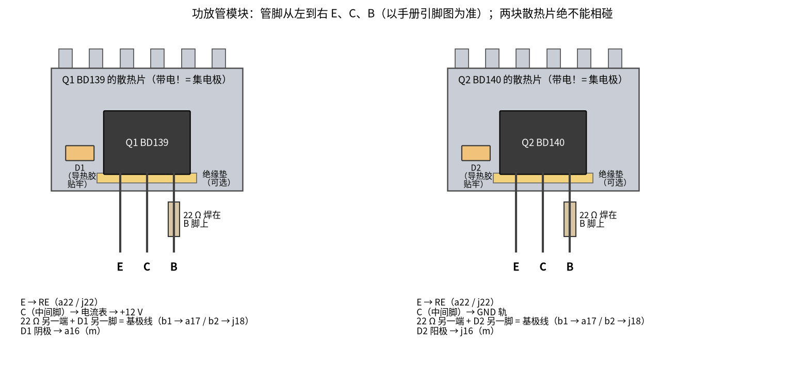
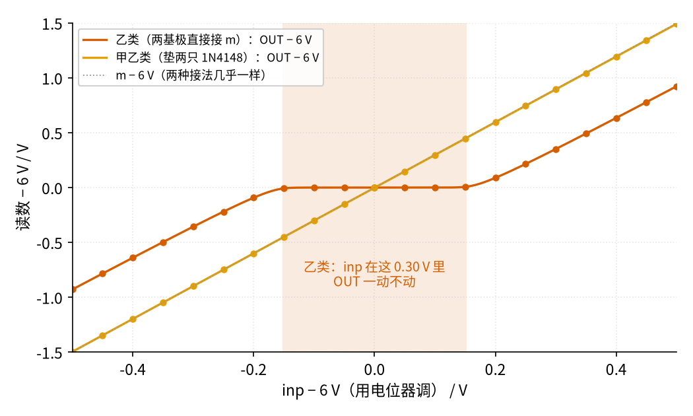
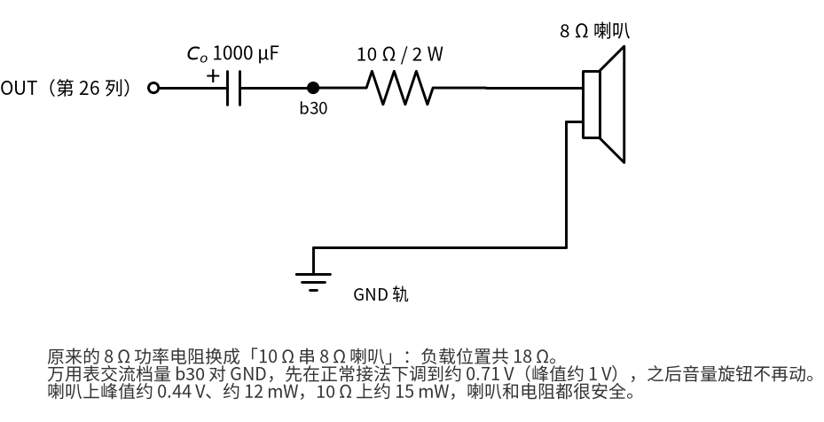

# 43 推挽功放：甲、乙、甲乙类 · 动手实验篇

[上一页：参数与调试篇](page3.md) · [直觉篇](page1.md) · [原理与实现篇](page2.md) · [参数与调试篇](page3.md) · 本页：动手实验篇 · 下一页：44 节 D 类功放（即将上线） · 前置节点：[19 射极跟随器 · 动手实验篇](../19-emitter-follower/page4.md)、[12 电压跟随器 · 动手实验篇](../12-voltage-follower/page4.md)

## 这次实验要验证什么

本次搭原理与实现篇里那台「TL072 + 两个恒流源 + BD139/BD140」的甲乙类推挽功放，负载先用 8 Ω 功率电阻。分四个小实验：

- **实验 A：静止状态。** 没有信号时，验证中点参考 $V_{MID}$ 、运放输出 m、推挽输出 OUT 都在 6 V 附近；两个恒流源各送约 23.7 mA（ $R_X$ 两端约 0.64 V）；静止电流约 33 mA（ $R_E$ 两端约 109 mV），并且 5 分钟内不往上爬。
- **实验 B：放大与效率。** 加 400 Hz 正弦，让负载电压峰值约 2 V，验证电流表平均读数约 82.5 mA、电源功率约 0.99 W、效率约 25.5%。
- **实验 C：没有示波器也能「看见」交越失真。** 用电位器慢慢调输入，用万用表一点一点读 OUT。先读甲乙类，再用两根跳线把 D1、D2 短接变成乙类，比较两条读数曲线；最后把反馈插回 OUT，看反馈环怎样「跳过」死区（C3）。
- **实验 D：用耳朵听交越失真（可选）。** 喇叭串 10 Ω 接到负载位置，先听乙类，再换回甲乙类对比，最后听「乙类 + 反馈环」。

## ⚠️ 安全须知

- **只用 12 V 直流电源**：实验室可调电源限流 0.5 A；或 12 V 适配器，正极串一只 1 A 保险丝。本节所有电压都不超过 12 V，不要接市电，也不要换更高电压的电源。
- **两只功放管 Q1、Q2 必须各装一块散热片。** 满音量（输入 1.0 V 峰值）时每管发热约 0.44 W，不装散热片温升约 44 °C；BD139 手册写着不加散热片、空气 25 °C 时最多 1.25 W，室温越高能耗的越少。恒流源的 Q3、Q4 静止只耗约 0.11 W，不用散热片。
- **只用测温探头量温度**：万用表温度档配热电偶、红外测温枪，或贴一只 NTC 热敏电阻都可以；**不要用手摸**。**散热片超过 60 °C 就立刻断电。**
- **散热片带电：BD139、BD140 背面的金属片和集电极（中间脚）相连**（见下面参考资料里的两份手册）。Q1 的集电极经电流表接 +12 V，所以 Q1 的散热片就是 +12 V；Q2 的集电极接 GND，所以 Q2 的散热片就是 GND。**两块散热片绝不能互相碰**，一碰就是 +12 V 直接短路到 GND；也不能碰任何导线和元件脚。条件允许时在管子和散热片之间垫一片绝缘垫（云母片或硅胶垫，配绝缘螺丝套），散热片就不带电了。D1、D2 的玻璃外壳是绝缘的，可以直接用导热胶贴在散热片上，但它们的管脚不能碰到散热片金属。
- **电流表先插好再上电**：表笔插 **10 A 插孔**、旋钮拨到**直流 A 档**，全程不换。开机时 $C_o$ 充电的冲击电流和放音时 Q1 约 0.25 A 的瞬时电流（SPICE，负载峰值 2 V 时；满音量约 0.38 A）都可能烧掉 mA 插孔的保险丝。
- **静止电流红线**：万用表在 $R_E$ 两端读到超过 165 mV（50 mA）就立刻断电，检查热耦合和二极管方向。
- **先用 8 Ω / 5 W 功率电阻做负载。** 试听喇叭时，必须先给喇叭**串一只 10 Ω / 2 W 电阻**，音量从 0 开始慢慢加。输出 OUT 和负载两端都不能短接到 GND 或 +12 V。
- **输出电容 $C_o$ 的正极接推挽输出（第 26 列那一侧），耐压 ≥ 16 V（如 25 V）。** 接反会发热、鼓包。
- **改线、换元件之前先断电。** 本节的电流比前面的小信号实验大得多，带电插拔很容易碰出火花。

## 器材清单

| 元件 | 型号或数值 | 数量 | 说明 |
|---|---|---|---|
| 运放 | TL072 | 1 | A 运放做 $V_{MID}$ 缓冲，B 运放做 ×3 同相放大 |
| 功放管 | BD139（NPN）、BD140（PNP） | 各 1 | Q1、Q2，各装一块小散热片 |
| 恒流源管 | BD140、BD139 | 各 1 | Q3（上）、Q4（下），不用散热片 |
| 二极管 | 1N4148 | 6 | D1、D2 贴散热片；D5～D8 给恒流源 |
| 基极阻尼电阻 | 22 Ω | 2 | RS1、RS2，焊在 Q1、Q2 的基极脚上 |
| 发射极电阻 | 3.3 Ω，1 W | 2 | RE1、RE2 |
| 恒流源电阻 | 27 Ω（ $R_X$ ）、4.7 kΩ（ $R_K$ ） | 各 2 | Rx3/Rx4、Rk3/Rk4 |
| 电阻 | 10 kΩ ×3、20 kΩ ×1、100 kΩ ×1 | — | R1、R2、RG；RF；Rbias |
| 电容 | 10 µF 电解 ×2、1000 µF / ≥ 16 V（如 25 V）电解 ×1、100 nF 瓷片 ×1 | — | Cd、Cin； $C_o$ ；Cz |
| Zobel 电阻 | 10 Ω | 1 | Rz |
| 负载 | 8 Ω / 5 W 功率电阻 | 1 | 实验 A、B、C 都用它 |
| 试听（可选） | 8 Ω 小喇叭 + 10 Ω / 2 W 电阻 | 各 1 | 串联后接到负载位置 |
| 实验 C 用 | 2 kΩ 电位器 ×1、4.7 kΩ ×2、100 Ω ×1、2 kΩ ×2、跳线 ×2 | — | 直流慢扫 |
| 电流表 | 第二只万用表（或电源自带电流显示） | 1 | 串在 Q1 集电极，10 A 插孔、直流 A 档 |
| 导热胶、测温工具 | 导热胶（或导热硅脂 + 扎带）；温度档万用表 / 红外测温枪 / NTC | — | 贴二极管；量散热片温度 |
| 信号源 | 手机测试音 App 或信号发生器 | 1 | 400 Hz 正弦，先把音量调到 0 |

## 搭建步骤

### 先做两个「功放管模块」（在面包板外）

1. 给 Q1（BD139）装散热片；把 22 Ω 电阻（RS1）焊在 Q1 的基极脚上；用导热胶把 D1（1N4148）贴在同一块散热片上，D1 的**阳极**焊到 RS1 的另一端，这一点叫 b1。从模块引出四根线：b1、D1 阴极、发射极 E、集电极 C。
2. 同样给 Q2（BD140）装散热片，焊上 RS2，把 D2 贴在**另一块**散热片上，D2 的**阴极**焊到 RS2 的另一端（这一点叫 b2）。引出 b2、D2 阳极、E、C 四根线。这两个模块就是图 43-p4-2 原理图里「Q1 + RS1 + D1」和「Q2 + RS2 + D2」那两块。

这两步就是「热耦合」：二极管和功放管一起热，偏置电压自动跟着变小。



*图 43-p4-6　功放管模块：散热片就是集电极，两块不能相碰*

图 43-p4-6 里管脚顺序按常见 BD139/BD140 的引脚图画（正面朝自己、管脚朝下，从左到右 E、C、B），动手前请对照你买的那批管子的手册。图 43-p4-6 的下方文字就是第 10 步要插的位置。

### 面包板接线

3. TL072 跨在凹槽上，缺口朝左，占第 3～6 列（下半区第 3～6 列是 1、2、3、4 脚，上半区第 3～6 列是 8、7、6、5 脚）。a3 接上方 +12 V 轨，j6 接下方 GND 轨。
4. **A 运放做 $V_{MID}$** ：R1 10 kΩ 从 j5 到下方 +12 V 轨，绿线 h5 → h8，R2 10 kΩ 从 j8 到 GND 轨，Cd 10 µF 在 i8–i10（正极在第 8 列），j10 接 GND 轨；g3–g4 短线（1 脚接 2 脚，跟随器）；绿线 h3 → h1，再 g1 → d1，把 $V_{MID}$ 送到上半区第 1 列。
5. **B 运放做 ×3 放大**：RG 10 kΩ 在 b1–b5，Rbias 100 kΩ 在 c1–c6，Cin 10 µF 在 a6–a9（正极在第 6 列），信号源接 a9 和上方 GND 轨；绿线 a5 → a12，RF 20 kΩ 在 a12–a15，绿线 a15 → a26（反馈取自 OUT）。
6. **运放输出 m**：蓝线 d4 → d16，再 e16–f16 短线跨过凹槽，第 16 列上下两半都是 m。
7. **发射极和输出**：RE1 3.3 Ω 在 c22–c26，RE2 3.3 Ω 在 h22–h26，橙线 d26 → g26 连通上下两半的第 26 列（OUT）；Rz 10 Ω 在 i26–i29，Cz 100 nF 从 j29 到 GND 轨； $C_o$ 1000 µF 在 b26–b30（**正极在第 26 列**）。
8. **上恒流源（上半区第 33～38 列）**：Q3（BD140）印字面朝自己插在 c33、c34、c35（E、C、B）；Rx3 27 Ω 从上方 +12 V 轨到 a33；Rk3 4.7 kΩ 从 a35 到上方 GND 轨；D5 从 +12 V 轨（阳极）到 a38（阴极），b38–b37 短线，D6 阳极 d37、阴极 d35；绿线 e34 → e17 把 Q3 集电极的电流送到 b1。
9. **下恒流源（下半区第 33～38 列）**：Q4（BD139）和 Q3 一样**印字面朝自己**（朝面包板下边沿），插在 g33、g34、g35，从左到右是 E、C、B，和图 43-p4-1 里 Q4 方块上的标注一致；插反了 E、C 会对调，恒流源就不工作；Rx4 27 Ω 从 j33 到下方 GND 轨；Rk4 4.7 kΩ 从 j35 到下方 +12 V 轨；D7 阳极 i35、阴极 i37，h37–h38 短线，D8 阳极 j38、阴极接 GND 轨；绿线 f34 → g18 把 b2 的电流抽到 Q4 集电极。
10. **接模块**：Q1 模块的 b1 线插 a17，D1 阴极线插 a16，E 线插 a22，C 线经电流表（红表笔插 10 A 插孔、接 +12 V 一侧，旋钮拨直流 A 档）接上方 +12 V 轨（第 31 列）。Q2 模块的 b2 线插 j18，D2 阳极线插 j16，E 线插 j22，C 线接下方 GND 轨（第 24 列）。
11. **负载**：8 Ω / 5 W 功率电阻一端接 b30（ $C_o$ 负极这一列），另一端用粗线接上方 GND 轨第 39 列。
12. **电源轨**：上下两条 +12 V 轨在第 41 列连起来，两条 GND 轨在第 40 列连起来。电源 +12 V 接 B+2，GND 接 B-3。这里的记号：T 表示面包板**上方**电源轨，B 表示**下方**电源轨；「+」「−」分别是 +12 V 轨和 GND 轨；后面的数字是列号。所以 B+2 就是「下方 +12 V 轨第 2 列」，B-3 就是「下方 GND 轨第 3 列」。本实验峰值电流约 0.25 A，面包板触点一般扛得住；负载和电源仍用粗线，若哪个触点发烫，按参数与调试篇排错表的办法改用接线端子。上电前先用万用表电阻档确认 +12 V 轨和 GND 轨之间不是短路（应大于几百欧）。


*图 43-p4-1　面包板接线：黄圈是测量点，功放管模块在板外*


*图 43-p4-2　对照原理图：灰字是面包板位置，黄圈编号与图 43-p4-1 相同*

**对照看**：图 43-p4-1 和图 43-p4-2 的黄圈编号一一对应。原理图里夹在 D1、D2 中间的 m 点，就是面包板第 16 列：蓝线从 TL072 的 7 脚（上半区第 4 列）拉过来，D1 的阴极线和 D2 的阳极线都插在这一列。原理图上「上恒流源 → b1」那根线，就是面包板上从 e34 走到 e17 的绿线；「b2 → 下恒流源」就是 f34 → g18。原理图的 RE1、RE2 汇到 OUT，就是面包板 c22–c26、h22–h26 两只 3.3 Ω 加上 d26 → g26 那根橙线。原理图左边的反馈电阻 RF 接在 OUT 上，面包板上就是 a15 → a26 那根长绿线。电流表在原理图里串在 +12 V 和 Q1 集电极之间，面包板上就是 Q1 模块 C 线经过电流表再到第 31 列的 +12 V 轨。

## 测量表

万用表黑表笔默认接 GND 轨。「应该读到」来自原理与实现篇的计算和 SPICE（`spice/43/run.py`），元件误差会让你的读数差几个百分点。

| 步骤 | 测什么 | 红表笔 | 黑表笔 | 挡位 | 应该读到 | 读不到时先查 |
|---|---|---|---|---|---|---|
| A1 | 信号源音量 0，上电：中点参考 $V_{MID}$ （①） | e1 | GND 轨 | 直流 20 V | 约 6.00 V | R1、R2 是否都接上；g1 → d1 跨线 |
| A2 | 运放输出 m（②） | g16 | GND 轨 | 直流 20 V | 约 6.0 V | 7 脚蓝线 d4 → d16；e16–f16 短线 |
| A3 | 推挽输出 OUT（④） | e26 | GND 轨 | 直流 20 V | 约 6.0 V | 反馈线 a15 → a26；RE1、RE2 是否插在第 26 列 |
| A4 | 上恒流源 $R_X$ 两端（⑤） | 上方 +12 V 轨 | e33 | 直流 2 V | 约 0.64 V（约 23.7 mA） | Q3 的 E、C、B 顺序；D5、D6 方向（读到 0 多半是恒流源没通） |
| A5 | 下恒流源 $R_X$ 两端（⑥） | i33 | 下方 GND 轨 | 直流 2 V | 约 0.64 V | Q4 的 E、C、B 顺序；D7、D8 方向 |
| A6 | RE1 两端（③）：静止电流 | b22 | e26 | 直流 200 mV | 约 109 mV（ $\div 3.3\ \Omega \approx 33\ \text{mA}$ ）；**超过 165 mV 立刻断电** | D1、D2 方向；模块 b1、b2 线是否插对列 |
| A7 | 电流表读数（Q1 集电极） | — | — | 10 A 插孔、直流 A 档 | 约 0.033 A，与 A6 一致（10 A 档通常只显示到 0.01 A，只能看到 0.03；精读以 A6 的 mV ÷ 3.3 为准） | 电流表是否插在 10 A 插孔、拨在直流 A 档 |
| A8 | 每分钟记一次 A6 和散热片温度，共 5 分钟 | 同 A6 | 同 A6 | 同 A6 | 基本稳定，不持续上升；散热片只是温热 | D1、D2 是否真的贴在散热片上 |
| B1 | 400 Hz 正弦，慢慢加音量：负载两端交流电压 | b30 | GND 轨 | 交流 2 V | 调到约 1.42 V（有效值，相当于峰值 2.01 V） | 音量是否够；Cin 方向 |
| B2 | 此时电流表读数 | — | — | 10 A 插孔、直流 A 档 | 约 0.083 A（82.5 mA；10 A 档只能看到 0.08，精读以 B2′ 的 274 mV ÷ 3.3 为准） | 读数在跳就等几秒，读平均 |
| B2′ | 此时 RE1 两端（③），直流档 | b22 | e26 | 直流 2 V | 约 274 mV（ $\div 3.3\ \Omega \approx 83\ \text{mA}$ ，和 B2 一致） | 这是放音时的平均值，165 mV 红线只管**静止**时的 A6 |
| B3 | 此时散热片温度 | 测温探头 | — | 温度档 | 温热，远低于 60 °C | 超过 60 °C 立即断电 |
| C1 | 改成直流慢扫（见下文），甲乙类：inp 与 OUT | b6 / e26 | GND 轨 | 直流 20 V | 见读完后展开的「预期参考」 | RF 改接是否到位（b16） |
| C2 | 两根跳线短接 D1、D2 变成乙类，重复 C1 | b6 / e26 | GND 轨 | 直流 20 V | 见读完后展开的「预期参考」 | 两根跳线位置 |
| C3 | 保留跳线，反馈线 b16 端改插 f26（乙类 + 反馈环）：inp、OUT 和 m（②） | b6 / e26 / g16 | GND 轨 | 直流 20 V | 见读完后展开的「预期参考」 | 反馈线是否插在 f26（a26 被测试负载占着） |

B1 用 400 Hz 而不是 1 kHz，是因为很多入门万用表的交流档只在几百赫兹以内准（查一下你那只表说明书里的频率范围）。推挽功放在 400 Hz 和 1 kHz 的表现几乎一样（原理与实现篇的幅频曲线在 100 Hz 以上已经是平的）。

B2′ 用万用表直流档量 RE1，读的是放音时的平均值：Q1 只在正半周导通，平均电流约 83 mA，所以 RE1 上平均约 274 mV（SPICE）。它比 165 mV 的红线高，这是正常的；红线只用来判断**没有信号时**的静止电流。

**怎么算效率**：电源功率 $P_S = 12\ \text{V} \times$ （B2 读数），负载功率 $P_L = V_{rms}^2 / 8\ \Omega$ 。按「应该读到」： $P_S = 12 \times 0.0825 \approx 0.99\ \text{W}$ ， $P_L = 1.42^2 / 8 \approx 0.252\ \text{W}$ ，效率约 25.5%。注意电流表只量 Q1 这一路；电源自带的电流显示会多出恒流源的约 24 mA 和运放的几毫安，那部分不算进这里的效率。

## 没有示波器怎么办

交越失真只出现在过零附近几十微秒里，万用表跟不上。办法是把「时间」换成「电位器」：让输入慢慢变，每变一点就用万用表读一次 OUT，自己画一条输入—输出曲线（实验 C）。

断电后做以下改动：

1. 拔掉信号源（a9 那根线）。
2. **反馈改接 m**：把 a15 → a26 那根绿线的 a26 一端改插到 b16。这样推挽级在反馈环外，才能看到它自己的死区。
3. **输入用电位器**：4.7 kΩ 从下方 +12 V 轨到 j12，2 kΩ 电位器三只脚插 h12、h13、h14（中间脚 h13 是滑动端），4.7 kΩ 从 j14 到下方 GND 轨；100 Ω 在 g11–g13，再用一根线 f11 → d6 接到 B 运放的同相端（上半区第 6 列）。滑动端电压范围约 4.95～7.05 V。
4. **测试负载**：2 kΩ 从 a26 到上方 +12 V 轨，另一只 2 kΩ 从 j26 到下方 GND 轨，让 OUT 在死区里被拉在 6 V。
5. 上电，从 inp 约 5.7 V 到 6.3 V，每隔约 50 mV 读一次 inp（b6）、OUT（e26）和 m（g16），记下来（这就是测量表的 C1；记录表里「m − 6 V」那一行也要用 m 的读数）。
6. 断电，加两根跳线：c16–c17（短接 D1）、h16–h18（短接 D2），两个基极都直接接 m，变成乙类。两个恒流源的电流一个流进 m、一个从 m 流出，差的零点几毫安由运放补上。再上电重复第 5 步（C2）。
7. 断电，**保留两根跳线**，把反馈线的 b16 一端插到 **f26**：a26 此时被测试负载占着，而 f26 在下半区第 26 列，经 d26 → g26 那根橙线和 a26 同属 OUT。这样乙类推挽又回到反馈环里。上电，在 inp − 6 V 为 −0.1、0、+0.1 V 附近各读一次 inp、OUT 和 m（g16），再在 6 V 两侧各 10 mV 处读两次 m（C3）。


*图 43-p4-4　实验 C 的改线：反馈改接 m，电位器慢扫，紫色跳线 C2 才插*


*图 43-p4-5　实验 C 的原理图：推挽级在反馈环外*

**对照看**：图 43-p4-4 下半区左边那一串「4.7 kΩ — 电位器 — 4.7 kΩ」，就是图 43-p4-5 最左边那一竖排；电位器中间脚 h13 是滑动端，经 g11–g13 的 100 Ω 和 f11 → d6 那根蓝线进到 inp。图 43-p4-4 里从 a15 走到 b16 的绿线，就是图 43-p4-5 里标着「RF 改接 m」的那根反馈线。两只 2 kΩ 测试负载在原理图右上角，面包板上分别插在 a26 和 j26。C3 时反馈线要回到 OUT，可上半区第 26 列 a26～e26 已经插满（测试负载、 $C_o$ 、RE1、橙线、测量点 ④），所以改插下半区的 f26，也就是图 43-p4-4 里那个绿色虚线圈；图 43-p4-5 底部注文写的也是 f26。两根紫色跳线在两张图里都绕过 D1、D2。

> **动手前先预测（C1、C2、C3 读完再展开下面的参考）**
>
> 1. 甲乙类（C1）：inp 每升 0.1 V，OUT 大约升多少？
> 2. 乙类（C2）：inp 在 6 V 附近变一点点时，OUT 会怎样？m 呢？
> 3. 乙类放回反馈环（C3）：OUT 还会有「不动」的一段吗？m 在 inp 经过 6 V 时会怎样？

<details><summary>测完再看：预期参考（SPICE）</summary>



*图 43-p4-3　直流慢扫的预期读数：乙类中间那段平台就是死区*

| inp − 6 V / V | −0.3 | −0.2 | −0.1 | 0 | 0.1 | 0.2 | 0.3 |
|---|---|---|---|---|---|---|---|
| C1 甲乙类 OUT − 6 V | −0.90 | −0.60 | −0.30 | 0 | 0.30 | 0.60 | 0.90 |
| C2 乙类 OUT − 6 V | −0.36 | −0.09 | 0 | 0 | 0 | 0.09 | 0.35 |
| C3 乙类 + 反馈环 OUT − 6 V | — | — | −0.30 | 0 | 0.30 | — | — |

- C1：OUT − 6 V ≈ 3 × (inp − 6 V)，一条直线。
- C1、C2 的 m（g16）：反馈此时取自 m，同相放大倍数是 1 + 20 kΩ / 10 kΩ = 3，所以 m − 6 V ≈ 3 × (inp − 6 V)：inp − 6 V 为 ±0.1 V 时，m − 6 V 约 ±0.30 V。记录表「m − 6 V」那两行就和这个比。
- C2：图 43-p4-3 里乙类的平台约 0.3 V 宽（SPICE 按 m 的摆幅除以 3 算是 0.31 V，图里按扫描点读出 0.30 V）。inp 在这段里变，m 跟着摆了约 ±0.46 V，可两只管子都还没导通，OUT 纹丝不动。这就是交越失真的「慢动作」。甲乙类的曲线在原点平滑通过，说明两只二极管垫的偏置把死区填平了。把你的读数点画在图 43-p4-3 上对比，就能亲眼看到偏置的作用。
- C3：OUT 又变回斜率 3 的直线，没有平台（±0.1 V 时约 ±0.30 V）。死区被藏进了 m：inp 从 6 V 下面 10 mV 走到上面 10 mV，m 一下子跳了约 1.02 V；inp − 6 V = +0.1 V 时 m − 6 V 约 0.84 V，比 OUT 高出一个 $V_{BE}$ 再加 RE 上的压降。运放用自己的输出「跳过」死区，这正是原理与实现篇里乙类放进反馈环后的那种跳变。

</details>

做完后**断电**，把两根跳线拆掉，拆掉电位器那一串和测试负载，信号源接回 a9，把反馈线从 f26 改插回 a26，恢复实验 B 的接法。

## 实验 D：用耳朵听交越失真（可选）



*图 43-p4-7　试听接法：喇叭先串 10 Ω，再接到原来 8 Ω 负载的位置*

断电，按图 43-p4-7 把 8 Ω 功率电阻换成「10 Ω / 2 W 串 8 Ω 喇叭」。每次改接都先断电，音量旋钮从头到尾只在第 1 步调一次：

1. 正常接法（甲乙类、反馈接 a26），400 Hz，音量从 0 慢慢加，直到万用表交流档在 b30 对 GND 读到约 0.71 V（峰值约 1 V）。记住这个声音。
2. **D1 乙类、反馈在环外**：断电，反馈线 a26 端改插 b16，插上两根跳线。上电听。
3. **D2 甲乙类、反馈在环外**：断电，拔掉两根跳线。上电听。
4. **D3 乙类、反馈在环内**：断电，插回两根跳线，反馈线插回 a26。上电听。
5. 断电，拆掉跳线，喇叭换回 8 Ω 功率电阻。

> **听之前先猜**：D1、D2、D3 三种接法里，你猜哪一种最「沙」、声音最小？哪一种和第 1 步几乎听不出差别？听完再展开下面的参考。

<details><summary>听完再看：SPICE 参考</summary>

- D1 乙类、反馈在环外：声音明显变小、发「沙」，负载位置峰值只剩约 0.30 V，失真（THD）约 45%。
- D2 甲乙类、反馈在环外：声音干净，峰值约 0.89 V，THD 约 0.085%。
- D3 乙类、反馈在环内：峰值回到约 1.0 V，THD 约 0.054%，和第 1 步几乎听不出差别（第 1 步本身约 0.0057%）。

</details>

图 43-p4-7 里喇叭上峰值约 0.44 V、约 12 mW，10 Ω 电阻上约 15 mW，喇叭和电阻都很安全。D1 那种「沙沙」声，就是图 43-p4-3 里那段平台变成的声音：小信号几乎整个掉进死区。

## 有示波器时：看交越波形（可选）

示波器探头接 b30（负载上端），**地夹夹在 GND 轨**上。本节的负载一端接地，所以地夹放在 GND 轨是安全的（下一节的 D 类功放用的是两端都不接地的接法，那里地夹绝不能夹在输出上）。

- 断电后按实验 C 的第 2 步把反馈改接 m，再加上第 6 步的两根跳线，但信号源接回 a9：400 Hz 正弦，负载峰值调到约 1 V，就能看到原理与实现篇里那种「过零处被削掉一截」的乙类波形。
- 拆掉两根跳线（甲乙类），台阶基本消失。
- 断电，把反馈线插回 a26（如果 2 kΩ 测试负载还占着 a26，就插 f26，同属 OUT），波形应和输入一模一样（只是大了 3 倍）。
- 时基调到 1 µs/div、带宽调满，看 OUT 有没有一层「毛」：有就是寄生振荡，参考参数与调试篇的排错表。

## 用 Python 核对你的读数

把你的读数填进 `mine`，运行后会和预期值比较，偏差超过 10% 的会被标出来。程序不读写任何文件，在哪个目录运行都行。

```python
RE, RX, RL = 3.3, 27.0, 8.0                        # ← 换成你实测的电阻值（RE、恒流源 RX、负载）
VS = 12.0                                          # ← 换成你实测的电源电压
exp = {                                            # 预期值（spice/43/run.py）
    "V_MID": 6.00, "OUT": 6.00,                    # 静止电压 / V
    "V_RX3": 0.64, "V_RX4": 0.64,                  # 恒流源电阻两端 / V
    "V_RE1": 0.109,                                # RE1 两端 / V（静止电流 33 mA）
    "I_amm_B": 0.0825, "V_rms_B": 1.42,            # 实验 B：电流表 / A、负载有效值 / V
}
mine = {"V_MID": 5.98, "OUT": 6.03, "V_RX3": 0.62,  # ← 换成你的读数
        "V_RX4": 0.66, "V_RE1": 0.118,
        "I_amm_B": 0.085, "V_rms_B": 1.40}
for k, v in mine.items():                          # 逐项比较
    w = exp[k]                                     # 预期值
    flag = "OK" if abs(v - w) / w <= 0.10 else "偏差超过 10%"  # 相对偏差
    print(f"{k:8s} 预期 {w:7.4f}，你读到 {v:7.4f} → {flag}")  # 打印
iq = mine["V_RE1"] / RE                            # 静止电流 = RE 电压 ÷ RE
print(f"静止电流 {iq * 1e3:.1f} mA", "（超过 50 mA 立刻断电！）" if iq > 0.050 else "（正常）")
print(f"恒流源：上 {mine['V_RX3'] / RX * 1e3:.1f} mA，下 {mine['V_RX4'] / RX * 1e3:.1f} mA（要求 ≥ 22 mA）")
ps = VS * mine["I_amm_B"]                          # 电源功率（只算 Q1 这一路）
pl = mine["V_rms_B"] ** 2 / RL                     # 负载功率
print(f"P_S = {ps:.3f} W，P_L = {pl:.3f} W，效率 {pl / ps * 100:.1f}%（预期约 25.5%）")
```

示例读数运行后应全部显示 OK。注意：若恒流源算出来小于 22 mA，平时也许听不出问题，但遇到 $h_{FE}$ 偏低的管子、音量开大时会削顶。

## 实验记录表

| 时间 / min | RE1 两端 / mV | 静止电流 = mV ÷ 3.3 / mA | 电流表 / mA | Q1 散热片 / °C | Q2 散热片 / °C |
|---|---|---|---|---|---|
| 0 | | | | | |
| 1 | | | | | |
| 2 | | | | | |
| 3 | | | | | |
| 5 | | | | | |

| 实验 B | 读数 | 预期 | 偏差 / % |
|---|---|---|---|
| 负载有效值 / V | | 1.42 | |
| 电流表平均 / mA | | 82.5 | |
| 电源功率 $P_S$ / W | | 0.99 | |
| 负载功率 $P_L$ / W | | 0.252 | |
| 效率 / % | | 25.5 | |

| 实验 C：inp − 6 V / V | −0.3 | −0.2 | −0.1 | 0 | 0.1 | 0.2 | 0.3 |
|---|---|---|---|---|---|---|---|
| C1 甲乙类 OUT − 6 V（我的） | | | | | | | |
| C2 乙类 OUT − 6 V（我的） | | | | | | | |
| C2 乙类 m − 6 V（我的） | | | | | | | |
| C3 乙类 + 反馈环 OUT − 6 V（我的） | | | | | | | |
| C3 乙类 + 反馈环 m − 6 V（我的） | | | | | | | |

| 实验 D | 听到的声音（大小、干净还是沙） |
|---|---|
| 正常接法 | |
| D1 乙类、环外 | |
| D2 甲乙类、环外 | |
| D3 乙类、环内 | |

实验 C 的预期值取自 `spice/43/dc_AB.csv`、`dc_B.csv` 和 `dc_B_loop.csv`，在上面「测完再看」里。试听时（负载位置峰值约 1 V），喇叭上峰值约 0.44 V、约 12 mW，10 Ω 电阻上约 15 mW，所以 2 W 的电阻足够。

## 思考题

**1.** 没有声音时电流表读约 33 mA，负载峰值 2 V 时读约 82.5 mA。多出来的电流从哪里来？如果是乙类（没有偏置），峰值 2 V 时电流表大约读多少？

<details><summary>答案</summary>

Q1 只在正半周导通，送出半个正弦，峰值 $2 / 8 = 0.25\ \text{A}$ ，半波的平均值是 $0.25 / \pi \approx 79.6\ \text{mA}$ 。甲乙类在这之上还有一部分静止电流（大信号时静止电流的贡献会变小），所以读到约 82.5 mA。乙类没有静止电流，读数接近 79.6 mA；理想乙类电源功率 $12 \times 0.0796 \approx 0.955\ \text{W}$ 。

</details>

**2.** 做完 C2 后，你应该发现 inp 在 6 V 附近的一小段里 OUT 不动，m（②）却在动。用你自己的读数回答：m 摆的大约是 inp 的几倍？为什么？m 摆了几百毫伏，两只管子为什么都还没导通？

<details><summary>答案</summary>

反馈改接 m 后，B 运放是一个增益 $1 + 20 / 10 = 3$ 的同相放大器，所以 m − 6 V ≈ 3 × (inp − 6 V)，0.15 V 变成约 0.46 V。乙类时 m 直接接两只基极，OUT 被测试负载拉在 6 V；m 要比 OUT 高出一个 $V_{BE}$ （约 0.6 V）Q1 才导通，低出一个 $V_{BE}$ Q2 才导通，±0.46 V 还没到，所以两只都截止。

</details>

**3.** 有同学嫌贴二极管麻烦，把 D1、D2 直接插在面包板上。刚上电静止电流正常，放了 5 分钟大音量音乐后变成 60 mA。发生了什么？该怎么办？

<details><summary>答案</summary>

大音量时功放管发热，它们的 $V_{BE}$ 每热 1 °C 约小 2 mV；而面包板上的二极管还是凉的，偏置电压不变，于是静止电流变大，管子更热，进入正反馈。60 mA 时 $R_E$ 上约 198 mV，已经超过 165 mV（50 mA）的红线，应立即断电，等它凉下来，把 D1、D2 用导热胶贴在各自的散热片上再试。参数与调试篇的失配图说明了 3.3 Ω 的 $R_E$ 能拖慢这个过程，但不能代替热耦合。

</details>

## 自测清单

- [ ] 我能说出甲类、乙类、甲乙类各自的效率和缺点。
- [ ] 我能解释为什么偏置电流要按 $h_{FE}$ 最差 25 算到 ≥ 22 mA，以及恒流源比 470 Ω 好在哪里。
- [ ] 我能用 $R_E$ 两端的 mV 算出静止电流，并知道 165 mV 是断电红线。
- [ ] 我能说出二极管为什么要贴在散热片上，以及温度为什么只能用测温探头量。
- [ ] 我能用电流表和负载电压算出电源功率、负载功率和效率。
- [ ] 我能用直流慢扫的读数说明交越失真是怎么来的。
- [ ] 我能说出为什么乙类放进反馈环后 OUT 没有平台，而运放输出 m 会跳一下。
- [ ] 我知道 Q1 的散热片是 +12 V、Q2 的散热片是 GND，两块绝不能相碰。

## 参考资料

- BD135～BD140 数据手册（Central Semiconductor，「Mounting pad is common to lead 2」，即背面金属片接集电极）：<https://my.centralsemi.com/datasheets/BD135_SERIES.PDF>
- BD139 数据手册（Philips，引脚图与外壳）：<https://www.alldatasheet.pl/html-pdf/16171/PHILIPS/BD139/493/2/BD139.html>
