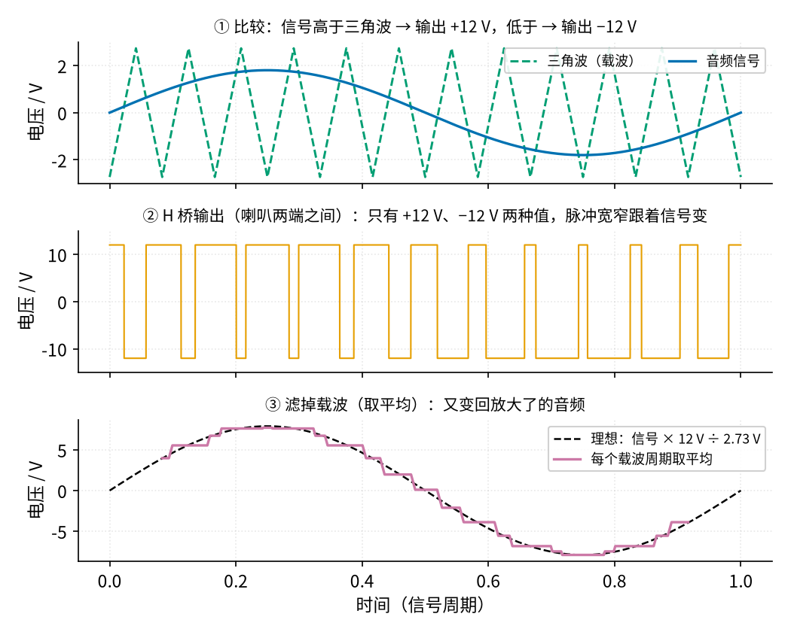
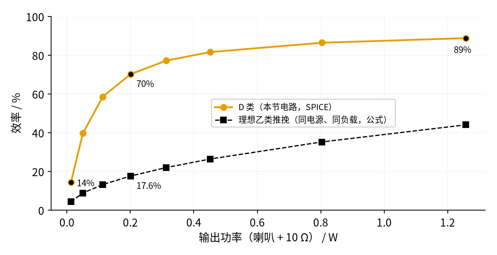
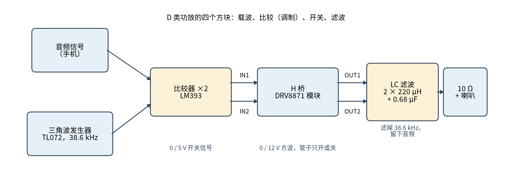

# 44 D 类功放 · 直觉篇

[上一页：43 推挽功放：甲、乙、甲乙类 · 动手实验篇](../43-push-pull-power-amp/page4.md) · 本页：直觉篇 · [原理与实现篇](page2.md) · [参数与调试篇](page3.md) · [动手实验篇](page4.md) · [下一页：原理与实现篇](page2.md) · 前置节点：[43 推挽功放 · 直觉篇](../43-push-pull-power-amp/page1.md)、[10 电压比较器 · 直觉篇](../10-voltage-comparator/page1.md)、[24 振荡器 · 直觉篇](../24-oscillator/page1.md)、[26 H 桥电机驱动 · 直觉篇](../26-h-bridge/page1.md)、[25 开关电源 · 直觉篇](../25-switching-power-supply/page1.md)

## 开头三问（先回忆，再往下读）

1. [43 推挽功放](../43-push-pull-power-amp/page1.md) 里，理想乙类推挽的效率最高是多少？它为什么做不到 100%？
2. [10 电压比较器](../10-voltage-comparator/page1.md) 里，同相端电压高于反相端时，输出是高还是低？
3. [25 开关电源](../25-switching-power-supply/page1.md) 里的开关管一直在通、断之间切换，为什么它反而不怎么发热？

答案

1. 约 78.5%（输出峰值顶到电源边上时）。管子工作在「半开」状态：管子两端有几伏电压，同时又流着电流，功率 P = V × I 就变成了热。音量越小，这部分浪费占的比例越大。
2. 输出高。比较器只回答一个问题：「哪边大？」，输出只有高、低两种。
3. 开关管只在两种状态之间跳：全开时电流大，但管子两端电压几乎为 0；全关时有电压，但电流为 0。两种情况下 V × I 都很小，所以发热少。

## 痛点：推挽功放一半的电都变成了热

43 节的甲乙类推挽已经比甲类省电很多，可它的输出管仍是「半开」的：要输出 3 V，管子就得替电源「扛着」剩下的几伏电压，同时流着喇叭电流。43 节的电路在峰值约 3 V 时效率只有 39% 左右（SPICE），也就是说电源给的电有六成变成了管子的热，所以要装散热片，还要盯着温度。

手机、蓝牙音箱、电脑里的小喇叭可没有地方装大散热片，电池也经不起这么浪费。TI 的白皮书写得很直接：D 类放大器的效率一般可以到 90% 左右，大约 10% 的能量变成热。算一笔账：同样输出 5 W，效率 78.5% 时管子要烧掉约 1.37 W，效率 90% 时只烧掉约 0.56 W，热量少了一大半。

D 类的办法听起来有点「反常」：**干脆不让管子半开**。管子只做两件事：全开或全关，像一个电灯开关；音频信息不再藏在「开多大」里，而是藏在「开多久」里。

## 类比：用开关调一盏灯的亮度

想让台灯暗一半，可以串一个大电阻，让灯两端只剩一半电压，但电阻会发烫，这是推挽的思路。另一种办法是飞快地开灯、关灯，一秒钟开关几万次，每次只开一半时间。眼睛跟不上这么快的闪烁，看到的是「一半亮」。开关本身不发热，因为它要么通（没有压降）、要么断（没有电流）。

喇叭和耳朵也跟不上每秒几万次的开关，它们只「感觉」得到平均值。只要让「开」的时间比例跟着音乐慢慢变，平均值就是放大了的音乐。

*图 44-p1-1　三角波比较 → 开关输出 → 取平均*

图 44-p1-1 分三步看。第一步，把音频信号和一个很快的三角波（叫**载波**）放在一起比：信号高于三角波，就让输出接 +12 V；低于三角波，就接 −12 V。第二步，输出只有两种值，但脉冲的宽窄跟着信号变：信号在高处时，它高于三角波的时间长，正脉冲就宽。这种「用脉冲宽度表示大小」的波形叫 **PWM**（脉冲宽度调制）。第三步，每个载波周期取一次平均，得到的台阶几乎贴着理想正弦：峰值 1.8 V 的信号变成了峰值约 7.9 V 的输出，放大了 12 ÷ 2.73 ≈ 4.4 倍。

图 44-p1-1 里画的是很慢的载波，好让你看清楚每个脉冲。真实电路里三角波每秒约 3.86 万次（38.6 kHz），一个 400 Hz 的音频周期里有将近一百个脉冲，平均出来的台阶细得看不出来。取平均靠的是一个**LC 低通滤波器**（电感 + 电容），它让低频的音频通过、把高频的载波挡住。

## 效率：省在哪里

*图 44-p1-2　同样的输出功率，D 类的效率比理想乙类高得多*

图 44-p1-2 是本节电路的 SPICE 结果，和「理想乙类推挽」（同样 12 V、同样 18 Ω 负载、没有任何多余损耗的公式值）放在一起比。输出 0.2 W 时，D 类约 70%，理想乙类才 17.6%；输出 1.257 W 时，D 类约 89%，乙类约 44%。注意这里拿来比的乙类是「理想」的，真实的 43 节电路还要更低。图里的「输出功率」指 10 Ω 电阻串 8 Ω 喇叭这整个 18 Ω 负载拿到的功率，喇叭本身只分到其中 8/18。43 节的实验用的是 8 Ω 负载，图里的理想乙类已按同样的 18 Ω 重新算过，这样比才公平。

图 44-p1-2 也说明 D 类不是处处 90%。最左边那一点（0.013 W），D 类只有 14%。原因是 D 类电路自己也要「开销」：三角波发生器、比较器、驱动芯片都要吃电，开关一次也要损失一点能量，这些开销不随音量变小。所以小音量时比例就难看了，大音量时才显出优势。参数与调试篇会把这些开销拆开来看。

## 本节的电路长什么样

*图 44-p1-3　D 类功放的四个方块：载波、比较、开关、滤波*

图 44-p1-3 把整机拆成四块，每一块都是前面学过的东西：

- **载波**：TL072 搭的三角波发生器，就是 [24 振荡器](../24-oscillator/page1.md) 里的「施密特触发器 + 积分器」，积分器见 [14 积分电路](../14-integrator/page1.md)。
- **比较**：LM393 双比较器（[10 电压比较器](../10-voltage-comparator/page1.md)），把音频和三角波一比，得到 PWM。
- **开关**：DRV8871 模块，就是 [26 H 桥电机驱动](../26-h-bridge/page1.md) 里的 H 桥，喇叭接在两个输出端 OUT1、OUT2 之间。
- **滤波**：两只电感加一只电容，原理和 [25 开关电源](../25-switching-power-supply/page1.md) 的输出滤波一样。

喇叭接在 OUT1 和 OUT2 之间、两端都不接地，这种接法叫**桥接**（BTL）。它的好处是 12 V 电源就能在喇叭上得到 ±12 V 的摆动；代价是**喇叭的任何一端都不能接地**，连示波器的地夹也不能夹上去。动手实验篇会反复提醒这一点。

> **先想一想（参数与调试篇「常见误区」里有答案）**：有人觉得「喇叭一端接地也能听，顶多声音小一点」。BTL 的 OUT1 和 OUT2 都在 0 V 和 12 V 之间来回跳，任何一端接地会怎样？

## 一句话

**D 类 = 用三角波把音频「翻译」成脉冲宽度，让管子只全开或全关，再用 LC 把脉冲平均回声音；管子几乎不发热，效率在大音量时可以到九成左右。**

下一页把完整电路拆开：三角波的频率和幅度怎么算、占空比和输出电压是什么关系、LC 滤波器怎么挑。

## 参考资料

- TI 白皮书 SLOA290A（D 类效率约 90%、约 10% 变成热）：<https://www.ti.com/lit/wp/sloa290a/sloa290a.pdf>
- ADI《Class D Amplifiers Guide》（BTL 输出两路互为镜像、无信号时占空比 50%、输出加 LC 低通）：<https://www.analog.com/en/resources/technical-articles/class-d-amplifiers-guide.html>
- TI SLAU508《Analog Pulse Width Modulation》（比较器 + 三角波生成 PWM）：<https://www.ti.com/lit/pdf/slau508>
- DRV8871 数据手册（H 桥、导通电阻、真值表）：<https://www.ti.com/lit/ds/symlink/drv8871.pdf>
