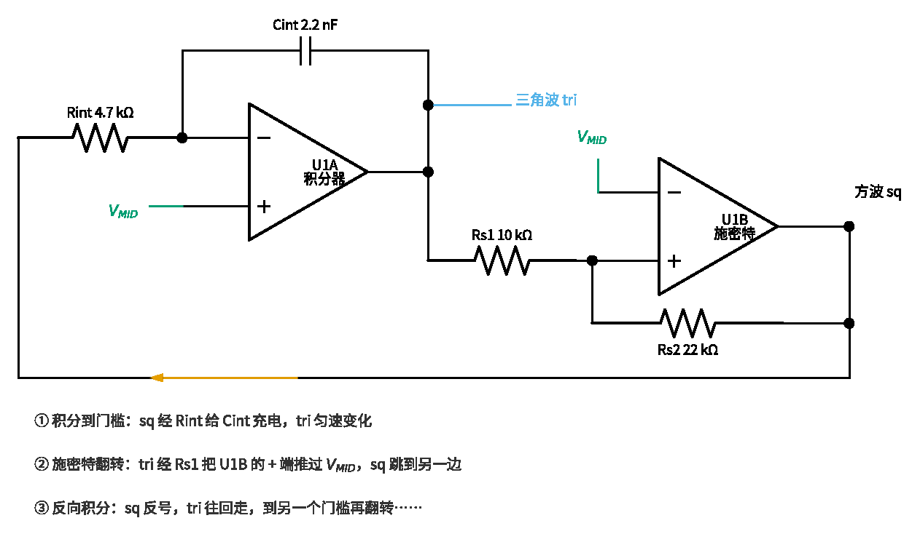
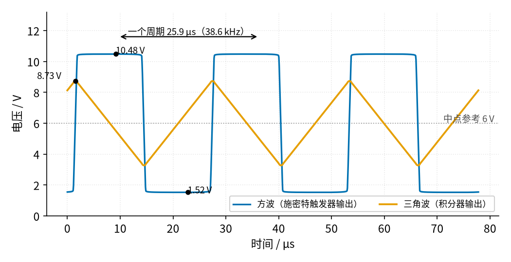
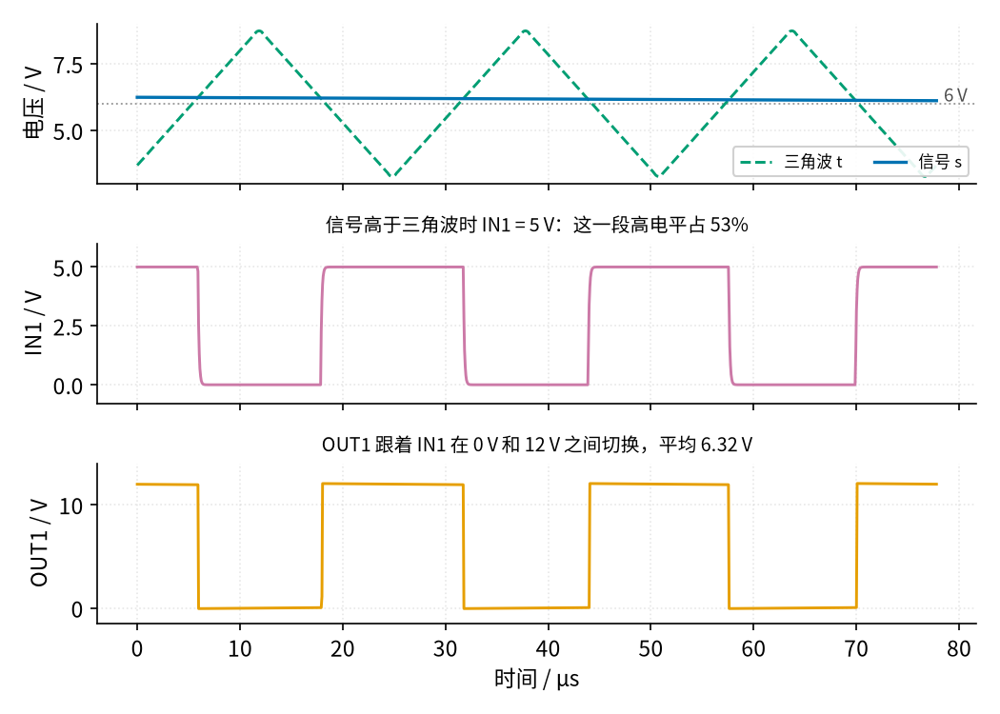
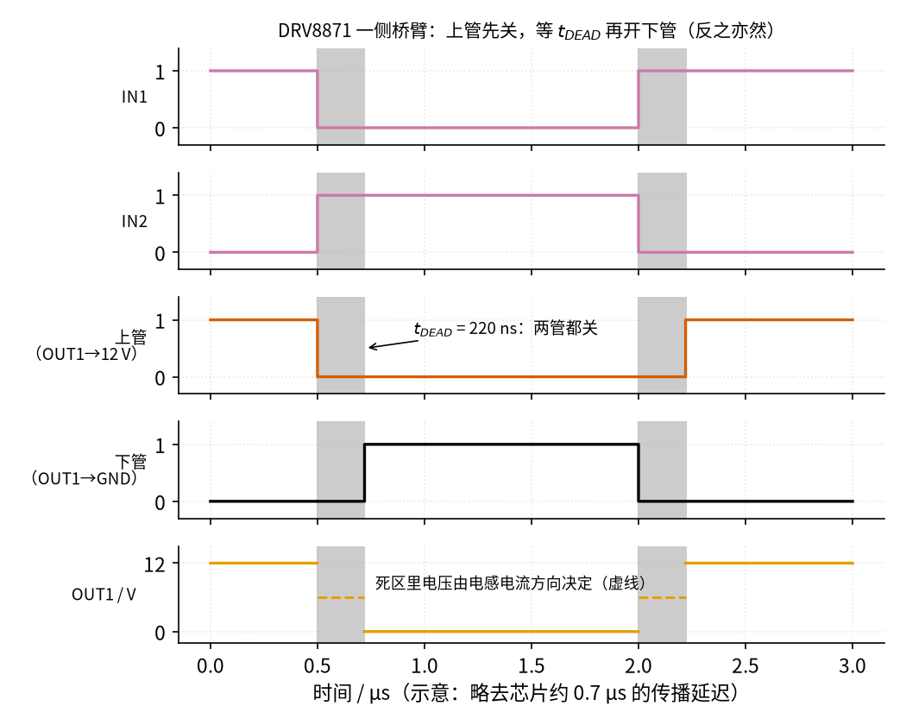
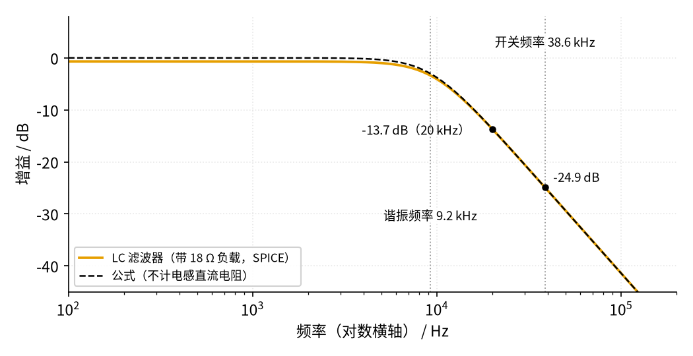
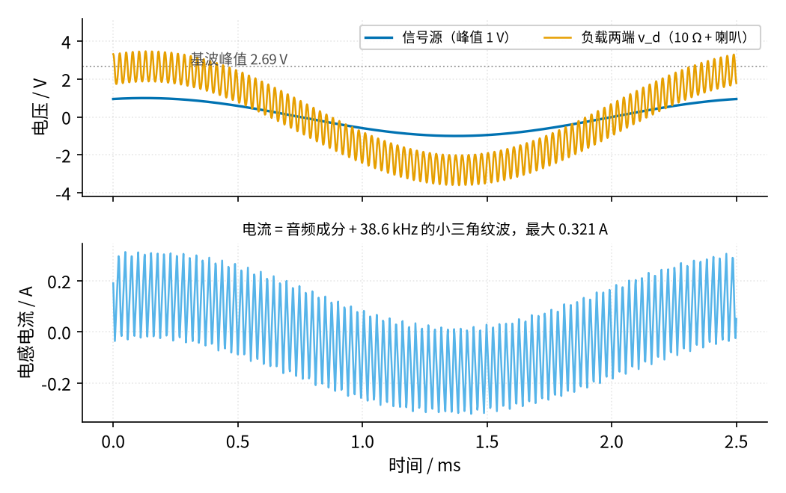
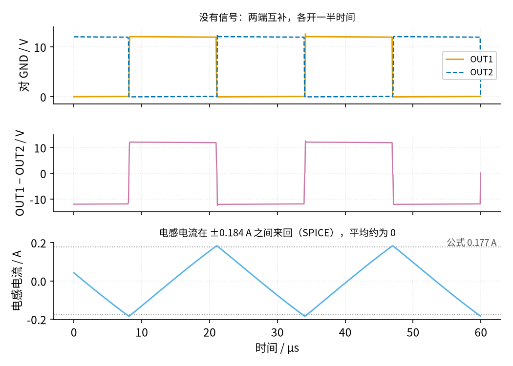

# 44 D 类功放 · 原理与实现篇

[上一页：直觉篇](page1.md) · [直觉篇](page1.md) · 本页：原理与实现篇 · [参数与调试篇](page3.md) · [动手实验篇](page4.md) · [下一页：参数与调试篇](page3.md) · 前置节点：[43 推挽功放 · 原理与实现篇](../43-push-pull-power-amp/page2.md)、[24 振荡器 · 原理与实现篇](../24-oscillator/page2.md)、[10 电压比较器 · 原理与实现篇](../10-voltage-comparator/page2.md)、[26 H 桥电机驱动 · 原理与实现篇](../26-h-bridge/page2.md)、[01 元件基础](../01-components-basics/page1.md)

## 最小知识

- **占空比** $D$ ：一个周期里高电平所占的比例。0 V / 12 V 的方波，占空比 50% 时平均 6 V，占空比 75% 时平均 9 V，即平均值 $= D \times V_S$ ，其中 $V_S$ 是电源电压（本节 12 V）。
- **桥接（BTL）**：喇叭接在 H 桥的两个输出 OUT1、OUT2 之间。喇叭上的电压是两者之差 $v_d = v_{OUT1} - v_{OUT2}$ ，可以在 $+V_S$ 和 $-V_S$ 之间摆动。
- **低通滤波**：电感对高频「阻力」大，电容对高频「短路」，两者组合（[01 元件基础](../01-components-basics/page1.md) 里的 RC 是同一思路）让慢变化通过、把快变化挡掉。

> **最小补充：「中点参考」V_MID**
>
> 本节只用一个 12 V 电源。三角波和音频都要在一个「中间值」上下摆，我们用两只 10 kΩ 把 12 V 分成 6 V，并接 10 µF 电容稳住，再用运放跟随器输出，叫**中点参考**，记作 $V_{MID}$ 。它只给运放、比较器的输入定一个静止点，电流很小。**喇叭电流不走 $V_{MID}$** ，喇叭两端接的是 H 桥的 OUT1 和 OUT2。

> **最小补充：载波**
>
> 「载波」就是那个又快又规则的三角波。它本身不带声音，只是一把「尺子」：拿音频和它比，量出每一小段时间该开多久。载波频率要远高于人耳能听到的 20 kHz 以下的声音，滤波器才能把它和音频分开。

## 一、完整电路，逐块看

整机分五块，元件编号和动手实验篇的原理图一致。先看图 44-p2-1，虚线框和编号 1～5 对应下面五段文字：


*图 44-p2-1　整机原理图：五块分区*


1. **中点参考**：R1、R2 各 10 kΩ 分压，Cd 10 µF 滤波，TL072 的 U2B 接成跟随器输出 $V_{MID} \approx 6\ \text{V}$ 。U2 的另一半 U2A 没用到，接成跟随器、输入接 $V_{MID}$ ，避免闲置运放乱振。
2. **三角波发生器**（[24 振荡器](../24-oscillator/page2.md) 的老朋友）：U1B 是施密特触发器（[36 施密特整形](../36-schmitt-pulse-shaping/page1.md) 讲过它的「两个门槛」），Rs1 10 kΩ、Rs2 22 kΩ；U1A 是积分器（[14 积分电路](../14-integrator/page1.md)），Rint 4.7 kΩ、Cint 2.2 nF。三角波再经 Ct 100 nF、Rt 100 kΩ 耦合到节点 t，中心对准 $V_{MID}$ 。
3. **输入**：信号源经 Rin1 4.7 kΩ、Cin 1 µF 进来，Rin2 10 kΩ 接到 $V_{MID}$ ，节点 s 上的音频是源的 10 / 14.7 ≈ 0.6803 倍，中心也在 $V_{MID}$ 。
4. **比较器**：LM393 两路。A 路同相端接 s、反相端接 t，输出 IN1；B 路正好反过来，输出 IN2。LM393 是集电极开路输出，各用 1 kΩ 上拉到 Arduino 的 5 V，因为 DRV8871 的 IN 脚建议不超过 5.5 V、绝对最大 7 V，不能拉到 12 V。
5. **H 桥 + LC**：DRV8871 模块，VM 接 12 V（模块上并 100 µF + 100 nF）。OUT1、OUT2 各串一只 220 µH 功率电感（Bourns RLB0913-221K），两电感后面跨接 Cf 0.68 µF 薄膜电容，再接负载：10 Ω / 5 W 电阻串 8 Ω 喇叭，共 18 Ω，**两端都不接地**。

## 二、推导：三角波的频率和幅度

先看三角波发生器自己怎么转起来。图 44-p2-2 把框 2 单独拿出来：U1B 施密特的输出（方波 sq）经 Rint 给 U1A 积分器充电，积分器输出（三角波 tri）又经 Rs1 回到施密特的同相端，构成一个闭环。**积分到门槛 → 施密特翻转 → 反向积分**，周而复始。



*图 44-p2-2　三角波发生器闭环：积分器 + 施密特触发器*



*图 44-p2-3　施密特触发器 + 积分器：方波和三角波*

施密特触发器在三角波碰到门槛时翻转；方波一翻，积分器的斜坡就反向。教科书上的理想公式（方波顶到电源、门槛瞬间翻转）：

$$
V_{tri,p} = \frac{R_{s1}}{R_{s2}}\thinspace V_{sq,p},\qquad f = \frac{R_{s2}}{4\thinspace R_{s1}\thinspace R_{int}\thinspace C_{int}} = \frac{22\ \text{k}}{4 \times 10\ \text{k} \times 4.7\ \text{k} \times 2.2\ \text{nF}} \approx 53.19\ \text{kHz}
$$

图 44-p2-3 的 SPICE 结果却是 38.56 kHz，差了近三成。原因有两个，图上都能看到：

- **方波没顶到电源**：TL072 的输出离两条电源线都有一段距离，方波只在 1.52～10.48 V 之间跳，相对 $V_{MID}$ 只有约 ±4.48 V，不是 ±6 V。
- **翻转有延迟**：按门槛算，三角波峰值应是 10 / 22 × 4.48 ≈ 2.04 V，SPICE 却是 2.73 V。积分器斜坡速度是 4.48 V ÷ (4.7 kΩ × 2.2 nF) ≈ 0.433 V/µs，多出来的约 0.7 V 相当于运放从饱和状态退出来花了约 1.6 µs。

用 SPICE 里的真实幅度重新算：三角波从谷到峰要走 2 × 2.73 ≈ 5.46 V，按 0.433 V/µs 需要约 12.6 µs，一个周期约 25.2 µs，即约 39.6 kHz，和 SPICE 的 38.56 kHz（周期 25.93 µs）很接近。**结论：频率和幅度都按实测为准**，动手实验篇会让你先量这两个数。

Ct、Rt 组成的高通转折频率是 $1 / (2\pi \times 100\ \text{k}\Omega \times 100\ \text{nF}) \approx 15.9\ \text{Hz}$ ，38.6 kHz 的三角波毫无损失地过去，积分器输出的直流偏差被挡住，节点 t 的中心在 6.00 V。输入端同理，Cin 和 Rin1 + Rin2 的转折约 10.8 Hz。

## 三、推导：占空比和输出电压



*图 44-p2-4　比较器：信号比三角波高多少，脉冲就宽多少*

三角波在 $V_{MID} - V_{tri,p}$ 到 $V_{MID} + V_{tri,p}$ 之间匀速上下走。信号 s 高于三角波的时间比例，就是 IN1 的占空比：

$$
D = \frac{1}{2} + \frac{v_s - V_{MID}}{2\thinspace V_{tri,p}}
$$

图 44-p2-4 这一小段里 s 平均 6.178 V，代入得 $D = 0.5 + 0.178 / (2 \times 2.732) \approx 53.3$ %，SPICE 数出来 53.2%。OUT1 平均值的公式 $D \times 12 \approx 6.39\ \text{V}$ ，SPICE 是 6.32 V，少的一点落在 DRV8871 管子的导通电阻上。

**先试试 26 节的办法（这是错的）**。[26 H 桥](../26-h-bridge/page2.md) 调速用「驱动—刹车」交替的 PWM：一路输入开关，另一路固定，H 桥在「驱动」和「刹车（两路输出都接 GND）」之间切换，平均电压是 $D \times V_S$ ，只能在 0 和 12 V 之间、只朝一个方向推。照搬过来放音频，静音时 D = 50%，喇叭两端就有约 6 V 直流：理想估算 6 ÷ 18 ≈ 0.333 A 一直推着喇叭，8 Ω 上 $0.333^2 \times 8 \approx 0.889\ \text{W}$ 。SPICE 算的正是这种接法（参数与调试篇故障表里「IN2 接成了 5 V」那一行，方向相反）：负载直流 −5.503 V，8 Ω 上 0.75 W，比理想值略小是因为管子和电感也分走了一点电压。纸盆被一直推在一边，音圈不停发热，而且没有声音的时候也一样。

所以 D 类要两路一起开关：IN2 正好是 IN1 反过来（B 路比较器两个输入对调），OUT2 的占空比是 $1 - D$ 。喇叭两端的平均电压：

$$
\overline{v_d} = D\thinspace V_S - (1-D)\thinspace V_S = (2D-1)\thinspace V_S = \frac{V_S}{V_{tri,p}}\thinspace (v_s - V_{MID})
$$

这就是 D 类的「放大倍数」：电源电压除以三角波峰值， $12 / 2.732 \approx 4.393$ 。**三角波越小、电源越高，放大越多**；三角波一旦比信号还小，信号就会「顶出」三角波，占空比卡在 0 或 100%，输出削顶。

整条链的估算增益：

- 输入分压 0.6803；
- 比较 + H 桥 4.393；
- LC 低频增益 0.9244（下一节解释）。

$0.6803 \times 4.393 \times 0.9244 \approx 2.762$ 。SPICE 用 1 V 峰值、400 Hz 正弦算出负载上的 400 Hz 成分峰值 2.687 V，增益 2.687，比估算小约 2.7%。主要原因是切换不是瞬间完成的：比较器翻转、上拉电阻把 IN 脚拉高都要一点时间，这一小段里 H 桥处在过渡状态，负载上没有加满 ±12 V，估算没算进去。真实的 DRV8871 还会在每次切换时插入约 220 ns 的死区（见下面的方框），效果同向。

> **最小补充：为什么两路互补、而且没信号时占空比是 50%**
>
> 没有信号时 s 就在 $V_{MID}$ ，D = 50%：OUT1、OUT2 各一半时间是 12 V，喇叭上的平均电压是 0，喇叭不会被直流推着烧。ADI 的 D 类指南把这叫「两路输出互为镜像」。

> **最小补充：直通和死区**
>
> H 桥每一侧都有一只上管（接 12 V）和一只下管（接 GND）。
>
> 1. 如果同一侧的上管、下管同时导通，12 V 就直接短到 GND，叫**直通**。电流只受两管导通电阻限制，理论上 12 ÷ 0.565 ≈ 21 A，远超芯片 3.7～6.4 A 的过流保护门槛。
> 2. 所以驱动器在「上管关 → 下管开」（或反过来）之间故意留一段两管都关的时间，叫**死区**（dead time）。DRV8871 内部自动插入，数据手册给的典型值是 220 ns。
> 3. 本节 IN1、IN2 由两只比较器给出，边沿快慢不完全一样（集电极开路往下拉快，靠 1 kΩ 上拉往上走慢），切换的一瞬间可能短暂出现 IN1、IN2 同为 0（滑行）或同为 1（刹车）。这只会让增益略小（上面那 2.7%）、失真略大，**不会**直通，因为防直通是芯片内部每一侧自己做的。
> 4. 因此本实验**不要**用分立 MOSFET 自己搭 H 桥，死区要自己设计，一旦做错就是直通。
>
> 注意：这里的「死区」是开关切换时两管都关的那 220 ns，和 [43 推挽功放](../43-push-pull-power-amp/page1.md) 里乙类交越失真的「死区」（输入 ±0.6 V 以内两管都不导通）是两回事，只是碰巧同名。

图 44-p2-5 画出 OUT1 这一侧的时序：IN1 变低后，上管先关，等过 $t_{DEAD}$ 下管才开；IN1 变高时反过来。灰色阴影就是两管都关的死区。



*图 44-p2-5　DRV8871 一侧桥臂的死区时序（示意，略去传播延迟）*

图 44-p2-5 里死区期间 OUT1 既没接 12 V 也没接 GND，电压由电感电流的方向决定（电流经体二极管流到 12 V 或 GND），所以画成虚线。

## 四、LC 滤波器：留下音频、挡住载波



*图 44-p2-6　LC 滤波器的幅频曲线（对数横轴）*

BTL 里两只电感是串在回路里的（OUT1 → L1 → 负载 → L2 → OUT2），对差分信号相当于一只 2L = 440 µH 的电感，和 Cf 0.68 µF 组成二阶低通：

$$
f_0 = \frac{1}{2\pi\sqrt{2L\cdot C_f}} = \frac{1}{2\pi\sqrt{440\ \mu\text{H} \times 0.68\ \mu\text{F}}} \approx 9.201\ \text{kHz}
$$

> **最小补充：Q 值**
>
> Q 值描述滤波器在转折处「鼓不鼓包」。Q 值 ≈ 0.707 时曲线最平、不鼓包；Q 值大于 1 就会在 $f_0$ 附近冒出一个峰，输入稍有这个频率的成分就被放大；Q 值很小则拐弯很「软」。负载电阻越大（越接近空载），这个滤波器的 Q 值越大。
>
> 回想一下：[20 有源滤波 · 原理与实现篇](../20-active-filter/page2.md) 里 Q 值 = 0.707 的二阶低通叫巴特沃斯，曲线最平；[25 开关电源 · 原理与实现篇](../25-switching-power-supply/page2.md) 输出端的 47 µH + 47 µF 也是同一种 LC 低通，只是转折频率低得多（约 3.39 kHz，要滤的是 200 kHz 开关纹波，留下的是直流）。

对本节的 18 Ω 负载：

$$
Q = R\sqrt{\frac{C_f}{2L}} = 18 \times \sqrt{\frac{0.68\ \mu\text{F}}{440\ \mu\text{H}}} \approx 0.7076
$$

正好在「最平」附近。图 44-p2-6 读几个数（SPICE，带电感直流电阻和管子导通电阻）：

| 频率 | 增益 | 说明 |
|---|---|---|
| 低频 | 0.9244（−0.68 dB） | 18 Ω 和 2 × 0.453 Ω（电感）+ 0.565 Ω（管子）分压 |
| 8.78 kHz | −3 dB | 高音从这里开始变小 |
| 20 kHz | 0.2063（−13.7 dB） | 最高的高音只剩约五分之一 |
| 38.6 kHz | 0.05685（−24.9 dB） | 载波只剩约 5.7% |

低频增益如果只算电感电阻，是 $18 / (18 + 2 \times 0.453) \approx 0.9521$ ；再加上 DRV8871 两管合计 0.565 Ω 才是 0.9244，和 SPICE 一致。

图 44-p2-6 也暴露了本节电路的一个妥协：为了把只有 38.6 kHz 的载波压下去，转折频率只能放在 9.2 kHz，10 kHz 以上的高音被削弱了。商用芯片把载波做到几百 kHz，转折频率就能放到 20 kHz 以上。参数与调试篇会比较几种选法。

## 五、带信号时的波形，和电感里的纹波电流



*图 44-p2-7　信号源 1 V、400 Hz：负载电压和电感电流*

图 44-p2-7 是 2.5 ms 的 SPICE 波形，正好一个 400 Hz 周期。负载电压里的正弦就是放大后的音频，基波峰值 2.687 V；上面的毛刺是没滤干净的载波。下面的电感电流也是两部分叠在一起：音频电流 $2.687 / 18 \approx 0.149\ \text{A}$ 的峰值，加上每个载波周期一次的三角形纹波，最大处到 0.321 A。



*图 44-p2-8　没有信号时：OUT1 − OUT2 是 ±12 V 方波，电感电流是三角波*

没有信号时，喇叭上平均 0 V，但并不是「什么都没有」。图 44-p2-8 中间那层：OUT1 − OUT2 在 +12 V 和 −12 V 之间来回跳，每半个周期都有约 12 V 加在 2L 上，电流就匀速升、匀速降：

$$
I_{ripple,p} = \frac{1}{2}\cdot\frac{V_S \cdot T/2}{2L} = \frac{V_S}{8\thinspace L\thinspace f_{sw}} = \frac{12}{8 \times 220\ \mu\text{H} \times 38.56\ \text{kHz}} \approx 0.1768\ \text{A}
$$

SPICE 是 0.1837 A，公式没算负载上还有一点纹波电压，误差约 4%。**这个电流不出声，但实打实地流过电感和管子**，静音时也在发热。它到了电感后面，大部分经 Cf 绕回去（电容给高频电流抄了近路），只有很少一部分漏进负载：负载上的载波有效值电流只有 $0.6148 / 18 \approx 0.034\ \text{A}$ （约 34 mA，见下一段），而纹波电流有效值约 $0.1837 / \sqrt{3} \approx 0.106\ \text{A}$ 。

负载上残留的载波电压也能估算：±12 V 方波的基波峰值是 $\frac{4}{\pi} \times 12 \approx 15.3\ \text{V}$ ，乘以 LC 在 38.6 kHz 的 0.05685，约 0.869 V 峰值，有效值约 0.614 V。SPICE 算出负载上的载波有效值 0.6148 V，在 18 Ω 上约 21 mW。

## 六、自己动手：一段短代码走一遍「比较 → PWM → LC 平均」

前面的数字都来自 SPICE。下面这段 Python 把同一条链用最简单的方式重算一遍：三角波和信号直接比大小得到 PWM，H 桥当成理想的 ±12 V 开关，再一步步解 2L、Cf 和 18 Ω 组成的 LC。在仓库根目录运行，图片存到系统临时目录（Linux/macOS 通常是 /tmp），不会写进仓库。

```python
import sys, pathlib
sys.path.insert(0, str(pathlib.Path("code/figs").resolve()))  # 在仓库根目录运行
import os, tempfile                       # 找系统临时目录：图片不写进仓库
import numpy as np                        # 数值计算
import matplotlib.pyplot as plt           # 画图
import figstyle as fs                     # 教程统一的中文字体和配色

VS, VMID = 12.0, 6.0                      # H 桥电源 12 V，中点参考 6 V
FSW, VTRI = 38.56e3, 2.732                # 载波频率、三角波峰值（都用 SPICE 实测值）
FSIG, VSRC, KIN = 400.0, 1.0, 0.6803      # 400 Hz、信号源峰值 1 V、输入分压比
L2, CF, RL = 440e-6, 0.68e-6, 18.0        # 两只电感合计 2L、滤波电容 Cf、负载 10 Ω + 8 Ω
RS = 2 * 0.453 + 0.565                    # 两只电感直流电阻 + 两管导通电阻，单位 Ω
dt = 1 / FSW / 400                        # 步长：每个载波周期算 400 步
t = np.arange(0, 1 / FSIG, dt)            # 时间轴：正好一个 400 Hz 周期（2.5 ms）

ph = (t * FSW) % 1.0                      # 载波相位，0～1 循环
tri = VMID + VTRI * (4 * np.abs(ph - 0.5) - 1)          # 三角波 t：在 6 ± 2.732 V 之间匀速上下
s = VMID + KIN * VSRC * np.sin(2 * np.pi * FSIG * t)    # 信号 s：6 V 上叠 0.68 V 峰值的音频
in1 = s > tri                             # 比较器 A：s 高于三角波时 IN1 = 1
vd = np.where(in1, VS, -VS)               # IN2 = 非 IN1，所以 OUT1 − OUT2 只有 +12 V、−12 V 两种

i, v, vo = 0.0, 0.0, np.empty_like(t)     # 电感电流、负载电压的初值；vo 存负载电压
for k in range(len(t)):                   # 逐步解 LC：2L·di/dt = vd − RS·i − v，Cf·dv/dt = i − v/RL
    i += (vd[k] - RS * i - v) / L2 * dt   # 先更新电感电流
    v += (i - v / RL) / CF * dt           # 再用新电流更新负载电压（半隐式欧拉，步长小也稳定）
    vo[k] = v                             # 记下这一步的负载电压

w = 2 * np.pi * FSIG                      # 400 Hz 的角频率
pk = np.hypot(2 * np.mean(vo * np.sin(w * t)), 2 * np.mean(vo * np.cos(w * t)))  # 一个周期的傅里叶：基波峰值
print(f"IN1 平均占空比 {in1.mean():.3f}；负载 400 Hz 峰值 {pk:.3f} V，总增益 {pk / VSRC:.3f}（SPICE 2.687）")

fig, ax = plt.subplots(2, 1, figsize=fs.SIZE["tall"])   # 上层看比较，下层看平均
m = t < 3 / FSW                           # 上层只画 3 个载波周期，看得清脉宽
ax[0].plot(t[m] * 1e6, tri[m], **fs.LS["fb"], label="三角波 t")   # 蓝绿色虚线
ax[0].plot(t[m] * 1e6, s[m], **fs.LS["vin"], label="信号 s")      # 蓝色实线
ax[0].plot(t[m] * 1e6, VMID + vd[m] / 6, **fs.LS["third"], label="OUT1−OUT2（÷6 再加 6 V）")  # 红紫色点划线
ax[1].plot(t * 1e3, vo, **fs.LS["vout"], label="负载电压")         # 橙色：PWM 被 LC 平均成正弦
ax[0].set_xlabel("时间 / µs"); ax[1].set_xlabel("时间 / ms"); ax[0].legend(fontsize=8); ax[1].legend(fontsize=8)
out = os.path.join(tempfile.gettempdir(), "44_pwm_lc.png")       # 存到临时目录，不弄脏仓库
fig.tight_layout(); fig.savefig(out, dpi=100); print("图已保存到", out)
```

运行结果：

```text
IN1 平均占空比 0.499；负载 400 Hz 峰值 2.759 V，总增益 2.759（SPICE 2.687）
```

读这个结果：

- **平均占空比 0.499**：音频一正一负，一个周期平均下来正好 50%，喇叭上没有直流。
- **增益 2.759**：和第三节的估算 $0.6803 \times 4.393 \times 0.9244 \approx 2.762$ 几乎相同，因为代码里的比较器和 H 桥都是瞬间翻转的。SPICE 的 2.687 小约 2.7%，差的就是比较器、上拉电阻和死区那一小段过渡时间，代码里没有。
- **图**：上层能看到信号 s 比三角波高的那段时间，红紫色的 OUT1−OUT2 就是 +12 V；下层橙色的负载电压是一条正弦，上面叠着细密的载波残余，和图 44-p2-7 的样子一致。

可以自己改参数试试（只在仿真里改，实物的信号源仍然不超过 1.5 V）：

- `VTRI` 改成 1.5：三角波变小，总增益从 2.759 升到 5.030，正好是第三节「电源电压除以三角波峰值」的规律。
- `VSRC` 改成 5.0：s 的音频峰值 3.40 V 已经超过三角波峰值 2.732 V，信号顶出三角波，下层正弦的顶被削平，总增益降到 2.481。
- `CF` 改成 0.1e-6：转折频率升高，载波压不住，下层的毛刺明显变粗（去掉 400 Hz 成分后剩下的有效值从约 0.59 V 涨到约 1.71 V）。

## 七、效率：钱花在哪里

本节的效率只算 VM 这一路（DRV8871 + LC + 负载）的电源功率，TL072、LM393 前级吃的几毫安没有算进去。SPICE 结果（负载功率只算 400 Hz 成分；「负载」是 10 Ω 电阻串 8 Ω 喇叭共 18 Ω，喇叭只分到其中的 8/18）：

| 信号源峰值 / V | 负载基波峰值 / V | 负载（10 Ω + 喇叭）功率 / W | 其中喇叭 / W | 电源功率 / W | 效率 |
|---|---|---|---|---|---|
| 0.25 | 0.6734 | 0.0126 | 0.0056 | 0.08774 | 14.4% |
| 0.5 | 1.345 | 0.05024 | 0.0223 | 0.1268 | 39.6% |
| 1 | 2.686 | 0.2005 | 0.0891 | 0.2857 | 70.2% |
| 1.5 | 4.03 | 0.4511 | 0.2005 | 0.5528 | 81.6% |
| 2 | 5.377 | 0.8031 | 0.3569 | 0.9292 | 86.4% |
| 2.5 | 6.726 | 1.257 | 0.5585 | 1.415 | 88.8% |

表里的效率按整个 18 Ω 负载算。对喇叭来说，10 Ω 电阻也是「浪费」，它在这里只为保护喇叭、调 Q 值；真正的 D 类功放不串这只电阻，喇叭拿到的效率大致就是表里的数（去掉 10 Ω 后 Q 值和电流都会变，不完全相等）。

没信号时 VM 电流 6.146 mA，即 $12 \times 6.146\ \text{mA} \approx 73.8\ \text{mW}$ ，可以拆成三份：

- DRV8871 自己的静态电流：模型里按数据手册典型值约 3 mA，约 36 mW；
- 纹波电流在电感直流电阻和管子上：有效值 $0.1837 / \sqrt{3} \approx 0.106\ \text{A}$ ，乘以 0.906 + 0.565 Ω，约 16.5 mW；
- 载波残余进负载：约 21 mW。

三份加起来约 73.5 mW，和 SPICE 吻合。信号源 1 V 时总损耗是 0.2857 − 0.2005 ≈ 0.085 W，其中 73.8 mW 是这笔「固定开销」。所以小音量时效率低，大音量时固定开销被摊薄，效率就上去了。

## 例题

三道题难度一级级加：例 1 全程示范，例 2 只给框架、留空让你填，例 3 自己做。

**例 1（看示范）**：已知方波相对 $V_{MID}$ 约 ±4.48 V，三角波峰值 2.73 V，Rint = 4.7 kΩ、Cint = 2.2 nF。估算载波频率和 H 桥这一级的放大倍数。

1. 积分器斜坡速度 = 方波幅度 ÷ (R × C) = 4.48 ÷ (4.7 kΩ × 2.2 nF) ≈ 0.433 V/µs。
2. 三角波从谷走到峰要 2 × 2.73 = 5.46 V，用时 5.46 ÷ 0.433 ≈ 12.6 µs；一个周期是它的两倍，约 25.2 µs，频率约 39.6 kHz（SPICE 38.56 kHz）。
3. 放大倍数 = 12 ÷ 2.73 ≈ 4.39。

**例 2（填空）**：信号源峰值 0.5 V，照下面的步骤填空：

1. 节点 s 上的音频峰值 = 0.5 × 0.6803 = ___ V。
2. 占空比在 50% 上下摆动 ± ___ %（用 D 的公式）。
3. 负载基波峰值 ≈ s 峰值 × 4.393 × 0.9244 = ___ V；和 SPICE 的 1.345 V 比，差 ___ %。

<details><summary>答案</summary>

1. 约 0.340 V。
2. 0.340 ÷ (2 × 2.732) ≈ 0.062，即 ±6.2%，占空比在约 43.8% 到 56.2% 之间变化。
3. 0.340 × 4.393 × 0.9244 ≈ 1.381 V；比 SPICE 的 1.345 V 高约 2.7%，和正文里估算比 SPICE 高约 2.7% 是同一个原因（开关切换的那一小段过渡时间）。

</details>

**例 3（自己做）**：如果把两只电感都换成 100 µH，载波频率不变（38.56 kHz），静音时电感里的纹波电流峰值是多少？是现在的几倍？

<details><summary>答案</summary>

12 ÷ (8 × 100 µH × 38.56 kHz) ≈ 0.389 A，约是现在（0.177 A）的 2.2 倍，也就是 220 ÷ 100。纹波电流越大，电感、管子静音时发热越多，电感也越容易接近饱和电流。

</details>

## 参考资料

- TI SLAU508《Analog Pulse Width Modulation》（三角波 + 比较器生成 PWM）：<https://www.ti.com/lit/pdf/slau508>
- DRV8871 数据手册（真值表、导通电阻、IN 引脚电压范围、静态电流）：<https://www.ti.com/lit/ds/symlink/drv8871.pdf>
- LM393 数据手册（集电极开路输出、需上拉）：<https://www.ti.com/lit/ds/symlink/lm393.pdf>
- TL072 数据手册（输出摆幅达不到电源线）：<https://www.ti.com/lit/ds/symlink/tl072.pdf>
- TI SLAA701B《LC Filter Design》（D 类功放输出 LC 滤波器的选型）：<https://www.ti.com/lit/an/slaa701b/slaa701b.pdf>
- Bourns RLB0913 系列数据手册（220 µH 的直流电阻、额定电流、饱和电流）：<https://www.bourns.com/docs/Product-Datasheets/RLB0913.pdf>
- ADI《Class D Amplifiers Guide》（BTL 输出两路互为镜像）：<https://www.analog.com/en/resources/technical-articles/class-d-amplifiers-guide.html>
