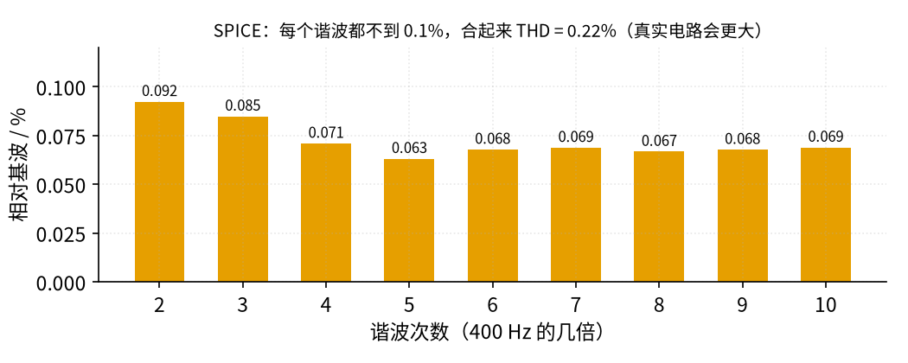
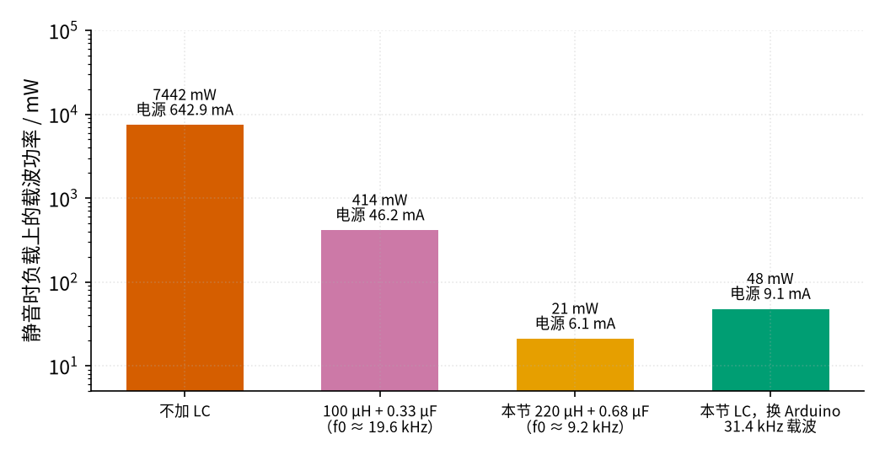
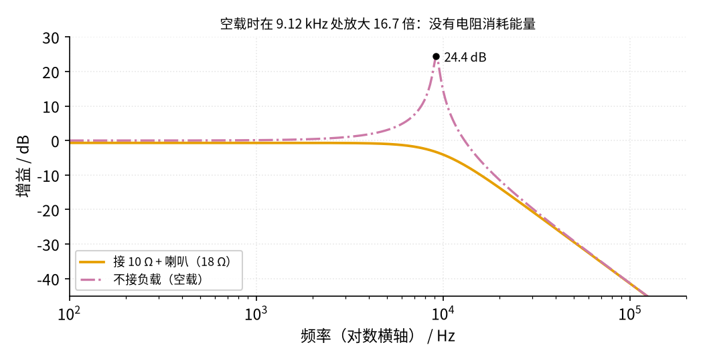
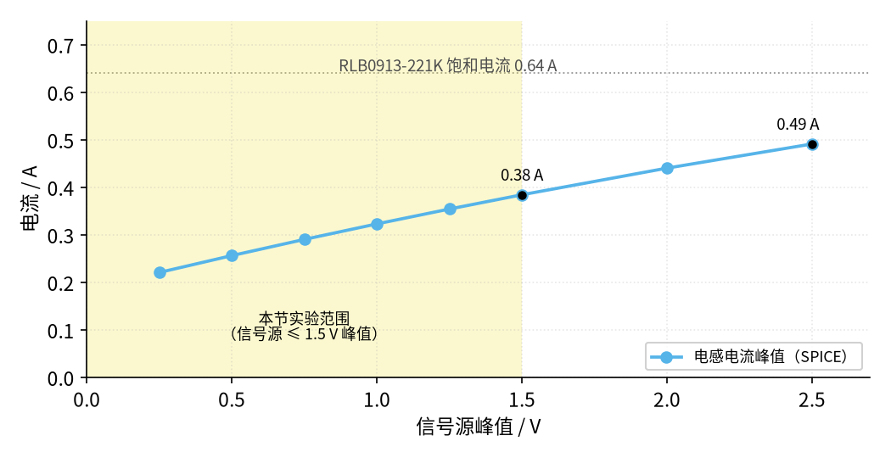
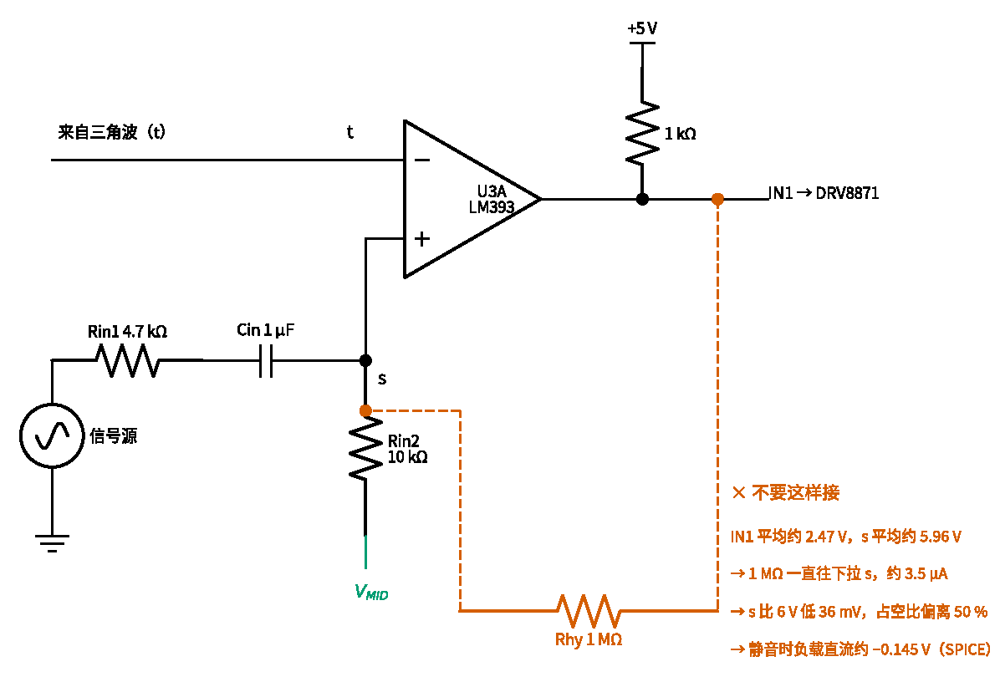

# 44 D 类功放 · 参数与调试篇

[上一页：原理与实现篇](page2.md) · [直觉篇](page1.md) · [原理与实现篇](page2.md) · 本页：参数与调试篇 · [动手实验篇](page4.md) · [下一页：动手实验篇](page4.md) · 前置节点：[43 推挽功放 · 参数与调试篇](../43-push-pull-power-amp/page3.md)、[25 开关电源 · 参数与调试篇](../25-switching-power-supply/page3.md)、[26 H 桥电机驱动 · 参数与调试篇](../26-h-bridge/page3.md)

## 参数一览

下表都是本节电路（12 V、18 Ω 负载、220 µH × 2 + 0.68 µF）的 SPICE 或公式结果，动手实验篇会拿实测值来对：

| 参数 | 数值 | 来源 |
|---|---|---|
| 载波频率 | 38.56 kHz（周期 25.93 µs） | SPICE；理想公式 53.19 kHz |
| 三角波峰值 | 2.732 V，中心 6.00 V | SPICE |
| H 桥这一级的放大倍数 | 12 ÷ 2.732 ≈ 4.393 | 公式 |
| 信号源到负载的总增益 | 2.687（估算 2.762） | SPICE |
| LC 谐振频率 / Q 值 | 9.201 kHz / 0.7076 | 公式 |
| LC 的 −3 dB 点（增益比 0 dB 低 3 dB，不是比低频的 −0.68 dB 再低 3 dB） | 8.78 kHz | SPICE |
| 静音时 VM 电流 | 6.146 mA | SPICE |
| 静音时负载直流电压 | −11.4 mV | SPICE（要求小于 50 mV） |
| 静音时电感纹波电流峰值 | 0.1837 A | SPICE；公式 0.1768 A |
| THD（信号源 1 V、400 Hz） | 0.2188% | SPICE，只算 2～10 次谐波 |
| 实验范围内最大音频功率 | 0.4511 W（信号源 1.5 V），效率 81.6% | SPICE |

> **最小补充：THD（总谐波失真）**
>
> 一个 400 Hz 正弦经过放大器，如果输出里混进了 800 Hz、1200 Hz……这些「整数倍」的成分，就说明波形被扭曲了。THD 把这些谐波的大小合起来，和 400 Hz 本身比一比，用百分数表示。越小越干净。

*图 44-p3-1　信号源 1 V、400 Hz 时各次谐波（SPICE）*

图 44-p3-1 是把负载电压做频谱分析的结果（频谱分析：把波形拆成 400 Hz、800 Hz、1200 Hz……各一份正弦，看每一份有多大；方波能拆成一串正弦，见 [33 带通与陷波 · 直觉篇](../33-bandpass-notch/page1.md)「直觉三」）：每一次谐波都不到基波的 0.1%，合起来 0.2188%。别太当真：SPICE 里的 DRV8871 是简化模型，没有 0.7 µs 的传播延迟，也没有芯片内部 220 ns 的死区（死区是什么见原理与实现篇第三节的方框），这两样在真实电路里都会让失真变大。图 44-p3-1 更大的用处是告诉你：**失真主要来自开关切换那一小段**，不是来自 LC。

## 一、发热：谁扛多少，温度怎么盯

**本节的功率很小，DRV8871 几乎不热**，这正是 D 类的好处。按信号源 1.5 V（实验上限）估算：

- 负载基波峰值 4.03 V，音频电流有效值 $4.03 / 18 / \sqrt{2} \approx 0.158\ \text{A}$ ；纹波电流有效值约 0.106 A；合起来约 0.191 A。
- DRV8871 导通损耗约 $0.191^2 \times 0.565 \approx 0.021\ \text{W}$ ，加静态约 0.036 W，合计约 0.057 W。
- 乘以数据手册给的结到空气热阻 41.1 °C/W（这是 TI 的标准测试板，小模块板子小，实际会更差），温升约 2.3 °C。
- 每只电感的铜损约 $0.191^2 \times 0.453 \approx 0.016\ \text{W}$ 。

功率电阻和喇叭倒要看一眼：信号源 1.5 V 时 10 Ω 上约 0.261 W、喇叭上约 0.209 W（都含约 21 mW 载波残余里的一份），10 Ω / 5 W 的电阻余量很大。注意这里用的是**负载电流**，有效值约 $\sqrt{0.158^2 + (0.6148/18)^2} \approx 0.162\ \text{A}$ ，不是上面的 0.191 A：0.191 A 是电感和 DRV8871 里的电流，其中的纹波大部分经 Cf 绕回去，不进负载。

**真正危险的是故障情况**。最典型的是 LC 没接好、或者 PWM 直接加在负载上：SPICE 里不加 LC 时，电源电流 0.6429 A，10 Ω 电阻上 4.134 W（离 5 W 额定只差一点）、8 Ω 喇叭上 3.308 W，这是一个常见 0.5 W 小喇叭承受不了的。DRV8871 自己的导通损耗约 $0.646^2 \times 0.565 \approx 0.236\ \text{W}$ ，按 41.1 °C/W 温升约 10 °C，芯片不会报警，但负载会冒烟。所以动手实验篇要求电源限流 0.2 A：正常放音时电源电流最多几十毫安（信号源 1.5 V 时 0.5528 W ÷ 12 V ≈ 46 mA），0.2 A 足够用，又能把这种大电流故障卡住。但限流不是万能的，下一节就有一种它卡不住的接错。

**温度限值**：DRV8871 芯片内部 150 °C 才热关断，那是保护芯片的最后一道闸，不是让你开到那么热。实验时用测温探头（或 NTC、万用表温度档）贴在 DRV8871 芯片、两只电感和 10 Ω 电阻上，**任何一处超过 60 °C 就断电**；正常时它们应该只比室温高几度。不要用手去摸。

## 二、喇叭保护：最怕直流

喇叭只认「来回推」，最怕被直流一直推向一边：音圈持续发热，振膜被推离中间位置。本节电路有三道保护：

1. **10 Ω 串联电阻**：把喇叭上的电流和功率都分掉一部分，也让 LC 的 Q 值在合适的范围。
2. **互补调制**：没信号时两路占空比都是 50%，负载上平均电压 SPICE 只有 −11.4 mV。动手实验篇上电后第一件事就是用万用表直流档量这个数，**大于 50 mV 就断电检查**。
3. **电源限流 0.2 A**：能卡住输出短路、不接 LC 这类大电流故障；但 IN2 接错这类「直流推喇叭」的故障，静音时电源电流只有几十到一百多毫安（见下表），限流根本不动作，要靠第 2 条的 50 mV 检查，以及动手实验篇的「静音电流超过 20 mA 就断电」。

接错时直流有多大？SPICE 模拟了两种：

| 故障 | 负载上直流电压 | 静音时 VM 电流 | 后果 |
|---|---|---|---|
| IN2 接成了 GND | 2.094 V | 34.5 mA | 只剩一路在开关，负载上一直有约 2.094 ÷ 18 ≈ 0.116 A 的直流；8 Ω 上约 0.116 W（含载波；只算直流是 0.116² × 8 ≈ 0.108 W） |
| IN2 接成了 5 V | −5.503 V | 155 mA | IN1 = 1 时 IN1、IN2 都是 1，H 桥「刹车」：两只下管导通，OUT1、OUT2 都接 GND；IN1 = 0 时 OUT2 = 12 V、OUT1 = GND。负载上只剩一个方向的电压，8 Ω 上 0.75 W、10 Ω 上 0.9375 W，喇叭被推向一边 |

两种故障的电源电流（34.5 mA、155 mA）都比 0.2 A 的限流小，电源不会报警；但都远大于正常静音时的 6.146 mA。第二行其实就是原理与实现篇里「照搬 26 节驱动—刹车 PWM」的情形。

下面这张对照原理图就是排错时要拿在手边的那部分：比较器、H 桥、LC 和负载，引脚号与动手实验篇的面包板一致。上面两种故障都发生在图里 IN2 那根线上。

*图 44-p3-2　排错用对照原理图：比较器、H 桥、LC 与退耦（标引脚号）*

**对照看图 44-p3-2**：先看 IN2 从哪来——它只能是 U3B 7 脚的输出。「IN2 接成了 GND」就是把这根线接到了地轨上，H 桥只剩 OUT1 那一侧在跟着信号开关（表里说的「只剩一路」）；「IN2 接成了 5 V」就是接到了上拉电阻的上端。两种都让 OUT2 不再跟着 OUT1 互补翻转，负载上出现直流。再看右边：负载夹在 L1、L2 之后、OUT1 和 OUT2 之间，图上没有任何一端画接地符号，这就是下面「绝对不能做」那件事的出处。左下和右上的几只退耦电容，排错表最后几行会用到。

还有一个**绝对不能做**的事：BTL 的 OUT1、OUT2 都在 0～12 V 之间跳，**任何一端都不能接地**。把喇叭一端接 GND，或把示波器地夹夹在输出上，等于把那一路输出直接短到地，DRV8871 会过流保护（3.7～6.4 A 才动作），在保护动作前，电感、线和面包板都可能先烧。

## 三、LC 怎么选：载波、空载、电感电流

### 载波频率和 LC 的距离

*图 44-p3-3　四种情况下，静音时负载白白吃掉的载波功率*

二阶 LC 在转折频率之上大约每十倍频衰减 40 dB，所以**载波离转折频率越远越好**。本节 38.56 ÷ 9.201 ≈ 4.19 倍，衰减到 0.05685（−24.9 dB）。这里的「LC」就是图 44-p3-2 右边的 L1、L2 和 Cf，负载是 10 Ω + 8 Ω。图 44-p3-3 比较了几种选法：

- **不加 LC**：±12 V 方波全部加在负载上，静音也要吃 7442 mW。
- **100 µH + 0.33 µF**：这是很多资料上的「工程值」，转折 19.59 kHz，高音保留得好；可它是为几百 kHz 载波设计的，在 38.6 kHz 只衰减到约 0.25（按 Q 值 0.707 计算，公式见下面「一个常见算错的例子」），负载上 414 mW 白白发热。
- **本节 220 µH + 0.68 µF**：21 mW，代价是高音从 8.78 kHz 开始衰减。
- **本节 LC + Arduino 31.4 kHz 载波**（动手实验篇的选做）：载波低一些，衰减少一些，47.7 mW。

一个常见算错的例子：转折频率 30 kHz 的 LC 配 25 kHz 的载波，载波在转折频率**以下**，按 Q 值 0.707 算增益 $1/\sqrt{1 + (25/30)^4} \approx 0.82$ ，几乎没挡住。图 44-p3-3 的结论：**先确定载波频率，再把 LC 的转折放在它的四分之一甚至更低**。

### 千万别空载

*图 44-p3-4　带负载和空载时 LC 的幅频曲线（对数横轴）*

Q 值和负载电阻成正比。负载拿掉，就没有电阻消耗能量，LC 在谐振频率处会「自己越振越大」。图 44-p3-4：空载时在 9.12 kHz 处放大 16.68 倍。SPICE 里空载只上电不给信号，电容上最高到 5.07 V；再给一个 8.8 kHz、只有 0.3 V 的信号，电容电压峰值冲到 9.865 V，电感电流峰值 0.5192 A，比带负载正常放音时还大。TI 论坛上也有人遇到「D 类功放不接喇叭反而很烫」的情况。

图 44-p3-4 的规矩：**负载（10 Ω + 喇叭）先接好再上电；拆负载之前先断电**。

### 电感电流不能碰饱和

*图 44-p3-5　电感电流峰值 = 音频电流 + 纹波电流*

电感有个**饱和电流**：电流超过它，电感量突然掉下去，纹波电流猛增、管子和电感一起发热。RLB0913-221K 的饱和电流 0.64 A、额定有效值电流 0.7 A。图 44-p3-5 显示，信号源 1.5 V 时峰值 0.3843 A，2.5 V 时 0.4912 A，都在 0.64 A 以下。

如果一直开大，信号顶到三角波（信号源约 2.732 ÷ 0.6803 ≈ 4.02 V）时，负载峰值最多约 12 × 0.9244 ≈ 11.09 V，音频电流峰值约 0.616 A，再加 0.177 A 纹波约 0.79 A，就超过饱和电流了。所以本节把信号源限在 1.5 V 峰值，这就是图 44-p3-5 里那块阴影。

**不要用色环电感**：它们看起来像电阻，额定电流往往只有一两百毫安，直流电阻又大。比如 Bourns 78F101J（100 µH）额定 165 mA、直流电阻 4.1 Ω，Vishay IM-2 系列同量级的只有 84 mA、8 Ω；静音时 0.18 A 的纹波电流就已经超了。

## 四、开关噪声：线怎么走

本电路在面包板上开关的是 38.6 kHz、12 V 摆幅、几百毫安的方波。电感前面那两根线（OUT1、OUT2 到 L1、L2）上的电压每 13 µs 就跳 12 V，它们就像小天线；DRV8871 的开关电流如果走面包板的 GND 轨，会在轨上留下几毫伏到几十毫伏的跳动，正好串进 t、s 这两个高阻节点，比较器就在边沿上来回抖，表现为 IN1、IN2 的毛刺和喇叭里的「沙沙」声。图 44-p3-6 是推荐的走线：

*图 44-p3-6　推荐走线：星形接地、开关回路短、负载线绞合*

图 44-p3-6 归结为四条：

1. **OUT1、OUT2 → L1、L2 → Cf 这一段尽量短**。这段里流着全部的开关电流，线越长越像天线。Cf 之后到负载的两根线绞在一起，两根线里电流方向相反，向外辐射的磁场互相抵消。
2. **开关线远离 t、s 和 TL072**。图上橙色的 IN1、IN2、OUT1、OUT2 线不要贴着三角波和音频线走。
3. **星形接地**：DRV8871 模块的 GND 用一根粗线直接回电源负极，面包板前级的 GND 另用一根线回同一个端子，两路 GND 只在电源负极相遇，开关电流就不会流过前级的 GND 轨。
4. **LC 也在帮忙**：它除了保护喇叭，让负载线上只剩约 0.61 V 有效值的载波残余（滤波前 OUT1 − OUT2 是 ±12 V 方波，有效值 12 V），负载线上没了大幅方波，向外辐射也就小了。TI 的 SLOA145 指出，即使是「免滤波」的 D 类芯片，为了通过电磁兼容（EMC）测试，有时也要在输出加 LC 或磁珠滤波。

## 排错表

| 现象 | 原因 | 怎么查 | 怎么改 |
|---|---|---|---|
| 上电后电源立刻限流，DRV8871 模块不工作 | 输出端接地了：喇叭一端接 GND，或示波器地夹夹在 OUT1 / OUT2 上 | 断电，用万用表通断档量 OUT1、OUT2 对 GND，应不通 | 负载两端都只接电感；示波器地夹只夹 GND，用 CH1−CH2 看 |
| 喇叭没信号也「嗡」、负载直流电压几百 mV 以上 | IN2 没接或接错（模块内部 100 kΩ 下拉，悬空就是 0）；比较器 B 两个输入接反 | 万用表直流档分别量 IN1、IN2，静音时都应约 2.5 V（50% 方波的平均） | 对照图 44-p3-2 检查 LM393 第 5 脚接 t、第 6 脚接 s；IN2 是 U3B 第 7 脚的输出，不是 GND |
| 示波器上 IN1、IN2 边沿一团毛刺，声音沙沙响 | 开关电流串进了 GND 轨或 t、s 节点，比较器在三角波和信号很接近时来回抖 | 先检查 GND 是否星形连接（DRV8871 GND 单独回电源负极）、开关线是否贴着 t / s；再用示波器 1 µs/div 看 IN1 边沿 | 按上面「开关噪声」四条重新走线；TL072、LM393 的 8 脚和 4 脚之间就近各接 100 nF（图 44-p3-2 左下） |
| 三角波频率、幅度和估算差很多 | TL072 输出摆不到电源线、翻转有延迟（本来就有） | 示波器量方波的高低电平和三角波峰峰值 | 以实测为准，用实测的三角波峰值算放大倍数 |
| 声音很小，示波器上 IN1 一直 50% | 信号没进到 s：Cin 接反或断路，或信号源地没接 GND | 量 s 点有没有 400 Hz 小正弦 | 信号源地线接 GND；检查 Cin |
| 声音沙哑、开大就破 | 信号太大，顶出了三角波，占空比卡在 0 或 100% | 示波器看 IN1：出现整段整段不翻转 | 减小信号源；不要超过 1.5 V 峰值 |
| 电感发烫 | 用了色环电感，或电感饱和 | 测温探头贴电感；看纹波电流是否变成「尖角」 | 换额定电流 ≥ 0.7 A 的功率电感 |
| 万用表交流档读负载电压明显偏大或乱跳 | 普通万用表只对正弦准，PWM 和载波残余会让读数偏 | 改用示波器 | 用动手实验篇的「没有示波器怎么办」方法 |
| IN1、IN2 都量到约 0 V，OUT1、OUT2 都没有方波，喇叭完全无声 | LM393 输出的 1 kΩ 上拉没接到 +5 V（或 Arduino 没上电），两路 IN 都是低电平；DRV8871 两个输入都为低超过约 1 ms 就进入休眠，两个输出都断开 | 万用表直流档量 IN1、IN2，静音时都应约 2.5 V；再量上拉电阻上端是不是 5 V | 接好图 44-p3-2 里两只 1 kΩ 上拉的 +5 V 端；先给 Arduino 上电，再接通 12 V |
| DRV8871 指示灯闪、输出时有时无 | VM 退耦不够，或 VM 线太细太长 | 示波器看 VM 上的跌落 | 模块旁并 100 µF + 100 nF（图 44-p3-2 右上），电源线尽量短 |

## 常见误区

- **「D 类就是数字功放」。** D 只是 A、B、C 之后的下一个字母。本节整条信号链都是模拟的：三角波、比较器、LC；只是输出管工作在开关状态。
- **「D 类效率永远 90%」。** 本节 SPICE：0.013 W 时只有 14%，0.2 W 时 70%，1.257 W 时才 88.8%。小音量时固定开销（静态电流、纹波电流、载波残余）占了大头。
- **「喇叭一端接地也能听」。** BTL 的两个输出都在跳，接地就是短路。连示波器地夹也一样。
- **「LC 拿掉，喇叭自己是电感，也能滤」。** 不加 LC 时 SPICE 里负载吃掉 7.442 W，10 Ω 电阻和喇叭都会过热；只有专门设计成「免滤波」调制方式的芯片才能省掉 LC，那是下一节的内容。
- **「电感随便找一个 220 µH 就行」。** 色环电感的额定电流太小，要看饱和电流和额定电流。
- **「先上电，再接喇叭」。** 空载时 LC 在 9.12 kHz 有 16.68 倍的谐振峰，负载先接好再上电。
- **「26 节的 H 桥 PWM 直接拿来就行」。** 26 节「一路开关、一路固定」的驱动—刹车 PWM 平均电压是 $D \times V_S$ ，静音时 D = 50% 就是约 6 V 直流推着喇叭（SPICE：−5.503 V，8 Ω 上 0.75 W）。D 类必须两路互补，见原理与实现篇第三节。
- **「电源限了 0.2 A，接错也烧不了」。** IN2 接 5 V 时喇叭上 0.75 W 直流，电源电流却只有 155 mA，限流不动作。要靠量负载直流电压（≤ 50 mV）和静音电流（≤ 20 mA）来抓。
- **「比较器抖，就给它加迟滞」。** 网上常见的做法是从比较器输出接一只大电阻回同相端（接法见下面的图 44-p3-7）。本电路里 IN1 只在 0～5 V 之间跳、平均约 2.5 V，而 s 点在 6 V，这只电阻会一直往下拉 s 点的直流。SPICE 里从 IN1 接 1 MΩ 到 s，负载直流变成约 −0.145 V，接近 50 mV 门限的 3 倍。抖动先从退耦和走线上解决。
- **「转折频率比载波低就够了」。** 本节差 4.19 倍才衰减到 0.05685；只差一点点（比如 30 kHz 配 25 kHz，还是反的）几乎挡不住。

*图 44-p3-7　反例：想给比较器加迟滞，从 IN1 接 1 MΩ 回 s（朱红虚线，不要这样接）*

**对照看**：图 44-p3-7 只画了动手实验篇对照原理图里 U3A 附近的一小块。黑线部分和原理图一模一样：t 进反相端，s 进同相端，输出经 1 kΩ 上拉成为 IN1。多出来的只有朱红虚线那只 Rhy 1 MΩ。SPICE（spice/44/hyst.cir）里 IN1 平均 2.47 V、s 平均 5.96 V，1 MΩ 上一直流着约 3.5 µA，把 s 拉低约 36 mV，占空比不再是 50%，静音时负载上就多出约 −0.145 V 直流。所以面包板上**不要接这只电阻**。

## 练习

1. 把三角波峰值减小到 2.0 V（其他不变），H 桥这一级放大倍数变成多少？信号源多大时会顶出三角波？
2. 本节的 LC 换成 2 × 470 µH + 0.33 µF，负载仍 18 Ω。求转折频率和 Q 值，判断它好不好用。
3. 如果把 10 Ω 串联电阻拿掉，只剩 8 Ω 喇叭，Q 值变成多少？
4. 和 43 节推挽功放比发热。43 节在负载峰值 3 V 时，8 Ω 上 0.56 W，两只功放管合计发热 0.88 W，每只 0.44 W，结到空气热阻约 100 °C/W。本节信号源 1.5 V 时，10 Ω 和喇叭合计约 0.47 W，DRV8871 约 0.057 W，热阻 41.1 °C/W。分别算「每送出 1 W 给负载，功放自己要发多少热」和温升，说明为什么 43 节必须装散热片、本节不用。
5. （变式）手头只有 4 Ω 喇叭。（a）照旧串 10 Ω，负载变成 14 Ω，Q 值多少？（b）有人把 10 Ω 也拿掉，只剩 4 Ω，Q 值多少？（c）情况（b）下，信号源 1.5 V、400 Hz 时电感电流峰值粗估多大？和 RLB0913-221K 的饱和电流 0.64 A 比一比。

答案

1. 12 ÷ 2.0 = 6.0 倍；s 点峰值超过 2.0 V 就顶出，换算到信号源是 2.0 ÷ 0.6803 ≈ 2.94 V。
2. 2L = 940 µH，转折频率 1 / (2π × √(940 µH × 0.33 µF)) ≈ 9.03 kHz，和本节差不多；Q 值 = 18 × √(0.33 µF ÷ 940 µH) ≈ 0.337，曲线拐弯很「软」，按公式 −3 dB 点只有约 3.43 kHz，高音掉得更早，不如本节。
3. Q 值 = 8 × √(0.68 µF ÷ 440 µH) ≈ 0.31。Q 值变小不危险，但没了 10 Ω，喇叭上的功率和电流都变大，故障时也没有缓冲。本节一律保留 10 Ω。
4. 43 节：0.88 ÷ 0.56 ≈ 1.57，每送出 1 W 自己发热约 1.6 W；每管温升 0.44 × 100 ≈ 44 °C，室温 25 °C 时约 69 °C，所以必须装散热片。本节：0.057 ÷ 0.47 ≈ 0.12，每送出 1 W 只发热约 0.12 W；温升 0.057 × 41.1 ≈ 2.3 °C。差别来自工作方式：43 节的管子一直半开着，同时扛着电压和电流；DRV8871 的管子不是全开就是全关，只剩导通电阻上的一点损耗。所以本节只要求用测温探头盯着，不用散热片。
5. （a）Q 值 = 14 × √(0.68 µF ÷ 440 µH) ≈ 0.55，比本节的 0.71 软一些，转折频率仍约 9.2 kHz（它只由 L、C 决定），但曲线拐弯更早：按练习 2 用过的二阶低通公式，−3 dB 点约 6.8 kHz（不计 RS 的理想值），高音少一点，还能用。（b）Q 值 = 4 × √(0.68 µF ÷ 440 µH) ≈ 0.16，曲线拐弯非常软，按同一公式 −3 dB 点只有约 1.5 kHz（同样是不计 RS 的理想值）。（c）按「源 → 分压 0.6803 → H 桥 4.393 倍 → LC（把电感直流电阻和导通电阻算进去，RS = 2 × 0.453 + 0.565 = 1.471 Ω）」粗估，4 Ω 上 400 Hz 峰值约 3.2 V，电流峰值约 3.2 ÷ 4 ≈ 0.80 A，已经超过 0.64 A 的饱和电流，电感会饱和、发热，4 Ω 喇叭上也有约 1.3 W。这还没算载波纹波：38.56 kHz、占空比约 50% 时纹波峰峰值约 24 × 0.25 ÷ (440 µH × 38.56 kHz) ≈ 0.35 A（这是峰峰值，正好是原理与实现篇里静音纹波峰值 0.177 A 的两倍），峰值再加约 0.18 A，电感电流峰值接近 1 A，饱和更严重。所以换 4 Ω 喇叭时也要照旧串 10 Ω。

## 参考资料

- DRV8871 数据手册（导通电阻、热阻 41.1 °C/W、过流 3.7～6.4 A、150 °C 热关断、IN 引脚 100 kΩ 下拉、真值表）：<https://www.ti.com/lit/ds/symlink/drv8871.pdf>
- Bourns RLB0913 系列数据手册（RLB0913-221K：直流电阻、额定电流 0.7 A、饱和电流 0.64 A）：<https://www.bourns.com/docs/Product-Datasheets/RLB0913.pdf>
- Bourns 78F 系列色环电感数据手册（78F101J：165 mA、4.1 Ω）：<https://www.bourns.com/pdfs/78f_series.pdf>
- TI SLAA701B《LC Filter Design》：<https://www.ti.com/lit/an/slaa701b/slaa701b.pdf>
- TI SLOA145《Filter-Free Class-D Audio Amplifiers》（D 类输出为了 EMC 仍可能需要 LC 或磁珠滤波）：<https://www.ti.com/lit/an/sloa145/sloa145.pdf>
- TI 论坛：D 类功放空载或无信号时发烫：<https://e2e.ti.com/support/audio-group/audio/f/audio-forum/50646/my-class-d-amplifier-gets-very-hot-with-no-load-or-no-input-signal>
- TI SLOA290A（D 类效率）：<https://www.ti.com/lit/wp/sloa290a/sloa290a.pdf>
