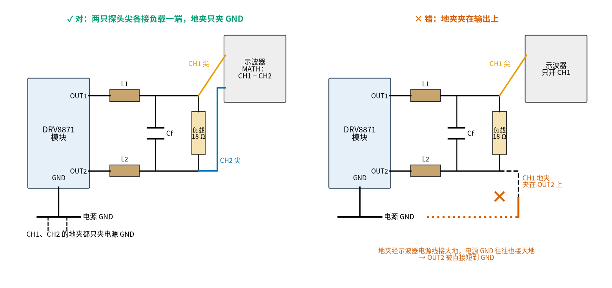
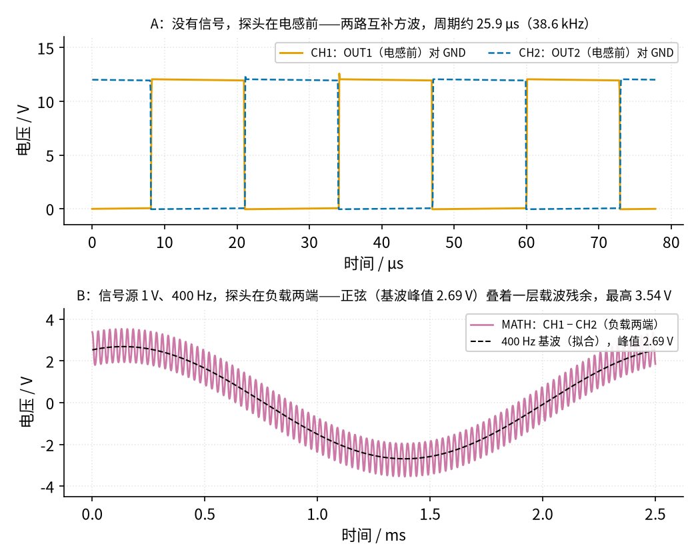

# 44 D 类功放 · 动手实验篇

[上一页：参数与调试篇](page3.md) · [直觉篇](page1.md) · [原理与实现篇](page2.md) · [参数与调试篇](page3.md) · 本页：动手实验篇 · [下一页：45 集成功放芯片与散热保护 · 直觉篇](../45-audio-amp-ics/page1.md) · 前置节点：[43 推挽功放 · 动手实验篇](../43-push-pull-power-amp/page4.md)、[26 H 桥电机驱动 · 动手实验篇](../26-h-bridge/page4.md)、[24 振荡器 · 动手实验篇](../24-oscillator/page4.md)

## 这次实验要验证什么

本次搭原理与实现篇里那台「TL072 三角波 + LM393 比较 + DRV8871 H 桥 + LC」的 D 类功放，负载是 10 Ω / 5 W 电阻串 8 Ω 喇叭（实验 A、B、C 先用 8 Ω / 5 W 假负载代替喇叭），两端都不接地。分三个实验和一个选做：

- **实验 A：静止状态。** 不给信号，验证中点参考 $V_{MID}$ 约 6.00 V；三角波周期约 25.93 µs（38.56 kHz），在约 3.27～8.73 V 之间；IN1、IN2 是互补的 50% 方波，万用表直流档各读约 2.50 V；负载上直流电压小于 50 mV（SPICE −11.4 mV）；VM 电流约 6.146 mA。
- **实验 B：放音与效率。** 信号源 400 Hz 正弦，峰值 0.5、1.0、1.5 V 三档，记下负载电压和 VM 电流，算效率，和 SPICE 的 39.6%、70.2%、81.6% 比。三档读数都接假负载做：SPICE 的负载就是 18 Ω 纯电阻，假负载和它一致，而且不出声。
- **实验 C：温度。** 信号源 1.5 V 连续放 5 分钟，仍接 8 Ω / 5 W 假负载（串 10 Ω），用测温探头量 DRV8871、两只电感、10 Ω 电阻和假负载，都应只比室温高几度。
- **选做 D：让 Arduino 直接产生 PWM。** 拔掉比较器的输出线，用 Arduino 的 Timer2 在 D11、D3 上输出约 31.37 kHz 的互补 PWM，听一个 400 Hz 的音。

## ⚠️ 安全须知

- **只用 12 V 直流电源，并限流 0.2 A**（实验室可调电源）。正常放音时 VM 电流最多约 46 mA（信号源 1.5 V），0.2 A 足够。限流能卡住输出短路这类大电流故障，但**卡不住 IN2 接错**：IN2 误接 5 V 时 8 Ω 负载（假负载或喇叭）上有 0.75 W 直流，电源电流却只有 155 mA（SPICE），限流不动作。所以还要下面两条判据。不要接市电，也不要换更高电压的电源。
- **BTL 输出的任何一端都不能接地。** OUT1、OUT2 和负载两端只接电感、Cf 和负载。上电前用万用表二极管档（很多表和通断档是同一档）确认 OUT1、OUT2 都不和 GND 相通（两个方向各量一次，方法见搭建步骤第 3 步）。若之前上过电，先断电并等 VM 的 100 µF 放完电（或用 1 kΩ 电阻跨接它两端几秒）再量。
- **示波器地夹只夹 GND。** 示波器的地夹通过电源线接大地，常常和电源 GND 是通的；把地夹夹在 OUT2 或负载一端，就等于把那一路输出短到 GND。看负载两端时，用两只探头各接一端、两个地夹都夹电路 GND，再用示波器的 MATH 功能显示 CH1−CH2。
- **负载先接好再上电，拆负载之前先断电。** 空载时 LC 会在 9.12 kHz 谐振、放大 16.68 倍（参数与调试篇），电容电压和电感电流都会冲高。
- **散热与温度限值**：DRV8871 模块靠板上铜箔散热，本节功率下不用另加散热片；但实验中用测温探头（万用表温度档配热电偶、或贴一只 NTC）盯着 DRV8871 芯片、两只电感和 10 Ω 电阻，**任何一处超过 60 °C 立刻断电**。不要用手摸。
- **静音电流判据**：信号源音量为 0 时，VM 电流正常约 6 mA（SPICE 6.146 mA）；**超过 20 mA 立刻断电**。IN2 接 GND 时是 34.5 mA，接 5 V 时是 155 mA，都能被这一条抓住。
- **用假负载做实验**：用一只 8 Ω / 5 W 功率电阻代替喇叭（仍串 10 Ω）。第一次上电、实验 A、B、C 都接假负载；全部做完、负载直流电压和静音电流都正常，断电后再换上喇叭试听。
- **保护耳朵**：400 Hz 连续音很刺耳，信号源 1.5 V 时喇叭上约 0.2 W，贴近了听足够伤耳朵。换上喇叭试听时，喇叭朝下或朝墙放，离耳朵至少 50 cm，不要贴耳听；音量从 0 开始，只用 0.5 V 档听几秒确认有声音就够了。5 分钟的实验 C 一律用假负载，不用喇叭。
- **喇叭保护**：喇叭必须串 10 Ω / 5 W 电阻。上电后先量负载两端直流电压，**超过 50 mV 就断电检查**（多半是 IN2 接错，喇叭会被直流推着发热）。信号源峰值不超过 1.5 V（接电路之前先用万用表交流档确认，见搭建步骤 4），音量从 0 开始加。
- **只用功率电感，不用色环电感。** RLB0913-221K 额定 0.7 A、饱和 0.64 A；色环电感额定只有一两百毫安，静音时的纹波电流就会超。
- **IN 脚只接 0～5 V。** LM393 的上拉电阻接 Arduino 的 5 V，绝不能接 12 V（DRV8871 的 IN 脚绝对最大 7 V）。
- **改线、换元件之前先断电。**

## 器材清单

| 元件 | 型号或数值 | 数量 | 说明 |
|---|---|---|---|
| 运放 | TL072 | 2 | U1：三角波（积分器 + 施密特）；U2： $V_{MID}$ 缓冲（另一半接成跟随器闲置） |
| 比较器 | LM393 | 1 | 两路，输出 IN1、IN2 |
| H 桥模块 | DRV8871 模块（如 Adafruit 3190） | 1 | VM 接 12 V；VM 端子旁另并 100 µF 电解 + 100 nF（见下面电容一行） |
| 功率电感 | Bourns RLB0913-221K（220 µH） | 2 | 不要用色环电感 |
| 薄膜电容 | 0.68 µF，耐压 ≥ 63 V | 1 | Cf，跨在两只电感后面 |
| 功率电阻 | 10 Ω / 5 W | 1 | 和假负载或喇叭串联 |
| 喇叭 | 8 Ω，≥ 0.5 W | 1 | |
| 假负载 | 8 Ω / 5 W 功率电阻 | 1 | 第一次上电和实验 A、B、C 都用它代替喇叭（仍串 10 Ω） |
| 电阻 | 10 kΩ ×4（R1、R2、Rs1、Rin2），22 kΩ，4.7 kΩ ×2（Rint、Rin1），100 kΩ，1 kΩ ×2 | 共 10 | |
| 电容 | 100 nF ×5，100 µF / 25 V 电解 ×1，10 µF 电解 ×1，2.2 nF ×1，1 µF 薄膜 ×1 | 共 9 | 100 nF：Ct 1 只，U1、U2（TL072）、U3（LM393）电源退耦各 1 只，DRV8871 VM 1 只；100 µF 正极接 VM、负极接模块 GND；10 µF 是 Cd；2.2 nF 是 Cint；Cin 用 1 µF 薄膜（无极性），s 点有 6 V 直流，若用电解正极要朝 s |
| Arduino | UNO，USB 供电 | 1 | 只当 5 V 上拉电源（选做 D 才用它产生 PWM） |
| 电源 | 12 V 可调限流电源 | 1 | 限流 0.2 A |
| 信号源 | 信号发生器（或手机播放 400 Hz 测试音） | 1 | 峰值不超过 1.5 V |
| 仪表 | 万用表 ×2（一只串在 VM 线上作电流表）、测温探头、双通道示波器（可选） | | |

## 搭建步骤

![D 类功放面包板图：上排电源轨 +12 V、下排 +5 V，两条 GND 轨在第 35 列连通；U1 三角波 TL072 在第 2 列，U2 中点参考 TL072 在第 13 列，U3 LM393 在第 26 列；绿色线是中点参考，天蓝色线是三角波和方波，蓝色线是音频 s，橙色线是开关信号；信号源从 a23 进入；上拉电阻 Rp 在 j32、j34 接到 +5 V 轨；板外右侧 DRV8871 模块的 IN1、IN2 接第 32、34 列，VM 经电流表（直流 200 mA 档）接 12 V 电源（限流 0.2 A），OUT1、OUT2 经 L1、L2，中间跨 Cf，再接 10 Ω 电阻串 8 Ω 喇叭（注明实验时先用假负载），标注两端都不接地；左下 Arduino（USB 供电）只当 5 V 电源；第 3、14、27 列各有一只 100 nF 跨在 +12 V 轨和 GND 轨之间，给三片芯片退耦；模块 VM 端子旁并 100 µF 电解（正极旁标红色「+」，接 VM）和 100 nF；模块 GND 用一根粗黑线绕到右侧，单独回到电源负极（星形接地），不接面包板 GND 轨；四个黄色测量点：① a20 中点参考，② j2 三角波，③ g32 IN1，④ i34 IN2](img/44_p4_1_breadboard.png)

*图 44-p4-1　面包板接线图（DRV8871 模块、LC、负载在板外）*


*图 44-p4-2　对照原理图，测量点编号和面包板图一致*

> **对照看**：图 44-p4-1 和图 44-p4-2 的测量点编号一样。① 在面包板 a20，是 U2B 输出的 $V_{MID}$ ；② 在 j2，是 U1A 积分器的输出（耦合电容之前的三角波）；③ 在 g32，是 LM393 A 路输出 IN1；④ 在 i34，是 B 路输出 IN2。面包板上 +12 V 只在上排轨，+5 V 只在下排轨，千万别把两者接反；两条 GND 轨在第 35 列连通，前级和 Arduino 的 GND 都在这两条轨上，再由一根线回电源负极。DRV8871 模块的 GND 不接面包板 GND 轨，而是用单独一根粗线直接回电源负极：大电流的开关回路不从前级的地线上走（图 44-p4-1 右侧的粗黑线，原理里叫星形接地）。

按下面的顺序，每一步验证通过再往下：

1. **断电搭前级**：照图 44-p4-1 插好 U1、U2、U3 和所有阻容；U1、U2、U3 的电源脚旁各插一只 100 nF，跨在上排 +12 V 轨和 GND 轨之间（图上第 3、14、27 列）。先**不接** DRV8871 模块。
2. **上电看前级**（只接 12 V 和 Arduino 5 V）：万用表直流档量 ①，应约 6.00 V。示波器（或下面「没有示波器怎么办」）看 ② 和 ③、④。
3. **断电接功率部分**：接上 DRV8871 模块、L1、L2、Cf 和负载（先接 8 Ω / 5 W 假负载代替喇叭，实验 A、B、C 都用它）；VM 端子旁并上 100 µF（正极接 VM）和 100 nF；模块 GND 用一根粗线**单独**接回电源负极（星形接地，见参数与调试篇「开关噪声」一节），不要借面包板的 GND 轨；电流表（直流 200 mA 或 400 mA 档）串在 12 V 电源和模块 VM 之间。用二极管档（很多表和通断档是同一档）确认 OUT1、OUT2、负载两端都**不**和 GND 相通。每处红黑表笔对调各量一次：DRV8871 的输出管自带体二极管，红笔接 GND、黑笔接 OUT 时（经下管体二极管正偏）显示约 0.5 V；反过来量，读数会从 0.5 V 左右慢慢爬到 OL（经上管体二极管给 VM 的 100 µF 充电），这两种都正常；**两个方向都响、都接近 0** 才是真短路。
4. **先确认信号源幅度**：信号源**不接电路**，万用表交流档直接量它的输出（400 Hz 正弦，交流档读数准），把音量调到读数 ≤ 1.0 V（1.5 V 峰值 ÷ √2 ≈ 1.06 V），记住这个音量位置。用手机时音量从最小开始加。
5. **信号源音量调到 0** 再接入电路，上电，做实验 A。负载直流小于 50 mV、VM 电流小于 20 mA 都要满足。
6. 仍接假负载，逐档加信号，做实验 B、C。
7. 断电，把假负载换成喇叭（仍串 10 Ω），喇叭朝下或朝墙、离耳朵 50 cm 以上；上电后先量负载直流仍小于 50 mV，再把信号源从 0 加到 0.5 V，听几秒确认有声音，然后关小、断电。

## 测量表

### 实验 A：静止状态（信号源接好，音量 0）

| 测量点 | 怎么量 | 预期（SPICE） |
|---|---|---|
| ① $V_{MID}$ | 万用表直流档，黑表笔 GND | 6.00 V |
| U1B 方波 | 示波器 | 约 1.52 V 和 10.48 V 之间跳 |
| ② 三角波 | 示波器，量周期和峰峰值 | 周期 25.93 µs（38.56 kHz），峰峰值约 5.46 V |
| ③ IN1、④ IN2 | 万用表直流档 | 各约 2.50 V（5 V 的 50%） |
| 负载两端直流 | 万用表直流 mV 档，两支表笔接负载两端 | −11.4 mV，**必须小于 50 mV** |
| VM 电流 | 电流表（直流 200 mA 或 400 mA 档，红表笔插 mA 孔；不要用 µA 档，实验 B 的电流会超量程） | 6.146 mA。DRV8871 手册写静态电流 $I_{VM}$ 典型 3 mA、最大 10 mA，再加上模块指示灯，读 6～15 mA 都算正常；**超过 20 mA 立刻断电** |

### 实验 B：放音（400 Hz 正弦）

| 信号源峰值 / V | 负载基波峰值 / V | VM 电流 / mA | 负载功率 / W | 效率 |
|---|---|---|---|---|
| 0.5 | 1.345 | 10.57 | 0.05024 | 39.6% |
| 1.0 | 2.686 | 23.81 | 0.2005 | 70.2% |
| 1.5 | 4.03 | 46.07 | 0.4511 | 81.6% |

VM 电流 = SPICE 的电源功率 ÷ 12 V；负载功率 = 负载基波峰值² ÷ (2 × 18 Ω)，是 10 Ω 加假负载一共拿到的 400 Hz 功率，8 Ω 那只只占 8/18。实验 B 接的是假负载，和 SPICE 里的 18 Ω 纯电阻一致，读数可以直接比；换成喇叭后它的阻抗随频率变，就不能直接套表里的数了。效率只算 VM 这一路，前级运放和比较器的电流不算。



*图 44-p4-3　示波器看 BTL 负载：两只探头 + MATH，地夹只夹 GND*

图 44-p4-3 左边是唯一正确的接法：两只探头的尖各接负载一端，两个地夹都夹在电路 GND 上，再打开 MATH 显示 CH1−CH2。右边是最容易犯的错：只用一个通道，把地夹当成「第二根表笔」夹在负载另一端。图 44-p4-3 右图下方的橙色字说明了后果：OUT2 被短到 GND，电源立刻限流。

探头拨到 10× 档。看 IN1、OUT1 这类快边沿时，长地线夹本身就是一个小线圈，会在边沿上叠出假的振铃；换用探头附带的短接地弹簧（接地针），就近接在被测点旁边的 GND 上，振铃明显变小的话，就说明那是测量引入的，不是电路的毛病。



*图 44-p4-4　示波器上应该看到什么（SPICE）*

图 44-p4-4 的 A 图是实验 A 在电感前看到的：两路互补方波。电感前对 GND 量是安全的，因为探头尖接 OUT、地夹接 GND，示波器只是「看」，没有把 OUT 接地。B 图是实验 B 信号源 1 V 时的负载两端：示波器读「最大值」会读到约 3.54 V，比基波峰值 2.69 V 大，多出来的是载波残余；读数时以那层细密波纹的「中线」为准，也就是图 44-p4-4 里黑色虚线那样的整体轮廓。

## 没有示波器怎么办

万用表也能把大部分数验证掉，但要知道它的局限：

- **直流档量平均值是准的。** IN1、IN2 是 0/5 V 方波，直流档读到的是平均值，占空比 50% 时约 2.50 V。两路都读到 2.5 V 左右，说明比较器在工作、互补正常；一路 0 V、一路 5 V，说明三角波没起振或比较器没接好。
- **交流档只对正弦准。** 普通的「平均值响应」万用表只在纯正弦时读数正确，量 PWM 会偏差很大；真有效值表也有带宽限制。Fluke 的应用文章专门讲过量变频器 PWM 输出时读数偏高的问题。所以**不要用交流档量 OUT1、OUT2**。
- **负载两端可以用交流档量**，因为 LC 已经把它变回了以 400 Hz 正弦为主的波形。信号源 1 V 时，音频有效值约 2.687 ÷ √2 ≈ 1.900 V，载波残余约 0.6148 V；按 √(1.900² + 0.6148²) 计算，完全算进载波的话约 2.00 V。万用表读数在 1.90～2.00 V 之间都算正常，取决于它对 38.6 kHz 「看得见」多少。
- **三角波频率**：如果万用表有频率档（Hz），在 ② 上量，应约 38.56 kHz。
- **耳朵**：音量从 0 慢慢加，应听到干净的 400 Hz 音；沙哑或「啪啪」响，回到参数与调试篇的排错表。

## 选做 D：让 Arduino 直接产生 PWM

比较器 + 三角波这一套，也可以换成单片机直接算出占空比。下面的程序用 Timer2 的相位修正 PWM，不分频时频率 16 MHz ÷ 510 ≈ 31.37 kHz；D11（OC2A）正相输出、D3（OC2B）反相输出，两路占空比互补，和 LM393 那两路一样。每个 PWM 周期进一次中断，从正弦表里取下一个占空比，相位步进 400 × 65536 ÷ 31372.5 ≈ 836，得到 400 Hz。

**接法**：断电，把面包板第 32、34 列通往模块 IN1、IN2 的两根线拔掉（比较器输出不能和 Arduino 输出连在一起「打架」），改接 D11 → IN1、D3 → IN2；Arduino GND 仍接面包板 GND 轨，面包板 GND 轨和模块 GND 各用一根线回到 12 V 电源负极（星形接地）。DRV8871 的 IN 脚内部只有 100 kΩ 下拉，5 V 时每脚约 0.05 mA，远低于 ATmega328P 每脚 40 mA 的绝对最大值。


*图 44-p4-5　选做 D 接线：Arduino 代替比较器驱动 IN1、IN2；两个地最终都在电源负极相遇*

> **对照看**：图 44-p4-5 只改了 IN1、IN2 的来源。面包板上第 32、34 列（比较器输出 ③、④）到模块的两根线拔掉，就是图中两个叉号；Arduino 的 D11、D3 接到原来那两根线在模块一端的位置；Arduino GND 本来就接下排 GND 轨，不用动。图 44-p4-5 下方把两条地线分开画：Arduino GND（经面包板 GND 轨）一根，模块 GND 一根，两个地最终都在电源负极相遇，模块 GND 不要直接接到 Arduino 的 GND 脚上，免得开关电流从 Arduino 和面包板的地线里走。功率部分和图 44-p4-2 完全一样。

```cpp
// 44 D 类功放选做：Arduino 直接产生互补 PWM（Timer2，约 31.37 kHz）
// D11（OC2A）→ DRV8871 IN1，D3（OC2B，反相）→ IN2，GND 接 GND
// 用了 Timer2：tone() 不能再用；Timer0（millis、delay）不动
const uint8_t AMP = 40;              // 幅度：占空比在 128 ± 40（满量程 255）之间摆；最大 45
static_assert(AMP <= 45, "AMP 最大 45：再大喇叭超功率、电感接近饱和");
const uint16_t STEP = 836;           // 400 Hz：400 × 65536 ÷ 31372.5 ≈ 836
int8_t tbl[256];                     // 一个周期的正弦表，已乘好 AMP
volatile uint16_t phase = 0;         // 相位累加器

void setup() {
  for (int i = 0; i < 256; i++) {
    tbl[i] = (int8_t)lround(AMP * sin(2.0 * PI * i / 256.0));
  }
  pinMode(11, OUTPUT);
  pinMode(3, OUTPUT);
  OCR2A = 128;
  OCR2B = 128;
  // 相位修正 PWM（TOP = 255），A 路正相、B 路反相，不分频：16 MHz ÷ 510 ≈ 31.37 kHz
  TCCR2A = _BV(COM2A1) | _BV(COM2B1) | _BV(COM2B0) | _BV(WGM20);
  TCCR2B = _BV(CS20);
  TIMSK2 = _BV(TOIE2);               // 每个 PWM 周期进一次中断，更新占空比
}

ISR(TIMER2_OVF_vect) {
  phase += STEP;
  int16_t v = 128 + tbl[phase >> 8];
  if (v < 7) v = 7;                  // DRV8871 最短脉宽 800 ns：留 7 个计数
  if (v > 248) v = 248;
  OCR2A = v;                         // D11 高电平占 v / 255
  OCR2B = v;                         // D3 反相：高电平占 1 − v / 255
}

void loop() {
}
```

这段程序已用 arduino-cli 为 UNO 编译通过。几点说明：

- **为什么限在 7～248**：一个 PWM 周期 510 个时钟（每个 62.5 ns），比较值为 v 时脉冲宽 2 × v × 62.5 ns；DRV8871 要求脉宽至少 800 ns，即 v ≥ 6.4，取 7。AMP = 40 时 v 只在 88～168 之间，用不到这个限幅，它只是防止占空比算出界。
- **AMP 最大 45**：AMP = 45 时负载基波峰值约 45 ÷ 127.5 × 12 × 0.9244 ≈ 3.92 V，和比较器版信号源 1.5 V（4.03 V）相当；电感电流峰值约 3.92 ÷ 18 + 12 ÷ (8 × 220 µH × 31.37 kHz) ≈ 0.218 + 0.217 ≈ 0.435 A。再大，喇叭会超功率、电感电流逼近甚至超过 0.64 A 的饱和电流（AMP = 120 时负载峰值约 10.4 V，电感峰值约 0.80 A）。程序里的 `static_assert` 会让 AMP 超过 45 时编译不通过。
- **预期**：两路占空比差最大 2 × 40 ÷ 255，负载基波峰值约 40 ÷ 127.5 × 12 × 0.9244 ≈ 3.48 V；SPICE 算出负载有效值 2.614 V（含载波），扣掉 0.9263 V 的载波残余后，音频峰值约 3.46 V。静音时（AMP 改成 0）VM 电流 9.135 mA，载波残余进负载约 47.7 mW，比比较器版的 21 mW 多，因为 31.37 kHz 离 LC 的转折频率更近。
- **不要碰 Timer0**：它管着 `millis()`、`delay()`。用了 Timer2，`tone()` 和 D3、D11 上的 `analogWrite()` 都不能再用。

## 用 Python 核对你的读数

把你的读数填进 `mine`，运行后会和预期值比较，偏差超过 10% 的会被标出来。程序不读写任何文件，在哪个目录运行都行。

```python
import sys, pathlib
sys.path.insert(0, str(pathlib.Path("code/figs").resolve()))  # 在仓库根目录运行（本段不导入仓库模块，换目录也能跑）
RL = 18.0                                          # ← 换成你实测的负载电阻（10 Ω 电阻 + 假负载实测电阻）
VS = 12.0                                          # ← 换成你实测的电源电压
exp = {                                            # 预期值（spice/44/run.py）
    "V_MID": 6.00,                                 # ① / V
    "T_us": 25.93, "Vtri_pp": 5.46,                # ② 三角波周期 / µs、峰峰值 / V
    "V_IN1": 2.50, "V_IN2": 2.50,                  # ③④ 直流档 / V
    "I_idle_mA": 6.146,                            # 静音 VM 电流 / mA
    "Vpk_1V": 2.687, "I_1V_mA": 23.81,             # 实验 B（信号源 1 V）：负载基波峰值 / V、VM 电流 / mA
}
mine = {"V_MID": 5.97, "T_us": 27.1, "Vtri_pp": 5.6,  # ← 换成你的读数
        "V_IN1": 2.47, "V_IN2": 2.53, "I_idle_mA": 6.6,
        "Vpk_1V": 2.60, "I_1V_mA": 25.0}
v_dc_mV = -18.0                                    # ← 负载两端直流 / mV
for k, v in mine.items():                          # 逐项比较
    w = exp[k]                                     # 预期值
    flag = "OK" if abs(v - w) / w <= 0.10 else "偏差超过 10%"  # 相对偏差
    print(f"{k:10s} 预期 {w:7.3f}，你读到 {v:7.3f} → {flag}")  # 打印
print(f"负载直流 {v_dc_mV:.1f} mV", "（超过 50 mV，立刻断电检查 IN2！）" if abs(v_dc_mV) > 50 else "（正常）")
print(f"静音 VM 电流 {mine['I_idle_mA']:.1f} mA", "（超过 20 mA，立刻断电！）" if mine["I_idle_mA"] > 20 else "（正常）")
gain = VS / (mine["Vtri_pp"] / 2)                  # H 桥这一级的放大倍数 = V_S ÷ 三角波峰值
print(f"用你的三角波算：H 桥放大 {gain:.2f} 倍，总增益估算 {0.6803 * gain * 0.9244:.2f}（SPICE 2.687）")
pa = mine["Vpk_1V"] ** 2 / (2 * RL)                # 负载（10 Ω + 假负载）的 400 Hz 功率
ps = VS * mine["I_1V_mA"] / 1000                   # VM 这一路的电源功率
print(f"P_load = {pa:.3f} W，P_VM = {ps:.3f} W，效率 {pa / ps * 100:.1f}%（SPICE 70.2%）")
```

示例读数运行后应全部显示 OK。如果三角波峰峰值和预期差得多，先用你自己的三角波算一遍增益再比较负载电压，原理与实现篇说过频率和幅度以实测为准。

## 实验记录表

| 实验 A | 读数 | 预期 | 偏差 / % |
|---|---|---|---|
| ① $V_{MID}$ / V | | 6.00 | |
| 三角波周期 / µs | | 25.93 | |
| 三角波峰峰值 / V | | 5.46 | |
| ③ IN1 直流 / V | | 2.50 | |
| ④ IN2 直流 / V | | 2.50 | |
| 负载两端直流 / mV | | −11.4（要求小于 50） | — |
| VM 电流 / mA | | 6.146（超过 20 立刻断电） | |

| 实验 B：信号源峰值 / V | 负载电压（峰值或有效值，注明） | VM 电流 / mA | 负载功率 / W | 效率 / % | 预期效率 / % |
|---|---|---|---|---|---|
| 0.5 | | | | | 39.6 |
| 1.0 | | | | | 70.2 |
| 1.5 | | | | | 81.6 |

| 实验 C：时间 / min | DRV8871 / °C | L1 / °C | L2 / °C | 10 Ω 电阻 / °C | 8 Ω 假负载 / °C | 室温 / °C |
|---|---|---|---|---|---|---|
| 0 | | | | | | |
| 1 | | | | | | |
| 3 | | | | | | |
| 5 | | | | | | |

实验 C 用信号源 1.5 V，负载是 10 Ω 串 8 Ω / 5 W 假负载。参数与调试篇估算 DRV8871 只热约 2.3 °C，10 Ω 电阻上约 0.261 W、8 Ω 假负载上约 0.209 W（和接 8 Ω 喇叭时一样）（负载有效值电流约 0.162 A，含载波残余；电感里的 0.191 A 大部分纹波经 Cf 回流，不进负载），都应该只比室温高几度；超过 60 °C 立刻断电。

## 思考题

**1.** 实验 A 里电流表读 6 mA 左右，可负载上明明「没有声音」。这些电去哪儿了？

<details><summary>答案</summary>

原理与实现篇把 73.8 mW（12 V × 6.146 mA）拆成三份：DRV8871 自己的静态电流约 36 mW；静音时 ±0.18 A 的纹波电流流过电感直流电阻和管子，约 16.5 mW；没滤干净的载波进了负载，约 21 mW。负载上虽然没有「声音」，但有 38.6 kHz 的电压，只是人耳听不见。

</details>

**2.** 有同学只有单通道示波器，就把探头尖接负载上端、地夹夹在负载下端。一上电电源就限流了，为什么？如果电源没有限流，可能会怎样？

<details><summary>答案</summary>

地夹经示波器电源线接大地，电路 GND 往往也接大地，地夹夹在负载下端就是把 L2 后面（也就是 OUT2）短到了 GND。OUT2 为高时，12 V 经 DRV8871 的上管直接对地短路。没有限流时，电流会冲到 DRV8871 过流保护（3.7～6.4 A）才停，在那之前电感、导线、面包板触点都可能先烧。正确做法：两只探头 + MATH CH1−CH2，地夹只夹 GND；只有单通道时就不看负载两端，改看电感前 OUT1 对 GND。

</details>

**3.** 选做 D 里 Arduino 的载波是 31.37 kHz，比比较器版的 38.56 kHz 低。为什么静音时负载上的载波功率从 21 mW 变成了 47.7 mW？

<details><summary>答案</summary>

LC 的转折频率是 9.201 kHz，二阶低通在转折频率以上大约按频率的平方衰减。载波从 38.56 kHz 降到 31.37 kHz，离转折频率近了，衰减变少；载波残余电压变大，功率又和电压的平方成正比，所以多了一倍多。

</details>

## 自测清单

- [ ] 我能说出三角波、比较器、H 桥、LC 四块各干什么。
- [ ] 我能用 V_S ÷ 三角波峰值算出 H 桥这一级的放大倍数。
- [ ] 我知道 BTL 输出的任何一端都不能接地，示波器只能用两只探头 + MATH 看负载两端。
- [ ] 我能说出为什么必须先接负载再上电，以及为什么不能用色环电感。
- [ ] 我能用电流表和负载电压算出效率，并解释小音量时为什么效率低。
- [ ] 我知道万用表直流档量 PWM 的平均值是准的，交流档量 PWM 不准。
- [ ] 我知道温度只用测温探头量，超过 60 °C 就断电。

## 预告：45 集成功放芯片与散热保护

下一节把本节这一整块板子换成一颗芯片：LM386、PAM8403 这类集成功放，以及更大功率的 TPA3116D2。先回顾一句本节的前置：**D 类 = 三角波比较出 PWM，H 桥开关，LC 取平均；BTL 输出两端都不能接地。**

## 参考资料

- DRV8871 数据手册（IN 引脚 0～5.5 V、绝对最大 7 V、100 kΩ 下拉、最短脉宽、过流与热关断）：<https://www.ti.com/lit/ds/symlink/drv8871.pdf>
- Adafruit DRV8871 模块说明（引脚、VM 范围）：<https://learn.adafruit.com/adafruit-drv8871-brushed-dc-motor-driver-breakout/pinouts>
- Adafruit DRV8871 模块产品页：<https://www.adafruit.com/product/3190>
- Bourns RLB0913 系列数据手册：<https://www.bourns.com/docs/Product-Datasheets/RLB0913.pdf>
- Arduino《Secrets of Arduino PWM》（Timer2、相位修正 PWM、频率计算）：<https://docs.arduino.cc/tutorials/generic/secrets-of-arduino-pwm/>
- Arduino `tone()` 说明（使用 Timer2）：<https://docs.arduino.cc/language-reference/en/functions/advanced-io/tone/>
- ATmega328P 数据手册（Timer2、每脚 40 mA 绝对最大值）：<https://docs.arduino.cc/resources/datasheets/ATmega328P-datasheet.pdf>
- Fluke：用万用表测量变频器 PWM 输出（PWM 读数偏差）：<https://www.fluke.com/en/learn/blog/motors-drives-pumps-compressors/multimeter-measurements-on-adjustable-speed-drives-utilizing-the-new-fluke-87v-dmm>
- Pico Technology：差分探测与示波器接地安全：<https://www.picotech.com/library/articles/application-note/how-true-differential-scope-inputs-boost-probing-safety-and-precision>
