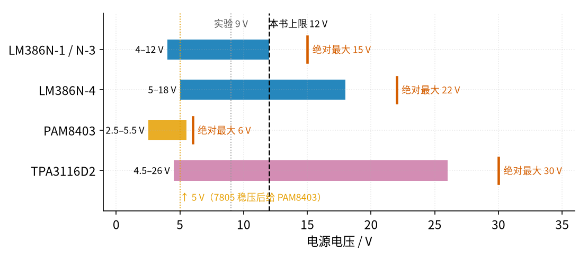
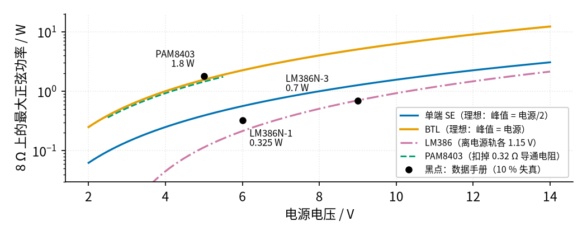
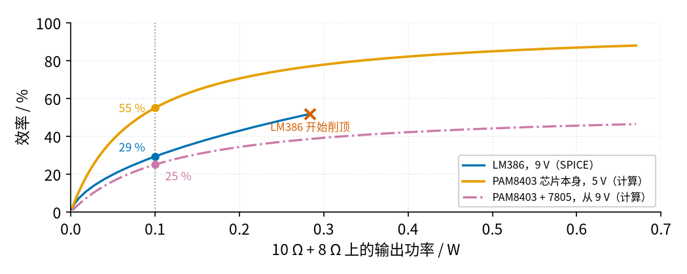

# 45 集成功放芯片与散热保护 · 直觉篇

上一页：44 节 D 类功放（即将上线） · 本页：直觉篇 · [原理与实现篇](page2.md) · [参数与调试篇](page3.md) · [动手实验篇](page4.md) · [下一页：原理与实现篇](page2.md) · 前置节点：[43 推挽功放 · 直觉篇](../43-push-pull-power-amp/page1.md)、44 节 D 类功放（即将上线）、[21 线性稳压 · 直觉篇](../21-linear-regulator/page1.md)、[25 开关电源 · 直觉篇](../25-switching-power-supply/page1.md)

## 开头三问（先回忆，再往下读）

1. [43 推挽功放](../43-push-pull-power-amp/page1.md) 里，乙类推挽在输出最大时效率最高约多少？输出很小时，效率是高还是低？
2. 44 节 D 类功放（即将上线） 里，喇叭接成桥接（BTL）以后，为什么喇叭的任何一端都不能接地？
3. [21 线性稳压](../21-linear-regulator/page1.md) 里，一只线性稳压器把 9 V 降到 5 V、输出 0.15 A 时，它自己大约要发多少热？

答案

1. 理想乙类推挽满幅时效率约 78.5%（π ÷ 4）。输出越小，效率越低，因为电源电压不变，大部分电压都落在管子上。
2. BTL 的两个输出端都在 0 V 和电源之间来回摆，静止时都停在电源的一半。把任何一端接地，就等于把一个推挽输出级直接对地短路。
3. 线性稳压器的发热 = 压差 × 电流 = (9 − 5) V × 0.15 A = 0.6 W。这一节后面算的 7805 正好就是这个量级。

## 痛点：为什么不自己搭，而要用一颗芯片

43、44 两节我们用分立元件搭了推挽功放和 D 类功放：偏置、推挽管、三角波、比较器、H 桥、LC……一块面包板插得满满的，调起来还要盯着静态电流和温度。

真实产品里，绝大多数小音箱、电脑音箱、玩具、门铃里的功放都是**一颗芯片**：外面只要几只电容、一两只电阻。本节看三颗有代表性的芯片：

- **LM386**：老牌的「甲乙类」小功放，单电源 4～12 V，外面接几个元件就能推小喇叭。本节的实验就用它。
- **PAM8403**：常见的 5 V、两声道 D 类小功放，常做成指甲盖大小的模块，喇叭接成 BTL。它的数据手册已经标为「不建议用于新设计」，并推荐改用 PAM8406；但它的模块仍然到处都是，所以我们照样拿它作例子。
- **TPA3116D2**：电压更高、功率更大的 D 类芯片，单电源最高 26 V，接 4 Ω 喇叭每声道约 50 W。它只作为「大功率时保护功能长什么样」的例子，**本节不搭**。

芯片把电路藏起来以后，你要关心的就从「每个管子怎么偏置」变成三件事：**能接多高的电源、能出多大功率、会不会过热**。

*图 45-p1-1　四颗芯片的供电范围：浅色是推荐范围，红色竖线是绝对最大值*

图 45-p1-1 里最该记住的一点：**PAM8403 绝对最大只有 6 V**。实验室常用的 9 V、12 V 电源都会直接把它烧掉。它的数据手册还专门写了一句：用 4 节碱性电池（新电池可超过 6 V）供电会损坏芯片。图 45-p1-1 同时说明，LM386 的 9 V、12 V 都在推荐范围里，所以本节的实验用 9 V 的 LM386；PAM8403 只在选做部分出现，而且要先用 7805 降到 5 V。

## 类比：单端像跷跷板一头坐人，BTL 像两头一起压

**单端**（SE）：喇叭一端接地，另一端接功放输出。输出只能在 0 V 和电源之间摆，又要先通过一只大电容挡掉中间的直流，所以喇叭上最多只有「电源的一半」那么大的峰值。LM386 就是单端。

**BTL**（桥接）：喇叭两端各接一个输出，两个输出反着摆：一个往上，另一个就往下。喇叭两端的电压差能达到「整个电源」那么大的峰值。电压是单端的 2 倍，功率和电压的平方成正比，所以**同样的电源下，BTL 的功率是单端的 4 倍**。PAM8403 和 TPA3116D2 都是 BTL。

*图 45-p1-2　8 Ω 喇叭上能得到的最大正弦功率：BTL 用 5 V 就超过单端用 9 V*

从图 45-p1-2 可以读出两件事：

- 5 V 的 PAM8403（BTL）接 8 Ω 能出约 1.8 W，比 9 V 的 LM386N-3 的 0.7 W 还大。这正是 BTL 的「4 倍」在起作用。
- LM386 的输出到不了电源轨，两边各差约 1.15 V（这个数是用数据手册「9 V、8 Ω 时 700 mW」反推出来的），所以紫色线比蓝线低一截。注意 700 mW 只对 LM386N-3 成立，N-1 在 6 V 时只有 325 mW。

图 45-p1-2 里的线都是用简单公式算的「最大值」，数据手册的黑点是在 10% 失真时测的，已经有明显失真，正常听音乐时要小得多。

> **最小补充：失真度（THD）**
>
> 输出波形和理想正弦差多少，用百分数表示，越小越好。数据手册常常给出「10% THD 时的功率」，这时波形已经被明显削平，耳朵听得出来。所以手册上的「最大功率」是上限，不是你平时能干净地听到的功率。

## 效率：小音量时，D 类的优势会被「吃掉」

44 节说 D 类效率能到九成左右。可本节的实验喇叭串了 10 Ω 保护电阻，总负载约 18 Ω，平时也只放零点几瓦。这时谁更省电？

*图 45-p1-3　输出 0.1 W 时，加上 7805 的 PAM8403 反而不如 LM386*

看图 45-p1-3 的 0.1 W 那条竖线：

- **PAM8403 芯片本身**约 55%：已经比 LM386 的约 29% 好，但离「九成」很远。原因是它不放音乐时自己也要吃约 16 mA（5 V × 16 mA = 80 mW），小音量时这 80 mW 占了大头。
- **PAM8403 + 7805** 只有约 25%，比 LM386 还低。因为 7805 是线性稳压器（见 [21 线性稳压](../21-linear-regulator/page1.md)），从 9 V 降到 5 V，压差 4 V 全变成热，相当于再乘上一个约 5 ÷ 9 的效率。
- 功率越大，D 类优势越明显：PAM8403 在 18 Ω 上满幅约 0.67 W 时，芯片本身约 88%。

所以「D 类一定更省电」要加个条件：**功率要足够大，而且电源最好直接就是芯片要的电压**。如果要降压，用 [25 开关电源](../25-switching-power-supply/page1.md) 里的开关降压模块，而不是 7805。

## 发热与保护：芯片也会「中暑」

功放芯片把一部分电能变成热，热从芯片里的「结」经过封装传到空气。温升可以这样估：

$$
温升 = 发热功率 \times 热阻
$$

热阻的单位是 °C/W，意思是「每发 1 W 热，温度升高多少度」。同一颗 LM386，插针的 DIP 封装约 53.4 °C/W，贴片的 SOIC 封装约 115.7 °C/W，贴片的升温是插针的两倍多。本节的实验里 LM386 最多发热约 0.27 W，DIP 封装大约只升温 14 °C。

不同芯片对「过热、短路」的态度差别很大：

- **LM386** 的数据手册没有写任何过热或短路保护，只能靠你自己：电源限流、喇叭串电阻、控制温升。
- **PAM8403** 发现输出短路就关掉输出，短路去掉后自动恢复；芯片约 140 °C 时关掉输出，降温 30 °C 后自动恢复。
- **TPA3116D2** 过流、过温、输出有直流时都会关掉输出并「锁住」，要重新上电或复位才恢复。

参数与调试篇会把这些保护功能画成一张对照图，并算出不同电源、不同负载下的温升。

## 一句话

**集成功放 = 把推挽或 D 类电路装进一颗芯片；用它要先看三个数：电源上限（PAM8403 只到 6 V）、功率（BTL 是单端的 4 倍）、温升（发热 × 热阻），再看它有没有保护。**

下一页把 LM386 的内部增益电路拆开，推导增益 20 和 200 是怎么来的、它最多发多少热，再看 PAM8403 的 BTL 输出为什么两端都停在 2.5 V。

## 参考资料

- TI LM386 数据手册 SNAS545D（供电范围、各型号功率、热阻、内部框图）：<https://www.ti.com/lit/ds/symlink/lm386.pdf>
- Diodes PAM8403 数据手册 DS36439（绝对最大 6 V、BTL、效率、短路与过温保护、不建议用于新设计）：<https://www.diodes.com/assets/Datasheets/PAM8403.pdf>
- TI TPA3116D2 数据手册 SLOS708G（4.5～26 V、50 W、故障保护）：<https://www.ti.com/lit/ds/symlink/tpa3116d2.pdf>
- TI LM7800 系列数据手册 SNOSBT0L（7805 输出电压、压降、热阻）：<https://www.ti.com/lit/ds/symlink/lm7800.pdf>
