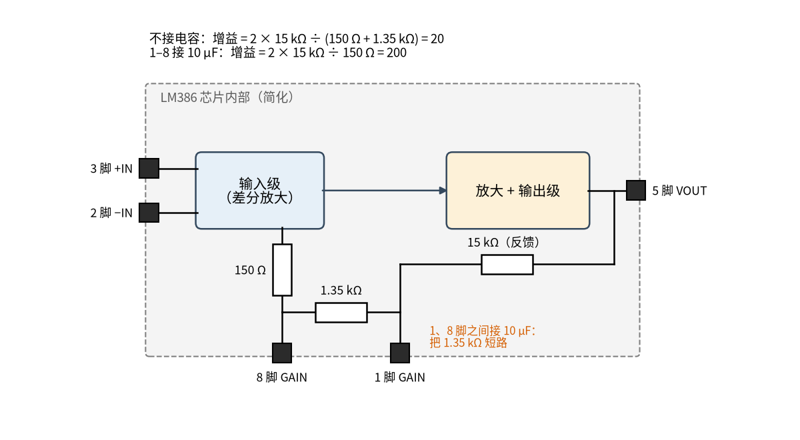
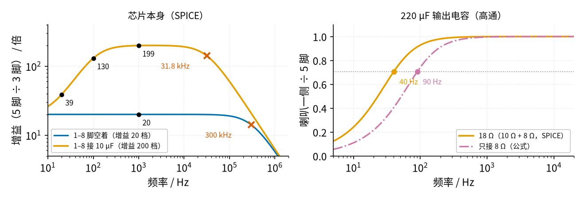
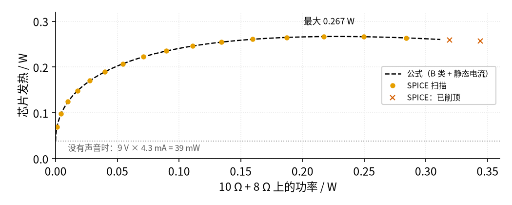

# 45 集成功放芯片与散热保护 · 原理与实现篇

[上一页：直觉篇](page1.md) · [直觉篇](page1.md) · 本页：原理与实现篇 · [参数与调试篇](page3.md) · [动手实验篇](page4.md) · [下一页：参数与调试篇](page3.md) · 前置节点：[43 推挽功放 · 原理与实现篇](../43-push-pull-power-amp/page2.md)、[44 D 类功放 · 原理与实现篇](../44-class-d-amp/page2.md)、[21 线性稳压 · 原理与实现篇](../21-linear-regulator/page2.md)

## 最小知识

本页要用到三件事：

- **单电源功放的输出中点。** LM386 只接一个 9 V 电源，它的输出（5 脚）静止时自动停在电源的一半，约 4.5 V，这叫「自定中点」，数据手册写作 Self-Centering Output Quiescent Voltage。音频就在 4.5 V 上下摆，所以喇叭前面要串一只大电容挡掉这 4.5 V 直流。
- **推挽输出级的发热**：[43 推挽功放](../43-push-pull-power-amp/page2.md) 里推导过，管子的发热不是在最大输出时最大，而是在中间某处最大。本页会用同一个思路算 LM386。
- **热阻**：直觉篇说过，温升 = 发热功率 × 热阻。

> **最小补充：耦合电容和下限频率**
>
> 串在信号路上、用来挡直流的电容叫**耦合电容**。电容对低频的「阻力」（容抗）大，所以它和后面的电阻组成一个高通：频率低于某个**下限频率**时，信号就明显变小。下限频率的公式和 RC 低通一样， $f_c = 1 / (2 \pi R C)$ ，只是这次留下的是高于 $f_c$ 的部分。

> **最小补充：吸收网络（Zobel 网络）**
>
> 5 脚到地串一只 10 Ω 和一只 47 nF，叫吸收网络。喇叭是线圈，频率越高「阻力」越大；吸收网络在很高的频率上给输出级一个稳定的电阻负载，防止芯片自己振荡。数据手册的典型电路用 10 Ω 和 0.05 µF，我们用最接近的常见值 47 nF。

## 一、完整电路，逐块看

本节实验的电路就是数据手册图 9-1 的「增益 20」典型电路（再插上 C5 就是图 9-3 的「增益 200」），加了几处为安全和测量服务的改动。先看整张原理图，虚线框把它分成五块：


*图 45-p2-1　LM386 完整外围电路：虚线框标出五块，和下面五段文字一一对应*

按图 45-p2-1 从输入到喇叭：

1. **块 1　输入分压 + 音量电位器**：手机满音量时输出约 1.05 V 有效值，峰值约 1.48 V（1.05 × √2 ≈ 1.485，SPICE 取 1.48 V）。LM386 的输入只允许 ±0.4 V，直接接上是它的 3.7 倍。所以先用 Ra 10 kΩ 和 Rb 1 kΩ 分压，再接 RP 10 kΩ 电位器调音量，音量开满时 3 脚峰值约 0.121 V。3 脚是同相输入，2 脚接地。
2. **块 2　电源退耦和旁路**：6 脚接 9 V，旁边就近放 C1 100 µF 和 C2 0.1 µF 到地；4 脚接 GND；7 脚接 C3 10 µF 到地（旁路，减小电源嗡声）。
3. **块 3　增益电容**：1、8 脚之间可以插 C5 10 µF（+ 端接 1 脚），增益从 20 变成 200。
4. **块 4　输出电容**：5 脚经 C4 220 µF 耦合电容（+ 端朝 5 脚），再串 10 Ω / 2 W 电阻，最后接 8 Ω 喇叭到地。
5. **块 5　吸收网络**：5 脚到地串 Rz 10 Ω 和 Cz 47 nF。

那只 10 Ω 是本教程所有功放实验的规矩：它把负载从 8 Ω 变成约 18 Ω，限制了电流；万一喇叭接错或输出出了问题，先发热的是这只电阻，而不是喇叭和芯片。

拿图 45-p2-1 和手册图 9-1、图 9-3 对照，取值有这几处不同：

| 位置 | 手册图 9-1 / 9-3 | 本书（图 45-p2-1） | 为什么改，影响多大 |
|---|---|---|---|
| 输出耦合电容 | 250 µF | C4 220 µF | 250 µF 不是常见规格。18 Ω 负载时下限从 35.4 Hz 升到 40.2 Hz（直接接 8 Ω 时从 79.6 Hz 升到 90.4 Hz），听不出差别 |
| 吸收网络 | 10 Ω + 0.05 µF | Rz 10 Ω + Cz 47 nF | 0.05 µF 不常见。拐点从 318.3 kHz 变成 338.6 kHz，都远高于音频 |
| 增益电容（图 9-3） | 10 µF | C5 10 µF | 相同 |
| 输入 | 10 kΩ 电位器直接接信号 | Ra 10 kΩ / Rb 1 kΩ 分压后再接 RP 10 kΩ | 手机峰值 1.48 V 超过 ±0.4 V 的输入上限 |
| 喇叭串联电阻 | 无 | 10 Ω / 2 W | 限流，保护喇叭和芯片 |
| 6 脚退耦、7 脚旁路 | 图 9-1 没画 | C1 100 µF + C2 0.1 µF；C3 10 µF | 面包板电源线长，就近退耦更稳；7 脚是手册引脚表里的 Bypass |

## 二、推导：增益 20 和 200 是怎么来的

LM386 内部有三个决定增益的电阻：从输出 5 脚到 1 脚的 15 kΩ 反馈电阻、1 脚到 8 脚之间的 1.35 kΩ，以及 8 脚内侧的 150 Ω。这三个值画在数据手册 SNAS545D 第 1 页的简化原理图（Schematic）里；正文里，§8.3（p.9）只写了 1.35 kΩ；15 kΩ 出现在 §9.2.1.2.1（p.10）讲低音提升的那段（「paralleling the internal 15-kΩ resistor」）。150 Ω 只在那张简化原理图里出现，也可以由增益 200 反推：2 × 15 kΩ ÷ 200 = 150 Ω。注意手册 §8.2 的功能框图（Functional Block Diagram）没有标电阻值，别去那里找。



*图 45-p2-2　LM386 内部的增益网络（简化），电阻值取自数据手册第 1 页的简化原理图*

按图 45-p2-2，增益等于「反馈电阻的 2 倍」除以「8 脚内侧的 150 Ω 加上 1、8 脚之间的 1.35 kΩ」：

$$
A_V = \frac{2 \times 15\thinspace\mathrm{k\Omega}}{150\thinspace\Omega + 1.35\thinspace\mathrm{k\Omega}} = 20
$$

1、8 脚之间接一只 10 µF，交流信号就从电容走，1.35 kΩ 被「短路」：

$$
A_V = \frac{2 \times 15\thinspace\mathrm{k\Omega}}{150\thinspace\Omega} = 200
$$

数据手册写的是 26 dB 和 46 dB，换成倍数就是 20 和 200。SPICE 在 1 kHz 得到 20.00 和 198.8。图 45-p2-2 里还有一个要点：手册说 LM386 只在增益大于 9 时稳定，所以不要试图把增益调得比 20 小很多。

但 10 µF 在低频时容抗变大，「短路」不彻底。容抗和 1.35 kΩ 并联以后再串 150 Ω，用复数算：

```python
import numpy as np                                # 复数运算
C = 10e-6                                         # 1、8 脚之间的电容 / F
for f in (20, 100, 200, 1000):                    # 几个频率 / Hz
    zc = 1 / (2j * np.pi * f * C)                 # 电容的复阻抗
    zp = 1.35e3 * zc / (1.35e3 + zc)              # 和 1.35 kΩ 并联
    g = abs(2 * 15e3 / (150 + zp))                # 增益的大小
    print(f"{f:5d} Hz：增益 {g:6.1f}")
```

运行结果是 20 Hz 约 38.8、100 Hz 约 130.3、200 Hz 约 172.6、1 kHz 约 198.6；SPICE 给出 38.8、130.3、172.7、198.8，相差不到 0.2%。也就是说，「增益 200」只在几百赫兹以上才成立。

## 三、幅频曲线：高频和低频各被谁限制



*图 45-p2-3　左：芯片增益的幅频曲线（对数横轴）；右：输出耦合电容的下限*

图 45-p2-3 左边是 SPICE 的结果：

- 增益 20 档，上限约 300 kHz，和数据手册的带宽 300 kHz 一致；
- 增益 200 档，上限降到约 31.8 kHz。增益乘带宽差不多是个常数，增益大 10 倍，带宽就小将近 10 倍。两档的上限都远高于 20 kHz，人耳听不出差别。数据手册图 6-4（Voltage Gain vs Frequency）里也有 1、8 脚接 10 µF 的那条曲线，在几十千赫开始下降，和 SPICE 的趋势一致；从图上读出的精确 −3 dB 点 [待核实]。

图 45-p2-3 右边是输出耦合电容造成的下限。220 µF 和负载组成高通：

$$
f_c = \frac{1}{2 \pi R C}
$$

负载是 10 Ω + 8 Ω = 18 Ω 时， $f_c$ 约 40.2 Hz；如果去掉 10 Ω、只接 8 Ω， $f_c$ 约 90.4 Hz。手册典型电路用 250 µF，18 Ω 时是 35.4 Hz，差别听不出来。负载电阻越小，要的电容越大，这就是功放输出电容动辄几百微法的原因。

## 四、推导：LM386 最多发多少热

LM386 的输出级是单电源甲乙类推挽。设喇叭侧（电容后）正弦峰值是 $V_p$ ，负载电阻 $R_L$ ，电源 $V_S$ ，静态电流 $I_Q$ 。

- 负载拿到的功率： $P_L = V_p^2 / (2 R_L)$ 。
- 电源只在半个周期往外送电流，平均电流是 $V_p / (\pi R_L)$ ，再加静态电流。电源功率 $P_S = V_S (V_p / (\pi R_L) + I_Q)$ 。
- 芯片发热 = 电源功率 − 负载功率。

$$
P_D = \frac{V_S V_p}{\pi R_L} - \frac{V_p^2}{2 R_L} + V_S I_Q
$$

这是一个开口向下的抛物线。对 $V_p$ 求最大值，得到在 $V_p = V_S / \pi$ 时最大：

$$
P_{D,max} = \frac{V_S^2}{2 \pi^2 R_L} + V_S I_Q
$$

9 V、18 Ω、静态电流取 4.3 mA（数据手册曲线在 9 V 处约 4.3 mA，SPICE 模型也是这个值）时，算出来约 0.267 W，出现在 $V_p$ 约 2.86 V 的时候。



*图 45-p2-4　LM386（9 V、18 Ω）的芯片发热：最大值不在满幅处*

图 45-p2-4 里的圆点是 SPICE 扫描输入幅度得到的，最大发热约 0.2667 W，出现在 3 脚输入峰值约 0.14 V 时，和公式的 0.2667 W 一致。从图 45-p2-4 可以看到三件事：

1. **发热最大的时候不是声音最大的时候。** 再往上推，负载拿走的更多，芯片反而凉一点。所以算散热要用 $P_{D,max}$ ，而不是满幅时的发热。
2. **不放音乐也发热**：9 V × 4.3 mA 约 38.7 mW。
3. **负载越小，发热越大**：同样 9 V，直接接 8 Ω 时 $P_{D,max}$ 约 0.552 W，是 18 Ω 时的两倍多。10 Ω 串联电阻也在保护芯片。

## 五、PAM8403：BTL 的两个输出为什么都停在 2.5 V

PAM8403 每个声道里有两个「半桥」：每个半桥是一个上管加一个下管，输出只在 0 V 和 5 V 之间切换。两个半桥的输出接喇叭两端，就是 [44 D 类功放](../44-class-d-amp/page2.md) 讲过的 BTL，只是它不用 LC 滤波器，靠喇叭线圈本身来平均。


*图 45-p2-5　无滤波 BTL 输出示意：没有输入时两端各自平均 2.5 V、喇叭两端平均 0 V；有输入时一高一低*

看图 45-p2-5：

- **左列，没有输入**：OUT+、OUT− 都是占空比 50% 的方波，而且两路几乎同相，所以**对 GND 的平均值都是 2.5 V**，喇叭两端（OUT+ − OUT−）只剩很窄的尖峰，平均为 0，喇叭里没有直流。TI 的应用报告 SLOA145 §2 讲「无滤波」调制时就是这样描述的：没有输入时两路输出几乎同相。同一份报告 §1 讲的**传统** D 类（要 LC 滤波器）则不同：两路反相、各 50%，喇叭上一直是满幅方波，所以必须加滤波器。
- **右列，有输入**：一路的占空比变大、另一路变小。图中的例子是 65% 和 35%，平均值分别是 3.25 V 和 1.75 V，喇叭两端平均 1.5 V。占空比再拉开，喇叭两端的电压差最大能到接近整个 5 V。
- PAM8403 数据手册 p.1 只说它是无滤波结构：「filterless architecture allows the device to drive the speaker directly, requiring no low-pass output filters」，但没有写具体用的是哪种调制，所以「PAM8403 就是这种无滤波调制」[待核实]。手册 p.7 还有一句「different in phase by 180°」，说的是两路输出里的**音频信号**互为反相（这就是 BTL），不是 SLOA145 §1 讲的传统 D 类「没有输入时两路方波反相」，别混在一起。但不管哪种，没有输入时两端对地平均都约 2.5 V，万用表读到的结论不受影响。

所以图 45-p2-5 也解释了直觉篇的「4 倍」：单端的峰值最多是电源的一半，BTL 的峰值接近整个电源。PAM8403 的上管导通电阻约 180 mΩ、下管约 140 mΩ，电流同时流过一个上管和一个下管，一共约 0.32 Ω。把它算进去：

$$
V_p = 5\thinspace\mathrm{V} \times \frac{R_L}{R_L + 0.32\thinspace\Omega}, \qquad P = \frac{V_p^2}{2 R_L}
$$

接 8 Ω 时约 1.445 W，接 4 Ω 约 2.679 W；数据手册在 1% 失真时给出 1.4 W 和 2.5 W，量级一致。

图 45-p2-5 左边的「半桥 A、半桥 B」只是方框。把方框里的上管、下管画出来（画成开关，芯片里实际是 MOSFET），就是下面这张原理图：


*图 45-p2-6　PAM8403 一个声道的 BTL 输出级原理图：两个半桥，喇叭跨在 OUT+、OUT− 之间*

**对照看**：上面 0.32 Ω 的来历就在图 45-p2-6 上。SA1、SB2 导通时，电流从 +5 V 经 SA1（约 180 mΩ）、10 Ω、喇叭、SB2（约 140 mΩ）回到 GND，一路串着一个上管和一个下管。反过来是 SB1 和 SA2，同样一共 0.32 Ω。再看「两端都不能接地」：OUT− 接地以后，SB1 每次导通都把 +5 V 直接接到 GND，中间只有约 180 mΩ。

> **最小补充：为什么 BTL 的两端都不能接地**
>
> 两端平均都在 2.5 V，而且都在 0 和 5 V 之间快速切换。把 OUT− 接地，OUT− 那个半桥的上管每次导通都直接把 5 V 短到地。PAM8403 会检测到短路并关掉输出，但别依赖它。用示波器时也一样：地夹只夹 GND。

## 例题

**例 1（示范）**：LM386 接 9 V、负载 18 Ω、静态电流 4.3 mA。求芯片最大发热；如果是 DIP 封装（热阻 53.4 °C/W），最多比环境高多少度？

解：

$$
P_{D,max} = \frac{9^2}{2 \pi^2 \times 18} + 9 \times 0.0043 = 0.2280 + 0.0387 = 0.2667\thinspace\mathrm{W}
$$

温升 = 0.2667 × 53.4 ≈ 14.2 °C。室温 25 °C 时，芯片里面约 39 °C。

```python
import math                                       # π
VS, RL, IQ = 9.0, 18.0, 4.3e-3                    # 电源 / V、负载 / Ω、静态电流 / A
pd = VS**2 / (2 * math.pi**2 * RL) + VS * IQ      # 最大发热 / W
print(f"P_D,max = {pd:.4f} W，此时 Vp = {VS / math.pi:.2f} V")
print(f"DIP 温升 {pd * 53.4:.1f} °C，SOIC 温升 {pd * 115.7:.1f} °C")
```

**例 2（填空）**：同一颗 LM386 还接 9 V，但去掉 10 Ω，直接接 8 Ω 喇叭。

- 交流部分： $9^2 / (2 \pi^2 \times 8)$ = ____ W；
- 加上静态发热 ____ W，得到 $P_{D,max}$ = ____ W；
- 贴片 SOIC 封装（115.7 °C/W）的温升 = ____ °C。

<details><summary>答案</summary>

交流部分 81 ÷ 157.9 ≈ 0.513 W；静态 9 × 0.0043 ≈ 0.0387 W；合计约 0.552 W。SOIC 温升约 0.552 × 115.7 ≈ 63.8 °C，室温 25 °C 时芯片约 89 °C，已经很烫。去掉 10 Ω，芯片发热翻了一倍多。

</details>

**例 3（自己做）**：PAM8403 用 5 V 供电，接 4 Ω 喇叭，两只管子导通电阻一共 0.32 Ω。求喇叭两端最大峰值和最大功率，并和单端 5 V、4 Ω 的理想值比较。

<details><summary>答案</summary>

峰值 = 5 × 4 ÷ 4.32 ≈ 4.630 V，功率 = 4.630² ÷ (2 × 4) ≈ 2.679 W。单端理想峰值是 2.5 V，功率 2.5² ÷ 8 ≈ 0.781 W。BTL 约是单端的 3.4 倍；如果不扣导通电阻，就正好是 4 倍。导通电阻在负载越小时影响越大。

</details>

## 参考资料

- TI LM386 数据手册 SNAS545D（第 1 页简化原理图里的 15 kΩ、150 Ω、1.35 kΩ，§8.3（p.9）正文的 1.35 kΩ、§9.2.1.2.1（p.10）正文的 15 kΩ；增益 26 / 46 dB；带宽 300 kHz；增益大于 9 才稳定；图 9-1/9-3 典型电路 250 µF、10 Ω + 0.05 µF；图 6-4 幅频曲线）：<https://www.ti.com/lit/ds/symlink/lm386.pdf>
- Diodes PAM8403 数据手册 DS36439（p.1 无滤波结构、导通电阻、输出功率、短路保护；p.7 最大增益与两路音频反相）：<https://www.diodes.com/assets/Datasheets/PAM8403.pdf>
- TI 应用报告 SLOA145《Filter-Free Class-D Audio Amplifiers》（§1 传统 D 类无输入时两路反相、50% 占空比；§2 无滤波调制无输入时两路几乎同相）：<https://www.ti.com/lit/an/sloa145/sloa145.pdf>
- 苹果 USB-C 耳机转接头输出电平实测（满音量最大输出约 1.05 V、输出阻抗约 0.9 Ω）：<https://doineedanamp.com/sources/iphone-usb-c/>
