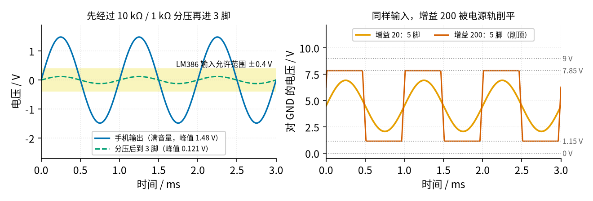
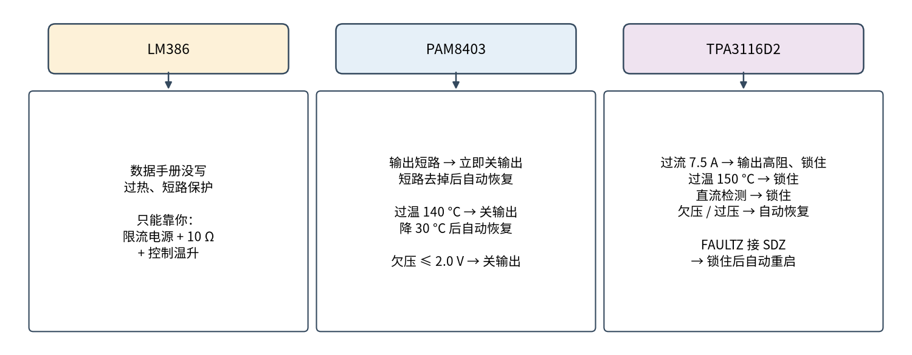

# 45 集成功放芯片与散热保护 · 参数与调试篇

[上一页：原理与实现篇](page2.md) · [直觉篇](page1.md) · [原理与实现篇](page2.md) · 本页：参数与调试篇 · [动手实验篇](page4.md) · [下一页：动手实验篇](page4.md) · 前置节点：[43 推挽功放 · 参数与调试篇](../43-push-pull-power-amp/page3.md)、[44 D 类功放 · 参数与调试篇](../44-class-d-amp/page3.md)、[21 线性稳压 · 参数与调试篇](../21-linear-regulator/page3.md)

## 参数一览

先把本节实验电路（9 V、增益 20、10 Ω + 8 Ω 负载）的数字列在一起。「SPICE」指 spice/45 里的仿真，「公式」指 code/figs/45_figs.py 的计算。

| 参数 | 数值 | 来源 |
|---|---|---|
| 5 脚、7 脚静态电压 | 4.50 V（电源的一半） | SPICE |
| 静态电流 | 约 4.3 mA | 手册图 9-4 读数，SPICE 取同值（手册表格只给 6 V 时典型 4 mA、最大 8 mA） |
| 增益（1 kHz） | 20.00 档 / 198.8 档 | SPICE；公式 20 / 200 |
| 上限频率 −3 dB | 300 kHz（增益 20）/ 31.8 kHz（增益 200） | SPICE |
| 输出电容下限 −3 dB | 40.2 Hz（18 Ω）/ 90.4 Hz（只接 8 Ω） | SPICE / 公式 |
| 输出离电源轨 | 约 1.15 V，所以只能摆在 1.15 V 到 7.85 V 之间 | 由手册 LM386N-3 在 9 V、8 Ω 的 700 mW 反推 |
| 手机满音量到 3 脚 | 峰值 0.1213 V | SPICE（手机峰值取 1.48 V） |
| 3 脚刚削顶的输入峰值 | 167.5 mV（增益 20）/ 16.75 mV（增益 200） | 公式 |
| 手机满音量时 5 脚交流峰值 / 喇叭峰值 | 2.426 V / 1.077 V | SPICE |
| 手机满音量时电源电流 | 47.2 mA | SPICE |
| 手机满音量时功率分配 | 电源 0.425 W，喇叭 72.5 mW，10 Ω 电阻 90.7 mW，芯片 0.261 W | SPICE |
| 芯片最大发热 | 0.2667 W（3 脚输入峰值约 0.14 V 时） | SPICE；公式 0.2667 W |
| 刚削顶前 18 Ω 上的功率 | 0.284 W | SPICE |
| 7 脚旁路：电源上 100 mV 纹波时喇叭的嗡声峰值 | 0.437 mV（接 10 µF）/ 20.6 mV（悬空） | SPICE（只算 7 脚这一条路径） |

## 一、输入：先分压，再调音量，别削顶



*图 45-p3-1　左：分压前后的输入；右：同样输入下增益 20 正常、增益 200 削顶*

LM386 数据手册的「绝对最大值」里写着输入电压 −0.4 V 到 +0.4 V。图 45-p3-1 左边的手机满音量峰值约 1.48 V（1.05 V 有效值 × √2），是这个上限的 3.7 倍。超过绝对最大值不一定马上坏，但手册明说可能造成永久损坏，我们不赌。

10 kΩ 和 1 kΩ 分压（1 kΩ 还并着 10 kΩ 电位器和芯片的 50 kΩ 输入电阻），分压比约 0.082，3 脚峰值约 0.121 V，安全。

接下来看输出会不会削顶。5 脚只能在 1.15 V 和 7.85 V 之间摆，中点 4.5 V 上下各 3.35 V。能放大而不削顶的最大输入是：

```python
VS, LOSS = 9.0, 1.15                              # 电源、输出离电源轨的距离 / V
vp_max = VS / 2 - LOSS                            # 5 脚最大交流峰值 / V
for gain in (20, 200):                            # 两档增益
    print(f"增益 {gain}：3 脚峰值不超过 {vp_max / gain * 1e3:.2f} mV")
vin = 1.48 * 0.08197                              # 手机满音量经分压到 3 脚 / V
print(f"手机满音量到 3 脚：{vin * 1e3:.1f} mV")
```

增益 20 时上限 167.5 mV，手机满音量的 121.3 mV 在范围内；增益 200 时上限只有 16.75 mV，同一个信号就被削成图 45-p3-1 右边的方波。削顶的声音又破又响，喇叭和芯片都更累。解决办法是把电位器关小：SPICE 里电位器开到 10%，3 脚只剩 12.1 mV，输出峰值 2.408 V，不削顶。

## 二、保护：三颗芯片各不相同



*图 45-p3-2　三颗芯片的保护功能，全部来自各自的数据手册*

图 45-p3-2 的三栏可以总结成三句话：

1. **LM386：手册里找不到保护。** 我们翻遍 SNAS545D，没有过热关断、短路保护的说明，只有封装功耗上限（DIP 1.25 W、SOIC 0.73 W）。所以本实验的保护全靠外面：电源限流 0.2 A、喇叭串 10 Ω、用测温探头盯温度。
2. **PAM8403：自动恢复。** 输出之间或输出对地短路，立刻关输出，短路去掉后自己恢复；芯片内部超过 140 °C（各颗芯片之间可能差 15 °C）关输出，降 30 °C 后自己恢复。自动恢复的坏处是：如果短路一直在，它会反复「关、开、关」，你可能只听到声音断断续续，而不知道出了故障。
3. **TPA3116D2：锁住。** 过流、过温、输出有直流这三种故障会让输出变成高阻并「锁住」，必须重新上电或拉一下 SDZ 才能恢复。手册给了一个办法：把 FAULTZ 直接接到 SDZ，就能自动清除锁住。

**喇叭最怕什么？** 怕直流。直流让喇叭的纸盆一直被推向一边，线圈只发热不出声。LM386 的输出停在 4.5 V，全靠 220 µF 挡住；电解电容极性接反（正极必须朝 5 脚）或者漏电，直流就会进喇叭。TPA3116D2 专门有「直流检测」：输出占空比在同一方向超过 60% 持续 420 ms 以上就判故障。LM386 没有，所以动手实验篇要求上电后先用万用表量喇叭两端的直流电压。

## 三、温升：查热阻、算温升、用探头量


*图 45-p3-3　各种用法下的最大温升（发热 × 热阻）*

图 45-p3-3 的每一根柱子都按「发热 × 热阻」算。读这张图要记住三点：

- **同一颗芯片，封装不同，温升差一倍多。** DIP 热阻 53.4 °C/W，SOIC 115.7 °C/W。买模块时看清芯片是插脚的还是贴片的。
- **12 V、8 Ω 的 SOIC 已经超标。** 最大发热约 0.963 W，超过 SOIC 的封装上限 0.73 W。这就是本实验坚持 9 V 加 10 Ω 的原因。
- **7805 也要算。** PAM8403 本身很凉（单声道 18 Ω 满幅只发热约 0.092 W），但从 9 V 降到 5 V 的 7805 要扛约 0.682 W（静态电流按手册最大 8 mA），不加散热片温升约 36.8 °C。热量没有消失，只是搬到了稳压器上。
- **7805 的热阻为什么有两个数？** LM7800 手册 SNOSBT0L 绝对最大值表的注 (3) 给 TO-220 在自由空气里 54 °C/W，这是不加散热片、只靠管子自己散热的情况，本节用它估最坏情况；§6.4 热参数表里的 23.9 °C/W 是在 JEDEC 标准测试板上测的，铜箔帮忙散热，所以小得多，按它算温升只有 16.3 °C。面包板上的 7805 更接近前一种。这和 21 节线性稳压讲的热阻是同一回事：热阻取决于怎么装、往哪里散热。
- **PAM8403 双声道的 59 °C 怎么来的？** 手册给 5 V、8 Ω、10% 失真时每声道 1.8 W，效率 87%。反推发热：2 × (1.8 ÷ 0.87 − 1.8) ≈ 0.538 W，乘热阻 110 °C/W 约 59.2 °C。这是满功率、两个声道一起开的情况，本实验只用一个声道、18 Ω，只有 10.1 °C。

> **最小补充：热阻是「每瓦升几度」**
>
> 热阻 53.4 °C/W 的意思是：芯片每发 1 W 的热，里面就比周围空气高 53.4 °C。这个数是在标准测试板上测的，你的面包板散热更差，实际温升会更高，所以算出来的数只是下限，必须实测。

**怎么量温度**：用万用表的温度档（配 K 型热电偶探头）、或者一只 NTC 热敏电阻贴在芯片顶面，用一小块胶带固定。**不要用手去摸**，芯片很烫时一碰就可能烫伤，而且手感一点也不准。动手实验篇规定：芯片表面超过 60 °C 就断电。

## 排错表

| 现象 | 原因 | 怎么查 | 怎么改 |
|---|---|---|---|
| 上电后电源立刻限流（0.2 A），没声音 | 6 脚和 4 脚接反，或输出电容后面对地短路 | 断电，用通断档量 5 脚对 GND、喇叭两端对 GND | 对照引脚图重接；6 脚是 VS，4 脚是 GND。芯片可能已经坏了：重接后先测静态电流，偏离 4～8 mA 就换芯片；C1 若反向接过、顶部鼓包，一并换掉 |
| 没放音乐时电流明显超过 8 mA（手册 6 V 时的最大值） | 芯片在高频自激（没接吸收网络或接错），或芯片已坏 | 示波器看 5 脚有没有几百千赫的振荡 | 5 脚到地补上 10 Ω + 47 nF；导线剪短 |
| 5 脚静态电压不是 4.5 V 左右 | 7 脚接错、2 脚或 3 脚上有直流 | 万用表量 2、3、7 脚 | 2 脚接地；输入经分压电阻接 3 脚，没有直流偏置 |
| 喇叭一直「嗡嗡」响，没放音乐也响 | 7 脚没接旁路电容，电源纹波进了输出 | 量 7 脚到地有没有 10 µF | 接上 10 µF；SPICE 里嗡声从 20.6 mV 降到 0.437 mV |
| 声音破、开大就「啪啪」响 | 削顶：增益 200 档或输入太大 | 示波器看 5 脚是不是平顶 | 关小电位器，或拔掉 1、8 脚的 10 µF |
| 声音小、低音没了 | 输出电容太小或用错（如 1 µF） | 看电容上的字 | 用 220 µF 以上，正极朝 5 脚 |
| 芯片很快超过 60 °C | 去掉了 10 Ω、电源超过 9 V、或在自激 | 测温探头加电流表一起看 | 恢复 10 Ω；电源 9 V；排查自激 |
| PAM8403 模块声音断断续续 | 输出短路保护在反复动作，或电源电压跌到 2.0 V 以下 | 万用表量 L+、L− 对 GND，应都约 2.5 V；量 VCC | 检查喇叭线有没有碰在一起、有没有接到 GND；电源换成 7805 的 5 V |
| PAM8403 模块上电后不工作、发烫或冒烟 | 接了 9 V 或 12 V（绝对最大值只有 6 V） | 量 VCC | 芯片多半已坏，换新模块；只能从 7805 取 5 V |

## 常见误区

- **「LM386 能输出 700 mW。」** 那是 LM386N-3 在 9 V、8 Ω、10% 失真时的典型值。常见的 LM386N-1 在 6 V、8 Ω 时典型只有 325 mW。本实验接 18 Ω，满幅约 0.31 W，其中喇叭只分到 8/18。
- **「4.3 mA 是静态电流的规格。」** 不是。手册表格只给 6 V 时典型 4 mA、最大 8 mA；4.3 mA 是从 9 V 的曲线上读出来的典型值，单颗芯片可能差不少。
- **「声音最大时芯片最热。」** 原理与实现篇推导过，单端推挽的发热在中间最大。
- **「D 类功放效率高，所以总是更省电。」** 输出 0.1 W 时，PAM8403 加 7805 从 9 V 取电，算下来效率约 25.1%，反而比 LM386 的 29.3% 低。静态电流和稳压器的损耗在小功率时占大头。只看 PAM8403 自己是 55.0%；满幅（18 Ω 0.670 W）时芯片自己约 87.9%，加上 7805 从 9 V 算是 46.4%，LM386 满幅约 54.5%。
- **「PAM8403 的 L− 是地。」** 不是。BTL 两端对 GND 都约 2.5 V，L− 接地就是短路。
- **「电源限流了就安全。」** 限流只管总电流，挡不住反接、电解电容接反，也挡不住直流进喇叭。接线还是要上电前逐项检查。
- **「增益越大越好。」** 增益 200 时满音量的手机信号就削顶（上限 16.75 mV，实际 121.3 mV），声音又破又响，芯片也更热。增益够用就好，音量靠电位器。
- **「热阻算出来温升只有 14 °C，不用量。」** 手册的热阻是在标准测试板上测的，面包板散热更差。算出的数只是参考，温度一定要用探头量。

## 练习

1. LM386 接 9 V、增益 20，3 脚输入峰值 0.1 V。5 脚的交流峰值是多少？会不会削顶？

<details><summary>答案</summary>

0.1 × 20 = 2.0 V 峰值，小于最大的 3.35 V（4.5 − 1.15），不削顶。5 脚在 2.5 V 到 6.5 V 之间摆。

</details>

2. 同一电路改成增益 200，要不削顶，3 脚峰值最多多少？电位器大约要开到多少？

<details><summary>答案</summary>

3.35 ÷ 200 = 16.75 mV。满音量时 3 脚是 121.3 mV，所以电位器大约开到 16.75 ÷ 121.3 ≈ 14% 以下。SPICE 里开到 10% 时输出峰值 2.408 V，没有削顶。

</details>

3. 一块 LM386 SOIC 模块，用 12 V 驱动 8 Ω 喇叭，静态电流按 4.3 mA。算最大发热，并说明为什么不行。

<details><summary>答案</summary>

最大发热 = 12² ÷ (2π² × 8) + 12 × 0.0043 ≈ 0.912 + 0.052 ≈ 0.963 W，超过 SOIC 的封装上限 0.73 W；温升约 0.963 × 115.7 ≈ 111 °C。改用 9 V、串 10 Ω，或换成 DIP 封装。

</details>

4. PAM8403 模块从 7805 取 5 V，单声道满幅时 5 V 电流约 152.5 mA，7805 输入 9 V。7805 发热多少？不加散热片温升多少（热阻 54 °C/W，静态电流按手册最大值 8 mA 估）？

<details><summary>答案</summary>

7805 发热 = (9 − 5) × 0.1525 + 9 × 0.008 = 0.610 + 0.072 = 0.682 W，温升约 0.682 × 54 ≈ 36.8 °C。要加散热片。8 mA 是 LM7805 在 25 °C 的最大值，手册没给典型值，所以这是偏保守的估算。

</details>

5. （选型迁移）手上有 12 V 电源和一只 4 Ω 喇叭，想要 3 W。LM386、PAM8403、TPA3116D2 三颗里选哪颗？用本页的方法说明另外两颗为什么不行。

<details><summary>答案</summary>

- PAM8403：电源绝对最大值只有 6 V，12 V 直接烧，不用算。
- LM386：单端输出峰值最多 6 − 1.15 = 4.85 V，4 Ω 上最多 4.85² ÷ (2 × 4) ≈ 2.94 W，已经不到 3 W；最大发热 12² ÷ (2π² × 4) + 12 × 0.0043 ≈ 1.875 W，超过 DIP 的封装上限 1.25 W，温升约 1.875 × 53.4 ≈ 100 °C。而且 LM386N-1/-3 的电源上限就是 12 V，没有余量。不行。
- TPA3116D2：BTL，12 V、4 Ω 满幅约 16.0 W，3 W 绰绰有余。3 W 时电流有效值 √(3 ÷ 4) ≈ 0.866 A，两只管子的导通损耗约 0.866² × 0.24 ≈ 0.18 W，加上 12 V 空载约 0.24 W，发热不到 LM386 的四分之一（开关损耗没算，要按手册效率曲线复核）。选它。

</details>

### 43、44、45 三节对比

| | 43 分立推挽 | 44 自搭 D 类（DRV8871 桥） | 45 集成芯片 |
|---|---|---|---|
| 元件数 | 多：管子、偏置、发射极电阻都要自己配 | 最多：比较器、三角波、DRV8871 驱动芯片、LC 滤波 | 少：芯片加几只电容电阻 |
| 调试点 | 偏置电流、输出中点、交越失真 | 三角波幅度和频率、开关波形、滤波；死区由芯片内部定好 | 基本不用调，只查静态电压和电流 |
| 效率 | AB 类，小功率时低 | 高，但小功率时静态损耗占比大 | LM386 同 AB 类；PAM8403 是 D 类 |
| 保护 | 全靠自己加 | DRV8871 自带过流（3.7～6.4 A）和 150 °C 热关断；但它只保护芯片自己，接错线、直流进喇叭仍要靠限流电源和上电前检查 | 看手册：LM386 没有，PAM8403 自动恢复，TPA3116D2 锁住 |

## 参考资料

- TI LM386 数据手册 SNAS545D（绝对最大值、封装功耗、热阻、典型输出功率、静态电流曲线）：<https://www.ti.com/lit/ds/symlink/lm386.pdf>
- Diodes PAM8403 数据手册 DS36439（短路保护、过温 140 °C 与 30 °C 回差、欠压 2.0 V、热阻 110 °C/W）：<https://www.diodes.com/assets/Datasheets/PAM8403.pdf>
- TI TPA3116D2 数据手册（故障表：过流、过温 150 °C、直流检测锁住；FAULTZ 接 SDZ 自动恢复）：<https://www.ti.com/lit/ds/symlink/tpa3116d2.pdf>
- TI LM7800 系列数据手册 SNOSBT0L（压差；LM7805 静态电流 25 °C 最大 8 mA；TO-220 热阻：绝对最大值注 (3) 54 °C/W，§6.4 JEDEC 板 23.9 °C/W）：<https://www.ti.com/lit/ds/symlink/lm7800.pdf>
