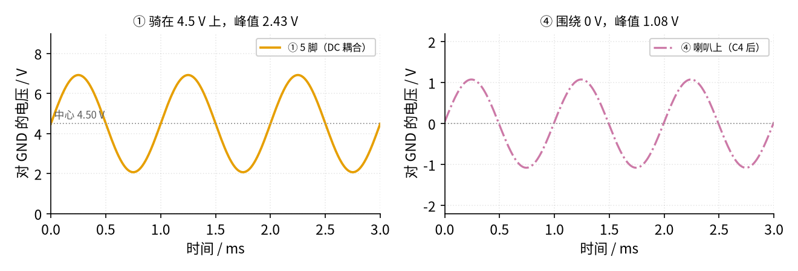

# 45 集成功放芯片与散热保护 · 动手实验篇

[上一页：参数与调试篇](page3.md) · [直觉篇](page1.md) · [原理与实现篇](page2.md) · [参数与调试篇](page3.md) · 本页：动手实验篇 · [下一页：返回目录](../README.md) · 前置节点：[43 推挽功放 · 动手实验篇](../43-push-pull-power-amp/page4.md)、[44 D 类功放 · 动手实验篇](../44-class-d-amp/page4.md)、[21 线性稳压 · 动手实验篇](../21-linear-regulator/page4.md)

## 这次实验要验证什么

本次用一颗 LM386N（8 脚插脚封装）搭一台手机小音箱：9 V 供电、增益 20，负载是 10 Ω / 2 W 电阻串 8 Ω 喇叭。选做部分换成 PAM8403 模块，看 BTL 输出的两端各在什么电压。分四个实验：

- **实验 A：静止状态。** 不放声音，验证 5 脚和 7 脚都约 4.50 V（电源的一半），电源电流约 4.3 mA，喇叭两端直流接近 0。
- **实验 B：放音。** 手机放 1 kHz 测试音、音量开满，验证 3 脚峰值约 0.121 V、5 脚交流峰值约 2.43 V、喇叭峰值约 1.08 V、电源电流约 47.2 mA。再插上 1、8 脚的 10 µF，听 2～3 秒增益 200 的削顶，然后把电位器关小到不削顶。喇叭朝下或朝墙放，离耳朵 50 cm 以上。
- **实验 C：温度。** 满音量连续放 5 分钟，用测温探头量 LM386 和 10 Ω 电阻。估算 LM386 只比室温高约 14 °C。这 5 分钟可以把喇叭换成 8 Ω / 2 W 电阻（芯片发热不变），或者戴上耳塞。
- **选做 D：PAM8403 模块。** 由 7805 稳压出 5 V 供电，手机信号同样先经 10 kΩ / 1 kΩ 分压和电位器；用万用表直流档量 L+、L− 对 GND 和两者之间的电压，体会 BTL 的「两端都在 2.5 V」。

## ⚠️ 安全须知

- **只用 9 V 直流电源，并限流 0.2 A**（实验室可调电源）。满音量时电源电流约 47 mA，0.2 A 足够。限流把**最坏情况下的总电流**限在 0.2 A 左右，能大大降低烧线、冒烟的风险，但它**挡不住**电源反接、电解电容接反，也挡不住直流进喇叭（这些在 0.2 A 以内照样会坏东西）。所以上电前一定按搭建步骤第 3 步，用万用表蜂鸣档逐项检查。LM386N-1 的绝对最大电源电压是 15 V，不要换更高的电源，也不要接市电。
- **散热与温度限值**：LM386 在本实验最多发热约 0.27 W，插脚封装估算温升约 14 °C，不用加散热片。但实验中一直用测温探头（万用表温度档配热电偶，或贴一只 NTC）盯着 LM386 和 10 Ω 电阻，**任何一处超过 60 °C 立刻断电**。不要用手摸。
- **喇叭保护**：喇叭必须串 10 Ω / 2 W 电阻；C4 220 µF 的正极朝 5 脚。**先接好喇叭再上电**；上电后先用万用表直流档量喇叭两端，**超过 50 mV 就断电检查**（多半是 C4 接反或漏电）。手机音量从 0 开始加。
- **保护耳朵**：1 kHz 测试音很尖，削顶时更刺耳。喇叭朝下或朝墙放，离耳朵至少 50 cm，不要贴耳听；实验 C 连续 5 分钟可以把喇叭换成 8 Ω / 2 W 电阻，或者戴耳塞；增益 200 的削顶演示只听 2～3 秒。
- **手机不能直接接 3 脚。** 手机满音量峰值约 1.48 V，是 LM386 输入上限 ±0.4 V 的 3.7 倍。一定经过 Ra、Rb 分压。选做 D 的 PAM8403 也一样要分压。
- **PAM8403 只能接 5 V。** 它的绝对最大电源电压只有 6 V，接 9 V 会坏。必须从 7805 取 5 V，7805 要装散热片，输入端就近接 0.33 µF。
- **BTL 输出的任何一端都不能接地。** PAM8403 的 L+、L−（模块上有时印作 L+ / L−、或 OUTL+ / OUTL−）只接 10 Ω 和喇叭。示波器地夹只夹 GND；要看喇叭两端，两只探头各接一端，用 MATH 看 CH1−CH2。
- **电流表的表笔插在 mA 或 10 A 孔时，这块表只当电流表用，绝不能拿去量电压**（等于把电源短路，会烧表里的保险）。选做 D 的电流表用 400 mA 档或 10 A 孔。
- **改线、换元件之前先断电。**

## 器材清单

| 元件 | 型号或数值 | 数量 | 说明 |
|---|---|---|---|
| 功放芯片 | LM386N-1 或 LM386N-3（DIP-8） | 1 | 不要用贴片模块，插脚的散热更好 |
| 电阻 | Ra 10 kΩ，Rb 1 kΩ | 各 1 | 输入分压 |
| 电位器 | RP B10k（10 kΩ 线性） | 1 | 音量；要线性（B 型），A 型（对数）的转角和分压比对不上 |
| 电解电容 | C1 100 µF / 16 V，C3 10 µF / 16 V，C4 220 µF / 16 V，C5 10 µF / 16 V | 各 1 | C5 插上增益 200，拔掉增益 20 |
| 瓷片电容 | C2 0.1 µF，Cz 47 nF | 各 1 | 电源退耦、吸收网络 |
| 电阻 | Rz 10 Ω（1/4 W） | 1 | 吸收网络 |
| 功率电阻 | 10 Ω / 2 W | 1 | 和喇叭串联 |
| 喇叭 | 8 Ω，≥ 0.5 W | 1 | |
| 音频线 | 3.5 mm 转杜邦线（或带耳机口的转接线） | 1 | 只用左声道和地 |
| 电源 | 9 V 可调限流电源 | 1 | 限流 0.2 A（选做 D 改 0.3 A） |
| 选做 D | PAM8403 模块、LM7805（TO-220）+ 散热片、0.33 µF、1 µF、22 µF / 16 V、10 Ω / 1 W 电阻 | 各 1 | 7805 输入端就近接 0.33 µF，输出端就近接 1 µF + 22 µF；输入分压 Ra、Rb、RP 沿用实验 A 的 |
| 仪表 | 万用表 ×2（一只串在电源线上作电流表，要有 200 mA 档；选做 D 用 400 mA 档或 10 A 孔）、测温探头、示波器（可选） | | |

## 搭建步骤

整机原理图见 [原理与实现篇](page2.md) 第一节；本页下面的图 45-p4-2 是同一张图加上了孔位。下面是它在面包板上的样子，请重点看图里标 ⑤ 的那根轨间黑线：

![LM386 功放面包板图：U1 LM386N（DIP-8）跨在中间槽上，占第 10 到 13 列，上排从左到右是 8、7、6、5 脚，下排是 1、2、3、4 脚；上方是 +9 V 轨（T+）和 GND 轨（T−），下方是 B+、B− 轨；9 V 直流电源（限流 0.2 A）的正极经电流表（直流 mA 档）接到 T+23，负极接 T−14；6 脚 a12 用红线拐到 T+13；C1、C2 在第 7、8 列跨接 T+ 和 T−；C3 从 a11（7 脚）接 T−11；2 脚 j11、4 脚 j13 分别用黑线接 B−11、B−13；⑤ 一根黑色长线从 T−22 绕到板子右侧再接 B−22，把上下两条 GND 轨连通；C4 从 b13 接到 b18，Rz 在 d13–d15，Cz 从 a15 接 T−15；a18 用橙色线引到板外右侧的 10 Ω / 2 W 电阻和 8 Ω 喇叭，喇叭回线接 T−23；下方信号源（手机，先把音量调到 0）的信号线用蓝线插 h2，地线接 B−1；Ra 在 g2–g5，Rb 从 j5 接 B−5，h5 到 h6 一根蓝色短线，RP 10 kΩ 占 f6/f7/f8，j8 接 B−8，滑动端 i7 用蓝线接到 i12（3 脚）；C5 在第 9 列 g9–d9，用两根绿色短线 c10→c9、h10→h9 接到 8 脚和 1 脚；黄色测量点：① a13 是 5 脚输出，② b11 是 7 脚，③ j12 是 3 脚输入，④ 在板外 10 Ω 和喇叭之间；图下方是元件表和测量点说明](img/45_p4_1_breadboard.png)

*图 45-p4-1　面包板接线图（电源、信号源、10 Ω 和喇叭在板外；⑤ 是上下 GND 轨的跨接线）*

图 45-p4-1 里，芯片的 4 脚、2 脚和输入分压都接在下方的 B− 轨，电源负极却接在上方的 T− 轨。面包板的上下两组电源轨在板内**不相通**，所以那根 ⑤ 黑线（T−22 → B−22）一定要插，不插的话芯片根本没有地，5 脚也不会是 4.5 V。另外注意，电源轨每 5 个孔一组，组和组之间的空档没有孔，6 脚的红线插 T+13、喇叭回线插 T−23，都是为了避开空档。

再看同一个电路的原理图，每个节点旁的灰色小字就是面包板上的孔位：

![对照原理图：左边信号源（手机）经 Ra 10 kΩ 到一个节点，节点经 Rb 1 kΩ 到地，再接 RP 10 kΩ 音量电位器到地，电位器滑动端接 LM386 的 3 脚同相输入；2 脚接地；6 脚接 +9 V（限流 0.2 A，串电流表），旁边 C1 100 µF 和 C2 0.1 µF 到地；4 脚接地；7 脚经 C3 10 µF 到地；1、8 脚之间是 C5 10 µF（拔掉 = 增益 20）；5 脚输出经 Rz 10 Ω 和 Cz 47 nF 到地，再经 C4 220 µF、10 Ω / 2 W 电阻到 8 Ω 喇叭，喇叭另一端接地；节点旁用灰色小字标出面包板孔位：信号 h2 → g2，信号地 → B−1，Ra、Rb 中点 g5/h5，Rb 下端 j5 → B−5，RP 三个脚 h6/f6、f7/i7、f8/j8 → B−8，3 脚 i12/f12，2 脚 f11/j11 → B−11，6 脚 e12/a12 → T+13，C1、C2 标 T+7/T−7、T+8/T−8，4 脚 f13/j13 → B−13，7 脚 e11/a11 → T−11，C5 左端（1 脚）f10/h10 → h9/g9，8 脚 e10/c10 → c9/d9，5 脚 e13/a13/b13/d13，Zobel 中点 d15/a15，Cz → T−15，C4 负端 b18/a18，喇叭回线 → T−23；黄色圆圈①在 5 脚，②在 7 脚，③在 3 脚，④在 10 Ω 和喇叭之间；底部说明所有 GND 符号最后都要回到电源负极，上轨 T−、下轨 B− 靠轨间黑线 T−22 → B−22 连通](img/45_p4_2_schem_lab.png)

*图 45-p4-2　对照原理图：节点旁标了面包板孔位，测量点编号和图 45-p4-1 一致*

> **对照看**：图 45-p4-2 里的每个节点，都能在图 45-p4-1 上找到对应的孔。
> - **电源**：原理图的「+9 V」= 电源正极经电流表到 T+23，再由 T+ 轨经 T+13 的红线到 6 脚 a12；C1、C2 插在 T+7/T−7、T+8/T−8。原理图里所有的 GND 符号 = T− 轨和 B− 轨，两者靠 ⑤ 黑线 T−22 → B−22 连在一起，电源负极接 T−14。
> - **输入**：手机信号 → h2 → Ra（g2–g5）→ 第 5 列下半（Rb 从 j5 到 B−5）→ h5–h6 蓝线 → RP 的一端 f6；RP 另一端 f8 经 j8 接 B−8；滑动端 f7 → i7 → 蓝线 → i12，就是 3 脚。
> - **芯片**：缺口朝左，下排从左到右是 1、2、3、4 脚（第 10～13 列 f～j 行），上排从左到右是 8、7、6、5 脚（第 10～13 列 a～e 行）。2 脚 j11 → B−11，4 脚 j13 → B−13。
> - **增益电容**：C5 不能直接插在 1、8 脚之间（被芯片挡住），所以放在第 9 列：8 脚 c10 → c9，1 脚 h10 → h9，C5 插 g9（+）和 d9。
> - **输出**：5 脚第 13 列上半 = 原理图的 5 脚节点；Rz 在 d13–d15，Cz 从 a15 到 T−15，就是块 5 吸收网络；C4 从 b13（+）到 b18，a18 引到板外的 10 Ω 和喇叭，喇叭回线插 T−23。
> - **测量点**：① a13（5 脚）、② b11（7 脚）、③ j12（3 脚）、④ 板外 10 Ω 和喇叭之间。

按下面的顺序，每一步验证通过再往下：

1. **断电搭电路**：照图 45-p4-1 插好芯片和阻容，C5 先**不插**（增益 20）。电解电容按图分清正负：C4 正极朝 5 脚，C3 正极朝 7 脚，C1 正极朝 +9 V。别忘了 ⑤ 黑线 T−22 → B−22。
2. **接好喇叭**：10 Ω / 2 W 电阻串 8 Ω 喇叭，接在 a18 和 T−23 之间。喇叭朝下或朝墙放。
3. **检查**（不通电，万用表蜂鸣档）：T+ 轨和 T− 轨之间不通、T+ 轨和 B− 轨之间也不通；6 脚 a12 通 T+ 轨；4 脚 j13 通电源负极接线处 T−14（这一步同时验证了 ⑤ 黑线）；喇叭两端接线不碰 5 脚。限流挡不住接错，这一步不能省。
4. **手机音量调到 0**，电流表（直流 mA 档）串在 9 V 电源正极和 T+23 之间，再上电，做实验 A。
5. 手机放 1 kHz 测试音，音量慢慢开满，做实验 B；之后连续放 5 分钟做实验 C（可换 8 Ω / 2 W 电阻代替喇叭，或戴耳塞）。
6. 断电，插上 C5，手机音量 0 再上电，慢慢加音量，听 2～3 秒削顶；然后关小电位器到声音干净。

## 测量表

电压都用一块万用表量；电源电流用另一块串在电源线上的表量。**表笔插在 mA 孔的那块表只当电流表，不许拿去量电压。**

### 实验 A：静止状态（手机音量 0）

| 步骤 | 测什么 | 红表笔 | 黑表笔 | 挡位 | 应该读到 | 读不到时先查 |
|---|---|---|---|---|---|---|
| A1 | ① 5 脚静态电压 | a13（5 脚） | T− 轨（GND） | DC 20 V | 约 4.50 V | 6 脚是否有 9 V；4 脚是否通电源负极；⑤ 黑线 T−22 → B−22 有没有插 |
| A2 | ② 7 脚静态电压 | b11（7 脚） | T− 轨（GND） | DC 20 V | 约 4.50 V | C3 极性；7 脚是否插紧 |
| A3 | 静态电流 | 电流表串联：红表笔（插 mA 孔）接电源正极一侧 | COM 接 T+23 一侧 | DC 200 mA | 约 4.3 mA（一般在 4～8 mA） | 0：电源线、6 脚红线 T+13；明显超过 8 mA：自激，查 Rz、Cz |
| A4 | 喇叭两端直流 | ④（10 Ω 和喇叭之间） | 喇叭回线 T−23 | DC 200 mV | 接近 0，**必须小于 50 mV** | 超过就断电：C4 极性、是否漏电 |

### 实验 B：放音（手机 1 kHz、满音量，增益 20）

交流档读的是有效值，乘 √2 是峰值；有示波器就直接读峰值。**注意交流档的频率范围**：不少入门万用表的交流档只标到 400 Hz 或 1 kHz 以内，1 kHz 的读数可能偏低。先看说明书；不够的话以示波器为准，或者手机改放 400 Hz 测试音，或者只看 ①÷③、④÷① 的比值（同一块表测，误差会抵消）。

| 步骤 | 测什么 | 红表笔 | 黑表笔 | 挡位 | 应该读到 | 读不到时先查 |
|---|---|---|---|---|---|---|
| B1 | ③ 3 脚输入 | j12（3 脚） | B− 轨（GND） | AC 2 V | 有效值 0.0858 V（峰值 0.1213 V） | 手机音量和 RP 是否开满；Ra、Rb 是否插对位置 |
| B2 | ① 5 脚交流部分 | a13（5 脚） | T− 轨（GND） | AC 20 V | 有效值 1.715 V（峰值 2.426 V，在 4.50 V 上下摆） | B2 ÷ B1 应约 20；不是的话查 1、8 脚之间有没有插东西 |
| B3 | ④ 喇叭上 | ④ | 喇叭回线 T−23 | AC 2 V | 有效值 0.762 V（峰值 1.077 V） | C4 是否接好；10 Ω 和喇叭是否串对 |
| B4 | 电源电流 | 同 A3 | 同 A3 | DC 200 mA | 约 47.2 mA | 明显更大：削顶或自激 |

预期值按手机满音量峰值 1.48 V 算。不同手机的满音量差别很大，所以③如果偏了，后面几项会按同样比例偏；重点看比值：①的交流部分 ÷ ③ 应约 20，④ ÷ ① 的交流部分应约 8 ÷ 18 = 0.444。



*图 45-p4-3　示波器上应该看到什么（SPICE，手机满音量、增益 20）*

图 45-p4-3 的左图用示波器的直流耦合看：波形的中心在 4.5 V，说明芯片的输出中点正常；右图是 C4 之后，直流被挡掉，只剩交流。两个峰值之比 1.08 ÷ 2.43 ≈ 0.444，正好是 8 Ω 在 18 Ω 里占的比例。

### 实验 B 追加：增益 200

插上 C5 后同样的满音量会被削顶（参数与调试篇算过：增益 200 时 3 脚超过 16.75 mV 就削顶），只听 2～3 秒就关小，5 脚在约 1.15 V 和 7.85 V 之间跳，声音又破又响。把电位器关到大约十分之一：SPICE 里 3 脚只剩 12.1 mV，5 脚峰值 2.408 V，声音重新变干净。

### 选做 D：PAM8403 模块

PAM8403 的最大增益约 24 dB（15.85 倍），数据手册第 7 页的应用说明特别提醒：输入太大会削顶，还可能损坏芯片。手机满音量（峰值 1.48 V）直接接进去，输出会削成 ±5 V 的方波：喇叭和 10 Ω 一共 18.32 Ω（含芯片内阻），电流约 0.273 A，喇叭约 0.596 W，超过常见 0.5 W 小喇叭的额定值，10 Ω 电阻约 0.745 W；9 V 电源要给约 0.297 A，正好顶到 0.3 A 限流，7805 发热约 1.228 W，不加散热片温升约 66 °C。所以选做 D 的输入**沿用实验 A 的 10 kΩ / 1 kΩ 分压和 RP 电位器**：算上模块的输入电阻（手册 p.7：最大增益时 RI = 18 kΩ。从模块 L 端往回看，外部分压相当于约 0.123 V 的源串约 0.83 kΩ 内阻，它和 RI 再分一次压），满音量时输入峰值约 117.9 mV，差分输出峰值约 1.868 V，喇叭峰值约 0.816 V、约 41.6 mW，很安全。要把输出推到 5 V，输入峰值得到约 315 mV，分压后的手机信号够不着。

按下面的原理图接线，节点旁写的是模块上的端子名和 7805 的引脚号：

![PAM8403 选做 D 原理图：最左边 9 V 直流电源（限流 0.3 A）经一块电流表（400 mA 档或 10 A 孔）接到 LM7805 的 1 脚 IN，IN 到地接 0.33 µF；LM7805 方框标「＋散热片」，引脚 1 IN、2 GND、3 OUT，下方注明 TO-220 正面（字朝自己）从左到右是 IN – GND – OUT；OUT 输出 5 V，就近接 1 µF 和 22 µF（有极性）到地，再接到 PAM8403 模块的 5V 端，模块 GND 接地；模块输入端子 L、G、R（R 不接）；手机耳机口 L 经 10 kΩ、1 kΩ 分压和 RP 10 kΩ 电位器接模块 L，手机 GND（线的根部那一节）接模块 G；模块输出端子 L+、L−、R+ / R−（不接）；L+ 经 10 Ω / 1 W 电阻接 8 Ω 喇叭（≥ 0.5 W），喇叭另一端回到 L−；红字警告 L− 不接 GND，BTL 的 L+、L− 都在 2.5 V 附近跳；黄色测量点 ① 在 L+，② 在 L−；底部说明：电压表用另一块表 DC 20 V 档，黑表笔接模块 GND，红表笔点 ① L+、② L−，再红 ①、黑 ② 量喇叭两端；插在 mA / 10 A 孔的那块表只当电流表，不许拿去量电压；带 10 kΩ / 1 kΩ 分压时手机满音量喇叭约 42 mW](img/45_p4_4_schem_lab.png)

*图 45-p4-4　选做 D 原理图：7805 稳压、PAM8403 模块、输入分压和 BTL 喇叭接法*

> **对照看**：图 45-p4-4 里的每个节点都对应一个实际的接线点。
> - **7805**：把 TO-220 有字的一面朝向自己，从左到右三只脚是 1 IN、2 GND、3 OUT。IN 接 9 V（经电流表），0.33 µF 紧贴 IN 和 GND 两脚；OUT 和 GND 之间就近接 1 µF 和 22 µF（22 µF 正极接 OUT）。散热片装在背面金属片上，金属片和 GND 脚相通。
> - **模块供电**：7805 的 OUT 接模块的「5V」端子，7805 的 GND、9 V 电源负极、模块「GND」、手机地全部接在一起。
> - **输入**：手机 L → 10 kΩ → 节点（经 1 kΩ 到地）→ RP 两端 → 滑动端接模块「L」；手机地接模块「G」（模块的 G 在板内就是 GND，所以手机地和系统地是连通的，不用另外接）。模块的「R」不接。
> - **输出**：模块「L+」→ 10 Ω / 1 W → 喇叭 → 回到模块「L−」。L+、L− 都**不接** GND，「R+ / R−」不接。
> - **测量点**：① 是 L+ 端子，② 是 L− 端子，黑表笔都放在模块 GND。

接线后手机音量先调到 0、RP 也转到 0，再上电。

| 步骤 | 测什么 | 红表笔 | 黑表笔 | 挡位 | 应该读到 | 读不到时先查 |
|---|---|---|---|---|---|---|
| D1 | 7805 输出 | 7805 的 3 脚 OUT | 模块 GND | DC 20 V | 约 5 V | 7805 引脚顺序 IN–GND–OUT；IN 有没有 9 V |
| D2 | ① L+ 对 GND | L+ | 模块 GND | DC 20 V | 约 2.5 V（0/5 V 方波的平均） | 模块 5V 端是否有 5 V |
| D3 | ② L− 对 GND | L− | 模块 GND | DC 20 V | 约 2.5 V | 读到 0 V：L− 被接到了 GND，立刻断电 |
| D4 | 喇叭两端 | ① L+ | ② L− | DC 200 mV | 接近 0（手册失调典型 10 mV） | 喇叭、10 Ω 是否接在 L+ 和 L− 之间 |
| D5 | 9 V 电源电流（静音） | 电流表串联：红表笔（400 mA 档的 mA 孔，或 10 A 孔）接电源正极一侧 | COM 接 7805 IN 一侧 | DC 400 mA（或 10 A） | 不超过约 24 mA（PAM8403 静态 16 mA + 7805 静态最多 8 mA；模块上的指示灯另算） | 明显更大：输出短路、L− 接地、7805 接反 |

万用表直流档读的是平均值，所以能读到 2.5 V；交流档在这里不准，不要用它量 L+、L−。放音时把 RP 从 0 慢慢往上转，听到声音就够了，喇叭仍然朝下、离耳朵 50 cm 以上。

## 没有示波器怎么办

- **直流档最可靠。** 实验 A 的所有项目、选做 D 的所有项目都只用直流档。
- **交流档量正弦。** 本实验的放大器是线性的，手机放 1 kHz 测试音时③、④都是正弦，交流档读到的有效值乘 √2 就是峰值（前提是表的交流频率范围覆盖 1 kHz，见测量表上方的提醒）。注意要量 5 脚的交流部分时，用交流档就会自动去掉 4.5 V 直流。
- **电流表看削顶。** 削顶时电源电流会明显上升，声音也会变破。
- **耳朵听**：嗡声（7 脚电容没接）、破音（削顶）、低音没了（C4 太小）都能听出来，对照参数与调试篇的排错表。

## 用 Python 核对你的读数

断电后把 Ra、Rb、RP 拔下来量实际阻值，再把电源电压和实验 A、B 的读数填进去。程序用你的实测阻值算出应读到的数，偏差超过 10% 的会被标出来。程序不读写任何文件，在仓库根目录运行。

```python
import sys, pathlib
sys.path.insert(0, str(pathlib.Path("code/figs").resolve()))  # 在仓库根目录运行

# ===== 把下面换成你自己的实测值（这里是一组示例） =====
VS = 9.0                        # 实测电源电压 / V
RA, RB, RP = 9.93e3, 0.998e3, 10.1e3   # 实测 Ra、Rb、RP 总阻值 / Ω
R10 = 10.1                      # 实测串联电阻 / Ω（喇叭按标称 8 Ω 算）
V_PHONE = 1.46                  # 手机满音量峰值：Ra 左端交流档读数 × √2 / V
mine = {"V5_dc": 4.43, "V7_dc": 4.47,           # 实验 A：5 脚、7 脚 / V
        "V3_pk": 0.118, "V5_pk": 2.37, "Vspk_pk": 1.03}   # 实验 B：峰值 / V
I_IDLE_mA, I_PLAY_mA = 4.6, 45.9                # 实验 A、B 的电源电流 / mA
V_DC_SPK_mV = 6.0                               # 实验 A：喇叭两端直流 / mV

R_IN, RSPK, GAIN = 50e3, 8.0, 20                # 3 脚内部到地 50 kΩ（手册 §9.2.1.2.2）、喇叭标称、增益
r_low = 1 / (1 / RB + 1 / RP + 1 / R_IN)        # Rb ∥ RP ∥ 50 kΩ
k = r_low / (RA + r_low)                        # 分压比（标称值时 0.08197）
exp = {"V5_dc": VS / 2, "V7_dc": VS / 2,
       "V3_pk": V_PHONE * k,                    # 用你的阻值和手机电平算
       "V5_pk": GAIN * mine["V3_pk"],           # 用你量到的 3 脚算
       "Vspk_pk": mine["V5_pk"] * RSPK / (R10 + RSPK)}  # 用你量到的 5 脚算
print(f"分压比 {k:.5f}")
for key, v in mine.items():
    w = exp[key]
    flag = "OK" if abs(v - w) / w <= 0.10 else "偏差超过 10%，先查测量表最后一列"
    print(f"{key:8s} 应读 {w:7.4f}，你读到 {v:7.4f} → {flag}")
print(f"静态电流 {I_IDLE_mA} mA", "（正常）" if 4 <= I_IDLE_mA <= 8 else "（不在 4～8 mA，查自激或芯片）")
print(f"喇叭直流 {V_DC_SPK_mV:.1f} mV", "（超过 50 mV，立刻断电检查 C4！）" if abs(V_DC_SPK_mV) > 50 else "（正常）")
pl = mine["Vspk_pk"] ** 2 / (2 * RSPK)                     # 喇叭功率 / W
pr = (mine["Vspk_pk"] * R10 / RSPK) ** 2 / (2 * R10)       # 串联电阻功率 / W
ps = VS * I_PLAY_mA / 1000                                 # 电源功率 / W
print(f"电源 {ps:.3f} W，喇叭 {pl * 1e3:.1f} mW，10 Ω {pr * 1e3:.1f} mW，芯片约 {ps - pl - pr:.3f} W（SPICE 0.261 W）")
```

示例读数运行后应全部显示 OK。3 脚偏了，后面几项会按同样比例偏，所以程序用你量到的上一级读数去算下一级，这样哪一级出问题一眼就能看出来。静态电流不在 4～8 mA 也不一定是芯片坏：手册只给了 6 V 时典型 4 mA、最大 8 mA，单颗芯片可能差不少，先排查自激。

## 实验记录表

| 实验 A | 读数 | 预期 | 偏差 / % |
|---|---|---|---|
| ① 5 脚 / V | | 4.50 | |
| ② 7 脚 / V | | 4.50 | |
| 静态电流 / mA | | 4.3 | |
| 喇叭两端直流 / mV | | 接近 0（要求小于 50） | — |

| 实验 B | 读数 | 预期 | 偏差 / % |
|---|---|---|---|
| ③ 3 脚峰值 / V | | 0.1213 | |
| ① 5 脚交流峰值 / V | | 2.426 | |
| ④ 喇叭峰值 / V | | 1.077 | |
| 电源电流 / mA | | 47.2 | |
| 增益 200 时不削顶的电位器位置 | | 约 14% 以下 | — |

| 实验 C：时间 / min | LM386 / °C | 10 Ω 电阻 / °C | 室温 / °C |
|---|---|---|---|
| 0 | | | |
| 1 | | | |
| 3 | | | |
| 5 | | | |

实验 C 手机满音量。SPICE 算出芯片发热约 0.261 W，插脚封装估算温升约 14 °C；10 Ω 电阻上约 90.7 mW，几乎不热。面包板散热比手册的测试板差，实测高几度是正常的；超过 60 °C 立刻断电。

| 选做 D | 读数 | 预期 |
|---|---|---|
| 7805 输出 / V | | 约 5 |
| L+ 对 GND / V | | 约 2.5 |
| L− 对 GND / V | | 约 2.5 |
| L+ 到 L− / mV | | 接近 0 |
| 9 V 电源电流（静音）/ mA | | 不超过约 24 |

## 思考题

**1.** 实验 A 里电流表读约 4 mA，可芯片「什么也没放大」。这 9 V × 4.3 mA 约 39 mW 去哪儿了？如果整天开着不放音乐，换成 PAM8403 + 7805 会更省电吗？

<details><summary>答案</summary>

全部变成芯片里的热，给内部的偏置电路和输出级的静态电流用了。PAM8403 + 7805 静态约 16 + ≤8 mA，最多约 24 mA，从 9 V 取约 0.2 W，比 LM386 的 39 mW 多得多。D 类在大功率时效率高，静止和小音量时反而不省电。

</details>

**2.** 有同学觉得 10 Ω 电阻白白分走了功率，把它去掉、直接接 8 Ω 喇叭。芯片最多发热多少？插脚封装和贴片封装的温升各多少？

<details><summary>答案</summary>

9 V、8 Ω 时最大发热约 0.552 W；插脚封装（53.4 °C/W）温升约 29.5 °C，贴片封装（115.7 °C/W）约 63.8 °C。发热翻了一倍多，而且喇叭一旦出问题，没有电阻替它扛。

</details>

**3.** 选做 D 里，有同学想用示波器看 PAM8403 喇叭两端，把地夹夹在 L− 上。会发生什么？正确做法是什么？

<details><summary>答案</summary>

地夹经示波器电源线接大地，电路 GND 往往也接大地，地夹夹在 L− 上就把 L− 短到了 GND。L− 那个半桥的上管每次导通，5 V 都直接对地短路。PAM8403 会检测到短路并关输出，短路去掉后自己恢复，所以你可能只看到声音断断续续。正确做法：两只探头各接 L+、L−，地夹都夹 GND，用 MATH 看 CH1−CH2。

</details>

**4.** 如果把 PAM8403 模块直接接到 9 V 电源上会怎样？为什么 7805 一定要加散热片？

<details><summary>答案</summary>

PAM8403 的绝对最大电源电压是 6 V，接 9 V 很可能直接损坏，它的欠压、过温保护都救不了过压。7805 在 PAM8403 单声道满幅时要扛约 0.682 W（静态电流按最大 8 mA），TO-220 不加散热片的热阻 54 °C/W，温升约 36.8 °C；两个声道一起开大时还会更多。

</details>

## 自测清单

- [ ] 我能说出 LM386 的增益 20 和 200 是怎么来的，以及 1、8 脚的电容起什么作用。
- [ ] 我能解释 5 脚静止时为什么在 4.5 V，以及为什么喇叭前面要串 220 µF。
- [ ] 我知道手机为什么不能直接接 3 脚，能算出分压后的电压。
- [ ] 我能用 $P_{D,max}$ 公式和热阻算出温升，并知道最大发热不在最大音量处。
- [ ] 我能说出 LM386、PAM8403、TPA3116D2 三颗芯片的保护各是什么。
- [ ] 我知道 PAM8403 只能用 5 V，BTL 输出的任何一端都不能接地。
- [ ] 我知道温度只用测温探头量，超过 60 °C 就断电。

## 全部节点到这里结束

这是本教程的最后一个节点。从电阻、运放、三极管一路走到集成功放，你已经能看懂一颗功放芯片的数据手册：先看绝对最大值，再看推荐工作条件，然后算发热、查热阻、看保护。回到 [目录](../README.md) 可以挑任何一节重新复习。

## 参考资料

- TI LM386 数据手册 SNAS545D（引脚、典型电路、绝对最大值、热阻）：<https://www.ti.com/lit/ds/symlink/lm386.pdf>
- Diodes PAM8403 数据手册 DS36439（5 V 供电、绝对最大 6 V、静态电流、短路保护、最大增益 24 dB、p.7 应用说明「输入过大会削顶并可能损坏」）：<https://www.diodes.com/assets/Datasheets/PAM8403.pdf>
- TI LM7800 系列数据手册 SNOSBT0L（TO-220 热阻 54 °C/W〔绝对最大值注 (3)〕、LM7805 静态电流 25 °C 最大 8 mA、测试电路输入 0.22 µF / 输出 0.1 µF）：<https://www.ti.com/lit/ds/symlink/lm7800.pdf>
- 苹果 USB-C 耳机转接头输出电平实测（满音量最大输出约 1.05 V、输出阻抗约 0.9 Ω）：<https://doineedanamp.com/sources/iphone-usb-c/>
- Pico Technology：差分探测与示波器接地安全：<https://www.picotech.com/library/articles/application-note/how-true-differential-scope-inputs-boost-probing-safety-and-precision>
