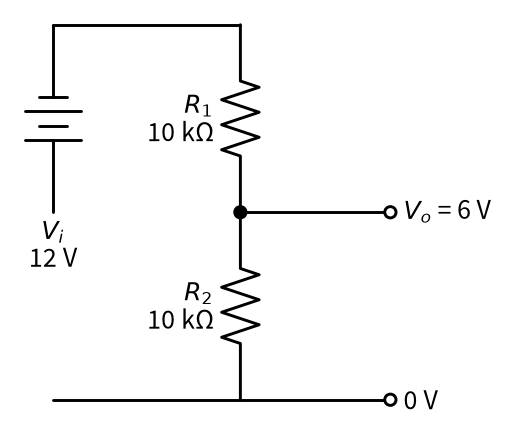
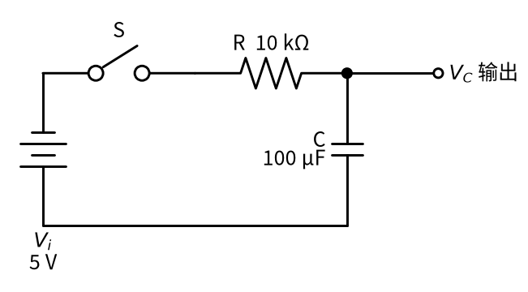
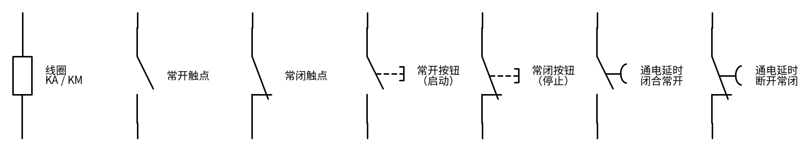
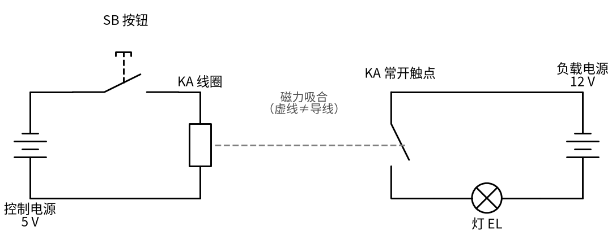

# P1 元件速成 · 直觉篇

[上一页：总纲](../README.md) · 本页：直觉篇 · [原理与实现篇](page2.md) · [参数与调试篇](page3.md) · [下一页：原理与实现篇](page2.md) · 前置节点：无（这是全书的起点）

## 为什么要先学这一页

高中物理里，我们学过电阻、欧姆定律、串联和并联，也见过电容器和线圈。但一打开真实的电路图，马上就会遇到三个"卡脖子"的问题：

1. 图上到处都是"两个电阻串起来，中间引出一根线"，这根线上的电压到底是多少？
2. 电容和电阻接在一起，为什么灯不是马上亮、而是慢慢亮？"延时""滤波""消抖"这些词背后是同一件事吗？
3. 继电器、接触器的线圈和触点为什么画在电路图的两个地方？按下一个小按钮，怎么就能让另一边的大电机转起来？

后面 26 个节点里，几乎每一个都要用到这一页的结论。所以这一页不追求面面俱到，只抓四样东西：**电阻分压、电容、电感、开关与继电器**。每样东西先给一个生活里的类比，再给一张电路图，最后用一句话总结。

## 一、电阻分压：两段水管分水压

把电源想成水塔，电压就是水压，电流就是水流，电阻就是一段细水管。两段细水管串起来，水从高处流到低处，中间那个接口的水压，一定介于两头之间；哪一段水管更细（电阻更大），水压就在哪一段"掉"得更多。

下面的 图 P1-p1-1 就是最常见的分压电路：12 V 电源上串联两个 10 kΩ 电阻，从中间引出输出端。

*图 P1-p1-1　电阻分压电路（输入 12 V，两个电阻都是 10 kΩ，输出 6 V）*

图 P1-p1-1 里，左边是输入电压 $V_i$ （电源电压），中间那个黑点引出的就是输出电压 $V_o$ 。两个电阻一样大，电压就被平分，输出正好是一半：6 V。如果把下面的电阻换大，输出就会升高；换小，输出就会降低。记住一个前提：**输出端不能接太"重"的负载**，否则负载会和下面的电阻并联，把输出电压拉低——这一点在原理篇会算给你看。

## 二、电容：一只会慢慢装满的水桶

电容可以想成一只水桶，桶里的水位就是电容两端的电压。往桶里灌水要经过一根细水管（电阻）：一开始桶是空的，水位低，水压差大，水流得很快；水越装越满，水压差越来越小，水流也越来越慢。所以电容的电压**不能突然跳变**，只能一点一点地涨上去，而且越到后面涨得越慢。

图 P1-p1-2 是最简单的 RC 充电电路：开关 S 合上以后，5 V 电源通过 10 kΩ 电阻给 100 μF 电容充电。

*图 P1-p1-2　RC 充电电路（电源 5 V，R=10 kΩ，C=100 μF）*

在 图 P1-p1-2 中，电容电压记作 $V_C$ 。电阻和电容的乘积叫做**时间常数**，写作 $\tau = RC$ （希腊字母 τ 读作"陶"），这里 τ = 10 kΩ × 100 μF = 1 s。经验结论只有两条：过了 1 个 τ，电容充到电源电压的约 63%；过了 5 个 τ，充到 99% 以上，工程上就当它"充满了"。放电也一样，只是方向反过来。

初学者最常犯的两个错误是：**把电容当电阻算**（以为它有一个固定的"阻值"，直接用欧姆定律去除），以及**以为电容一接上就瞬间充满**。实际上电容电压是"攒"出来的，攒得快慢由 τ 决定。

## 三、电感：水管里的一个大飞轮

电感（线圈）的脾气和电容正好相反。想象水管中间装了一个很重的飞轮，水流推着它转。水流想突然变大，飞轮转不快，拖住水流；水流想突然停下，飞轮却靠惯性继续转，反过来推着水往前冲。所以**电感里的电流不能突变**。

最危险的情况是"突然断电"：开关一断开，电流没路可走，可电感偏要维持原来的电流，于是在线圈两端憋出一个很高的电压尖峰，可能把开关、三极管击穿。继电器、接触器的线圈都是电感，所以驱动它们的电路里常常反向并联一只"续流二极管"，给电流留一条退路。

## 四、开关、按钮、继电器和接触器

开关和按钮最好理解：手动把电路接通或断开。按钮按下才动作、松手就复位。按"平时是什么状态"分两种：**常开**（平时断开，按下才接通）和**常闭**（平时接通，按下才断开）。图 P1-p1-3 把后面控制电路里会用到的符号画在了一起。

*图 P1-p1-3　线圈与触点的图形符号（国标画法）*

图 P1-p1-3 从左到右依次是：线圈（矩形框）、常开触点、常闭触点、常开按钮（多一根虚线推杆）、常闭按钮，以及时间继电器的两种延时触点（多一个半圆弧，像一顶小降落伞，表示"慢慢动作"）。常闭触点右端那根竖直的小挡头，就是它"平时压在一起"的标志。

**继电器**是"用小电流控制大电流"的开关：给线圈通电，线圈变成电磁铁，把衔铁吸过去，带动触点闭合或断开。**接触器**是大号的继电器，触点能通断电动机那样的大电流，结构上分为主触点、辅助触点和线圈三部分，而且线圈电压常常和主触点所接的电压不一样。关键在于：**线圈和触点之间没有电线相连**，它们只靠磁力和机械联动发生关系，所以在电路图上分别画在两个独立的回路里，用同一个文字符号（例如 KA、KM）表示它们属于同一个元件。看 图 P1-p1-4。

*图 P1-p1-4　继电器把电路分成两个回路：控制回路（左）和负载回路（右）*

图 P1-p1-4 左边是控制回路：按下按钮 SB，5 V 电源让 KA 线圈通电；右边是负载回路：KA 的常开触点被吸合，12 V 电源点亮灯 EL。中间的灰色虚线只表示"磁力吸合"，**不是导线**。新手常见的错误就是把触点和线圈画进同一个回路，结果画出来的图根本不能工作。后面的自锁（17）、互锁（18）、星三角启动（19）都建立在这张图的思路上。

> [!WARNING]
> 实际的接触器主触点常常接 220V/380V 市电。本页和本节点的所有仿真与实验都只用 12V 以下的低压电源；任何接触市电的接线都必须断电、验电后由持证电工完成。

## 一句话总结

**电阻按比例分电压，电容攒电压（τ = RC，5τ 充满），电感保电流（断电会冒高压尖峰），继电器用线圈的磁力去拨动另一个回路里的触点。**
