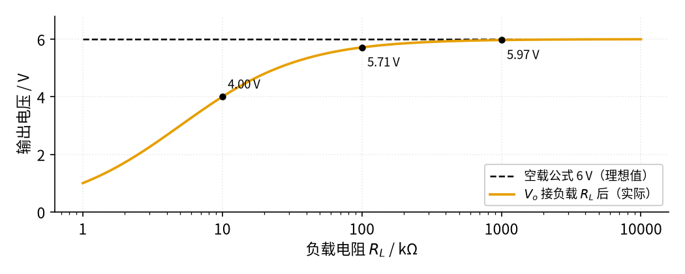
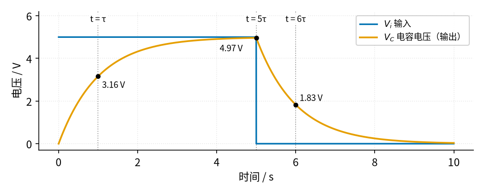
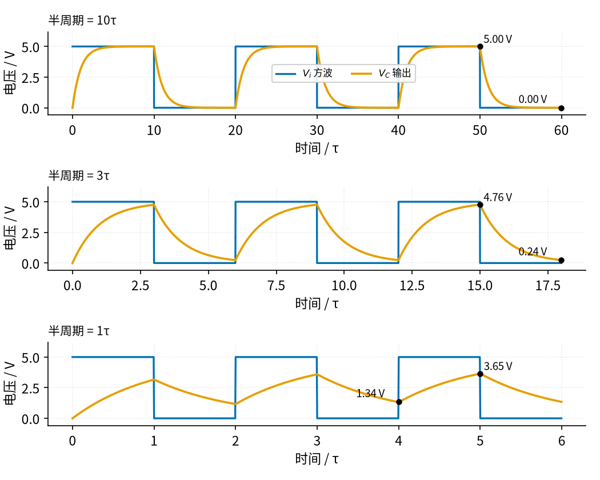
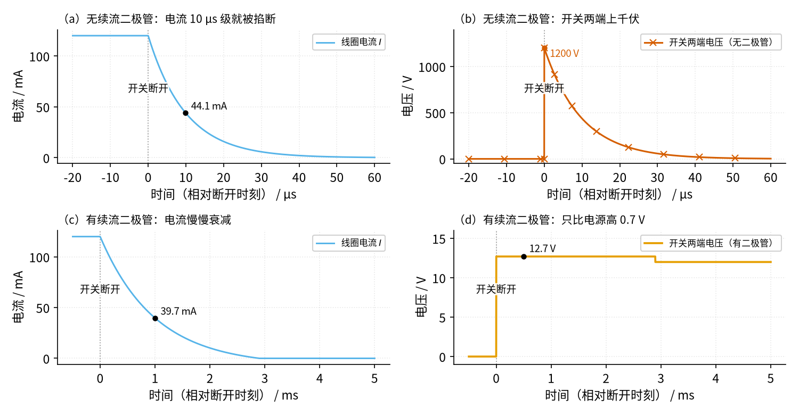
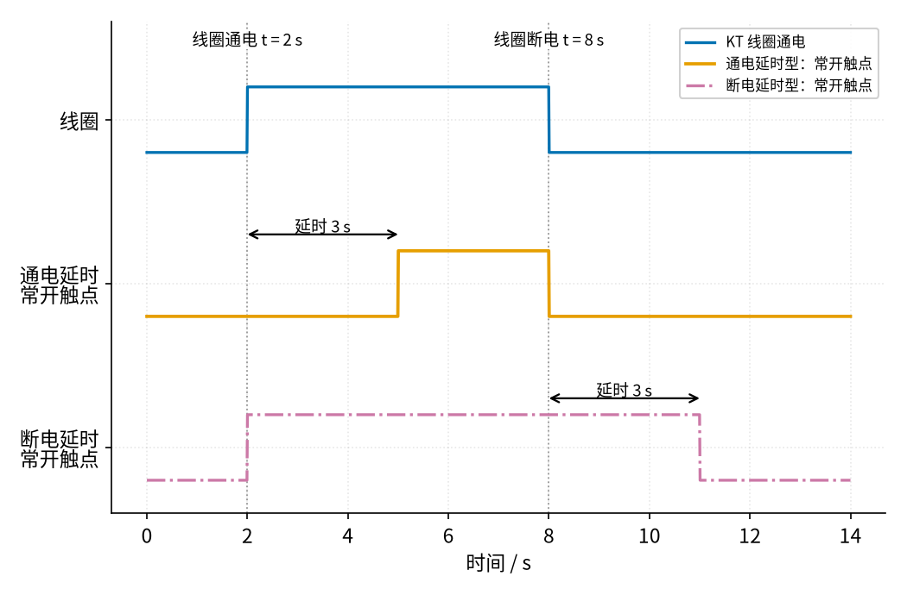
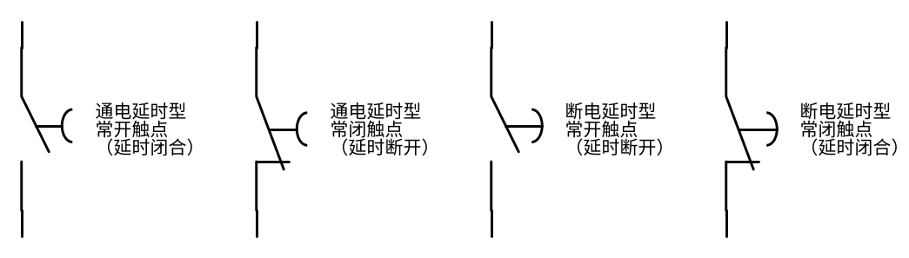
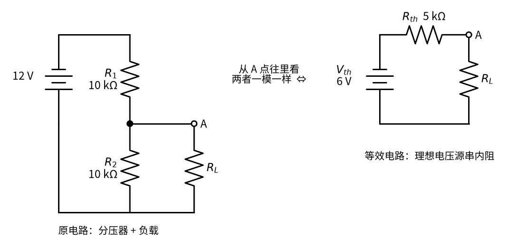

# P1 元件速成 · 原理与实现篇

[上一页：直觉篇](page1.md) · [直觉篇](page1.md) · 本页：原理与实现篇 · [参数与调试篇](page3.md) · [下一页：参数与调试篇](page3.md) · 前置节点：无

## 先补一点最小知识

本页要用到三个高中物理就有的概念，先统一一下说法：

- **电荷量** $Q$ （单位库仑 C）：电容里"攒"了多少电。电容的定义就是 $Q = C \cdot V$ ：电容 $C$ （单位法拉 F）越大，同样的电压能存越多的电荷。
- **电流** $I$ （单位安培 A）：每秒流过的电荷量。电流乘以时间，就是这段时间里流过的电荷。
- **斜率**：一条曲线"有多陡"，也就是"每过一小段时间，数值变了多少"。本页不用微积分，凡是"变化率"都理解成"一小段时间里变了多少 ÷ 这段时间"。

符号约定：输入电压 $V_i$ ，输出电压 $V_o$ ，电容两端电压 $V_C$ ，时间 $t$ ，时间常数 $\tau$ 。

## 一、分压公式：从欧姆定律两步推出来

**中文意思**：两个电阻串联，流过它们的是同一个电流；每个电阻分到的电压和它的阻值成正比。

**写成公式**：串联电路的电流是 $I = \dfrac{V_i}{R_1 + R_2}$ ，下面那个电阻 $R_2$ 两端的电压就是输出：

$$V_o = I \cdot R_2 = V_i \cdot \frac{R_2}{R_1 + R_2}$$

**代数验证**：用直觉篇分压电路图的数值， $V_i$ =12 V， $R_1 = R_2$ =10 kΩ，得 $V_o$ = 12 × 10 / 20 = 6 V。

这个公式有一个容易被忽略的前提：**输出端没有电流流出**（空载）。一旦输出端接了负载电阻 $R_L$ ，负载就和 $R_2$ 并联，要先算出并联后的等效电阻 $R_2 \parallel R_L = \dfrac{R_2 R_L}{R_2 + R_L}$ ，再代回分压公式。TI 的应用笔记（[SLAA067](https://www.ti.com/lit/an/slaa067/slaa067.pdf)）专门提醒过：很多人在负载比下电阻大 10 倍时就把负载忽略掉，但误差最多可以接近 10%（上电阻远大于下电阻时最糟）；本例两个电阻相等，误差约 5%。为什么是这两个数，本页第七节用「内阻」的眼光一算就清楚。下面的 图 P1-p2-1 先把这件事画出来。



*图 P1-p2-1　接负载以后的分压输出（输入 12 V，两个分压电阻都是 10 kΩ）*

图 P1-p2-1 中黑色虚线是空载公式给出的理想值 6 V，橙色曲线是接上负载 $R_L$ 后的实际输出。负载等于 10 kΩ 时输出只有 4.00 V，掉了三分之一；负载是 100 kΩ（10 倍）时输出 5.71 V，误差约 5%；负载到 1 MΩ 才几乎看不出差别。所以分压电路只适合给"几乎不取电流"的地方提供电压，例如运放的输入端、比较器的门限（比较器是把两个电压比大小、输出高或低的芯片，门限就是它拿来比的那个参考电压，见 [14 电压比较器 · 直觉篇](../14-voltage-comparator/page1.md)）；要给别的电路"供电"，就得用后面的稳压电路。

## 二、电容：电流对应斜率，电压对应"攒下的面积"

**中文意思**：流进电容的电荷越多，电容电压越高；电流大，电压就涨得快。

**写成公式**：在很短的时间 $\Delta t$ 里，流进电容的电荷是 $I \cdot \Delta t$ ，电压就上涨

$$\Delta V_C = \frac{I \cdot \Delta t}{C}$$

反过来读就是 $I = C \cdot \dfrac{\Delta V_C}{\Delta t}$ ：**电容电流正比于电压曲线的斜率**。电压不变（斜率为 0），电流就是 0，所以直流稳定以后电容相当于断开；电压要"突然跳变"（斜率无穷大），就需要无穷大的电流，这在现实中做不到，所以电容电压不能突变。把每一小段的 $I \cdot \Delta t$ 加起来，就是电流曲线下的"面积"，所以也可以说：**电容电压的变化 = 电流曲线下的面积 ÷ C**。后面的积分电路（12）和微分电路（13）正是利用这两句话。

**RC 充电为什么是"先快后慢"**：在直觉篇的 RC 充电电路图里，电阻两端的电压是 $V_i - V_C$ ，所以充电电流是

$$I = \frac{V_i - V_C}{R}$$

一开始 $V_C$ =0，电流最大，电压涨得最快；随着 $V_C$ 接近 $V_i$ ，电流越来越小，电压涨得越来越慢。把这个过程一小段一小段算下去，结果可以写成一个指数公式：

$$V_C(t) = V_i \cdot \left( 1 - e^{-t/\tau} \right), \quad \tau = RC$$

这里 $e \approx 2.718$ 是自然常数。代入几个时刻（与 ADI 的 [ADALM1000 RC 实验教程](https://www.analog.com/en/resources/analog-dialogue/studentzone/studentzone-april-2018.html) 给出的表格一致）：

| 时间 | 1τ | 2τ | 3τ | 4τ | 5τ |
|---|---|---|---|---|---|
| 充到电源电压的百分比 | 63.2% | 86.5% | 95.0% | 98.2% | 99.3% |

换个角度读这张表：每过 1 个 τ，离终点（5 V）的差距就缩小到上一刻的约 37%。差距依次是 100% → 36.8% → 13.5% → 5.0% → 1.8% → 0.7%，正好是 100% 减去表里各个百分比。理论上永远到不了 100%，工程上把 5τ 当作"充满"。放电时把电源换成 0 V，公式变成 $V_C(t) = V_0 \cdot e^{-t/\tau}$ ，每过 1τ 剩下原来的 36.8%。

## 三、最小可运行仿真：一小段一小段地算

下面这段程序没有用任何"高级"的数学工具，只是把上面三句话（欧姆定律算电流 → 电流乘时间得电荷 → 电荷除以 C 得电压变化）重复了一万次。前 5 秒接 5 V 充电，后 5 秒把输入接到 0 V 放电。程序最后用 `assert` 自动检查三个结论：1τ 时等于公式值、5τ 时超过 99%、刚接通时电压不会突变。同样的代码保存在 [code/P1_sim.py](../code/P1_sim.py)。请在仓库根目录（也就是能看到 `code/` 文件夹的那一层）运行，例如 `python code/P1_sim.py`；它会把下面的 图 P1-p2-2 重新画一遍，存到 `P1-components-basics/img/` 里。

```python
# P1 最小仿真：RC 电路先充电、再放电。思路：把时间切成很多 1 ms 的小段，每一段里
#   ① 用欧姆定律算流过电阻的电流；② 电流 × 时间 = 流进电容的电荷；③ 电荷 ÷ C = 电容电压涨了多少。
import sys, pathlib
sys.path.insert(0, str(pathlib.Path("code/figs").resolve()))  # 在仓库根目录运行
import numpy as np                                 # 数组运算
import matplotlib.pyplot as plt                    # 画图
import figstyle as fs                              # 全书统一的颜色、轴标签、保存函数

V_i = 5.0                 # 电源电压 5 V（蓝色曲线）
R = 10e3                  # 电阻 10 kΩ
C = 100e-6                # 电容 100 μF
tau = R * C               # 时间常数 τ = RC = 1 s
dt = 1e-3                 # 每一小段 1 ms，远小于 τ，算出来才准
t = np.arange(0, 10 * tau, dt)                     # 一共算 10 s
v_src = np.where(t < 5 * tau, V_i, 0.0)            # 前 5τ 接 5 V（充电），之后把输入接到 0 V（放电）
v_c = np.zeros_like(t)                             # 电容电压 V_C，一开始电容是空的：0 V
for k in range(1, len(t)):                         # 一小段一小段往前算
    i = (v_src[k - 1] - v_c[k - 1]) / R            # ① 电阻两端的电压差 ÷ R = 电流（放电时为负）
    v_c[k] = v_c[k - 1] + i * dt / C               # ②③ 电荷 i·dt 流进电容，电压上涨 i·dt/C

def v_at(x):                                       # 查表：取 t = x 秒时的 V_C
    return v_c[int(round(x / dt))]

exact = V_i * (1 - np.exp(-1))                     # 公式答案：t = τ 时应为 V_i·(1 − e^-1)
print(f"t = τ  : 仿真 {v_at(tau):.3f} V，公式 {exact:.3f} V，占 {v_at(tau)/V_i*100:.1f}%")
print(f"t = 5τ : 仿真 {v_at(5*tau - dt):.3f} V，占 {v_at(5*tau - dt)/V_i*100:.1f}%")
print(f"放电 1τ 后（t = 6τ）: {v_at(6*tau):.3f} V，剩 {v_at(6*tau)/v_at(5*tau)*100:.1f}%")
assert abs(v_at(tau) - exact) < 0.01               # 逐步算法和公式误差小于 10 mV
assert v_at(5 * tau - dt) > 0.99 * V_i              # 5τ 时已经超过 99%，工程上算「充满」
assert v_at(0.01) < 0.1                            # 刚接通 10 ms 时还不到 0.1 V：电容电压不能突变

fig, ax = plt.subplots(figsize=fs.SIZE["single"])
ax.plot(t, v_src, **fs.LS["vin"], label="$V_i$ 输入")                 # 蓝色：输入
ax.plot(t, v_c, **fs.LS["vout"], label="$V_C$ 电容电压（输出）")       # 橙色：电容电压
fs.ref_v(ax, tau, "t = τ"); fs.ref_v(ax, 5 * tau, "t = 5τ"); fs.ref_v(ax, 6 * tau, "t = 6τ")
print("[参考线] t = τ = 1 s, 5τ = 5 s, 6τ = 6 s")
fs.mark(ax, tau, v_at(tau), unit=" V", dx=4, dy=-12)                   # 标出 1τ 时的电压（并打印）
fs.mark(ax, 5 * tau, v_at(5 * tau - dt), unit=" V", dx=-38, dy=-14)
fs.mark(ax, 6 * tau, v_at(6 * tau), unit=" V", dx=4, dy=4)
fs.axlabels(ax, "时间", "s", "电压", "V")
ax.set_ylim(-0.3, 6.2); ax.legend(loc="upper right")
fs.save(fig, "P1", "P1_p2_2_rc_charge.png")         # 保存到 P1-components-basics/img/
```

运行后终端会打印：1τ 时仿真 3.162 V、公式 3.161 V（63.2%），5τ 时 4.966 V（99.3%），放电 1τ 后剩 1.826 V（36.8%）。画出来就是 图 P1-p2-2。



*图 P1-p2-2　RC 充放电仿真（R=10 kΩ，C=100 μF，τ=1 s）*

图 P1-p2-2 中蓝色是输入 $V_i$ ，橙色是电容电压 $V_C$ 。注意两个细节：第一，输入在 t=0 和 t=5 s 都是"一下子"跳变的，而橙色曲线始终是连续的，没有任何台阶——这就是"电容电压不能突变"；第二，橙色曲线在 1τ 处已经爬到 3.16 V，之后越爬越慢，5τ 时 4.97 V，几乎贴住 5 V。放电段的形状和充电段上下对称。

## 四、方波输入：τ 和脉宽谁大谁小决定了波形

真实电路里，输入常常不是一次阶跃，而是不停开关的方波（例如单片机输出的脉冲）。这时关键是比较 **方波半周期** 和 **τ**。图 P1-p2-3 用同一个 RC 电路，输入三种不同快慢的 0～5 V 方波。



*图 P1-p2-3　方波激励下的 RC 输出（从上到下半周期为 10τ、3τ、1τ）*

图 P1-p2-3 最上面一格半周期是 10τ，电容每次都有足够时间充满、放空，橙色输出只是方波的"边角被磨圆了"；中间一格半周期 3τ，最高只到 4.76 V、最低 0.24 V；最下面一格半周期只有 1τ，电容来不及充满就要放电，输出变成在 1.34 V 和 3.65 V 之间来回爬的"锯齿"，平均值接近 2.5 V。最后这种情况就是 RC 低通滤波的雏形：快速变化被"抹平"，只剩平均值。按钮消抖（26）、滤波（15）都用的是这个效果。

## 五、电感：电压对应电流的斜率

电感的公式和电容"对称"：电感两端的电压正比于电流的变化率，

$$V_L = L \cdot \frac{\Delta I}{\Delta t}$$

$L$ 是电感量（单位亨利 H）。这就是高中物理里的自感电动势：线圈里的电流一变，线圈自己就产生一个阻碍这种变化的电压，变得越快电压越大。电流不变时电感两端没有电压（相当于一根导线）；电流要瞬间变成 0，就要求无穷大的电压——现实中，电压会一直升高，直到把某处击穿、让电流找到路为止。电阻和电感串联（RL 电路）通电时，电流也是"先快后慢"地上升，时间常数是 $\tau = L / R$ 。

图 P1-p2-4 模拟的是一个 0.1 H、内阻 100 Ω 的继电器线圈，接 12 V 时电流 120 mA。在 t=0 时刻开关断开，比较"不加二极管"和"反向并联续流二极管"两种情况。二极管是只允许电流单向通过的元件，像单向阀门，导通时两端约 0.7 V，详见 [P2 半导体入门 · 直觉篇](../P2-semiconductor-basics/page1.md)；"反向并联"是指它并在线圈两端，平时电源方向的电流过不去，只有断电时线圈自己产生的电流才能从它绕回来。



*图 P1-p2-4　电感断电：无续流二极管（上排）与有续流二极管（下排）*

图 P1-p2-4 上排没有二极管：开关断开后，电流只能硬挤过断开的开关（这里把它等效成 10 kΩ），天蓝色电流在约 10 μs 内就降下来，但代价是开关两端出现朱红色的 1200 V 尖峰（断开瞬间 120 mA 全部挤过 10 kΩ：0.12 A × 10 kΩ = 1200 V）——比电源高了一百倍。TE 公司的继电器应用白皮书（[Relay Coil Suppression with DC Relays](https://www.te.com/en/products/relays-and-contactors/electromechanical-relays/intersection/relay-coil-suppression-dc-relays.html)）也指出，12 V 直流继电器断电时可能产生 1000～1500 V 的反向电压。下排加了二极管：电流改走二极管，慢慢衰减（τ = L/R = 1 ms），开关两端只有 12.7 V（电源 12 V 加二极管压降 0.7 V），开关就安全了。代价是电流消失得慢，触点释放也变慢，这一点在 [22 三极管开关与继电器驱动 · 原理与实现篇](../22-bjt-relay-driver/page2.md) 里还会细讲。

细看下排还有两个数：按 τ = 1 ms 的纯指数衰减，1 ms 时电流应剩 120 × 36.8% ≈ 44.1 mA，图上却只有 39.7 mA；而且电流在断开后 2.90 ms 就降到 0，不像纯指数那样"永远到不了"。原因是二极管导通时自己要占约 0.7 V，相当于在线圈回路里多串了一节反着接的小电池，一直在帮着"刹车"，所以电流比纯指数掉得快，并在约 2.9 ms 时彻底归零。电流归零后二极管不再导通，开关两端的电压也就从 12.7 V 回到电源电压 12 V。

## 六、时间继电器：通电延时与断电延时

时间继电器（文字符号 KT）就是"带闹钟的继电器"。按 Omron 的[定时器分类说明](https://www.ia.omron.com/support/guide/13/classifications.html)，最常用的有两类：**通电延时**——线圈通电后要等设定时间，触点才动作，线圈一断电立即复位；**断电延时**——线圈一通电触点立即动作，线圈断电后要等设定时间才复位。图 P1-p2-5 把两者的常开触点画在同一条时间轴上。



*图 P1-p2-5　通电延时与断电延时（设定延时 3 s）*

图 P1-p2-5 中蓝色是线圈：2 s 通电、8 s 断电。橙色的通电延时型常开触点要等到 5 s 才闭合，8 s 线圈一断电它就立刻断开；红紫色点划线的断电延时型常开触点在 2 s 立即闭合，线圈断电后还要再保持 3 s，到 11 s 才断开。星三角启动（[19 星三角降压启动 · 直觉篇](../19-star-delta-start/page1.md)）就靠通电延时触点完成"先星形、后三角形"的切换。

符号上，两种延时触点都比普通触点多一个半圆弧，规则是"**半圆弧的开口方向就是触点延时动作的方向**"（见[电工天下的符号说明](https://dgjs123.com/jdq/19870.htm)）。这句话抽象，下面的 图 P1-p2-6 把四种延时触点并排画出来对照。



*图 P1-p2-6　四种延时触点符号（竖着画，动触片在左，半圆弧在右）*

图 P1-p2-6 左边两个是通电延时型：半圆弧开口朝右，背离动触片，表示线圈通电后触点要等一会儿才动作，断电时立即复位。右边两个是断电延时型：半圆弧开口朝左，朝向动触片，表示通电时立即动作，断电后要等一会儿才复位。看图时只要先找半圆弧、再看开口朝哪边，就能分出是哪一型。每种又分常开（平时断开）和常闭（平时闭合），常闭触点的下端有一小段被动触片压住的横线。直觉篇符号图里画的是通电延时型的常开、常闭两种触点。

## 七、把一个电源看成理想电压源串一个内阻（戴维南等效）

第一节看到：分压器一接负载，输出就往下掉。高中物理里其实早见过同样的事：电池接上外电阻后，路端电压比电动势小，因为电池有内阻 $r$ ，闭合电路欧姆定律写成 $I = \dfrac{E}{R + r}$ 。这一节把这个想法推广到任何"有两个输出端的电路"。

**中文意思**：不管一个电路内部多复杂，只要它由电源和电阻组成，从两个输出端往里看，它的表现都和"一个理想电压源串一个电阻"一模一样。这个理想电压源叫 **等效电压** $V_{th}$ ，串的电阻叫 **内阻**（也叫输出电阻） $R_{th}$ 。这个结论叫戴维南定理，本教程直接用结论，严格证明超出本教程。

**两个量怎么求**（只用欧姆定律）：

- $V_{th}$ 就是输出端什么都不接时量到的电压，即 **空载电压**。
- 想象把输出端用导线直接短接，算出 **短路电流**，则 $R_{th}$ = 空载电压 ÷ 短路电流。（真实电源别去短路，只在纸上算。）

**用在分压器上**：12 V、 $R_1 = R_2$ =10 kΩ。空载电压就是第一节的 6.00 V；输出端一短路， $R_2$ 被导线旁路，短路电流 = 12 V ÷ 10 kΩ = 1.20 mA；所以 $R_{th}$ = 6.00 V ÷ 1.20 mA = 5.00 kΩ。这个数恰好等于 $R_1$ 和 $R_2$ 的并联值 $\dfrac{R_1 R_2}{R_1 + R_2}$ ，分压器的内阻总是这样算。图 P1-p2-7 把原电路和等效电路并排画出来。



*图 P1-p2-7　分压器与它的等效电路（12 V，两个 10 kΩ）*

图 P1-p2-7 左边是第一节的分压器在 A 点接了负载 $R_L$ ，右边是 6 V 理想电压源串 5 kΩ 内阻、再接同一个 $R_L$ 。对负载来说，两者完全分不出来。用右边算接负载后的输出，就是一次普通的串联分压：

$$V_o = V_{th} \cdot \frac{R_L}{R_{th} + R_L}$$

**代数验证**： $R_L$ =10 kΩ 时 $V_o$ = 6 × 10 / 15 = 4.00 V； $R_L$ =100 kΩ 时 $V_o$ = 6 × 100 / 105 = 5.71 V，和第一节"先并联再分压"算出的 4.00 V、5.71 V 一模一样，但这次只要一步。

**一条好用的规律**：负载电阻比内阻大得越多，输出越接近空载电压。 $R_L$ 正好是 $R_{th}$ 的 10 倍时，输出是空载的 10/11 ≈ 90.9%，掉 9.1%。这就解释了第一节的两个数：本例 $R_{th}$ = 5 kΩ，100 kΩ 负载是它的 20 倍，所以只掉 4.8%；如果上电阻远大于下电阻，内阻几乎就等于下电阻，"负载是下电阻的 10 倍"就几乎等于"负载是内阻的 10 倍"，误差就逼近 9.1%，也就是 TI 说的"接近 10%"。

后面的节点里说某个电路"输出电阻小"、"内阻大"、"带负载能力强"，指的都是这里的 $R_{th}$ ：内阻越小，接上负载后电压掉得越少。例如射极跟随器（[07 射极跟随器 · 直觉篇](../07-emitter-follower/page1.md)）的作用，就是把一个内阻很大的信号源变成内阻很小的输出。

**内阻算例（完整示例）**：一个电源盒什么都不接时量到 5.00 V，接上 100 Ω 电阻后量到 4.00 V。求它的内阻；如果改接 50 Ω，输出多少？

- 中文意思：掉下去的 1 V 全落在内阻上，内阻和负载流过同一个电流。
- 公式：电流 $I = V_o / R_L$ ，内阻 $r = (V_{th} - V_o) / I$ 。
- 代数： $I$ = 4.00 V ÷ 100 Ω = 40 mA； $r$ = 1.00 V ÷ 40 mA = 25 Ω。改接 50 Ω： $V_o$ = 5 × 50 / (25 + 50) = 3.33 V。
- 检查：如果把输出短路，电流是 5 V ÷ 25 Ω = 200 mA，比 40 mA 大得多但有限，说明这个电源"软"，带重负载会明显掉压。

**内阻留空题**：一节 9 V 电池空载 9.0 V，接 30 Ω 后量到 8.1 V。内阻是 ____ Ω；如果改接 10 Ω，输出是 ____ V。

<details><summary>答案</summary>

电流 8.1 ÷ 30 = 270 mA，内阻 0.9 V ÷ 270 mA ≈ 3.33 Ω；接 10 Ω 时输出 9 × 10 / 13.33 ≈ 6.75 V。负载越重（电阻越小），内阻分走的电压越多。

</details>

## 八、渐隐例题

**例 1（完整示例）**：用 12 V 电源和两个电阻得到 4 V 给比较器做门限，已选 $R_2$ =10 kΩ，求 $R_1$ 。

- 中文意思：4 V 占 12 V 的三分之一，所以 $R_2$ 要占总电阻的三分之一。
- 公式： $\dfrac{R_2}{R_1 + R_2} = \dfrac{V_o}{V_i} = \dfrac{4}{12}$ 。
- 代数： $R_1 + R_2$ = 3 × 10 kΩ = 30 kΩ，所以 $R_1$ =20 kΩ。
- 检查：比较器（把两个电压比大小的芯片）的输入端几乎不取电流，空载公式成立；用第七节的话说，负载电阻远大于这个分压器的内阻 20 kΩ ∥ 10 kΩ ≈ 6.7 kΩ。

**例 2（关键步骤留空）**：R=47 kΩ，C=10 μF，电容从 0 开始充电，多久能"充满"？

- 中文意思：先算时间常数，再乘 5。
- 公式： $\tau = RC$ 。
- 代数：τ = 47 × 10³ Ω × 10 × 10⁻⁶ F = ____ s，所以 5τ = ____ s。

<details><summary>答案</summary>

τ = 0.47 s，5τ = 2.35 s。参数与调试篇的第一张扫描图里，蓝绿色虚线（R=4.7 kΩ、C=100 μF）的 τ 也是 0.47 s——只要 RC 乘积相同，曲线就完全一样。

</details>

**例 3（变体迁移：RL 电路）**：把电容换成电感，L=0.1 H 的线圈（内阻 100 Ω）接 12 V，电流最终是多少？大约多久达到？

- 提示：稳定以后电感就是一根导线，最终电流只由电阻决定；时间常数从 RC 换成 L/R。自己算完后，到参数与调试篇的练习里核对答案图。
