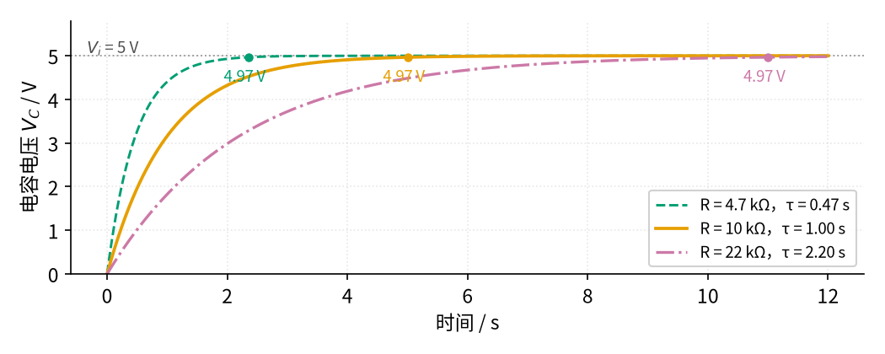
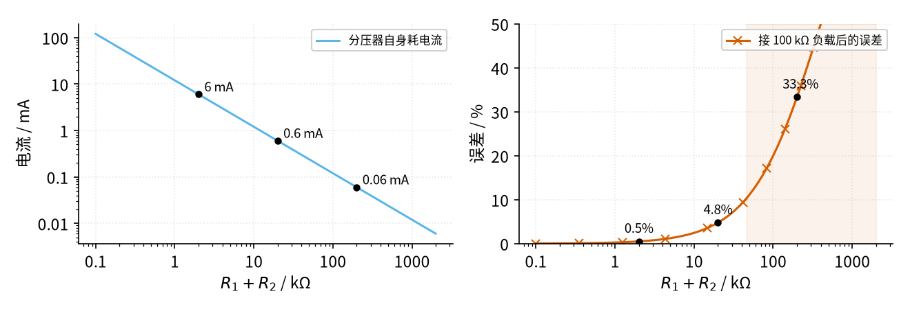
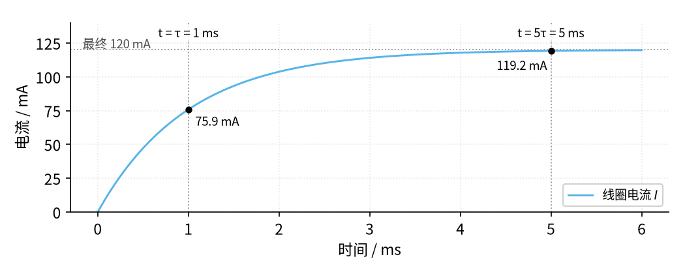

# P1 元件速成 · 参数与调试篇

[上一页：原理与实现篇](page2.md) · [直觉篇](page1.md) · [原理与实现篇](page2.md) · 本页：参数与调试篇 · [下一页：P3 运放入门 · 直觉篇](../P3-opamp-basics/page1.md) · 前置节点：无

## 一、参数的物理含义和常见取值

| 参数 | 物理含义 | 常见取值 | 选大了 / 选小了会怎样 |
|---|---|---|---|
| 分压电阻 $R_1$ 、 $R_2$ | 决定输出比例，也决定分压器自己耗多少电 | 1 kΩ～100 kΩ | 太小：白白耗电、电阻发热；太大：一接负载输出就被拉低，还容易受干扰 |
| 电容 $C$ | 能"攒"多少电荷；和 R 一起决定 τ | 几 pF～几千 μF | 太大：延时太长、上电冲击电流大；太小：滤不平、延时不够 |
| 时间常数 $\tau = RC$ | 充到 63% 所需的时间；5τ 视为充满 | 由需求定：消抖约几 ms，延时电路几秒 | 和信号快慢比：τ 远小于脉宽时波形基本不变，τ 远大于脉宽时只剩平均值 |
| 电感 $L$ | 维持电流的"惯性" | 继电器线圈约 0.01～1 H 量级 [待核实] | 越大，断电尖峰越难消，续流后电流也消失得越慢 |
| 线圈额定电压 / 电流 | 让继电器、接触器可靠吸合所需的电 | 继电器常见 5 V、12 V、24 V；接触器线圈常见 24 V、220 V | 电压不够吸不牢、触点抖动；电压太高线圈发热烧毁 |

先看 RC 的参数扫描。图 P1-p3-1 保持 C=100 μF 不变，把 R 换成 4.7 kΩ、10 kΩ、22 kΩ 三档。

*图 P1-p3-1　改变 R 对充电快慢的影响（C=100 μF，电源 5 V）*

图 P1-p3-1 中蓝绿色虚线（4.7 kΩ，τ=0.47 s）最快，2.35 s 就到了 4.97 V；橙色（10 kΩ，τ=1 s）在 5 s 到达；红紫色点划线（22 kΩ，τ=2.2 s）要等 11 s。三条曲线的形状完全一样，只是在时间轴上被"拉长"或"压缩"了：**R 或 C 变成几倍，充电时间就变成几倍**。想要延时更长，加大 R 或 C 都可以；但 R 太大时漏电流和负载的影响会变得显著，所以通常优先加大 C。

再看分压电阻怎么选。图 P1-p3-2 固定输入 12 V、负载 100 kΩ，让 $R_1 = R_2$ ，扫描总电阻 $R_1 + R_2$ 。

*图 P1-p3-2　分压电阻的取舍：左边是自身耗电，右边是接 100 kΩ 负载后的误差*

图 P1-p3-2 左图的天蓝色线说明：总电阻 2 kΩ 时分压器自己就要吃掉 6 mA，200 kΩ 时只有 0.06 mA；右图朱红色线说明：总电阻 2 kΩ 时误差只有 0.5%，20 kΩ 时 4.8%，200 kΩ 时高达 33.3%，阴影部分是误差超过 10% 的区域。两边一对照就得到经验规则：**分压器里流过的电流至少要比负载电流大 10 倍以上**，误差才能控制在百分之几；电池供电、对耗电敏感的场合则要换用运放跟随器（03）来隔开负载。

## 二、故障排查表

| 现象 | 原因 | 怎么查 | 怎么改 |
|---|---|---|---|
| 分压输出比公式算的低很多 | 负载太重，和下电阻并联拉低了输出 | 断开负载测一次输出，再接上负载测一次，对比 | 减小分压电阻（让分压电流大于负载电流 10 倍），或加电压跟随器 |
| 延时比算的长很多或短很多 | 电解电容容量误差大（常见 ±20% [待核实]）；或把 μF、nF 单位弄错 | 用万用表电容档实测 C；重新核对单位换算 | 按实测值重算 R；需要准确延时时改用定时器芯片或时间继电器 |
| 电容一直充不上电，或发热鼓包 | 电解电容极性接反，或电容被击穿短路 | 看外壳负极标记；断电放电后测两端电阻 | 按正确极性更换，耐压选电源电压的 1.5 倍以上 [待核实] |
| 按下按钮，继电器"咔哒"响了，但灯不亮 | 负载接到了常闭端，或者负载回路自己没有电源 | 断电后用万用表通断档，按住线圈通电时测公共端与常开端 | 按"公共端—常开端—负载—电源"重新接成独立回路 |
| 继电器完全不吸合 | 线圈电压不够，或驱动电流不够（例如直接用单片机引脚驱动） | 测线圈两端电压，与额定电压对比 | 换对电压的线圈，或加三极管驱动（22） |
| 一关断继电器，三极管就坏或单片机复位 | 线圈断电产生上千伏尖峰 | 用示波器看开关两端电压（低压实验中观察） | 在线圈两端反向并联续流二极管 |
| 加了续流二极管后，触点释放变慢、偶尔粘连 | 二极管让电流衰减变慢，触点分开的速度变慢 | 测线圈断电到触点分开的时间 | 改用"二极管 + 稳压管"等抑制方案（见 TE 白皮书） |

最后两行的依据都来自 TE 公司的[继电器线圈抑制白皮书](https://www.te.com/en/products/relays-and-contactors/electromechanical-relays/intersection/relay-coil-suppression-dc-relays.html)：它比较了二极管、二极管加稳压管、电阻、压敏电阻、TVS 等几种方案，指出单独一只二极管虽然把尖峰压得最低，但会让触点释放变慢。

> [!WARNING]
> 动手排查时只在 12V 以下的低压电路上测量。接触器主触点一侧如果接的是 220V/380V 市电，必须先断电、验电，由持证电工操作；不要用手或普通万用表表笔去碰正在运行的市电触点。

## 三、练习

**练习 1（易）**：用 9 V 电池得到 3 V，下电阻选 10 kΩ，上电阻应选多大？此时分压器自己消耗多大电流？

答案

3 V 占 9 V 的三分之一，所以 $R_2$ 要占总电阻的三分之一：总电阻 30 kΩ，上电阻 $R_1$ =20 kΩ。电流 $I$ = 9 V / 30 kΩ = 0.3 mA。

**练习 2（中）**：R=100 kΩ，C=47 μF，从 0 V 开始充电，电源 10 V。（1）τ 是多少？（2）多久充到 6.32 V？（3）多久可以认为充满？

答案

（1）τ = 100 × 10³ × 47 × 10⁻⁶ = 4.7 s。（2）6.32 V 是 10 V 的 63.2%，正好 1τ，即 4.7 s。（3）5τ = 23.5 s。注意：不是"一接上就充满"，也不是"用 10 V ÷ 100 kΩ 算出电流就完事"——那是把电容当电阻算了。

**练习 3（中）**：12 V 电源、两个 10 kΩ 电阻分压，输出端接了一个 10 kΩ 的负载。输出是多少？如果把两个分压电阻都换成 1 kΩ 呢？代价是什么？

答案

下电阻和负载并联后是 5 kΩ，输出 = 12 × 5 / (10 + 5) = 4 V，比空载的 6 V 低了三分之一。换成 1 kΩ 后，并联电阻约 0.909 kΩ，输出 = 12 × 0.909 / 1.909 ≈ 5.71 V，接近 6 V 了；代价是分压器自己的电流从 0.6 mA 涨到 6 mA，耗电变成 10 倍。

**练习 4（较难）**：某同学画了这样一个电路：5 V 电源 → 按钮 SB → KA 线圈 → KA 常开触点 → 灯 → 回到电源，全部串在一个回路里。按下按钮，灯会亮吗？应该怎么改？

答案

不会亮。KA 常开触点和线圈串在同一个回路里：触点没吸合之前回路是断的，线圈根本得不到电，触点也就永远不会吸合——"鸡生蛋、蛋生鸡"。正确做法是像直觉篇的两回路图那样分成两个回路：控制回路"电源—按钮—线圈"，负载回路"电源—KA 常开触点—灯"，两者只靠同一个文字符号 KA 联系。

**练习 5（变体迁移：RL 电路）**：把 RC 电路里的电容换成电感：L=0.1 H、内阻 100 Ω 的线圈接到 12 V 电源上。（1）最终电流多大？（2）时间常数多大？（3）1 ms 和 5 ms 时电流各是多少？

答案

（1）稳定后电感相当于导线，电流 = 12 V / 100 Ω = 120 mA。（2）τ = L / R = 0.1 / 100 = 1 ms。（3）规律和 RC 充电一样：1τ 时到 63.2%，约 75.9 mA；5τ 时约 119.2 mA，基本稳定。下面的 图 P1-p3-3 是脚本算出的曲线。

*图 P1-p3-3　练习 5 答案：RL 电路通电电流（L=0.1 H，R=100 Ω，12 V）*

图 P1-p3-3 中天蓝色曲线就是线圈电流：它和 RC 电路的电容电压长得一模一样，只是"攒"的东西从电压换成了电流。这就是电容和电感的对称性：电容保电压，电感保电流。

