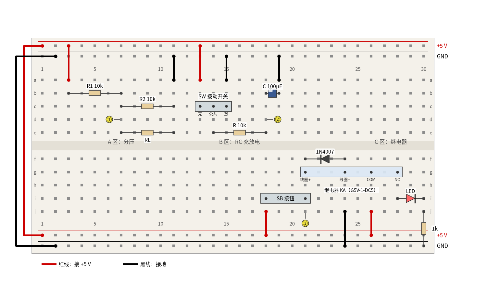
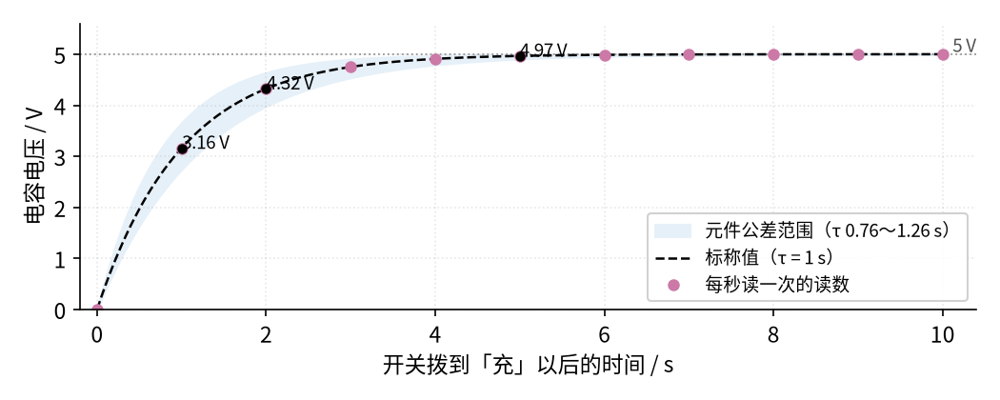

# P1 元件速成 · 动手实验篇

[上一页：参数与调试篇](page3.md) · [直觉篇](page1.md) · [原理与实现篇](page2.md) · [参数与调试篇](page3.md) · 本页：动手实验篇 · [下一页：P3 运放入门 · 直觉篇](../P3-opamp-basics/page1.md) · 前置节点：无

## 这次实验要验证什么

前三页的结论都是"算"出来的，这一页把它们搭出来、量出来。一共三个小实验，都用 5 V 电源：

1. **分压器**：两个 10 kΩ 电阻把 5 V 分成 2.5 V；一接负载，输出就被拉低。对应 [P1 元件速成 · 原理与实现篇](page2.md) 第一节的分压公式和"空载前提"。
2. **RC 充电**：10 kΩ 和 100 μF 组成 τ = 1 s 的电路，1 s 时充到约 63%，5 s 时基本充满。对应 [P1 元件速成 · 原理与实现篇](page2.md) 第二、三节的充电曲线。
3. **继电器与续流二极管**：按下按钮，线圈吸合，另一个回路里的 LED 点亮；松开时线圈电流从续流二极管绕回去。对应 [P1 元件速成 · 原理与实现篇](page2.md) 第五节"有无续流二极管"的对比。

## ⚠️ 安全须知

- **只用 12 V 及以下的直流电**。本页全部用 5 V：USB 充电头经面包板电源模块供电，或者 4 节 5 号电池（约 6 V，读数要按实测电源电压重算）。不要接任何市电插座。
- **电解电容分正负极**。100 μF 电容外壳上有一条印着"−"号的白色（或浅色）带子，那一脚是负极；新电容的长脚是正极。接反了会发热、鼓包，甚至喷出电解液。
- **电阻、三极管、稳压管可能发烫，不要用手摸**。本页的电流都很小，正常情况下不会热；如果闻到焦味、看到冒烟，或者元件变色，马上断电查线，多半是把电源正负极短路了。
- **接线、改线之前先断电**。先拔掉电源模块的 USB 线（或拨到 OFF），再插拔元件；插好、检查一遍再通电。
- **继电器线圈断电的那一瞬间会憋出高压**。[P1 元件速成 · 原理与实现篇](page2.md) 第五节算过：不加二极管时，线圈两端的尖峰可以比电源高一百倍。这个尖峰时间极短、能量很小，但足以击穿三极管，也会让手指"麻一下"。本页**只讲道理，不让学生用手去碰**：续流二极管 1N4007 一直装着，任何时候都不要在通电状态下用手捏线圈两脚或按钮两脚。想"看见"这股电流，用下文的 LED 演示；氖泡演示只由老师做。

## 器材清单

| 元件 | 型号或数值 | 数量 | 说明 |
|---|---|---|---|
| 面包板 | 400 孔或 830 孔，带上下两组电源轨 | 1 | 本页按 30 列画；830 孔的只用左边 30 列 |
| 电源 | 5 V 面包板电源模块 + USB 线 | 1 | 也可以用 4 节 5 号电池盒（约 6 V） |
| 电阻 | 10 kΩ，1/4 W，±5% | 4 | R1、R2、RL（负载）和 RC 里的 R |
| 电阻 | 100 kΩ，1/4 W | 1 | 换下 RL 做"轻负载"；也可换下 R，把 τ 放大到 10 s |
| 电阻 | 1 kΩ，1/4 W | 1 | 触点一侧 LED 的限流电阻 |
| 电解电容 | 100 μF，耐压 16 V 或 25 V | 1 | 耐压按 [P1 元件速成 · 参数与调试篇](page3.md) 的"电源电压 × 1.5"选 |
| 拨动开关 | 单刀双掷（三脚，例如 SS12D00） | 1 | 中间脚是公共端，两边分别接"充""放" |
| 按钮 | 两脚轻触按钮 | 1 | 四脚轻触按钮也行，跨槽插并用对角两脚 |
| 继电器 | Omron G5V-1-DC5（5 V 线圈） | 1 | 其他 5 V 小型信号继电器也可以，先量线圈电阻 |
| 整流二极管 | 1N4007 | 1 | 续流二极管，色环一端是阴极 |
| 开关二极管 | 1N4148 | 1 | 只在 LED 演示里用 |
| LED | 5 mm 红色 | 2 | 一只接触点，一只做续流演示；长脚是阳极 |
| 万用表 | 数字万用表，直流电压挡、电阻挡 | 1 | 直流电压挡输入电阻一般约 10 MΩ |
| 跳线 | 红、黑两色杜邦线若干 | — | 红色只接 +5 V，黑色只接地 |
| 秒表 | 手机秒表即可 | 1 | RC 实验每秒读一次数 |

继电器的线圈参数来自 [G5V-1 数据手册](https://xonstorage.z8.web.core.windows.net/pdf/Omron/4226465XON.pdf) 的线圈参数表：5 V 款额定电流 30 mA、线圈电阻 167 Ω（±10%），电感约 0.15 H（衔铁释放时）到 0.29 H（衔铁吸合时）。换了别的继电器，就用你自己量到的线圈电阻代替 167 Ω。

## 搭建步骤

先熟悉面包板：图里横着数的是**列号** 1～30，竖着排的是**行号** a～j。同一列的 a～e 五个孔在板子里面是连通的，f～j 五个孔也是连通的，但上下两半被中间的隔离槽隔开。最上面和最下面各有两条长长的**电源轨**，整条连通。下文"b3"就是 b 行第 3 列那个孔。对照电路原理，可以先回看 [P1 元件速成 · 直觉篇](page1.md) 的分压电路图、RC 充电电路图和继电器两个回路的图，以及 [P1 元件速成 · 原理与实现篇](page2.md) 第一节那张接负载后的分压输出曲线。整块板子的接法见 图 P1-p4-1。



*图 P1-p4-1　P1 动手实验的面包板接线图（5 V，三个实验共用一块板）*

图 P1-p4-1 里红线一律接 +5 V，黑线一律接地，米色小方块是电阻，深蓝色方块是电解电容（"+"号一侧是正极），黑色三角加竖杠是二极管（竖杠一侧是阴极），红色三角是 LED。黄色圆圈①②③是后面测量表里的测量点。三个实验互不相连，可以一次全插好，也可以做一个插一个。

**公共部分：电源轨**

1. 断电状态下，把电源模块插在面包板一端，跳线帽拨到 5 V。上面一组电源轨：靠外的一条是 +5 V，靠里的一条是 GND（地）。
2. 用一根红线把上下两条 +5 V 轨在第 1 列连起来，一根黑线把上下两条 GND 轨在第 2 列连起来（有的电源模块两组都供电，就不用接）。

**A 区：分压器（上半块第 3～11 列）**

3. 红线：上面 +5 V 轨第 3 列 → a3。
4. R1（10 kΩ）：一脚插 b3，另一脚插 b7。
5. R2（10 kΩ）：一脚插 c7，另一脚插 c11。
6. 黑线：a11 → 上面 GND 轨第 11 列。现在第 7 列就是分压器的输出端（测量点①）。
7. 负载 RL 先不插。量完空载以后，断电，把 RL（先用 10 kΩ，再换 100 kΩ）插在 e7 和 e11 之间：它跨在输出端和地之间，正好和 R2 并联。

**B 区：RC 充放电（上半块第 13～19 列）**

8. 拨动开关的三只脚插 c13、c14、c15，中间脚 c14 是公共端。
9. 红线：+5 V 轨第 13 列 → a13（开关拨到这一边叫"充"）。黑线：a15 → GND 轨第 15 列（开关拨到这一边叫"放"）。
10. R（10 kΩ）：一脚插 e14，另一脚插 e18。
11. 电容 C（100 μF）：**正极（长脚）插 b18，负极（有"−"带的一脚）插 b19**。黑线：a19 → GND 轨第 19 列。第 18 列就是电容电压（测量点②）。
12. 开关先拨到"放"，让电容从 0 V 开始。

**C 区：继电器（下半块第 18～30 列）**

13. 红线：下面 +5 V 轨第 18 列 → j18。按钮 SB 的两脚插 i18 和 i21。
14. 继电器：先在断电时用电阻挡找出线圈的两脚（读数约 167 Ω 的那一对），再找出 COM（公共触点）和 NO（常开触点）。引脚以所买继电器手册的底视图为准。G5V-1 可以跨槽直接插，引脚对不上时用四根杜邦线把"线圈+"接 g21、"线圈−"接 g24、COM 接 g26、NO 接 g28。
15. 黑线：j24 → 下面 GND 轨第 24 列。线圈就接在第 21 列（按钮另一端）和地之间。
16. 续流二极管 1N4007：**阴极（色环一端）插 f21，阳极插 f24**。也就是阴极朝 +5 V 那一侧、阳极朝地。插反了会怎样，见思考题 2。
17. 触点一侧：红线 +5 V 轨第 26 列 → j26（COM 接 +5 V）；红色 LED 长脚插 i28、短脚插 i30；1 kΩ 电阻一脚插 j30，另一脚直接插进下面 GND 轨第 30 列。
18. 检查一遍：红线只碰 +5 V 轨，黑线只碰 GND 轨；电容、二极管、LED 方向都对。然后再通电。

## 测量表

万用表打到直流电压挡（20 V 挡或自动挡），**黑表笔一直接地**（插进任意一条 GND 轨）。电阻值要在断电、并且至少一端离开电路时量。下表"应该读到"的范围按 5% 电阻、20% 电容、10% 线圈电阻算出，数字由 `code/figs/P1_figs.py` 打印；RC 那两行和 [P1 的 SPICE 核对表](../review/spice/P1.md) 的面包板读数一致。

| 步骤 | 测什么 | 红表笔 | 黑表笔 | 挡位 | 应该读到 | 读不到时先查 |
|---|---|---|---|---|---|---|
| 0 | 电源电压 | 上面 +5 V 轨 | GND 轨 | 直流 20 V | 4.75～5.25 V（USB 规定的范围） | 电源模块跳线帽是否拨到 5 V、开关是否打开 |
| 1 | ① 分压输出（空载） | e7 旁边的第 7 列任一空孔 | GND 轨 | 直流 20 V | 2.38～2.62 V（标称 2.50 V） | R1、R2 是否真跨在 3–7 列和 7–11 列；有没有插错色环 |
| 2 | ① 接 RL = 10 kΩ | 第 7 列 | GND 轨 | 直流 20 V | 1.56～1.78 V（标称 1.67 V） | RL 是否插在 e7–e11（并在 R2 上），而不是串在 R1 上 |
| 3 | ① 接 RL = 100 kΩ | 第 7 列 | GND 轨 | 直流 20 V | 2.26～2.51 V（标称 2.38 V） | 色环是不是 100 kΩ（棕黑黄） |
| 4 | ② 拨到"充"后 1 s | 第 18 列 | GND 轨 | 直流 20 V | 2.7～3.7 V（标称 3.16 V） | 秒表是否和拨开关同时开始；电容是不是 100 μF |
| 5 | ② 拨到"充"后 10 s | 第 18 列 | GND 轨 | 直流 20 V | 4.9～5.0 V | 电容是否接反（会一直充不满、还发热） |
| 6 | ② 拨到"放"后 1 s | 第 18 列 | GND 轨 | 直流 20 V | 约 1.84 V（5 V 的 36.8%） | 放电也走 R，τ 同样是 1 s |
| 7 | 线圈电阻（断电，拔下按钮） | 线圈+ 脚 | 线圈− 脚 | 电阻 2 kΩ 挡 | 150～184 Ω（167 Ω ±10%） | 是否量到了触点脚；有没有拔掉 1N4007（它并在线圈上会影响读数） |
| 8 | ③ 按住按钮时线圈电压 | 第 21 列 | GND 轨 | 直流 20 V | 约等于步骤 0 的电源电压 | 按钮是否接在 18、21 列；"咔哒"声有没有 |
| 9 | ③ 松开按钮后 | 第 21 列 | GND 轨 | 直流 20 V | 0 V（尖峰只有几毫秒，万用表看不到） | — |
| 10 | 触点侧 1 kΩ 两端（按住按钮） | j30 一侧的电阻脚 | GND 轨 | 直流 20 V | 约 3 V（5 V 减去 LED 约 2 V） | LED 长短脚是否反了；COM、NO 是否找对 |

一共 11 个测量点。第 6 行"约 1.84 V"是 5 × e^(−1) 算出来的标称值，公差范围和第 4 行一样宽（1 s 时剩下的电压在 1.3～2.3 V 之间都算正常）。第 9 行写 0 V 不是说没有尖峰，而是万用表每秒只刷新两三次，几毫秒的事件它根本来不及显示。

## 没有示波器怎么办

**RC 充电：用秒表 + 万用表**。τ = 1 s 已经慢到能用眼睛跟上。开关拨到"充"的同时按下手机秒表，每过 1 s 念一次读数，让同伴记下来，记 10 个点就能画出 图 P1-p4-2 那样的曲线。



*图 P1-p4-2　没有示波器时，用秒表每秒读一次电容电压（5 V、10 kΩ、100 μF）*

图 P1-p4-2 中黑色虚线是标称曲线，红紫色圆点是每秒读一次应得到的读数，浅蓝色带子是元件公差允许的范围。1 s 时约 3.16 V，2 s 时约 4.32 V，5 s 以后几乎贴在 5 V 上。你的点只要落在浅蓝色带子里就算对；如果每个点都偏低一截，多半是电容实际容量偏大（电解电容 ±20% 很常见）。嫌 1 s 太快，就把 R 换成 100 kΩ，τ 变成 10 s，每 10 s 念一次。万用表约 10 MΩ 的输入电阻并在电容上，会让终值从 5 V 降到约 4.95 V，误差只有 1% 左右，可以不管。

**继电器：用耳朵和 LED**。按下按钮能听到"咔哒"一声，触点一侧的 LED 同时亮起；松开时又是一声，LED 熄灭。这就证明了 [P1 元件速成 · 直觉篇](page1.md) 讲的"线圈和触点在两个回路里，只靠磁力联系"：你可以用万用表确认，第 21 列和第 26～30 列之间没有任何导线相连。

**断电尖峰：只讲道理，用 LED 演示电流"绕回去"**。线圈断电时到底冒出多高的电压，要用示波器才能看清，样子就是 [P1 元件速成 · 原理与实现篇](page2.md) 第五节那张有无续流二极管的对比图：上排不加二极管时是一根又高又窄的朱红色尖峰，下排加了二极管以后，按钮两端最高只比电源高一个二极管压降。我们用一个安全的办法"看见"这股续流电流：

1. 断电。拔下 1N4007。
2. 1N4148 阴极（黑色环一端）插 c21、阳极插 c23；一只红色 LED 的长脚插 d24、短脚插 d23。这样 LED 和 1N4148 串起来，代替 1N4007 接在线圈两端，方向和 1N4007 一样（阳极朝地）。线圈通电时这一串是反向接着的，LED 能承受的反向电压不高，串上 1N4148 让两只管子一起分担这 5 V，更保险。
3. 通电，关灯或用手遮光，按住按钮再松开。**松开的一瞬间这只 LED 会闪一下**：那就是线圈"不肯停"的电流，从地那一端出来，经过 LED 和 1N4148 绕回线圈另一端。

按 G5V-1 的 0.29 H、167 Ω 估算，这股电流从 30 mA 降到 0 只要约 1.8 ms（只装 1N4007 时约 3.6 ms），所以只是很暗的一闪，暗处才看得清。这一闪说明：如果没有任何一条退路，这 30 mA 就会硬去"击穿"别的地方。

**氖泡演示（只由老师做）**：拔掉所有续流元件，把一只小氖泡（按说明串好它要求的限流电阻）跨接在线圈两脚上。小氖泡要几十伏以上才会起辉，而电源只有 5 V；松开按钮的瞬间氖泡闪亮，就证明线圈两端短时间冒出了远高于 5 V 的电压。演示时学生站在一臂以外，老师只碰按钮，不碰线圈、氖泡和按钮的金属脚；演示完立刻断电、把 1N4007 装回去。

## 用 Python 核对你的读数

把你量到的电源电压、电阻实际值和线圈电阻填进 `measured`，把各步读数填进 `readings`，运行后会打印"应该读到"的值和偏差，偏差超过 10% 的会给出提示。下面填的是一组示例。

```python
import sys, pathlib
sys.path.insert(0, str(pathlib.Path("code/figs").resolve()))  # 在仓库根目录运行
import math

# ① 你量到的元件和电源（断电后用电阻挡量；电容用标称值）
measured = dict(Vs=5.08, R1=9.93e3, R2=10.05e3, RL10=9.88e3, RL100=99.1e3,
                R=10.02e3, C=100e-6, Rcoil=171.0, Vled=2.0, Rled=0.99e3)
# ② 你在各步读到的万用表读数（伏）
readings = {"1 分压空载": 2.55, "2 接 10 kΩ": 1.70, "3 接 100 kΩ": 2.41,
            "4 充电 1 s": 3.05, "5 充电 10 s": 5.07, "8 线圈电压": 5.05, "10 触点侧电阻": 3.02}

m = measured
par = lambda a, b: a * b / (a + b)
tau = m["R"] * m["C"]
expect = {
    "1 分压空载": m["Vs"] * m["R2"] / (m["R1"] + m["R2"]),
    "2 接 10 kΩ": m["Vs"] * par(m["R2"], m["RL10"]) / (m["R1"] + par(m["R2"], m["RL10"])),
    "3 接 100 kΩ": m["Vs"] * par(m["R2"], m["RL100"]) / (m["R1"] + par(m["R2"], m["RL100"])),
    "4 充电 1 s": m["Vs"] * (1 - math.exp(-1.0 / tau)),
    "5 充电 10 s": m["Vs"] * (1 - math.exp(-10.0 / tau)),
    "8 线圈电压": m["Vs"],
    "10 触点侧电阻": m["Vs"] - m["Vled"],
}
hint = {"1 分压空载": "R1、R2 是否插对列；电阻色环是否认错",
        "2 接 10 kΩ": "RL 应并在 R2 上（e7–e11）",
        "3 接 100 kΩ": "RL 是否换成了 100 kΩ",
        "4 充电 1 s": "电解电容 ±20%，偏差大时再看秒表是否同步",
        "5 充电 10 s": "电容是否接反、是否漏电",
        "8 线圈电压": "按钮接触不良会让线圈电压偏低",
        "10 触点侧电阻": "LED 压降可能不是 2 V，用二极管挡量一下 LED"}
print(f"τ = R·C = {tau:.2f} s，线圈电流约 {m['Vs'] / m['Rcoil'] * 1e3:.0f} mA，触点侧 LED 电流约 {(m['Vs'] - m['Vled']) / m['Rled'] * 1e3:.1f} mA")
for k, v in readings.items():
    e = expect[k]
    dev = (v - e) / e * 100
    flag = "" if abs(dev) <= 10 else f"  ← 偏差超过 10%，先查：{hint[k]}"
    print(f"{k:<10} 实测 {v:5.2f} V  计算 {e:5.2f} V  偏差 {dev:+5.1f}%{flag}")
```

示例里的读数全部在 10% 以内。如果你那一行出现了提示，先按提示查，再对照上面测量表最后一列。注意第 4 步对秒表误差很敏感：晚读 0.2 s，读数就会高出好几个百分点。

## 实验记录表

| 步骤 | 测什么 | 实测值 | 计算值 | 偏差 |
|---|---|---|---|---|
| 0 | 电源电压 |  |  |  |
| 1 | 分压输出（空载） |  |  |  |
| 2 | 分压输出（RL = 10 kΩ） |  |  |  |
| 3 | 分压输出（RL = 100 kΩ） |  |  |  |
| 4 | 电容电压，充电 1 s |  |  |  |
| 5 | 电容电压，充电 10 s |  |  |  |
| 6 | 电容电压，放电 1 s |  |  |  |
| 7 | 线圈电阻 |  |  |  |
| 8 | 按住按钮时线圈电压 |  |  |  |
| 10 | 触点侧 1 kΩ 两端电压 |  |  |  |

## 思考题

**思考题 1**：你量到的空载分压输出比 2.50 V 小了 3%，是不是万用表坏了？

<details><summary>答案</summary>

多半不是。先看电源：如果电源只有 4.85 V，输出就是 4.85 ÷ 2 ≈ 2.43 V，正好小 3%。再看电阻：R1 偏大 3%、R2 偏小 3% 也会让输出小约 3%。所以每次都要先量电源电压和电阻实际值，再把它们填进上面的 Python 重算。万用表约 10 MΩ 的输入电阻并在 R2 上，只会让输出低约 0.05%，可以忽略。

</details>

**思考题 2**：如果把 1N4007 插反（阳极接第 21 列、阴极接地），按下按钮会发生什么？

<details><summary>答案</summary>

按下按钮时，1N4007 变成正向导通，直接把第 21 列接到地，等于把 5 V 电源经过按钮短路：继电器不吸合，二极管和电源模块会发热，有的电源模块会保护断电。这就是"续流二极管必须反向并联"的原因：平时它必须是截止的，只有断电时才导通。发现接反要立刻断电。

</details>

**思考题 3**：LED 演示里，为什么 LED 是在**松开**按钮的瞬间闪，而不是按下时？

<details><summary>答案</summary>

按下时，第 21 列是 +5 V、第 24 列是地，LED 和 1N4148 被反向加了 5 V，不导通，电流只走线圈。松开时，电感要维持原来的电流，线圈两端电压反过来（第 21 列变得比地还低），LED 和 1N4148 变成正向导通，这股电流就绕着"线圈 → 地那一端 → LED → 1N4148 → 线圈另一端"转圈，直到能量耗完，所以只在松开的一瞬间闪。

</details>

## 自测清单

- 我能说出面包板哪些孔是连通的，并按"b3–b7"这种写法把电阻插到指定位置。
- 我能用万用表量出分压器空载和接负载时的输出，并解释为什么接 10 kΩ 负载后掉了三分之一。
- 我能用秒表和万用表测出 RC 电路的 τ，并判断读数是否落在公差范围内。
- 我能正确插好续流二极管（阴极朝 +5 V），并说出插反的后果。
- 我能解释松开按钮时线圈为什么会冒出高压，以及为什么不能用手去碰。
