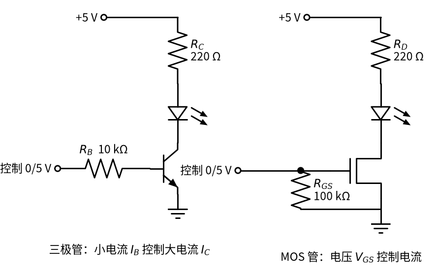

# P2 半导体入门 · 直觉篇

[上一页：P3 运放入门 · 动手实验篇](../P3-opamp-basics/page4.md) · 本页：直觉篇 · [原理与实现篇](page2.md) · [参数与调试篇](page3.md) · [下一页：原理与实现篇](page2.md) · 前置节点：[P1 元件速成 · 直觉篇](../P1-components-basics/page1.md)

## 为什么要学这一节

高中物理里的电路只有电池、电阻、开关和灯泡，电阻两端的电压和电流永远成正比。可是一拆开手机充电器、遥控器或者电动玩具，电路板上最多的反而是另外几种小黑块：二极管、稳压管、发光二极管（LED）、三极管和 MOS 管。后面的整流（06 节）、稳压（08、10 节）、开关电源（09 节）、继电器驱动（22 节），全都靠它们干活。

这些元件统称「半导体器件」。教科书讲它们要从硅晶体、PN 结、载流子讲起，读完一章可能还不会接一个 LED。好消息是：**做电路只需要会用，不需要会造**。本节点只教三件事：每种元件像生活里的什么东西；它有哪一两个关键电压要记住；新手最常犯哪三种错——忘记 0.7 V 压降、三极管不加基极电阻、MOS 管栅极悬空。

## 二极管：电路里的单向阀

家里的水管上常装一种「止回阀」：水只能朝一个方向流，倒流时阀门自己关上。二极管就是电路里的止回阀。它有两个脚，电流只能从**阳极**流向**阴极**，电路符号里那个三角形的尖头就是允许电流流动的方向，竖线一侧是阴极，实物上一般用一条色环标出阴极。

止回阀里有一根小弹簧，水压太小推不开它。二极管也一样：正向电压要超过大约 0.7 V（普通硅二极管）才会明显导通，导通以后两端电压基本就停在 0.7 V 左右，多出来的电压都落在别的元件上。这个「推开阀门要花掉的电压」叫正向压降，记作 $V_D$ 。

请看图 P2-p1-1 的两个电路，比较二极管方向和灯的状态。

*图 P2-p1-1　二极管正接时灯亮，反接时灯不亮*

左边二极管的尖头顺着电流方向（从电源正极出发，经过二极管、灯泡回到负极），阀门被推开，灯亮；右边把二极管调了个头，阀门被倒流的水压死死压住，整条回路没有电流，灯不亮。注意左边灯泡分到的电压并不是 6 V，而是大约 6 V − 0.7 V = 5.3 V，这 0.7 V 就是阀门的「过路费」。

## 稳压管：水位到了就溢出的溢流口

如果把一个特殊的二极管反着接，并且反向电压大到一定程度，它会突然「击穿」开始导电。普通二极管被击穿通常就坏了，**稳压管**却是专门设计在击穿状态下长期工作的。击穿以后，不管流过它的电流是多一点还是少一点，它两端的电压都几乎不变，这个电压叫稳压值，记作 $V_Z$ 。

生活类比是浴缸上沿的溢流口：水位一旦到达溢流口的高度，多放进来的水都从溢流口流走，水位就不再升高。稳压管就是电路里的溢流口，多余的电流从它身上流走，电压被钉在 $V_Z$ 。

请看图 P2-p1-2：12 V 电源经过 1 kΩ 电阻接到一个 5.1 V 稳压管上，注意稳压管的阴极（带折角竖线的一端）朝向电源正极。

*图 P2-p1-2　稳压管反向接入：输出被钉在约 5.1 V*

12 V 里约 6.9 V 落在电阻上，剩下约 5.1 V 落在稳压管上。电阻在这里不能省：它像溢流口前面的一段细水管，限制总的水流，否则电源会直接把稳压管烧掉。电阻怎么选是 10 节「稳压管稳压」的主题。

## 发光二极管：会发光的二极管

LED 也是二极管，同样只许电流单向通过，只是导通时会发光。它的「弹簧」更硬：红色 LED 正向压降约 2 V，蓝色、白色约 3 V 多。LED 和普通二极管一样，一旦导通，电压稍微升一点电流就猛增，所以**必须串一个限流电阻**，靠电阻来决定电流大小。

## 三极管：用小水流去推开大阀门的水龙头

想象一个特殊的水龙头：它没有把手，而是在旁边开了一根细细的控制水管。往细管里灌一点点水，主水管的大阀门就开一点；细管水流加倍，主水流也加倍。这就是 NPN 三极管：三个脚分别叫基极（B）、集电极（C）、发射极（E），流进基极的小电流 $I_B$ 控制着从集电极流到发射极的大电流 $I_C$ ，两者的比值叫电流放大倍数 $\beta$ ，常见的小三极管在 100 左右。

三极管有三种状态。基极没有电流时，大阀门关死，叫**截止**；基极电流适中时，主水流等于控制水流的 $\beta$ 倍，叫**放大**；基极电流足够大时，大阀门已经开到底，主水流只受外面水管粗细的限制，再加控制水流也没用，叫**饱和**，这时三极管就像一个闭合的开关。拿三极管当开关用，就是让它在截止和饱和之间切换。本书里三极管几乎只当开关用（截止 ↔ 饱和），放大区只需要知道它存在，并且记住开关时要尽快穿过它——停在放大区的三极管既不算全开也不算全关，自己会发热。

请看图 P2-p1-3 左半部分：控制信号经过基极电阻 $R_B$ 进入三极管的基极，LED 和电阻 $R_C$ 串在集电极一侧。

*图 P2-p1-3　左：NPN 三极管开关；右：N 沟道 MOS 管开关，栅极带下拉电阻*

左图里，控制端给 5 V，几百微安的小电流从基极流入，三极管饱和，LED 亮；控制端给 0 V，基极没有电流，三极管截止，LED 灭。基极电阻 $R_B$ 绝不能省：基极到发射极之间本身就像一个二极管，直接接 5 V 会产生很大电流，烧坏三极管或者控制它的芯片。

## MOS 管：按压就开的电压阀门

MOS 管（全称金属-氧化物-半导体场效应管，常写作 MOSFET）也能当开关，但控制方式不同：它的控制脚叫栅极（G），和里面的导电通道之间隔着一层极薄的绝缘层，几乎不吸收电流。决定它通不通的是栅极和源极（S）之间的电压 $V_{GS}$ 。打个比方，三极管像是要靠水流去推的阀门，MOS 管则像一个按压式阀门：只要按下去的「力」（电压）够大，阀门就打开，按住不动并不需要持续出力。

$V_{GS}$ 低于一个门限电压时 MOS 管关断，高出门限足够多时，漏极（D）和源极之间就像一个很小的电阻。图 P2-p1-3 右半部分就是这样一个开关。注意栅极和地之间那个 100 kΩ 的电阻 $R_{GS}$ ：因为栅极几乎不吸收电流，它一旦悬空（比如控制线断开、单片机还没上电），手一靠近、旁边一有干扰，栅极上就可能积累电荷把管子「按开」，负载莫名其妙地动作。下拉电阻保证没人控制时栅极被拉回 0 V，MOS 管可靠关断（为什么要下拉、取多大，见 [21 MOS 管开关 · 直觉篇](../21-mosfet-switch/page1.md)）。

## 镜像版本：PNP 和 P 沟道 MOS 管

上面讲的 NPN 三极管和 N 沟道 MOS 管都接在负载和地之间（叫低边开关）。它们各有一个「镜像版本」：PNP 三极管和 P 沟道 MOS 管，电压和电流方向全部反过来，常放在电源和负载之间（叫高边开关）。P 沟道 MOS 管的栅极电压要比源极**低**才导通，这一点第一次接触时最容易搞反。[P2 半导体入门 · 原理与实现篇](page2.md) 会用一个最小的例子演示它怎么开、怎么关，以及配套的「上拉电阻」是什么，[P2 半导体入门 · 参数与调试篇](page3.md) 的练习再专门练。

## 一句话总结

二极管是单向阀，导通要交约 0.7 V 的「过路费」；稳压管是反着接的溢流口，把电压钉在 $V_Z$ ；三极管是用小电流 $I_B$ 推开大电流 $I_C$ 的水龙头，必须串基极电阻；MOS 管是靠电压 $V_{GS}$ 按开的阀门，栅极不能悬空。下一页（[P2 半导体入门 · 原理与实现篇](page2.md)）把这些比喻换成曲线和公式，并用 Python 把它们算出来。
