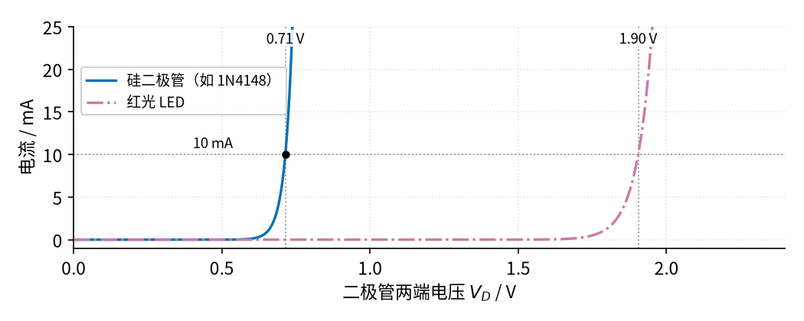
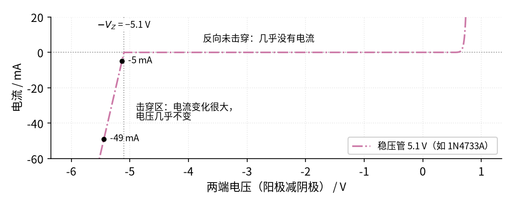
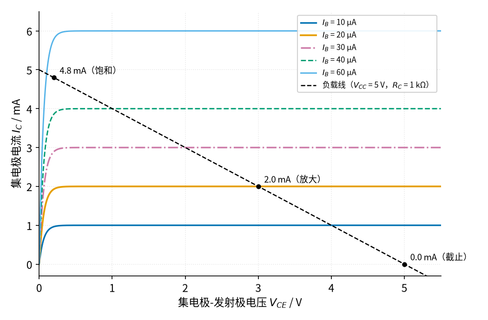
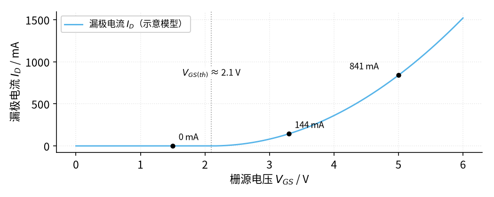
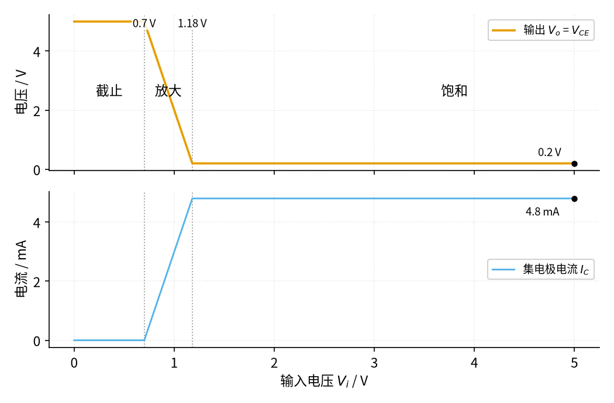

# P2 半导体入门 · 原理与实现篇

[上一页：直觉篇](page1.md) · [直觉篇](page1.md) · 本页：原理与实现篇 · [参数与调试篇](page3.md) · [下一页：参数与调试篇](page3.md) · 前置节点：[P1 元件速成 · 直觉篇](../P1-components-basics/page1.md)

## 先补一个工具：伏安特性曲线

要说清一个元件「怎么导电」，最直接的办法是给它加一个个不同的电压，记下流过它的电流，再把这些点连成曲线，这条曲线叫**伏安特性曲线**（横轴电压、纵轴电流）。电阻的伏安特性是一条过原点的直线，斜率就是 $1/R$ ，这正是欧姆定律（见 [P1 元件速成 · 直觉篇](../P1-components-basics/page1.md) 的电阻分压一节）。半导体器件的曲线都是弯的，而这一节的全部内容，就是读懂这几条弯曲线，再从中提炼出能拿来估算的简单规则。

本页的器件参数来自真实数据手册，出处写在每段末尾；画曲线用的是简化的教学模型，数值和具体型号会有出入，但形状和量级是对的。

## 1. 二极管：指数曲线与「0.7 V 规则」

二极管的电流随电压按指数规律增长。用一句话说：**正向电压每多约 0.06 V，电流就变成原来的 10 倍**。写成公式（肖克利方程，不用背）：

$$I = I_S \left(e^{V_D / V_T} - 1\right)$$

其中 $V_D$ 是二极管两端的正向压降； $I_S$ 是一个极小的常数（本页取 $10^{-14}$ A）； $V_T$ 叫热电压，是一个只由温度决定的电压常数，室温下约 0.02585 V，温度越高它越大（它来自半导体物理，这里直接用结论，推导超出本教程）。代一组数：要让电流达到 1 mA，需要 $V_D = V_T \ln(I/I_S) = 0.02585 \times \ln(10^{11}) \approx 0.655$ V；要达到 10 mA，只需 0.714 V。电流涨了 10 倍，电压只多了约 0.06 V。

请看图 P2-p2-1，比较蓝色曲线（硅二极管）和红紫色点划线（代表红光 LED，画线颜色和 LED 的发光颜色无关）分别在哪里「起飞」。



*图 P2-p2-1　硅二极管与红光 LED 的正向伏安特性（教学模型）*

两条曲线都是先贴着横轴几乎没有电流，过了某个电压后几乎垂直地往上冲。蓝色曲线在 0.71 V 附近起飞，红紫色点划线在 1.90 V 附近起飞。正因为曲线这么陡，实际电路里可以把导通的二极管简单看成「一个固定 0.7 V 的压降」，这就是 **0.7 V 规则**；LED 则看成约 2 V（红光）或约 3 V 多（蓝光、白光）。真实器件的参数：Vishay 的 1N4148 数据手册规定 10 mA 时正向压降最大 1 V，典型曲线在 1–10 mA 时约 0.6–0.7 V（[1N4148 数据手册](https://www.vishay.com/docs/81857/1n4148.pdf)）；SparkFun 的教程给出 LED 压降 1.2–3 V，超亮红色约 2.2 V、超亮蓝色约 3.3 V（[SparkFun Diodes](https://learn.sparkfun.com/tutorials/diodes/all)）。

有了 0.7 V 规则，带二极管的电路就能用欧姆定律算：电阻上的电压 = 电源电压 − 0.7 V。例如 5 V 电源串 1 kΩ 电阻再串一只二极管，电流约为

$$I = \frac{V_{CC} - V_D}{R} = \frac{5 - 0.7}{1000} = 4.3\ \text{mA}$$

这里 $V_{CC}$ 是电源电压。下面的仿真会用指数方程精确求解，得到 4.31 mA，和估算只差 0.01 mA。

顺便认识一种后面会常见的二极管：**肖特基二极管**。它用金属和半导体直接接触做成，正向压降只有约 0.15–0.45 V（[SparkFun Diodes](https://learn.sparkfun.com/tutorials/diodes/all)），开关速度也快；代价是反向漏电比普通硅二极管大。所以对「0.7 V 过路费」心疼、或者开关很快的地方（例如 09 节开关电源的续流二极管）常用它。

## 2. 稳压管：反向击穿后的「墙」

稳压管的正向和普通二极管一样，关键在反向：反向电压没到 $V_Z$ 时几乎没有电流；一旦到达 $V_Z$ ，电流可以从几毫安一路涨到几十毫安，电压却只变一点点。电压随电流变化的那一点点，可以用一个小电阻 $r_Z$ （动态电阻）来描述：

$$V = V_Z + r_Z \thinspace (I_Z - I_{ZT})$$

$I_Z$ 是流过稳压管的反向电流。手册上的 $V_Z$ 不是「击穿起点」，而是在一个规定的**测试电流** $I_{ZT}$ 下量出来的电压，所以公式写成「测试点电压，加上电流偏离测试电流的那部分乘 $r_Z$ 」：电流正好等于 $I_{ZT}$ 时 $V = V_Z$ ，电流比它小时电压略低，比它大时电压略高。以 1N4733A 为例，数据手册给出 $V_Z$ = 5.1 V（在 $I_{ZT}$ = 49 mA 下测得，公差 ±5%），动态电阻**最大** 7 Ω，最大允许电流 178 mA，额定功率 1.3 W（[Vishay 1N4728A 系列数据手册](https://www.vishay.com/docs/85816/1n4728a.pdf)）。代数：49 mA 时 $V$ = 5.1 V；5 mA 时 $V = 5.1 + 7 \times (0.005 - 0.049) \approx 5.1 - 0.308 = 4.792$ V。电流变了近 10 倍，电压只变了约 0.31 V；因为 7 Ω 是最大值，这已经是最坏情况，多数管子变得更少。

请看图 P2-p2-2 里红紫色点划线在左边几乎竖直的那一段。



*图 P2-p2-2　5.1 V 稳压管的伏安特性：右边是正向导通，左边是反向击穿*

横轴是阳极电压减阴极电压，所以反向击穿出现在左边：曲线在约 −4.8 V 处开始往下冲，到 −5.1 V（灰色点线）时电流正好是测试电流 49 mA，和手册对得上。电流从 −5 mA 变到 −49 mA，电压只移动了约 0.308 V，看起来像一堵墙。这里的模型把动态电阻当常数，真实稳压管在电流很小时（接近 1 mA 的拐点电流）墙会变「软」，所以设计时要保证它始终流过足够的电流，这是 10 节的重点。

## 3. 三极管：三个区和一条负载线

NPN 三极管有三个电流：流进基极的 $I_B$ 、流进集电极的 $I_C$ 、从发射极流出的两者之和。基极和发射极之间就是一只二极管，所以只要有基极电流，基极-发射极电压 $V_{BE}$ 就约为 0.7 V。集电极和发射极之间的电压记作 $V_{CE}$ 。

三个区的规则，先说中文再写式子：

- **截止**：基极没有电流，集电极也没有电流： $I_B = 0$ 、 $I_C = 0$ 。
- **放大**：集电极电流是基极电流的 $\beta$ 倍： $I_C = \beta I_B$ 。
- **饱和**：外电路最多只能提供 $(V_{CC} - V_{CE(sat)})/R_C$ 的电流，三极管「想要」的 $\beta I_B$ 比这还大，于是 $I_C$ 被外电路卡住， $V_{CE}$ 降到约 0.2 V（记作 $V_{CE(sat)}$ ）。

请看图 P2-p2-3：五条彩色曲线是不同基极电流下 $I_C$ 随 $V_{CE}$ 的变化，黑色虚线是 5 V 电源串 1 kΩ 集电极电阻的「负载线」。



*图 P2-p2-3　NPN 输出特性（β = 100）与负载线上的三个工作点*

负载线上的每一点都满足 $V_{CE} = V_{CC} - I_C R_C$ ，三极管的工作点只能落在这条线上。基极电阻取 47 kΩ：输入 0 V 时 $I_B = 0$ ，工作点在右下角（截止， $V_{CE}$ = 5 V）；输入 1.64 V 时 $I_B = (1.64 - 0.7)/47000 = 20$ μA， $I_C = 100 \times 20$ μA = 2.0 mA，工作点落在橙色曲线上（放大， $V_{CE}$ = 3.0 V）；输入 5 V 时 $I_B$ = 91.5 μA，按 β 算该有 9.15 mA，可负载线最多只给 4.8 mA，工作点被推到左上角（饱和， $V_{CE}$ = 0.2 V）。数据手册中 2N3904 的 β 在 10 mA 时为 100–300，饱和压降最大 0.2 V（[onsemi 2N3904 数据手册](https://www.onsemi.com/download/data-sheet/pdf/2n3904-d.pdf)）。

## 4. MOS 管：门限电压和导通电阻

N 沟道 MOS 管只看 $V_{GS}$ 。 $V_{GS}$ 低于门限电压 $V_{GS(th)}$ 时漏极电流几乎为零；超过以后，电流随 $V_{GS}$ 迅速增大。以常见的小功率 MOS 管 2N7000 为例，数据手册给出 $V_{GS(th)}$ 最小 0.8 V、典型 2.1 V、最大 3.0 V，栅源电压不得超过 ±20 V（[onsemi 2N7000 数据手册](https://www.onsemi.com/download/data-sheet/pdf/nds7002a-d.pdf)）。

请看图 P2-p2-4 天蓝色的电流曲线在门限前后的变化。



*图 P2-p2-4　N 沟道 MOS 管漏极电流随栅源电压变化（示意模型，门限电压 2.1 V，电流数值被放大，不对应 2N7000）*

1.5 V 时电流为 0，3.3 V 时约 144 mA，5 V 时约 841 mA。这里用的是示意模型，数字不代表 2N7000 本身能流这么大的电流（它的额定电流只有 200 mA），要看的是形状：门限以下完全关断，门限以上越往上「按」开得越大。注意门限电压的定义是「刚开始导通」，不是「完全打开」，这个区别在 [P2 半导体入门 · 参数与调试篇](page3.md) 会变成一个常见故障。

### P 沟道 MOS 管的最小例子，以及「上拉电阻」

P 沟道 MOS 管是 N 沟道的镜像：它常放在电源和负载之间做高边开关，源极接电源正极，看的仍然是 $V_{GS}$ （栅极电压减源极电压），只是要让栅极比源极**低**足够多才导通。设源极接 12 V，漏极经负载接地，门限按示意值 −2 V 估：

| 栅极接到 | $V_{GS}$ （栅极减源极） | 状态 |
|---|---|---|
| 12 V | 12 − 12 = 0 V | 没有低于门限，关断，负载断电 |
| 0 V | 0 − 12 = −12 V | 比门限低得多，导通，负载得电（还要确认 12 V 没超过管子的栅源最大电压，常见为 ±20 V） |

一句话记：**P 沟道管，栅极拉到电源就关，拉到地就开**。和 N 沟道管的下拉电阻一样（下拉的道理见 [21 MOS 管开关 · 直觉篇](../21-mosfet-switch/page1.md)），P 沟道管的栅极也不能悬空，只是方向反过来：在栅极和源极（12 V）之间接一只电阻，叫**上拉电阻**。「上拉」的意思是：没人控制这一点时，电阻把它拉到电源电压；有人用更强的力量（比如一只导通的小三极管）把它拉向地时，电阻上只流过一个小电流，不妨碍控制。所以上拉电阻保证「没人管时 P 沟道管关断」，下拉电阻保证「没人管时 N 沟道管关断」。[P2 半导体入门 · 参数与调试篇](page3.md) 练习 5 会用到这个组合。

## 5. 仿真：二极管工作点与三极管开关曲线

下面这段代码做两件事：先用二分法精确解出「电源串电阻串二极管」的电流，验证 0.7 V 规则；再把三极管开关的输入电压从 0 扫到 5 V，画出输出电压和集电极电流。请在仓库根目录运行（这段不依赖仓库里的文件，放在别的目录也能跑；图存到当前目录）。图上只有英文标签，所以不需要导入 figstyle 设置中文字体。

```python
# 在仓库根目录运行：/workspace/circuits-venv/bin/python 本段代码.py
import numpy as np                      # 数值计算
import matplotlib                       # 画图库
matplotlib.use("Agg")                   # 不弹窗口，直接存文件
import matplotlib.pyplot as plt

VT, IS = 0.02585, 1e-14                 # 热电压 0.02585 V；二极管常数 IS（示意值）

def diode_point(vs, r):                 # 电源 vs 串电阻 r 再串二极管，求 (V_D, I)
    lo, hi = 0.0, min(vs, 1.0)          # 二极管电压一定在 0 到 1 V 之间
    for _ in range(60):                 # 二分 60 次，精度远小于 1 μV
        vd = (lo + hi) / 2              # 猜一个二极管电压
        i_d = IS * (np.exp(vd / VT) - 1)   # 二极管在这个电压下要流的电流
        i_r = (vs - vd) / r             # 电阻在这个电压下能给的电流
        lo, hi = (vd, hi) if i_d < i_r else (lo, vd)  # 电流不够就把电压猜高一点
    return vd, (vs - vd) / r

for vs in [2.0, 5.0, 12.0]:             # 三种电源电压，电阻都是 1 kΩ
    vd, i = diode_point(vs, 1e3)
    print(f"电源 {vs:4.1f} V: V_D = {vd:.3f} V, I = {i*1e3:.2f} mA")

def bjt_switch(vin, rb=10e3, rc=1e3, vcc=5.0, beta=100, vbe=0.7, vsat=0.2):
    ib = max(0.0, (vin - vbe) / rb)     # 基极电流：输入超过 0.7 V 才有
    ic = min(beta * ib, (vcc - vsat) / rc)  # 放大区是 β·I_B，但最多到饱和上限
    return ic, vcc - ic * rc            # 返回 I_C 和 V_CE

vin = np.linspace(0, 5, 501)            # 输入电压从 0 扫到 5 V
ic, vce = np.array([bjt_switch(v) for v in vin]).T
print(f"V_in = 5 V 时: I_C = {ic[-1]*1e3:.1f} mA, V_CE = {vce[-1]:.1f} V")

fig, (a1, a2) = plt.subplots(2, 1, sharex=True)     # 上下两张子图
a1.plot(vin, vce, color="#E69F00"); a1.set_ylabel("V_CE / V")    # 橙色：输出电压
a2.plot(vin, ic * 1e3, color="#56B4E9"); a2.set_ylabel("I_C / mA")  # 天蓝色：电流
a2.set_xlabel("V_in / V")
fig.savefig("P2_bjt_switch.png", dpi=100)          # 存到当前文件夹
```

运行后终端打印：电源 2 V、5 V、12 V 时二极管压降分别为 0.662 V、0.692 V、0.717 V，电流分别为 1.34 mA、4.31 mA、11.28 mA；输入 5 V 时 $I_C$ = 4.8 mA、 $V_{CE}$ = 0.2 V。电源电压变了 6 倍、电流变了 8 倍多，二极管压降只变了约 0.055 V，0.7 V 规则站得住。仓库里的 [code/P2_sim.py](../code/P2_sim.py) 是同一段计算加上全书统一的配色和标注，它生成了图 P2-p2-5。

请看图 P2-p2-5，上图橙色是输出电压，下图天蓝色是集电极电流，两条灰色点线把横轴分成三段。



*图 P2-p2-5　NPN 开关（基极电阻 10 kΩ、集电极电阻 1 kΩ、电源 5 V、β = 100）的输出电压与集电极电流*

输入低于 0.7 V 时三极管截止，输出停在 5 V；0.7 V 到 1.18 V 之间是放大区，输出随输入直线下降，斜率很陡；超过 1.18 V 以后三极管饱和，输出贴在 0.2 V，电流停在 4.8 mA 不再增加。做开关时我们只想要两端的「全关」和「全开」，中间那段放大区要尽快穿过去，所以输入高电平要远高于 1.18 V，给 β 的离散留足余量。1.18 V 这个分界点也可以手算：刚好饱和时 $I_B = 4.8\ \text{mA} / 100 = 48$ μA，对应 $V_i = 0.7 + 48\ \mu\text{A} \times 10\ \text{k}\Omega = 1.18$ V。

## 6. 例题：从照着做到自己做

**例 1（完整示例）：给红色 LED 选限流电阻**。电源 5 V，红色 LED 压降按 2 V 算，希望电流 10 mA。电阻上的电压是 5 − 2 = 3 V，所以

$$R = \frac{V_{CC} - V_D}{I} = \frac{5 - 2}{0.01} = 300\ \Omega$$

300 Ω 不是常见标准值，选相邻的 330 Ω，实际电流 3 V ÷ 330 Ω ≈ 9.1 mA，略小于 10 mA，更安全。

**例 2（关键步骤留空）：给三极管开关选基极电阻**。单片机输出 3.3 V，通过 NPN 三极管控制一个接在 5 V 上、电阻为 100 Ω 的负载。请按步骤填空：

1. 饱和时负载电流 $I_C = (5 - 0.2)/100 =$ ____ mA。
2. 2N3904 数据手册里 50 mA 时 β（手册写作 $h_{FE}$ ）最小 60，所以至少需要 $I_B = I_C / 60 =$ ____ mA；为保证饱和再乘 2 倍余量，取 ____ mA。
3. 基极电阻 $R_B = (3.3 - 0.7) / I_B =$ ____ Ω，选一个不大于它的标准值。

<details><summary>答案</summary>

1. $I_C$ = 48 mA。
2. 最少 0.8 mA，乘 2 倍余量取 1.6 mA。
3. $R_B = 2.6 / 0.0016 = 1625$ Ω，选 1.5 kΩ（选小一点基极电流更大，饱和更深）。若误用 β = 200 去算，会得到约 10.8 kΩ 的边界，换一只 β 小的管子就进不了饱和，[P2 半导体入门 · 参数与调试篇](page3.md) 的第一张扫描图专门展示这件事。

</details>

**例 3（变体迁移）：同样的 100 Ω 负载，改用 N 沟道 MOS 管 2N7000 做开关，3.3 V 单片机能直接驱动吗**？提示：比较 3.3 V 和 2N7000 的 $V_{GS(th)}$ 最大值 3.0 V，以及数据手册给出导通电阻时用的 $V_{GS}$ 。

<details><summary>答案</summary>

不稳妥。3.3 V 只比 $V_{GS(th)}$ 的最大值 3.0 V 高 0.3 V，碰上门限偏高的管子几乎打不开；而且数据手册只在 $V_{GS}$ = 4.5 V 和 10 V 下保证导通电阻，3.3 V 下没有任何保证。TI 的应用笔记专门把「以为 $V_{GS}$ 超过门限就算导通」列为常见错误（[TI SLPA021](https://www.ti.com/lit/an/slpa021/slpa021.pdf) 第 4.2 节）。可以改用数据手册在 2.5 V 或更低电压下标注了导通电阻的「逻辑电平」MOS 管，或者先用三极管把驱动电压抬高。[P2 半导体入门 · 参数与调试篇](page3.md) 会用一张扫描图看导通电阻和发热怎么随 $V_{GS}$ 变化。

</details>
