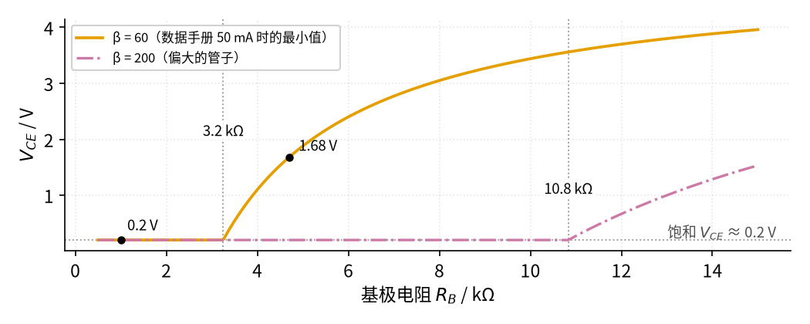
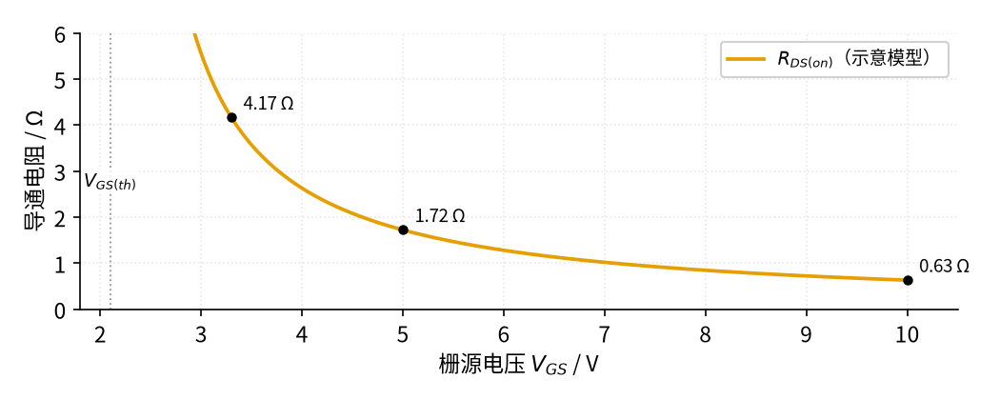

# P2 半导体入门 · 参数与调试篇

[上一页：原理与实现篇](page2.md) · [直觉篇](page1.md) · [原理与实现篇](page2.md) · 本页：参数与调试篇 · [下一页：17 自锁 · 直觉篇](../17-self-locking/page1.md) · 前置节点：[P1 元件速成 · 直觉篇](../P1-components-basics/page1.md)

## 本页要解决的问题

上一页学会了用 0.7 V 规则、 $I_C = \beta I_B$ 和门限电压去估算电路。可真去买元件时，数据手册上有几十个参数，到底该看哪几个？电路搭好了不工作、或者能工作但三极管烫手，又该从哪里查起？本页先列一张「最该看的参数表」，再用两张扫描图说明最常见的两个坑：三极管没进饱和、MOS 管没开到底，最后是故障排查表和练习。

## 1. 数据手册里最该看的参数

| 器件 | 参数 | 含义 | 典型值（型号） | 设计时怎么用 |
|---|---|---|---|---|
| 二极管 | 正向压降 $V_F$ | 导通时两端电压，本教程记作 $V_D$ | 10 mA 时最大 1 V（1N4148） | 估算时用 0.7 V，算最坏情况用手册最大值 |
| 二极管 | 反向耐压 $V_{RRM}$ | 反接时能承受的最大电压 | 100 V（1N4148） | 要高于电路里可能出现的最高反向电压 |
| 稳压管 | 稳压值 $V_Z$ | 击穿后两端电压，在测试电流 $I_{ZT}$ 下测得 | 5.1 V ±5%，49 mA 下（1N4733A） | 输出电压就是它，注意公差；电流偏离 $I_{ZT}$ 时按 $V = V_Z + r_Z(I_Z - I_{ZT})$ 修正 |
| 稳压管 | 动态电阻 $r_Z$ （手册写作 $Z_{ZT}$ ） | 电流每变 1 A 电压变几伏 | 最大 7 Ω（1N4733A） | 用最大值估算最坏的电压变化 |
| 稳压管 | 拐点电流 $I_{ZK}$ / 最大电流 $I_{ZM}$ | 稳得住的最小电流 / 不烧的最大电流 | 1 mA / 178 mA（1N4733A） | 工作电流要始终落在两者之间 |
| 稳压管 | 额定功率 $P_Z$ | 能长期承受的功耗 | 1.3 W（1N4728A 系列） | 实际功耗 $V_Z I_Z$ 留一半余量 |
| 三极管 | 电流放大倍数 β（手册写作 $h_{FE}$ ） | $I_C / I_B$ | 10 mA 时 100–300，50 mA 时最小 60（2N3904） | 设计开关时**用最小值** |
| 三极管 | 饱和压降 $V_{CE(sat)}$ | 饱和时集电极-发射极电压 | 最大 0.2 V（10 mA）、0.3 V（50 mA）（2N3904） | 估算负载电流时从电源里扣掉 |
| 三极管 | 最大集电极电流 $I_C$ | 长期允许的电流 | 200 mA（2N3904） | 负载电流留余量 |
| 三极管 | 最大功耗 $P_C$ / 结到环境热阻 $\theta_{JA}$ | 长期允许的发热功率 / 每发 1 W 热管芯比周围空气热多少度 | 625 mW（环境 25 °C，每升高 1 °C 减 5 mW）/ 200 °C/W（2N3904，TO-92，onsemi） | 管耗约 $V_{CE} I_C$ ；饱和开关时很小，工作在放大区时要算（见 [07 射极跟随器 · 原理与实现篇](../07-emitter-follower/page2.md)） |
| MOS 管 | 门限电压 $V_{GS(th)}$ | 刚开始导通（1 mA）时的 $V_{GS}$ | 0.8 / 2.1 / 3.0 V（2N7000 最小/典型/最大） | 只说明「从这里开始开」，不说明「开到底」 |
| MOS 管 | 导通电阻 $R_{DS(on)}$ | 完全导通时漏源之间的电阻，**必须看测试条件里的** $V_{GS}$ | 4.5 V 时最大 5.3 Ω，10 V 时最大 5 Ω（2N7000） | 驱动电压要不低于手册测试条件 |
| MOS 管 | 栅源最大电压 $V_{GSS}$ | 栅源之间不能超过的电压 | ±20 V（2N7000） | 高边开关时尤其要检查 |

数据来自 [1N4148](https://www.vishay.com/docs/81857/1n4148.pdf)、[1N4728A 系列](https://www.vishay.com/docs/85816/1n4728a.pdf)、[2N3904](https://www.onsemi.com/download/data-sheet/pdf/2n3904-d.pdf) 和 [2N7000](https://www.onsemi.com/download/data-sheet/pdf/nds7002a-d.pdf) 的数据手册。一个读表习惯：**设计时总按最坏值算**。β 取最小值、 $V_{GS(th)}$ 取最大值、 $V_Z$ 考虑 ±5% 公差，这样换一批元件电路照样能工作。

## 2. 扫描一：基极电阻选大了，三极管就不饱和

[P2 半导体入门 · 原理与实现篇](page2.md) 例 2 用 β 的最小值 60 算出基极电阻应选 1.5 kΩ。如果有人用手边一只 β 很大的管子做实验，发现 10 kΩ 也能点亮负载，就把 10 kΩ 写进了设计，会怎样？下面固定单片机驱动 3.3 V、电源 5 V、负载 100 Ω（饱和时 48 mA），把基极电阻从 0.5 kΩ 扫到 15 kΩ，比较两只不同 β 的管子。

请看图 P2-p3-1：橙色实线是 β = 60 的管子，红紫色点划线是 β = 200 的管子，纵轴是三极管两端电压 $V_{CE}$ 。

*图 P2-p3-1　驱动 3.3 V、负载 100 Ω 时，基极电阻对三极管两端电压的影响（两种 β）*

两条曲线左边都贴在灰色点线（饱和 $V_{CE}$ ≈ 0.2 V）上，说明基极电阻小时都能饱和。β = 200 的管子要到 10.8 kΩ 才离开饱和，β = 60 的管子过了 3.2 kΩ 就离开了。取 $R_B$ = 4.7 kΩ 时，β = 200 的管子仍然饱和，β = 60 的管子 $V_{CE}$ 却升到 1.68 V：负载少分了约 1.5 V，三极管自己要承受 1.68 V × 约 33 mA ≈ 55 mW 的发热，比饱和时大好几倍。这就是「同样的板子，有的能用、有的不行、有的三极管发烫」的来源。结论很简单：**按 β 最小值算，再留 2 倍左右的余量**；用 1 kΩ 时两只管子都稳稳饱和在 0.2 V。

## 3. 扫描二：MOS 管「开了」不等于「开到底」

MOS 管在门限电压附近只是刚开始导电，导通电阻很大；要再往上加几伏，导通电阻才会降到手册给的值。下面用 [P2 半导体入门 · 原理与实现篇](page2.md) 同一个示意模型，扫描 $V_{GS}$ 从 2.6 V 到 10 V 时的导通电阻，并算出负载电流为 0.2 A 时 MOS 管自己的发热（功率 $P = I^2 R_{DS(on)}$ ）。

请看图 P2-p3-2 中橙色曲线在 3.3 V、5 V 和 10 V 三个点的数值。

*图 P2-p3-2　N 沟道 MOS 管导通电阻随栅源电压变化（示意模型，非具体型号）*

3.3 V 驱动时导通电阻约 4.17 Ω，0.2 A 下发热 167 mW；5 V 驱动时 1.72 Ω、69 mW；10 V 驱动时只有 0.63 Ω、25 mW。从 3.3 V 加到 10 V，导通电阻降为约七分之一。示意模型的具体数字不对应某个型号，但规律是普遍的：TI 的应用笔记把「以为 $V_{GS}$ 超过门限就完全导通」列为 MOS 管最常见的设计错误之一，并建议驱动电压至少达到手册给出 $R_{DS(on)}$ 时所用的 $V_{GS}$ （[TI SLPA021](https://www.ti.com/lit/an/slpa021/slpa021.pdf) 第 4.2 节）。同一份笔记的第 6 节还提醒：栅极悬空会自己积累电荷导致误导通，应在栅源之间加一只电阻，TI 给的范围是 10 kΩ 到 1 MΩ；本教程统一写「常用 10 kΩ–100 kΩ（TI 建议范围 10 kΩ–1 MΩ）」，具体取多大是关断速度和驱动电流之间的折中（太大防干扰能力弱，太小会和栅极电阻分压、多耗驱动电流），见 [21 MOS 管开关 · 参数与调试篇](../21-mosfet-switch/page3.md) 的参数表。

## 4. 故障排查表

| 现象 | 可能原因 | 怎么查 | 怎么改 |
|---|---|---|---|
| LED 完全不亮 | LED 接反（阳极、阴极颠倒） | 万用表二极管档测 LED，红表笔接阳极时应微亮或显示约 1.8 V | 掉头重焊；长脚是阳极 |
| LED 亮一下就灭，或发烫 | 没串限流电阻，电流失控 | 看电路里 LED 是否直接接在电源上 | 按 $(V_{CC} - V_D)/I$ 串电阻，见 [P2 半导体入门 · 原理与实现篇](page2.md) 例 1 |
| 负载电压比预期低约 0.7 V | 忘了二极管的正向压降（例如电源端加了防反接二极管） | 测二极管两端电压 | 计算时扣掉 0.7 V；对压降敏感时改用肖特基二极管（正向压降只有约 0.15–0.45 V 的二极管，代价是反向漏电较大，见 [P2 半导体入门 · 原理与实现篇](page2.md)） |
| 三极管开关时负载不够亮、三极管发热 | 基极电流不够，三极管工作在放大区而非饱和 | 测 $V_{CE}$ ：饱和应约 0.2 V，明显更高就是没饱和 | 按 β 最小值重算 $R_B$ ，留 2 倍余量，见图 P2-p3-1 |
| 三极管或单片机引脚烧坏 | 没有基极电阻，基极直接接到驱动信号 | 查基极回路是否有串联电阻 | 加基极电阻，把 $I_B$ 限制在几毫安 |
| 断开控制线后负载自己乱开乱关 | MOS 管栅极悬空 | 用手指靠近栅极，负载状态变化即可确认 | 栅源之间加下拉电阻，常用 10 kΩ–100 kΩ（TI 建议范围 10 kΩ–1 MΩ） |
| MOS 管能开，但发热、负载电压偏低 | $V_{GS}$ 只比门限高一点，导通电阻大 | 测漏源电压，算 $R_{DS(on)} = V_{DS}/I_D$ | 换逻辑电平 MOS 管，或抬高驱动电压，见图 P2-p3-2 |
| 稳压管发烫、电压漂移或损坏 | 功耗 $V_Z I_Z$ 超过额定功率，或限流电阻太小 | 测限流电阻两端电压，算出电流 | 加大限流电阻，或换更大功率的稳压管 |
| 稳压管输出只有约 0.7 V | 稳压管接反，变成正向导通的普通二极管 | 看管身色环（阴极）是否朝向正电源；测两端电压约 0.7 V | 阴极朝正电源方向重接 |
| 稳压管输出等于电源电压（不接负载时） | 稳压管开路、没焊上或已烧断 | 断电后用万用表二极管档测稳压管，正反都不通即开路 | 补焊或更换稳压管，并检查限流电阻是否太小把它烧了 |

## 5. 练习

**练习 1（易）**：12 V 电源串一个 1 kΩ 电阻，再串两只同方向的硅二极管，电流约多少？

答案

每只二极管按 0.7 V 算，两只共 1.4 V，电阻上是 12 − 1.4 = 10.6 V，电流约 10.6 mA。

**练习 2（易）**：[P2 半导体入门 · 直觉篇](page1.md) 稳压管那张图里的电路（12 V、1 kΩ、5.1 V 稳压管）在不接负载时，稳压管流过多少电流、功耗多少？用 1N4733A 安全吗？

答案

电阻上的电压 12 − 5.1 = 6.9 V，电流 6.9 mA，全部流过稳压管；功耗 5.1 V × 6.9 mA ≈ 35 mW，远小于 1.3 W，也在 1 mA 到 178 mA 的工作范围内，安全。（精确一点：这个电流比测试电流 49 mA 小得多，按 [P2 半导体入门 · 原理与实现篇](page2.md) 的模型稳压管电压略低于 5.1 V。把 $V = 5.1 + 7(I - 0.049)$ 和 $I = (12 - V)/1000$ 联立，解得 $I \approx 7.19$ mA、 $V \approx 4.81$ V，功耗 4.81 × 7.19 ≈ 35 mW，结论不变。）

**练习 3（中）**：5 V 单片机驱动 NPN 三极管控制一个 12 V、120 Ω 的负载，三极管的 β 最小 50，饱和压降按 0.2 V 算。基极电阻最大可以取多少？留 2 倍余量后选哪个标准值？

答案

负载电流 $I_C = (12 - 0.2)/120 \approx 98$ mA；最少需要 $I_B$ = 98 ÷ 50 ≈ 2.0 mA，留 2 倍余量取 4 mA。 $R_B = (5 - 0.7)/0.004 \approx 1075$ Ω，选 1 kΩ。不留余量的边界是 $R_B$ ≈ 2.2 kΩ，选 2.2 kΩ 就刚好压线，换一只 β 偏小的管子便会出现图 P2-p3-1 那样的不饱和。

**练习 4（中）**：小明用 3.3 V 单片机的一个引脚直接接 2N7000 的栅极，2N7000 的漏极接一个 5 V、100 Ω 的负载，源极接地，栅极和地之间什么都没接。电路「有时能用」。请找出两处问题，并分别给出改法。

答案

第一处是驱动电压不够： $V_{GS}$ 最多 3.3 V，只比 2N7000 门限的最大值 3.0 V 高 0.3 V，而手册只在 4.5 V 和 10 V 下保证导通电阻；碰到门限偏高的管子，它半开半关、发热，负载电压偏低（见图 P2-p3-2 的规律）。改法：换数据手册在 2.5 V 或更低 $V_{GS}$ 下标了导通电阻的逻辑电平 MOS 管，或者先用三极管把驱动电压抬高。

第二处是栅极没有下拉电阻：单片机上电复位、引脚还没设成输出时，栅极悬空，负载可能自己乱开（下拉的道理见 [21 MOS 管开关 · 直觉篇](../21-mosfet-switch/page1.md)）。改法：栅源之间加一只下拉电阻，常用 10 kΩ–100 kΩ（TI 建议范围 10 kΩ–1 MΩ）。负载电流 5 V ÷ 100 Ω = 50 mA，在 2N7000 的 200 mA 额定电流以内，这一项没问题。

**练习 5（难，变体迁移）**：想用 5 V 单片机直接控制一个 P 沟道 MOS 管，把 12 V 电源接通或断开给负载（高边开关），源极接 12 V，栅极直接接单片机引脚。单片机输出 0 V 和 5 V 时 MOS 管分别是什么状态？问题出在哪？怎么改？

答案

P 沟道 MOS 管看的是栅极比源极**低**多少。输出 0 V 时 $V_{GS}$ = 0 − 12 = −12 V，管子导通；输出 5 V 时 $V_{GS}$ = 5 − 12 = −7 V，仍远超门限，**管子关不断**。要关断，栅极必须拉回接近 12 V。常见改法（上拉电阻的意思见 [P2 半导体入门 · 原理与实现篇](page2.md) 的 P 沟道最小例子）：栅极经一个电阻上拉到 12 V，再用一只 NPN 三极管（或 N 沟道 MOS 管）把栅极拉到地，单片机控制这只小管子——单片机给高电平，小管子导通把栅极拉低，P 沟道管导通；给低电平，上拉电阻把栅极拉回 12 V，P 沟道管关断。电源电压更高时还要保证 $V_{GS}$ 不超过 ±20 V 的极限，TI 的应用笔记第 5.3 节专门提醒了这一点（[TI SLPA021](https://www.ti.com/lit/an/slpa021/slpa021.pdf)）。SparkFun 的三极管教程也指出 5 V 单片机不能直接关断 12 V 的 PNP 高边开关（[SparkFun Transistors](https://learn.sparkfun.com/tutorials/transistors/all)）。

## 小结与下一步

选元件时盯住少数几个参数，并且总按最坏值算：β 取最小、 $V_{GS(th)}$ 取最大、 $R_{DS(on)}$ 看测试条件。调试时先测关键电压： $V_{CE}$ 是否约 0.2 V、 $V_{DS}$ 是否足够小、稳压管两端是否等于 $V_Z$ 。下一个节点 [17 自锁 · 直觉篇](../17-self-locking/page1.md) 回到线圈和触点，讲按一下按钮就能「自己保持」的控制电路；本节的三极管开关会在 22 节被用来驱动继电器线圈，[P1 元件速成 · 原理与实现篇](../P1-components-basics/page2.md) 讲过的续流二极管也会在那里派上用场。
