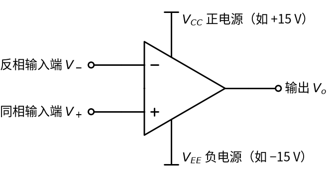
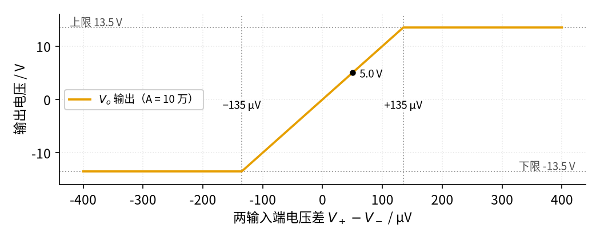
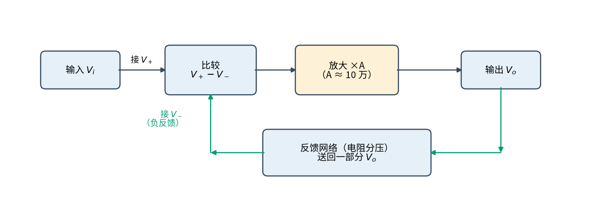

# P3 运放入门 · 直觉篇

[上一页：P1 元件速成 · 参数与调试篇](../P1-components-basics/page3.md) · 本页：直觉篇 · [原理与实现篇](page2.md) · [参数与调试篇](page3.md) · [下一页：原理与实现篇](page2.md) · 前置节点：[P1 元件速成 · 直觉篇](../P1-components-basics/page1.md)

## 为什么要学运放

假设你做了一个温度计：热电偶或者电桥传感器在温度变化 1 ℃ 时，只给出几毫伏的电压变化。单片机的模数转换器（把电压变成数字的电路）却希望看到 0～5 V 的信号。几毫伏直接送进去，几乎看不出变化，还会被噪声淹没。我们需要一个"放大器"：把小电压**按准确的倍数**放大，比如放大 100 倍、1000 倍，而且倍数不能随温度、随批次乱变。

用 P1 学过的电阻能不能做到？不能。电阻分压（见 [P1 元件速成 · 原理与实现篇](../P1-components-basics/page2.md)）只会把电压**变小**，永远放大不了。三极管（一种用小电流控制大电流的半导体元件，下一节 [P2 半导体入门 · 直觉篇](../P2-semiconductor-basics/page1.md) 会细讲）能放大，但它的放大倍数随温度和个体差异飘得很厉害。这一页要介绍的**运算放大器**（简称运放）解决的正是这个问题：它本身的放大倍数大得夸张，也不太准；但给它配上两个电阻，整个电路的放大倍数就只由这两个电阻决定，又准又稳。全书后面 01～04、15、16 等节点都建立在这一页的两个结论上：**虚短**和**虚断**。14 电压比较器则恰好是反例：它不加负反馈，不能用虚短，只能用"谁大谁小"来分析。

## 一、运放长什么样：五根线

运放是一块集成电路，画在图上是一个三角形。先看 图 P3-p1-1，认一认它的五根引线。

*图 P3-p1-1　运放的符号和五根引线*

图 P3-p1-1 左边有两个输入端：标"−"号的叫**反相输入端**，它的电压记作 $V_-$ ；标"+"号的叫**同相输入端**，电压记作 $V_+$ 。右边的尖角是**输出端**，电压记作 $V_o$ 。上下两根线接电源：上面是正电源 $V_{CC}$ （例如 +15 V），下面是负电源 $V_{EE}$ （例如 −15 V）。很多电路图为了简洁不画电源线，但它们一定存在：**运放的输出电压只能在两个电源电压之间活动**，这一点后面会反复用到。

"−"和"+"不是说这个端子只能接负电压或正电压，而是说：同相端的电压升高，输出跟着**升高**；反相端的电压升高，输出反而**降低**。

## 二、运放只会做一件事：比较，然后狠狠放大

运放内部有几十个三极管，但对外它只做一件事：看两个输入端的电压**差**，然后把这个差放大 A 倍输出。用一句话说就是"输出等于 A 乘以同相端减去反相端"：

$$V_o = A\thinspace (V_+ - V_-)$$

这里的 A 叫做**开环增益**（"开环"的意思是还没接任何反馈电阻时运放自身的放大倍数）。它大得惊人：常见的 LM358B 典型值约为 14 万倍，我们取个整数 A = 100000 来算。

代一组数试试：如果 $V_+$ 比 $V_-$ 高 50 μV（微伏，百万分之一伏），输出就是 100000 × 0.00005 V = 5 V。只要差 50 μV，就能输出 5 V。那差 1 mV 呢？按公式应该是 100 V，可电源只有 ±15 V，输出不可能超过电源，于是输出就"顶到头"不动了，这叫**饱和**。请看 图 P3-p1-2。

*图 P3-p1-2　不接反馈时运放的输入—输出关系（A = 10 万，电源 ±15 V）*

图 P3-p1-2 中的橙色线是输出电压。只有在中间极窄的一段（两输入端相差 −135 μV～+135 μV）里，输出才随输入按比例变化；横轴上只要再往外走一点，输出就贴在上限 13.5 V 或下限 −13.5 V 上（两条灰色点线），一动不动。为什么是 13.5 V 而不是 15 V？因为实际的运放输出离电源总要差一截，这张图假设上下各差 1.5 V（LM358B 的正电源一侧大约就差这么多，负电源一侧差得少一些，[P3 运放入门 · 参数与调试篇](page3.md) 会细讲）。

这说明：**直接拿运放当放大器用是不行的**。它就像一辆油门极其灵敏的车，脚尖轻轻一碰就冲到最高速，根本没法匀速行驶。外界一点点噪声、两个输入端的一点点不对称，都会让输出撞到电源上。这种"不加反馈"的用法也有用处，它就是第 14 节的电压比较器，专门用来判断"谁大谁小"。

## 三、负反馈：把输出的一部分送回反相端

怎样让这辆"油门超灵敏的车"稳稳地开？办法是让司机一直看着速度表：快了就松油门，慢了就踩一点。在电路里，"看速度表"就是把输出电压的一部分送回到**反相输入端**，这就叫**负反馈**。看 图 P3-p1-3 的方框图。

*图 P3-p1-3　负反馈环路：输出的一部分被送回反相端参与比较*

图 P3-p1-3 里，输入 $V_i$ 接到同相端，蓝绿色的箭头是反馈路径：输出 $V_o$ 经过电阻分压，把一部分送回反相端。想一想会发生什么：如果输出偏高，送回反相端的电压也偏高，两端之差变小，输出就被拉下来；如果输出偏低，差变大，输出又被推上去。来回几下，电路很快停在一个平衡点上，而在这个平衡点上，**两个输入端的电压差小到只有几十微伏，几乎为零**。

这和洗澡调水温一模一样：手一直试着水温，烫了就往冷水那边拧一点，凉了就往热水那边拧一点，最后水温稳定在你想要的温度。真正决定水温的是"你想要多少度"，而不是龙头有多灵敏。对运放来说，龙头的灵敏度就是 A，"你想要多少度"由反馈电阻决定。所以：**A 越大，电路越听电阻的话**。

## 四、两句口诀：虚短和虚断

有了负反馈、而且输出没有饱和，运放电路就可以用两条非常简单的口诀来分析：

1. **虚短**：两个输入端的电压几乎相等， $V_+ \approx V_-$ 。"短"是说它们像被导线短接了一样电压相同，"虚"是说并没有真的连起来。
2. **虚断**：流进两个输入端的电流几乎为零。"断"是说输入端像断开了一样不取电流，"虚"是说它们其实还连在电路里。

虚断几乎总是成立的，因为运放的输入端本身就很"娇气"，几乎不吸电流；**虚短却有条件**：必须有负反馈，而且输出没有顶到电源（没有饱和）。如果反馈接到了同相端，那是**正反馈**：输出偏高时送回去的电压让它更高，输出会被一路推到电源，虚短同样不成立（14 比较器的迟滞和 16 振荡器会用到正反馈）。像 图 P3-p1-2 那样不加反馈，两个输入端可以差好几伏，输出早就饱和了，这时候再说"虚短"就是大错特错。这是初学者最常见的错误，请先记在心里。

## 一句话总结

**运放把两输入端的电压差放大 A 倍（A 约 10 万），不加反馈时一碰就饱和；加上负反馈、且输出未饱和时，两输入端电压几乎相等（虚短）、输入端几乎不取电流（虚断），电路的放大倍数就只由外接电阻决定**。下一页（[P3 运放入门 · 原理与实现篇](page2.md)）我们用一个反相放大电路，把这两句口诀从 $V_o = A(V_+ - V_-)$ 一步一步推出来。
