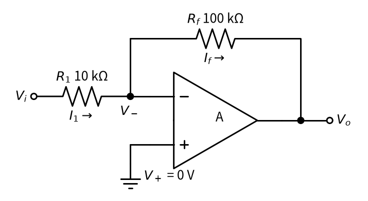
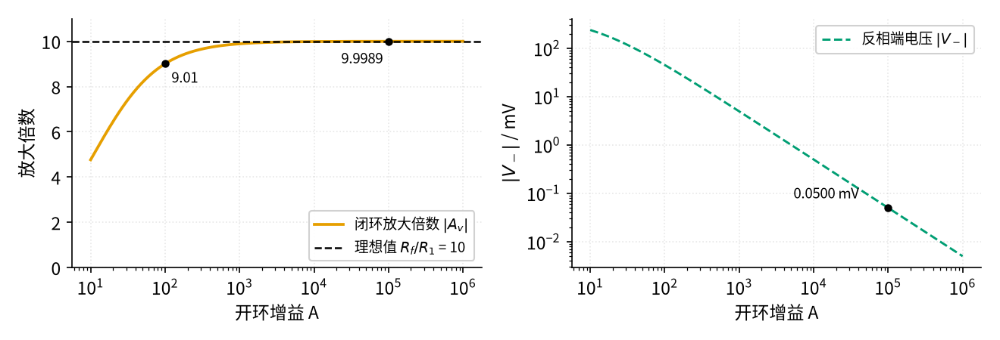
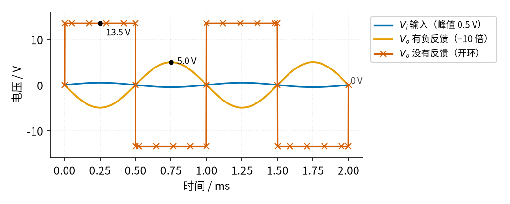

# P3 运放入门 · 原理与实现篇

[上一页：直觉篇](page1.md) · [直觉篇](page1.md) · 本页：原理与实现篇 · [参数与调试篇](page3.md) · [下一页：参数与调试篇](page3.md) · 前置节点：[P1 元件速成 · 直觉篇](../P1-components-basics/page1.md)

## 本页要解决的问题

上一页给了两句口诀：虚短（有负反馈、输出未饱和时，两输入端电压几乎相等）和虚断（输入端几乎不取电流）。可是"几乎"到底是多少？为什么开环增益 A 只有 10 万、并不是无穷大，我们却敢把两端电压当成相等？这一页只用上一页的一个式子 $V_o = A(V_+ - V_-)$ 和 P1 里学过的欧姆定律，**不借助任何口诀**，把一个真实的放大电路算到底，再看口诀是怎么"自己冒出来"的。最后用一段 Python 仿真，把 A 从 10 扫到 100 万，亲眼看着结果逼近口诀给出的答案。

## 一、理想运放的四条假设

教科书和厂家的应用笔记（如 TI 的 SLAA068）通常先假设一个"理想运放"：

1. 开环增益 A 无穷大；
2. 输入端不取电流（输入电阻无穷大）；
3. 输出端的内阻为零：不管接什么负载，它想输出多少伏就是多少伏（内阻的意思是：把一个电源看成"理想电压源串一个电阻"，这个电阻就是内阻，见 [P1 元件速成 · 原理与实现篇](../P1-components-basics/page2.md)）；
4. 对所有频率的信号一视同仁。

真实的运放当然做不到，比如 LM358B 的 A 典型值约为 14 万倍，两个输入端之间的电阻约 10 MΩ（兆欧，一千万欧），输入电流虽然很小，但不是零。下面我们只保留第 2 条（输入不取电流），A 就用有限的 10 万，看看误差有多大。

## 二、推导：A 有限时的反相放大器

请看 图 P3-p2-1。这是第 01 节要专门讲的"反相放大器"：输入电压 $V_i$ 经过输入电阻 $R_1$ 接到反相端，输出 $V_o$ 经过反馈电阻 $R_f$ 也接回反相端，同相端接地。注意：直觉篇的负反馈方框图是输入接同相端的版本，这里换成输入接反相端的版本，因为它推起来最简单；两种接法的结论（虚短、虚断）完全相同。



*图 P3-p2-1　用来推导的反相放大电路（输入电阻 10 kΩ，反馈电阻 100 kΩ，开环增益 A）*

在 图 P3-p2-1 中，反馈电阻 $R_f$ 把输出接回了反相端，这就是上一页说的负反馈。图里标了两个电流： $I_1$ 从 $V_i$ 流过 $R_1$ 到达反相端， $I_f$ 从反相端流过 $R_f$ 到达输出端。反相端那个黑点的电压记作 $V_-$ ，同相端接地， $V_+ = 0$ 。

**第 1 步：电流守恒**。反相端这个点像一个三通水管接头，流进来多少就要流出去多少。运放输入端不取电流，所以从 $R_1$ 流进来的电流全部从 $R_f$ 流走。用欧姆定律分别写出两个电流（电流 = 电阻两端电压差 ÷ 电阻）：

$$\frac{V_i - V_-}{R_1} = \frac{V_- - V_o}{R_f}$$

**第 2 步：运放自己的规律**。输出等于 A 乘以两端之差，而 $V_+ = 0$ ：

$$V_o = A\thinspace (0 - V_-) \quad\Rightarrow\quad V_- = -\frac{V_o}{A}$$

**第 3 步：联立**。把第 2 步的 $V_-$ 代入第 1 步，整理一下（只用到移项和通分）就得到输出电压：

$$V_o = -\frac{R_f}{R_1}\thinspace V_i \cdot \frac{1}{1 + \dfrac{1 + R_f/R_1}{A}}$$

<details><summary>中间步骤（自己推不出来时再展开）</summary>

为了少写字，记电阻比 $k = R_f/R_1$ 。

1. 第 1 步的式子两边同乘 $R_f$ ，左边变成 $k(V_i - V_-)$ ： $kV_i - kV_- = V_- - V_o$ 。
2. 把含 $V_-$ 的项移到右边： $kV_i = (1+k)V_- - V_o$ 。
3. 代入第 2 步的 $V_- = -V_o/A$ ： $kV_i = -\frac{(1+k)V_o}{A} - V_o = -V_o\left(1 + \frac{1+k}{A}\right)$ 。
4. 两边同除以括号里的那一项，就得到 $V_o = -kV_i \div \left(1 + \frac{1+k}{A}\right)$ ，把 $k$ 换回 $R_f/R_1$ 就是上面的式子。

</details>

这个式子用中文说就是：**输出等于"负的电阻比乘以输入"，再乘一个修正系数**。修正系数的分母里有一项"(1 + 电阻比) ÷ A"，A 越大，这一项越小，修正系数就越接近 1。

**第 4 步：代数**。取 $R_1$ =10 kΩ， $R_f$ =100 kΩ（电阻比为 10）， $V_i$ =0.5 V，A = 100000：

- 修正项 = (1 + 10) ÷ 100000 = 0.00011，修正系数 = 1 ÷ 1.00011 ≈ 0.99989；
- $V_o$ ≈ −10 × 0.5 V × 0.99989 ≈ −4.99945 V，放大倍数 $A_v = V_o / V_i$ ≈ −9.9989；
- $V_-$ = 4.99945 V ÷ 100000 ≈ 0.050 mV，也就是 50 μV。

这里 $A_v$ 是**电压放大倍数**，即输出电压除以输入电压，负号表示输出和输入方向相反。接上反馈以后整个电路的放大倍数叫**闭环放大倍数**（"闭环"就是输出经反馈电阻又绕回输入、形成了一个环），就是这里的 $A_v$ ；它和运放自身的开环增益 A 是两回事。结果和"理想答案" −10 只差万分之一点一；而反相端的电压只有 50 μV，和同相端的 0 V 相比，完全可以当成相等。

> 💡 **实际芯片会怎样**：50 μV 是只考虑开环增益时的理论值。真实的 LM358B 两个输入端之间本来就有一个零点几毫伏的**失调电压**（手册典型 ±0.3 mV、最大 ±3 mV），用 TI 的 LM358B 模型做 SPICE 仿真，反相端是 362 μV 而不是 50 μV，输出 −4.99696 V。所以用万用表量反相端，读到的是零点几毫伏甚至几毫伏；它对 5 V 输出的影响只有千分之一左右，只要有负反馈、输出没饱和，虚短照样好用。

## 三、虚短、虚断是这样冒出来的

把第 3 步的式子里的 A 想象成无穷大，修正系数就变成 1：

$$V_o = -\frac{R_f}{R_1}\thinspace V_i$$

同时第 2 步的 $V_- = -V_o / A$ 变成 0，也就是 $V_- = V_+$ 。这就是**虚短**。**虚断**则是我们一开始就用上的"输入端不取电流"。所以以后遇到有负反馈、输出未饱和的运放电路，可以直接跳过上面四步：

1. 由虚短，反相端电压等于同相端电压（这里是 0 V，这个点因此叫"虚地"）；
2. 由虚断， $R_1$ 上的电流全部流过 $R_f$ ；
3. 一行就得 $V_o = -\frac{R_f}{R_1} V_i$ 。

但要记住口诀的**两个前提**：一是**必须有负反馈**（反馈接在反相端；反馈接到同相端就是**正反馈**，输出会被推向饱和，虚短不成立，14、16 会用到它），二是**输出没有饱和**。推导的第 2 步之所以能得到" $V_-$ 很小"，是因为负反馈把输出钉在一个有限的值上；没有反馈时，第 1 步的电流方程根本不存在，两输入端可以差好几伏。

下面这段仿真把上面的四步交给 Python：对 200 个不同的 A 解出放大倍数和 $V_-$ ，并画出 图 P3-p2-2。代码可以直接复制运行（需要 numpy 和 matplotlib）：把它存成一个文件，**在仓库根目录运行**，开头两行会让 Python 找到 `code/figs` 里全书统一的画图样式 `figstyle`（图上的中文也靠它显示，否则会变成方框）。完整文件见 [code/P3_sim.py](../code/P3_sim.py)。

## 四、仿真：A 从 10 扫到 100 万

```python
import sys, pathlib
sys.path.insert(0, str(pathlib.Path("code/figs").resolve()))  # 在仓库根目录运行
# P3 最小仿真：开环增益 A 有限时，反相放大器的闭环放大倍数和反相端电压 V- 各是多少。
# 思路：运放只做一件事 V_o = A·(V+ − V-)；反相端节点满足「流进 = 流出」（输入电流为 0），
#      两式联立就能解出 V_o，不需要任何「虚短」假设。看 A 越大，结果越接近 −R_f/R_1、V- 越接近 0。
import numpy as np                                 # 数组运算
import matplotlib.pyplot as plt                    # 画图
import figstyle as fs                              # 全书统一的颜色、轴标签、保存函数

R1, Rf = 10e3, 100e3                               # 输入电阻 R1 = 10 kΩ，反馈电阻 Rf = 100 kΩ
V_i = 0.5                                          # 输入电压 0.5 V（直流，便于看清数字）

def solve(A):                                      # 给定开环增益 A，解出闭环放大倍数和 V-
    # 联立 ① V_o = A·(0 − V-)  ② (V_i − V-)/R1 = (V- − V_o)/Rf，消去 V- 得：
    V_o = -(Rf / R1) * V_i / (1 + (1 + Rf / R1) / A)   # 有限 A 下的输出电压
    return V_o / V_i, -V_o / A                     # 放大倍数 A_v = V_o/V_i；V- 由 ① 倒推 = −V_o/A

A = np.logspace(1, 6, 200)                         # 开环增益从 10 扫到 100 万（对数均匀取 200 个点）
gain, V_minus = solve(A)                           # 一次算出 200 个点
at = solve                                         # 打印单个点时也用同一个函数

for a in (1e2, 1e3, 1e5):                          # 打印几个典型值（正文引用的数字都来自这里）
    g, vm = at(a)
    print(f"A = {a:>8.0f}: A_v = {g:.4f}，V- = {vm*1e3:.4f} mV")
g5, vm5 = at(1e5)
assert abs(g5 - (-10)) < 0.002                     # A = 10 万时，放大倍数和理想值 −10 相差不到 0.002
assert abs(vm5) < 1e-4                             # A = 10 万时，V- 不到 0.1 mV：几乎就是 0 V（虚短）

fig, (a1, a2) = plt.subplots(1, 2, figsize=fs.SIZE["pair"])
a1.semilogx(A, -gain, **fs.LS["vout"], label="闭环放大倍数 $|A_v|$")      # 橙色：仿真结果
a1.axhline(Rf / R1, **fs.LS["good"], label="理想值 $R_f/R_1$ = 10")      # 黑色虚线：理想值
fs.mark(a1, 1e2, -at(1e2)[0], dx=4, dy=-12)                               # 标出 A = 100 时的值
fs.mark(a1, 1e5, -at(1e5)[0], fmt="{:.4f}", dx=-30, dy=-14)              # 标出 A = 10 万时的值
fs.axlabels(a1, "开环增益 A", None, "放大倍数", None); a1.set_ylim(0, 11); a1.legend(loc="lower right")
a2.loglog(A, abs(V_minus) * 1e3, **fs.LS["fb"], label="反相端电压 $|V_-|$")  # 蓝绿色虚线：V-
fs.mark(a2, 1e5, abs(vm5) * 1e3, fmt="{:.4f}", unit=" mV", dx=-60, dy=6)
fs.axlabels(a2, "开环增益 A", None, "$|V_-|$", "mV"); a2.legend(loc="upper right")
fs.save(fig, "P3", "P3_p2_2_gain_vs_A.png")        # 保存到 P3-opamp-basics/img/
```

运行后会打印：

```text
A =      100: A_v = -9.0090，V- = 45.0450 mV
A =     1000: A_v = -9.8912，V- = 4.9456 mV
A =   100000: A_v = -9.9989，V- = 0.0500 mV
```

并生成下面的 图 P3-p2-2。



*图 P3-p2-2　开环增益 A 对闭环放大倍数（左）和反相端电压（右）的影响*

图 P3-p2-2 左图的橙色线是电路的放大倍数（取了绝对值），黑色虚线是理想值 $R_f/R_1$ = 10。A 只有 100 时，放大倍数只有 9.01，误差约 10%；A 到 1000 以上，橙色线就几乎贴住了黑色虚线；A = 10 万时是 9.9989。右图的蓝绿色虚线是反相端电压 $|V_-|$ ，两个坐标轴都是对数刻度（对数刻度：每一大格代表数值乘 10，所以 10、100、1000 的间距一样），它是一条斜直线：A 每大 10 倍， $V_-$ 就小 10 倍，A = 10 万时只剩 0.0500 mV。这就是"A 越大，越听电阻的话"的定量版本：电阻比决定了结果，A 只负责把误差压小。

## 五、对照：同一个运放，不加反馈会怎样

把 图 P3-p2-1 里的 $R_f$ 拿掉，输入直接接同相端、反相端接地，运放就工作在开环状态。下面的 图 P3-p2-3 用同一个峰值 0.5 V、频率 1 kHz 的正弦输入，对比两种接法（这张图由 [code/figs/P3_figs.py](../code/figs/P3_figs.py) 生成）。



*图 P3-p2-3　有负反馈与没有反馈的输出对比（输入峰值 0.5 V，1 kHz）*

图 P3-p2-3 中蓝色是输入 $V_i$ ，橙色是接了负反馈的输出：一条反相、峰值 5.0 V 的平滑正弦，正是 −10 倍。朱红色带 × 的是开环输出：输入只要稍微大于 0，输出就冲到 13.5 V；稍微小于 0，就掉到 −13.5 V，正弦变成了方波。这张图为了简单把上下限都画成 ±13.5 V；用 TI 的 LM358B 模型做 SPICE 仿真，方波上沿约 13.8 V、下沿约 −15.0 V，负电源一侧离电源近得多，上下并不对称，[P3 运放入门 · 参数与调试篇](page3.md) 第一、二节会讲到。这时两个输入端之间的电压差最大有 0.5 V，比虚短的 50 μV 大了一万倍。**开环时不能用虚短**，这张图就是最直接的证据。

## 六、例题：由完整到留空到迁移

**例 1（完整示例）**　 $R_1$ =10 kΩ， $R_f$ =100 kΩ，A = 100000， $V_i$ =0.5 V，求 $V_o$ 和 $V_-$ 。

解：修正项 (1+10)/100000 = 0.00011； $V_o$ = −10 × 0.5 ÷ 1.00011 ≈ −4.99945 V； $V_-$ = − $V_o$ /A ≈ 0.050 mV。与理想值 −5 V 相差约 0.011%，与仿真打印的 −9.9989 倍一致。

**例 2（关键步骤留空）**　换一个便宜的运放，A = 10000；电阻改成 $R_1$ =10 kΩ、 $R_f$ =200 kΩ（电阻比 20）， $V_i$ =0.1 V。请把下面代码里的空格填上再运行：

```python
R1, Rf, A, V_i = 10e3, 200e3, 1e4, 0.1
V_o = -(Rf / R1) * V_i / (1 + ____ / A)      # 修正项的分子是什么？
V_minus = ____                               # 由 V_o = A·(0 − V-) 倒推
print(V_o, V_minus)
```

<details><summary>答案</summary>

修正项分子是 `(1 + Rf / R1)`，即 21；`V_minus = -V_o / A`。

$V_o$ = −20 × 0.1 ÷ (1 + 21/10000) = −2 ÷ 1.0021 ≈ −1.9958 V，放大倍数约 −19.958，误差约 0.21%； $V_-$ ≈ 0.20 mV。可以看出：电阻比越大、A 越小，误差越大，误差约等于 (1 + 电阻比)/A。

</details>

**例 3（变体迁移：单电源）**　把例 1 的电路接到单电源上： $V_{CC}$ =5 V， $V_{EE}$ 接地（0 V），输入 $V_i$ =+0.5 V。按公式应输出 −5 V，实际会输出多少？虚短还成立吗？先自己想，再看答案。

<details><summary>答案</summary>

输出只能在 0～5 V 之间活动，−5 V 根本到不了，输出会贴在最低点上不动，也就是**饱和**了。这个最低点只比 0 V 高一点：LM358B 手册给出，5 V 单电源、负载接地时输出最低典型只有约 5 mV、最大 20 mV（SPICE 仿真约 0.024 V）；[参数与调试篇](page3.md)的参数表"输出摆幅"一行写的"比负电源高约 0.1 V"是更保守的估计，这里按 0.1 V 算，结论不变（按 0.02 V 代入，反相端约 0.456 V，仍约 0.46 V）。这时反相端电压 $V_-$ 由 $R_1$ 、 $R_f$ 串联分压决定，只是两端分别是 0.5 V 和 0.1 V，都不是 0 V。做法是：先算两端电压差 0.5 − 0.1 = 0.4 V；电流 = 0.4 V ÷ (10 kΩ + 100 kΩ)，它在 $R_1$ 上降掉 0.4 × 10/110 ≈ 0.036 V；再从 0.5 V 往下减：0.5 − 0.036 ≈ 0.46 V。同相端却是 0 V，两端相差约 0.46 V，**虚短不成立**。解决办法是给同相端加一个"中点电压"（例如 2.5 V），让输出以 2.5 V 为中心上下摆动；[参数与调试篇](page3.md)还会画图算给你看单电源下输出能摆多远。

</details>

## 小结

- 只用"输入端不取电流"和 $V_o = A(V_+ - V_-)$ ，就能推出反相放大的输出；A 有限时，误差约为 (1 + 电阻比)/A，A = 10 万时只有万分之一左右。
- A 趋于无穷大，就得到虚短（ $V_+ = V_-$ ）和虚断两条口诀，以后可以一步到位。
- 口诀的前提是**有负反馈、输出不饱和**；开环时输出在电源之间来回跳，绝不能用虚短。

参考：TI《Understanding Basic Analog – Ideal Op Amps》(SLAA068B) https://www.ti.com/lit/an/slaa068b/slaa068b.pdf ；TI 反相放大电路手册 (SBOA270) https://www.ti.com/lit/pdf/sboa270 。
