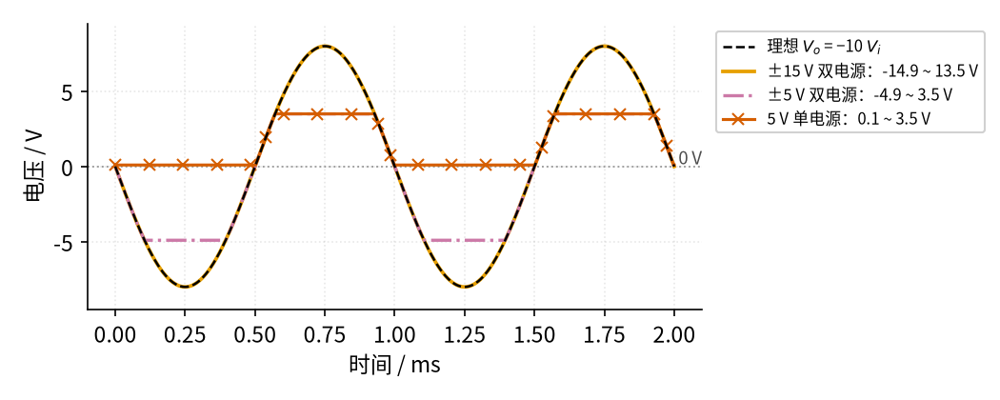
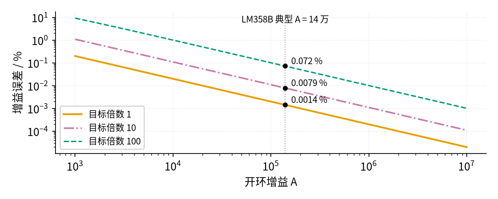

# P3 运放入门 · 参数与调试篇

[上一页：原理与实现篇](page2.md) · [直觉篇](page1.md) · [原理与实现篇](page2.md) · 本页：参数与调试篇 · [下一页：P2 半导体入门 · 直觉篇](../P2-semiconductor-basics/page1.md) · 前置节点：[P1 元件速成 · 直觉篇](../P1-components-basics/page1.md) · 后续：[01 反相放大 · 直觉篇](../01-inverting-amp/page1.md)

## 本页要解决的问题

前两页用的是"差不多理想"的运放。可一旦真的去买一颗运放、搭一块板子，马上会遇到这样的问题：数据手册上几十个参数，哪几个是入门必须看的？为什么书上算出来输出应该是 8 V，示波器上却只有 3.5 V？为什么同一个电路，换成 5 V 单电源就"没有输出"了？这一页把最要紧的几个参数讲清楚，用两张图看看参数变化会带来什么后果，再给出一张故障排查表和四道练习。

## 一、入门必须看懂的六个参数

下表的"典型值"取自 TI LM358B 数据手册（LM358 是最常见、最便宜的通用运放之一）。本书写的"LM358B"和常听到的"LM358"是同一个系列：手册把 LM358B 称为业界标准 LM358 的新一代版本，引脚相同，本书的数字一律以 B 版为准。这些数字只用来建立数量级的感觉，设计时请以你实际用的型号为准。

| 参数 | 物理含义 | 典型值（LM358B） | 对电路的影响 |
|---|---|---|---|
| 开环增益 A | 不加反馈时运放自身的放大倍数 | 约 14 万倍（最小 7 万） | 越大，闭环倍数越接近电阻比 |
| 输入电阻 | 两个输入端"吃电流"的难易 | 约 10 MΩ | 越大，虚断越成立 |
| 输出摆幅 | 输出最高、最低能到哪里 | 比正电源低约 1.35～1.5 V；比负电源高约 0.1 V（输出几乎不往里吸电流时；负载接在地上、输出在负半周、要吸收约 1 mA 时，余量增大到约 0.75 V） | 决定会不会削顶 |
| 电源电压 | 允许接的总电压 | 3～36 V（或 ±1.5～±18 V） | 决定输出摆幅的上下限 |
| 增益带宽积 GBW | 信号越快，A 越小；GBW 是"放大倍数 × 频率"能达到的上限 | 约 1.2 MHz | 高频信号放不大：例如放大 100 倍时，信号频率到 1.2 MHz ÷ 100 = 12 kHz 附近，实际倍数就明显不足了（01、15 节细讲） |
| 压摆率 SR | 输出电压每微秒最多能变化多少伏 | 约 0.5 V/μs | 大幅度的快信号会变形 |

另外还有一个由你自己决定的"参数"：**外接电阻的大小**。电阻比决定放大倍数，但电阻本身取多大也有讲究，通常在 1 kΩ～1 MΩ 之间：太小（比如几十欧），运放要输出很大的电流去推动它们，可能超出能力范围，还会发热；太大（比如几十兆欧），运放那一点点输入电流流过电阻也会产生可观的误差电压，电路还容易拾取干扰。所以 01 节的反相放大常用 10 kΩ 和 100 kΩ 这样的组合。

## 二、改变电源：输出能摆多远

先看第一个最常踩的坑：输出摆幅。我们让反相放大电路放大 10 倍，输入峰值 0.8 V 的正弦，理想输出峰值应为 8 V。下面的 图 P3-p3-1 分别接三种电源，输出上下限按 LM358B 的典型值计算（最高比正电源低 1.5 V，最低比负电源高 0.1 V）。

*图 P3-p3-1　同一个 −10 倍放大电路，接三种电源时的输出（输入峰值 0.8 V）*

图 P3-p3-1 把三种电源拆成上中下三个子图，每个子图里的黑色虚线都是理想输出。上图橙色的 ±15 V 双电源输出范围是 −14.9～13.5 V，8 V 的峰值装得下，所以和黑色虚线完全重合。中图红紫色点划线是 ±5 V 双电源：输出只能在 −4.9～3.5 V 之间，正半周在 3.5 V 被削平，负半周在 −4.9 V 被削平，而且上下削得不一样多。下图朱红色带 × 的是 5 V 单电源：输出只能在 0.1～3.5 V 之间，负半周整个"消失"了，只在 0.1 V 附近趴着。

> 💡 **实际芯片会怎样**：图里按手册典型值画边界。用 TI 的 LM358B 模型做 SPICE 仿真：±5 V 时正半周削在约 3.8 V（比图里的 3.5 V 略高，手册的 1.35～1.5 V 是偏保守的余量）；负半周的 −4.9 V 只在输出几乎不带负载时成立（仿真 −4.98 V），如果输出端再接一个 10 kΩ 电阻到地，负半周大约在 −4.3 V 就被削平了。原因是 LM358B 输出级往里吸电流的能力比往外推弱，负载越重，负侧离电源越远。5 V 单电源时输出最低其实只有约 0.02 V，比图里的 0.1 V 更贴地，但负半周整个消失这一现象完全一样。

结论有两条。第一，**电源电压决定了输出能摆多远**，设计时要先算一下"最大输出 = 最大输入 × 放大倍数"是否装得进输出摆幅。第二，**单电源电路里输出到不了负电压**，要放大有正有负的信号，必须先把信号"抬"到中点附近（练习 4 会用到）。有些运放的输出能非常接近电源（手册上写着"rail-to-rail output"，即"轨到轨输出"），低电压电路里常用它们。

## 三、改变开环增益：误差有多大

[P3 运放入门 · 原理与实现篇](page2.md) 推出，开环增益 A 有限时，反相放大的实际倍数比理想值小，误差约为 (1 + 电阻比) ÷ A。用中文说：**目标倍数越大、A 越小，误差越大**。写成公式（这里 G 表示目标放大倍数 $R_f/R_1$ ）：

$$\text{误差} \approx \frac{1 + G}{A}$$

代一组数：G = 100、A = 14 万时，误差 ≈ 101 ÷ 140000 ≈ 0.072%。下面的 图 P3-p3-2 把三种目标倍数的误差画在一起（由 [code/figs/P3_figs.py](../code/figs/P3_figs.py) 按 [P3 运放入门 · 原理与实现篇](page2.md) 的精确公式计算）。

*图 P3-p3-2　开环增益 A 与增益误差的关系（目标倍数 1、10、100）*

图 P3-p3-2 中橙色、红紫色点划线、蓝绿色虚线分别对应目标倍数 1、10、100，两个坐标轴都是对数刻度（每一大格代表乘 10）。灰色点线标出了 LM358B 的典型 A = 14 万，与三条线的交点分别是 0.0014%、0.0079%、0.072%（即 2 ÷ 140000、11 ÷ 140000、101 ÷ 140000，都保留两位有效数字）。可见对于几倍到几十倍的放大，开环增益带来的误差远小于 1% 精度的电阻本身的误差，基本可以忽略；只有在一级放大几百、上千倍时才需要留意。还要提醒一句：A 会随信号频率升高而下降（这就是 GBW 的含义），所以信号越快，实际误差比这张图更大。

## 四、故障排查表

| 现象 | 原因 | 怎么查 | 怎么改 |
|---|---|---|---|
| 输出一直贴在正电源或负电源附近，不随输入变化 | 没有负反馈（反馈电阻没焊上，或接到了同相端），运放处于开环 | 断电量反馈电阻两端是否真的连到输出和反相端；通电量两输入端电压差，如果有几百毫伏甚至几伏，说明虚短不成立 | 把反馈接回反相端，检查焊点和面包板接触 |
| 波形顶部或底部被削平 | 输出超出了摆幅：输入太大、倍数太大或电源太低 | 用"最大输入 × 倍数"和手册上的输出摆幅比较；看被削平的电压是否就在"电源减 1～2 V"附近 | 减小输入或倍数，提高电源电压，或换轨到轨输出的运放 |
| 单电源电路中，负半周完全没有输出 | 输出不能低于地，负半周被削掉 | 量输出在没有输入时的静态电压，若接近 0 V 即为此问题 | 给同相端加中点电压（如电源的一半），让输出以中点为中心摆动 |
| 完全没有输出，运放不发热也不工作 | 电源没接上，或正负电源接反、只接了一路 | 用万用表直接量运放电源引脚之间的电压 | 按数据手册的引脚图重新接电源，注意引脚编号 |
| 实测倍数比 $R_f/R_1$ 小了不少 | 电阻取值太小，运放带不动；或信号频率太高，A 不够大 | 降低信号频率再测；换大一些的同比例电阻再测 | 电阻取 1 kΩ～1 MΩ；高频信号换 GBW 更大的运放 |
| 输出上叠加了高频振荡或毛刺 | 输出直接接了较大的电容负载（容性负载：输出端直接接了电容，长电缆也算），或电源没有去耦（去耦电容：紧贴运放电源脚对地接一个 0.1 μF 小电容，就地供应瞬间电流、吸收电源上的毛刺） | 用示波器看振荡频率；断开负载对比 | 电源引脚就近加 0.1 μF 去耦电容；容性负载前串一个小电阻（03 节细讲） |

## 五、练习

**练习 1（基础）**　某运放 A = 100000，电源 ±15 V，输出最高、最低各比电源差 1.5 V。不加反馈时，若同相端比反相端高 20 μV，输出是多少？高 1 mV 呢？

答案

20 μV 时： $V_o$ = 100000 × 0.00002 V = 2 V，还在线性区内（线性区只有 ±135 μV，见 [P3 运放入门 · 直觉篇](page1.md) 的开环特性图）。

1 mV 时：按公式应为 100 V，超出了上限，输出饱和在 13.5 V。这说明开环使用时输出几乎总是在两个极端之间，不能用来做准确的放大，也不能用虚短。

**练习 2（基础：判断题）**　下面三种接法用的是同一颗运放，电源 ±15 V，输入都是峰值 0.1 V 的正弦，从 $V_i$ 经 10 kΩ 进入运放：

- (a) $V_i$ 接同相端，反相端接地，输出端什么也不接回去；
- (b) $V_i$ 经 10 kΩ 接反相端，输出经 100 kΩ 接回反相端，同相端接地；
- (c) 和 (b) 一样，只是 100 kΩ 从输出接回的是**同相端**， $V_i$ 经 10 kΩ 也接同相端，反相端接地。

哪一种可以用虚短分析？为什么？

答案

只有 (b) 可以。(b) 是负反馈：输出偏高时，送回反相端的电压也偏高，把输出往回拉；输出峰值 0.1 × 10 = 1 V，远没到 ±13.5 V，没有饱和，两个条件都满足。

(a) 没有反馈，是开环，输入只要偏离 0 一点点，输出就冲到 ±13.5 V，两端可以差 0.1 V，虚短不成立。(c) 是正反馈：输出偏高时，送回同相端的电压让两端之差更大，输出被一路推到电源，同样饱和，虚短不成立。(a) 正是 14 电压比较器的接法；(c) 这种正反馈在 14 的迟滞比较器和 16 振荡器里会用到，分析它们时只能用"谁大谁小"，不能用虚短。

**练习 3（进阶）**　要做一级放大 100 倍的反相放大器，要求开环增益带来的误差小于 0.1%。A 至少要多大？LM358B 的典型值（14 万）和最小值（7 万）够不够？

答案

误差 ≈ (1 + 100) ÷ A < 0.001，所以 A > 101 ÷ 0.001 = 101000，约 10 万。

典型值 14 万：误差 ≈ 101 ÷ 140000 ≈ 0.072%，满足（与 图 P3-p3-2 的标注一致）。最小值 7 万：误差 ≈ 101 ÷ 70000 ≈ 0.14%，**不满足**。设计时要按最坏情况（最小值）考虑，所以应该换一颗 A 更大的运放，或者分成两级各放大 10 倍（每级误差约 11 ÷ 70000 ≈ 0.016%，合起来约 0.03%）。

**练习 4（变体迁移：单电源中点偏置）**　用 5 V 单电源的 LM358B 做 10 倍反相放大，输出范围按 0.1～3.5 V 计算。把同相端接到某个"中点电压"后，输出会以这个中点为中心上下摆动（输入信号是以同一中点为中心的交流信号）。(1) 中点取 2.5 V 时，不削顶的最大输入峰值是多少？(2) 中点取多少最合适？此时最大输入峰值是多少？

答案

(1) 中点 2.5 V：向上只有 3.5 − 2.5 = 1.0 V 的空间，向下有 2.5 − 0.1 = 2.4 V，取小的 1.0 V。输出峰值不能超过 1.0 V，输入峰值最大 1.0 ÷ 10 = 0.10 V。

(2) 中点放在输出范围正中间最合适：(0.1 + 3.5) ÷ 2 = 1.8 V，此时上下各有 1.7 V 的空间，输入峰值最大 0.17 V，比取 2.5 V 时大了七成。可见 LM358B 的输出摆幅上下不对称，"电源的一半"并不总是最好的中点；换成轨到轨输出的运放，中点取 2.5 V 就很合适。

## 参考资料

- TI LM358B 数据手册（开环增益、输出摆幅、电源范围、GBW、压摆率）：https://www.ti.com/lit/ds/symlink/lm358.pdf
- TI《Understanding Basic Analog – Ideal Op Amps》(SLAA068B)：https://www.ti.com/lit/an/slaa068b/slaa068b.pdf
- TI《Understanding Op Amp Specifications》(SLOA011)：https://www.ti.com/lit/pdf/sloa011
