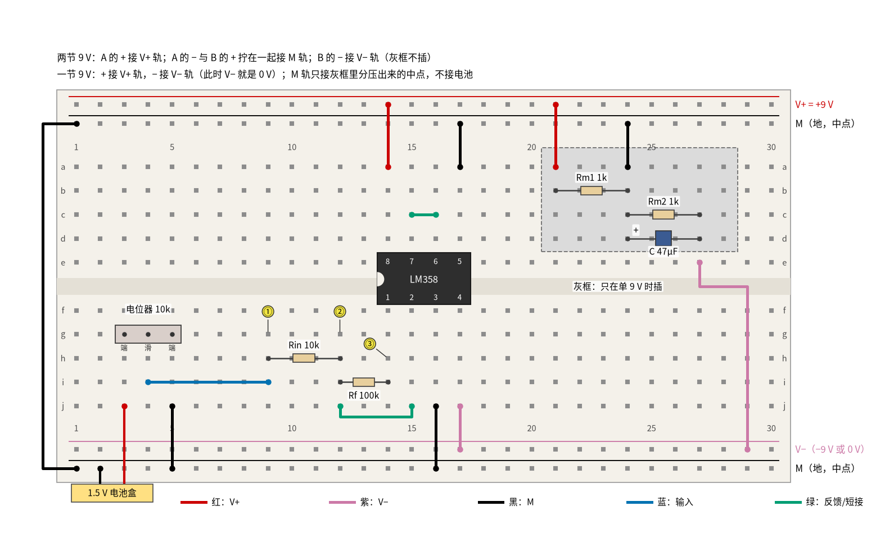
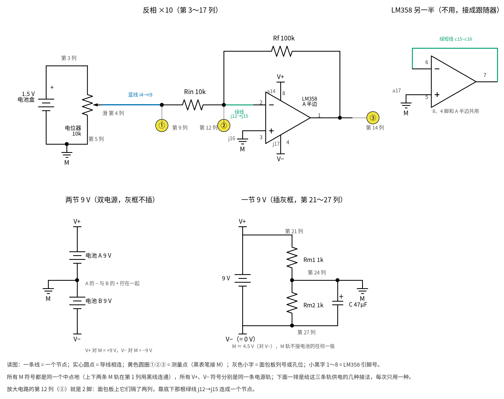
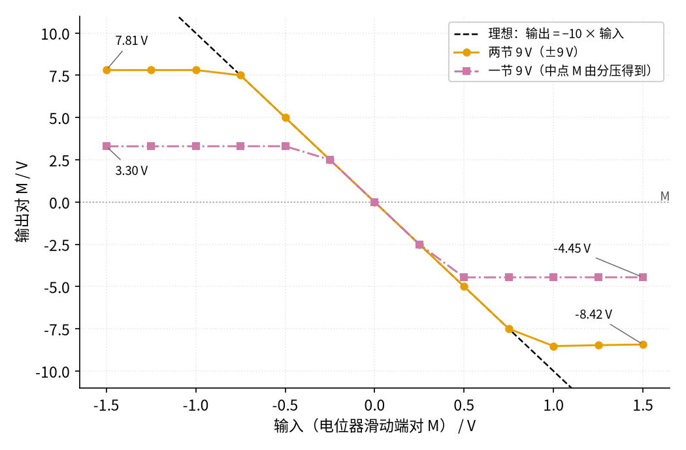

# P3 运放入门 · 动手实验篇

[上一页：参数与调试篇](page3.md) · [直觉篇](page1.md) · [原理与实现篇](page2.md) · [参数与调试篇](page3.md) · 本页：动手实验篇 · [下一页：P2 半导体入门 · 直觉篇](../P2-semiconductor-basics/page1.md) · 前置节点：[P1 元件速成 · 直觉篇](../P1-components-basics/page1.md) · 后续：[01 反相放大 · 直觉篇](../01-inverting-amp/page1.md)

## 这次实验要验证什么

这一页把前三页的反相放大电路（输入电阻 10 kΩ、反馈电阻 100 kΩ，放大 −10 倍）真的搭出来，用一片 LM358 和 9 V 电池，只用万用表验证三件事：

1. **负反馈让输出只听电阻的话**：输入 +0.2 V，输出约 −2.0 V；输入 −0.2 V，输出约 +2.0 V。对应 [P3 运放入门 · 原理与实现篇](page2.md) 第二节推出的"输出 = −(Rf ÷ Rin) × 输入"。
2. **虚短是真的，但有条件**：电路正常放大时，反相端离中点只有零点几毫伏；输出一旦顶到电源，反相端立刻离开中点上百毫伏。对应 [P3 运放入门 · 原理与实现篇](page2.md) 第三节和第五节。
3. **电源决定输出能摆多远**：同一个电路，两节 9 V 电池时输出能到约 +7.8 V 和 −8.5 V，一节 9 V 电池时只剩约 +3.3 V 和 −4.5 V。对应 [P3 运放入门 · 参数与调试篇](page3.md) 第二节。

另外还有一个"拔掉反馈电阻"的对照：没有负反馈，输出只会在两个极端之间跳，正是 [P3 运放入门 · 直觉篇](page1.md) 第二节说的"比较，然后狠狠放大"。

## ⚠️ 安全须知

- **只用 12 V 及以下的直流电**。本页任何一点对中点 M 都不超过 9 V。两节电池串联后 V+ 轨到 V− 轨之间有 18 V，这仍是安全的低压直流，也在 LM358 允许的范围内，但它已是本页的上限：不要再串第三节电池，也不要换成别的电源去"试试更大的"。
- **9 V 电池的两个扣子不能碰在一起**。短路的 9 V 电池几秒钟就会发烫，电池扣接好以后，裸露的另一头要先插进面包板或用胶带包好。
- **芯片方向和 4 脚、8 脚别接反**。LM358 缺口朝左，8 脚接正电源，4 脚接负电源（或 0 V）。电源接反时芯片会很快发烫，**不要用手去摸**，立刻断电。电阻、电池在接错时也可能发烫，同样不要摸。
- **电解电容分正负极**。单电源接法里那只 47 μF 电容，长脚（+）接中点 M，短脚（−，外壳上有白色条纹的一侧）接 0 V。
- **接线、改线之前先断电**：把电池扣从电池上拔下来再动手。本页要拔插反馈电阻、换电源接法、对调电池盒，每一次都先断电。

## 器材清单

| 元件 | 型号或数值 | 数量 | 说明 |
|---|---|---|---|
| 运放 | LM358（DIP-8 直插封装） | 1 | 一片里有两个运放，本页只用 A 半边，B 半边接成跟随器 |
| 9 V 电池 | 6F22 叠层电池 + 电池扣 | 2 | 双电源用两节；单电源只用一节 |
| 1.5 V 电池 | 5 号电池 + 单节电池盒 | 1 | 产生 ±0.2～±1.5 V 的小输入 |
| 电位器 | 10 kΩ，三脚直插 | 1 | 调输入电压 |
| 电阻 | 10 kΩ | 1 | 输入电阻 Rin |
| 电阻 | 100 kΩ | 1 | 反馈电阻 Rf |
| 电阻 | 1 kΩ | 2 | 单电源时做中点分压 Rm1、Rm2 |
| 电解电容 | 47 μF / 16 V（10～100 μF 都行） | 1 | 单电源时稳住中点 |
| 面包板 | 830 孔 | 1 | 上下各两条电源轨 |
| 跳线 | 红、黑、紫、蓝、绿 | 若干 | 颜色约定见下图 |
| 万用表 | 数字式，有直流 200 mV 挡 | 1 | 量虚短要用 200 mV 挡 |

电阻用普通 5% 碳膜电阻即可。为了照顾公差，下面"应该读到"的范围按 5% 电阻算：放大倍数可能在 9.05～11.05 倍之间，输入 0.20 V 时输出在 −1.81～−2.21 V 之间都算正常。

## 搭建步骤

先说清楚本页最关键的一件事：**中点（地）怎么来**。运放电路里的"地"就是所有电压的参考点，本页把它叫 M。面包板上面第二条轨（T2）和下面第二条轨（B2）都是 M，最上面一条（T1）是 V+，下面第一条（B1）是 V−。万用表的黑表笔几乎一直插在 M 上。

- **两节 9 V（双电源，推荐）**：电池 A 的 + 接 V+ 轨；电池 A 的 − 和电池 B 的 + 拧在一起，接 M 轨；电池 B 的 − 接 V− 轨。两节电池串起来是 18 V，M 正好在它们的连接点上，于是 V+ 对 M 是 +9 V，V− 对 M 是 −9 V。
- **一节 9 V（单电源）**：电池的 + 接 V+ 轨，− 接 V− 轨，这时 V− 轨就是 0 V。电池本身没有"中间那一点"，所以 M 要自己造：两个 1 kΩ 电阻从 V+ 串到 V−，连接点电压约 4.5 V，把它接到 M 轨，再并一只 47 μF 电容让它更稳。**M 轨不接电池的任何一极**。

见 图 P3-p4-1，两种接法画在同一张图里，右上角灰框里的三个元件只在单电源时插。电路原理图就是 [P3 运放入门 · 原理与实现篇](page2.md) 第二节那张反相放大电路图，只是"地"换成了 M。



*图 P3-p4-1　LM358 反相 ×10 的面包板接法（灰框只在单 9 V 时插；图顶两行写的是两种电池接法）*

运放的八只脚挤在中间槽两边，最容易看花眼，对照 图 P3-p4-3 的电路原理图来认：上面一排是放大电路和 LM358 不用的另一半，下面一排是给 V+、M、V− 三条轨供电的两种接法。



*图 P3-p4-3　图 P3-p4-1 对应的电路原理图（灰色小字是面包板列号或孔位，小黑字 1～8 是 LM358 引脚号）*

**对照看**：同列五孔连通、上下两半隔开的规则见 [P1 元件速成 · 动手实验篇](../P1-components-basics/page4.md)，这里只看运放。LM358 缺口朝左时，下排 f14～f17 是 1～4 脚、上排 e14～e17 是 8～5 脚，所以第 14 列下半就是输出 1 脚（③），第 15 列是反相端 2 脚，第 16 列是同相端 3 脚，第 17 列是 4 脚 V−。②所在的第 12 列和 2 脚隔着两列，是靠底下那根绿线 j12→j15 连成原理图上的同一个节点，Rf 则从这个节点跨到第 14 列。原理图里所有 M 符号是同一条轨：双电源时它接在两节电池中间，单电源时它只接灰框里 Rm1、Rm2 的连接点（第 24 列），不碰电池的任何一极。

图 P3-p4-1 里红线是 V+，紫色线是 V−，黑线是 M，蓝线是输入，绿色线是反馈和短接。黄色圆圈 ①②③ 是三个测量点。按下面的顺序插：

1. 用一根黑线把上面的 M 轨（T2 第 1 列）和下面的 M 轨（B2 第 1 列）连起来，上下两条 M 轨就成了一条。
2. LM358 缺口朝左，跨在中间槽上：1～4 脚插在 f14～f17，8～5 脚插在 e14～e17。
3. 电源脚：红线 a14 → V+ 轨（8 脚），紫色线 j17 → V− 轨（4 脚）。
4. 同相端接 M：黑线 j16 → 下面的 M 轨（3 脚）。
5. 不用的 B 半边接成跟随器：绿色短线 c15–c16（7 脚接 6 脚），黑线 a17 → 上面的 M 轨（5 脚）。不用的运放悬空时可能自己乱跳、发热，这样接最省心。
6. 电位器插在 g3、g4、g5（中间 g4 是滑动端），黑线 j5 → M 轨；1.5 V 电池盒的红线插 j3，黑线插 M 轨（B2 第 2 列）。滑动端于是能在 0～1.5 V（相对 M）之间调。
7. 输入：蓝线 i4 → i9，第 9 列就是输入点 ①。
8. 输入电阻 Rin（10 kΩ）插 h9–h12；绿色线从 j12 绕到 j15，把第 12 列接到 2 脚（反相端），第 12 列就是测量点 ②。
9. 反馈电阻 Rf（100 kΩ）插 i12–i14，从反相端接回 1 脚（输出），输出测量点 ③ 在第 14 列。
10. 只在单电源时：红线 T1 第 21 列 → a21；Rm1 插 b21–b24；黑线 a24 → 上面的 M 轨；Rm2 插 c24–c27；47 μF 电容长脚插 d24、短脚插 d27；紫色线 e27 → V− 轨（B1 第 29 列）。
11. 最后按上面两种接法之一接电池。先接双电源做完第 0～11 步，再断电改成单电源做第 12～16 步。

## 测量表

万用表直流电压挡，**黑表笔接 M 轨**（第 12、13 步例外，黑表笔接 V− 轨，也就是单电源时的 0 V）。"应该读到"一栏的数由 `code/figs/P3_figs.py` 用 ngspice 加 TI 的 LM358B 模型现算并打印，电路和本页完全一样（两节 9 V 或一节 9 V 加 1 kΩ/1 kΩ 分压）；反相端的毫伏范围和输出离电源轨的距离，取自 [P3 的 SPICE 核对表](../review/spice/P3.md)。

| 步骤 | 测什么 | 红表笔 | 黑表笔 | 挡位 | 应该读到 | 读不到时先查 |
|---|---|---|---|---|---|---|
| 0 | 双电源：V+ | V+ 轨 | M 轨 | 直流 20 V | +8 V 以上 | 电池 A 的电池扣 |
| 1 | 双电源：V− | V− 轨 | M 轨 | 直流 20 V | −8 V 以下（带负号） | 读到正值：电池 B 接反了 |
| 2 | ① 输入调到 +0.20 V | 第 9 列 | M 轨 | 直流 2 V | 0.200 V（边看表边转电位器） | 电池盒红线是否在 j3 |
| 3 | ② 反相端（虚短） | 第 12 列 | M 轨 | 直流 200 mV | −3～+3 mV（仿真 +0.31 mV） | 读到几百毫伏：输出顶到电源了，查 4 脚、8 脚 |
| 4 | ③ 输出 | 第 14 列 | M 轨 | 直流 20 V | −1.81～−2.21 V（仿真 −2.00 V） | 读到约 −8.5 V：Rf 没插好 |
| 5 | ③ 电池盒两根线对调，① 调到 −0.20 V | 第 14 列 | M 轨 | 直流 20 V | +1.81～+2.21 V（仿真 +2.00 V） | ① 是否真的变成负值 |
| 6 | ③ 电池盒正接，① 调到 +1.00 V | 第 14 列 | M 轨 | 直流 20 V | 约 −8.5 V（仿真 −8.52 V，比 V− 轨高 0.02～0.8 V） | 这一步本来就削平了，不是 −10 V |
| 7 | ② 同一状态下的反相端 | 第 12 列 | M 轨 | 直流 2 V | 约 +0.13 V（仿真 +0.135 V） | 不再是 0：虚短失效 |
| 8 | ③ 电池盒对调，① 调到 −1.00 V | 第 14 列 | M 轨 | 直流 20 V | 约 +7.8 V（仿真 +7.81 V，比 V+ 轨低 1.1～1.5 V） | 正负两边不对称是正常的 |
| 9 | ③ 断电拔掉 Rf，① 调回 +0.20 V | 第 14 列 | M 轨 | 直流 20 V | 约 −9.0 V（仿真 −8.98 V，比 V− 轨高 0.02～0.1 V） | 拔 Rf 前先断电 |
| 10 | ③ 仍无 Rf，① 调到 −0.20 V | 第 14 列 | M 轨 | 直流 20 V | 约 +7.8 V（仿真 +7.83 V） | 同第 8 步 |
| 11 | ③ 仍无 Rf，把 ① 慢慢往 0 调 | 第 14 列 | M 轨 | 直流 20 V | 在 +7.8 V 和 −9 V 之间突然跳变，停不到中间 | 见思考题 1 |
| 12 | 单电源：电池电压 | V+ 轨 | V− 轨（0 V） | 直流 20 V | 8 V 以上 | 电池扣 |
| 13 | 单电源：中点 M | M 轨 | V− 轨（0 V） | 直流 20 V | 第 12 步的一半，4.27～4.73 V（9 V 时；仿真 4.50 V） | Rm1、Rm2 是否都是 1 kΩ |
| 14 | ③ 插回 Rf，① 调到 +0.20 V | 第 14 列 | M 轨 | 直流 20 V | −1.81～−2.21 V（仿真 −2.00 V，和双电源一样） | 黑表笔必须在 M，不是 0 V |
| 15 | ③ ① 调到 +1.00 V | 第 14 列 | M 轨 | 直流 20 V | 约 −4.45 V（仿真；输出已贴到 0 V 轨） | 双电源时这里是 −8.5 V |
| 16 | ③ 电池盒对调，① 调到 −1.00 V | 第 14 列 | M 轨 | 直流 20 V | 约 +3.30 V（仿真；输出对 0 V 约 7.8 V） | 双电源时这里是 +7.8 V |

一共 17 步。第 3 步一定要切到 200 mV 挡，2 V 挡只能显示到 1 mV，看到的会是"0.000"，那也说明虚短成立，只是看不到细节。第 7 步的 0.13 V 不是乱来的：输出削平在 −8.52 V 以后，Rin 和 Rf 就是一个普通分压器，反相端 = 输入 − (输入 − 输出) × 10 ÷ 110 = 1 − 9.52 ÷ 11 ≈ 0.135 V。

第 6、8、15、16 步只给了"约"，因为输出能摆多远取决于电池的实际电压，也取决于输出吸进多少电流：第 6 步输出要从输入那边经 Rin、Rf 吸进约 86 μA 电流，所以比第 9 步（没有 Rf，几乎不吸电流）离 V− 轨远一些。[P3 的 SPICE 核对表](../review/spice/P3.md) 给出的规律是：正侧比 V+ 低约 1.2 V，负侧在几乎不吸电流时离 V− 只有 0.02～0.1 V，吸电流越多离得越远。拿你实际的 V+、V− 读数套这个规律，就是你这块板子"应该读到"的值，下面的 Python 就是这么算的。

## 没有示波器怎么办

本页全是直流，万用表就够了。书里用示波器看的是"输出随输入怎么变"的整条曲线，我们**用电位器加万用表逐点测**：

1. 双电源，插着 Rf。电池盒正接，把 ① 依次调到 0、0.25、0.5、0.75、1.0、1.25、1.5 V，每档记下 ① 和 ③ 的读数。
2. 断电，对调电池盒两根线，再把 ① 调到 −0.25～−1.5 V 那几档，同样记录。
3. 换成单电源，重复一遍。
4. 横轴是输入、纵轴是输出，把点画在方格纸上，就得到 图 P3-p4-2。



*图 P3-p4-2　没有示波器时，逐点测出的反相 ×10 传输特性（两节 9 V 与一节 9 V 对比）*

图 P3-p4-2 里黑色虚线是理想的"输出 = −10 × 输入"。橙色圆点是两节 9 V 时应该读到的点：从 −0.75 V 到 +0.75 V 这一段都贴着虚线，再往外就变平了，左边平在 7.81 V，右边平在约 −8.5 V（输入 1.5 V 时是 −8.42 V，比 1 V 时略高一点，因为输出要吸的电流更大了）。紫色方块是一节 9 V 时的点：中间一段和橙色完全重合，说明放大倍数和电源无关；但只要输出超出 +3.30 V 或 −4.45 V 就被削平。

这张图其实就是把 [P3 运放入门 · 参数与调试篇](page3.md) 第二节那张三种电源对比图"横过来"看：那里是正弦输入随时间变化，削平的部分是被压扁的波峰；这里是一个个直流点，削平的部分是变平的线段。示波器能一眼看到的东西，万用表多花十分钟也能量出来。

## 用 Python 核对你的读数

先断电量出两个 9 V 电池和四个电阻的实际值，再把各步读数填进去。程序按你的实际值算出"应该读到"的数并比较：偏差超过 10%、并且差值超过 0.05 V 的会给出提示；第 3 步是毫伏级的数，只看它是否在 ±3 mV 以内。下面填的是一组示例。

```python
import sys, pathlib
sys.path.insert(0, str(pathlib.Path("code/figs").resolve()))  # 在仓库根目录运行
# ① 你量到的电池电压和电阻值（电池电压按第 0、1、12 步，都写正数）
m = dict(VA=9.42, VB=9.31, Vsingle=9.38, Rin=9.93e3, Rf=99.1e3, Rm1=0.995e3, Rm2=1.004e3)
# ② 各步读数（伏）；vin 是你在第 2、6、14、15 步实际调到的输入
vin = {"2": 0.200, "6": 1.003, "14": 0.201, "15": 1.000}
readings = {"3 反相端": 0.0004, "4 输出(+0.2V)": -1.99, "6 输出(+1V)": -8.86, "7 反相端(削平)": 0.104,
            "8 输出(-1V)": 8.20, "9 开环输出": -9.27, "13 中点M": 4.69, "14 单电源输出": -2.00,
            "15 单电源削平(下)": -4.66, "16 单电源削平(上)": 3.48}

g = m["Rf"] / m["Rin"]
vm = m["Vsingle"] * m["Rm2"] / (m["Rm1"] + m["Rm2"])
expect = {
    "4 输出(+0.2V)": -g * vin["2"],
    "6 输出(+1V)": -m["VB"] + 0.5,                 # 吸约 86 μA 时比 V− 高约 0.5 V（仿真 0.48 V）
    "7 反相端(削平)": vin["6"] - (vin["6"] - readings["6 输出(+1V)"]) * m["Rin"] / (m["Rin"] + m["Rf"]),
    "8 输出(-1V)": m["VA"] - 1.2,                  # 正侧比 V+ 低约 1.2 V
    "9 开环输出": -m["VB"] + 0.05,                 # 几乎不吸电流，离 V− 只有几十毫伏
    "13 中点M": vm,
    "14 单电源输出": -g * vin["14"],
    "15 单电源削平(下)": 0.04 - readings["13 中点M"],   # 输出贴到 0 V 轨（仿真 0.04 V），再相对 M
    "16 单电源削平(上)": m["Vsingle"] - 1.2 - readings["13 中点M"],
}
hint = {"4 输出(+0.2V)": "Rf、Rin 是否插对；读数正负号", "6 输出(+1V)": "电池 B 电压",
        "7 反相端(削平)": "用的是第 6 步同一状态吗", "8 输出(-1V)": "电池 A 电压",
        "9 开环输出": "Rf 是否真的拔掉", "13 中点M": "Rm1、Rm2 阻值；电容是否插反",
        "14 单电源输出": "黑表笔是否在 M 轨", "15 单电源削平(下)": "4 脚是否接 0 V",
        "16 单电源削平(上)": "电池电压是否掉了"}
v3 = readings["3 反相端"]
print(f"倍数 Rf/Rin = {g:.2f}；第 3 步反相端 {v3 * 1e3:+.1f} mV" + ("" if abs(v3) <= 3e-3 else "  ← 超过 ±3 mV，先查：输出是否顶到电源"))
for k, e in expect.items():
    v = readings[k]
    dev = (v - e) / abs(e) * 100
    bad = abs(dev) > 10 and abs(v - e) > 0.05
    flag = f"  ← 偏差超过 10%，先查：{hint[k]}" if bad else ""
    print(f"{k:<12} 实测 {v:+7.3f} V  计算 {e:+7.3f} V  偏差 {dev:+6.1f}%{flag}")
```

示例里的读数都没有触发提示。第 6、8、9、15、16 步的"计算值"用的是经验规律（正侧低 1.2 V、负侧高 0.05～0.5 V），只能估到零点几伏；差个 0.3 V 不必紧张，差到 1 V 以上才要查线。

## 实验记录表

| 步骤 | 测什么 | 实测值 | 计算值 | 偏差 |
|---|---|---|---|---|
| 0 | 双电源 V+ |  |  |  |
| 1 | 双电源 V− |  |  |  |
| 2 | 输入 ① |  |  |  |
| 3 | 反相端 ②（mV） |  |  |  |
| 4 | 输出 ③（+0.2 V） |  |  |  |
| 5 | 输出 ③（−0.2 V） |  |  |  |
| 6 | 输出 ③（+1 V） |  |  |  |
| 7 | 反相端 ②（+1 V） |  |  |  |
| 8 | 输出 ③（−1 V） |  |  |  |
| 9 | 开环输出（+0.2 V） |  |  |  |
| 10 | 开环输出（−0.2 V） |  |  |  |
| 12 | 单电源电池电压 |  |  |  |
| 13 | 中点 M 对 0 V |  |  |  |
| 14 | 单电源输出（+0.2 V） |  |  |  |
| 15 | 单电源输出（+1 V） |  |  |  |
| 16 | 单电源输出（−1 V） |  |  |  |

逐点测量另记一张表：输入、双电源输出、单电源输出三栏，13 行。第 11 步没有固定读数，把你看到的现象用一句话写下来。

## 思考题

**思考题 1**：第 11 步拔掉 Rf 以后，为什么无论怎么小心转电位器，输出都停不到 0 V 附近，只会在两头之间跳？

<details><summary>答案</summary>

没有负反馈时，输出 = 开环增益 × 两个输入端的电压差。LM358 的开环增益约 10 万倍，输出最多摆 ±8 V 多，换算回输入只有约 ±0.1 mV 的"线性区"（[P3 的 SPICE 核对表](../review/spice/P3.md) 在 ±15 V 时算得约 ±0.19 mV）。电位器转一度，滑动端就变化好几毫伏，远远跨过了这个窗口；再加上运放本身零点几毫伏的失调，0 V 输入时输出到底顶上还是落下都说不准。这就是 [P3 运放入门 · 直觉篇](page1.md) 第二节"比较，然后狠狠放大"的样子，以后的 [14 电压比较器 · 直觉篇](../14-voltage-comparator/page1.md) 正是利用这一点。

</details>

**思考题 2**：同样输入 +1 V，为什么双电源时输出是 −8.5 V，单电源时相对 M 只有 −4.45 V？是放大倍数变了吗？

<details><summary>答案</summary>

放大倍数没变：第 4 步和第 14 步都是 −2.0 V，图 P3-p4-2 中间那段两种颜色完全重合。变的是输出的"天花板"和"地板"。单电源时 V− 轨是 0 V，LM358 的输出最低只能贴到 0 V 附近（约 0.04 V），而 M 在 4.5 V，所以相对 M 最低只有约 −4.45 V；最高约 7.8 V，相对 M 是 +3.3 V。双电源时地板是 −9 V，自然能摆得更远。想要 −10 V 的输出，必须让电源装得下它，这就是 [P3 运放入门 · 参数与调试篇](page3.md) 第二节说的"先算最大输出装不装得进摆幅"。

</details>

**思考题 3**：单电源时，如果你把黑表笔插在 0 V（V− 轨）上去量第 14 步的输出，会读到多少？如果把 Rm1、Rm2 换成 100 kΩ，中点还稳吗？

<details><summary>答案</summary>

黑表笔在 0 V 上，读到的是"中点电压 + 相对 M 的输出"，约 4.5 − 2.0 = 2.5 V，看起来像是"放大倍数不对"，其实只是参考点选错了。至于换成 100 kΩ：输入电流 0.2 V ÷ 10 kΩ = 20 μA 会流进中点，1 kΩ/1 kΩ 分压的内阻是 500 Ω，中点只被推动约 10 mV（仿真从 4.500 V 变成 4.490 V）；换成 100 kΩ/100 kΩ，内阻变成 50 kΩ，同样 20 μA 会把中点推动约 1 V，中点就不再是"地"了。47 μF 电容只能挡住快速变化，挡不住这种直流偏移。所以分压电阻不能太大，或者用一个运放跟随器把中点"撑住"，这在 [03 电压跟随器 · 直觉篇](../03-voltage-follower/page1.md) 里会讲到。

</details>

## 自测清单

- 我能说清楚两节 9 V 电池和一节 9 V 电池两种接法里，中点 M 分别从哪里来，并把黑表笔插对地方。
- 我能看着缺口认出 LM358 的 1～8 脚，正确接好 4 脚、8 脚和不用的另一半运放。
- 我能用 200 mV 挡量出虚短，并说出输出顶到电源时为什么虚短不再成立。
- 我能根据电池电压估算输出最高、最低能到多少，并解释单电源时输出为什么到不了 −8.5 V。
- 我能用电位器和万用表逐点测出放大电路的传输特性，代替示波器。
