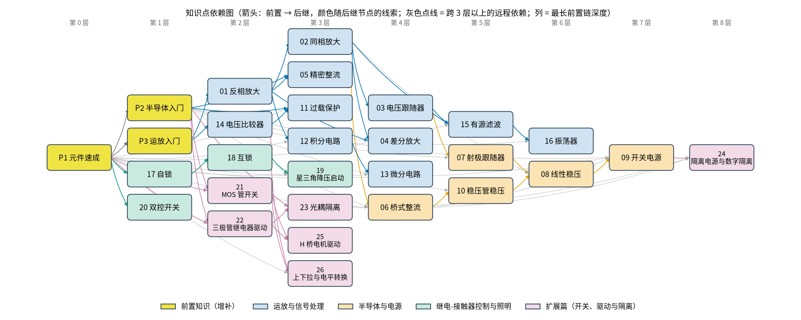

# 阶段 1：逆向教学设计

本文件是整套教案的「总设计图」：先定学完以后要达到什么水平，再倒推每个知识点讲什么、按什么顺序讲、由谁来写。所有作者动笔前必须读完本文件和 [AUTHOR_GUIDE.md](AUTHOR_GUIDE.md)。依赖关系的唯一数据源是 [code/figs/00_figs.py](../code/figs/00_figs.py)，本文件里的表格与它保持一致；改依赖时两边一起改，并重新运行脚本生成 [依赖图](../img/00_dag.png)。

任务原文见 [specs/task-spec.md](../specs/task-spec.md)，原始附图见 [specs/source-20-circuits.jpg](../specs/source-20-circuits.jpg)。

## 1. 学习者画像

**会的**：欧姆定律、串联与并联、电功率，能看懂由电池、开关、灯泡组成的简单电路；可能听说过电容。会一点点 Python，至少能照着说明运行一个脚本。

**不会的**：电容充放电的定量规律、电感、交流电的相位、二极管和三极管、MOSFET、运放、反馈、复数与频率响应、微积分、继电器和接触器控制电路。

**写作规则**：

- 凡是用到「不会的」知识，必须先补最小必要知识，补在前置节点 P1–P3 里，或者在本页用一个小框就地补上，并链接到前置节点。
- 积分和微分一律从「面积」「斜率」的直觉讲起，不默认读者学过微积分。
- 频率响应不讲复数，用「电容对快变化的信号更好通过」「容抗随频率下降」这样的直觉加仿真曲线来讲；需要公式时只给幅值公式。
- 读者会被大段符号吓退。每个公式都先用一句中文说出它的意思，再给符号形式，然后马上代一组数算一遍。

## 2. 终态验收（学完全部节点后，读者应当能做到）

对 20 个标准电路和 6 个扩展电路中的每一个，读者都能：

1. **能看懂并画出**：认出电路图里每个元件的符号和作用，能凭记忆画出电路的基本形态，并说清信号从哪里进、从哪里出。
2. **能用公式估算参数**：给定指标（例如增益 10 倍、输出 5V、截止频率 1kHz、延时 5s），能选出元件的数量级并算出具体值，再挑一个最接近的标准值。
3. **能用仿真验证**：能运行并修改教案里的 Python 脚本，改动一个参数后能预测波形会怎么变，再用仿真结果核对自己的预测。
4. **能排查常见故障**：看到「没有输出」「输出顶到电源」「发热」「继电器抖动」这类现象，能按「现象 → 原因 → 怎么查 → 怎么改」的思路定位问题。
5. **能讲清安全要点**：凡涉及 220V/380V 市电的电路，能说出危险点在哪里，知道哪些实验只能在低压下做，知道为什么必须断电操作、为什么要隔离和接地。

## 3. 硬性标准（每个知识点都必须满足）

- 3 个 md 页面，每页正文不少于 500 汉字（代码、公式、图注不计入）：
  - page1「直觉篇」：痛点引入、生活类比、示意图。
  - page2「原理与实现篇」：推导，加一段逐行注释、可直接运行的最小 Python 仿真，输出 png。
  - page3「参数与调试篇」：每个元件参数的物理含义和取值范围，改变参数后波形或效果怎么变；故障排查表（现象 → 原因 → 怎么查 → 怎么改）；练习题，答案放在 `<details>` 里。
- 教学闭环：痛点先行，直觉先于严谨；例题按「完整示例 → 关键步骤留空 → 变体迁移」三步渐隐。
- 图：电路图用 schemdraw，波形和曲线用 matplotlib，全部是 PNG；禁止 ASCII 图和 Mermaid。图号写成「图 NN-pX-k」，每张图都有引导句、图注和图后讲解；答案图放在揭晓之后。
- 代码：Python 3 + NumPy + matplotlib，必要时加 SciPy；必须真的跑通，否则标「未经运行验证」。
- 公式必须能在 github.com 上正常渲染（规则见 AUTHOR_GUIDE 第 5 节）。
- 链接和引文必须真实可访问，否则标「[待核实]」，禁止编造。
- **安全**：涉及市电（220V/380V）的节点（06、09、17、18、19、20，以及扩展篇的 22、23、24）必须写明安全警示，仿真和实验只建议在低压下做。

## 4. 符号表（全书统一，首次出现必须解释）

| 符号 | 含义 | 单位 | 备注 |
|---|---|---|---|
| $V_i$ 或 $V_{in}$ | 输入电压 | V | 同一页只用其中一种写法 |
| $V_o$ | 输出电压 | V | |
| $V_{CC}$ 、 $V_{EE}$ | 正电源、负电源 | V | 单电源电路里 $V_{EE}$ 就是地 |
| $V_{ref}$ | 基准电压、门限电压 | V | 比较器、稳压器 |
| $V_{BE}$ 、 $V_{GS}$ | 三极管基极–发射极电压、MOSFET 栅极–源极电压 | V | $V_{BE}$ 约 0.7V |
| $V_D$ 、 $V_Z$ | 二极管正向压降、稳压管击穿电压 | V | |
| $R$ 、 $R_1$ 、 $R_f$ | 电阻、输入电阻、反馈电阻 | Ω | $R_f$ 专指运放反馈支路的电阻 |
| $C$ | 电容 | F | 常用 μF、nF |
| $L$ | 电感 | H | 常用 mH、μH |
| $I$ 、 $I_B$ 、 $I_C$ | 电流、基极电流、集电极电流 | A | |
| $t$ | 时间 | s | |
| $f$ 、 $f_c$ | 频率、截止频率 | Hz | |
| $T$ | 周期 | s | $T = 1/f$ |
| $\tau$ | 时间常数 | s | $\tau = RC$ |
| $A_v$ | 电压放大倍数 | 无 | $A_v = V_o / V_i$ |
| $D$ | 占空比 | 无 | 开关电源、PWM |
| $\beta$ | 三极管电流放大倍数 | 无 | |
| CTR | 光耦电流传输比 | % | 只在 23、24 用 |

## 5. 依赖图



图 00-1 由 `code/figs/00_figs.py` 生成。箭头从前置节点指向后继节点；列号等于从 P1 出发的最长前置链深度；填充色区分线索：黄色是前置知识，浅蓝色是运放与信号处理，浅橙色是半导体与电源，浅绿色是继电-接触器控制与照明，浅红紫色是扩展篇。跨 3 层以上的远程依赖画成灰色点线，避免图面过乱。

### 5.1 节点

| 编号 | 名称 | 文件夹 | 线索 |
|---|---|---|---|
| P1 | 元件速成 | [P1-components-basics](../P1-components-basics/) | 前置 |
| P2 | 半导体入门 | [P2-semiconductor-basics](../P2-semiconductor-basics/) | 前置 |
| P3 | 运放入门 | [P3-opamp-basics](../P3-opamp-basics/) | 前置 |
| 01 | 反相放大 | [01-inverting-amp](../01-inverting-amp/) | 运放 |
| 02 | 同相放大 | [02-noninverting-amp](../02-noninverting-amp/) | 运放 |
| 03 | 电压跟随器 | [03-voltage-follower](../03-voltage-follower/) | 运放 |
| 04 | 差分放大 | [04-differential-amp](../04-differential-amp/) | 运放 |
| 05 | 精密整流 | [05-precision-rectifier](../05-precision-rectifier/) | 运放 |
| 06 | 桥式整流 | [06-bridge-rectifier](../06-bridge-rectifier/) | 电源 |
| 07 | 射极跟随器 | [07-emitter-follower](../07-emitter-follower/) | 电源 |
| 08 | 线性稳压 | [08-linear-regulator](../08-linear-regulator/) | 电源 |
| 09 | 开关电源 | [09-switching-power-supply](../09-switching-power-supply/) | 电源 |
| 10 | 稳压管稳压 | [10-zener-regulator](../10-zener-regulator/) | 电源 |
| 11 | 过载保护 | [11-overload-protection](../11-overload-protection/) | 运放 |
| 12 | 积分电路 | [12-integrator](../12-integrator/) | 运放 |
| 13 | 微分电路 | [13-differentiator](../13-differentiator/) | 运放 |
| 14 | 电压比较器 | [14-voltage-comparator](../14-voltage-comparator/) | 运放 |
| 15 | 有源滤波 | [15-active-filter](../15-active-filter/) | 运放 |
| 16 | 振荡器 | [16-oscillator](../16-oscillator/) | 运放 |
| 17 | 自锁 | [17-self-locking](../17-self-locking/) | 控制 |
| 18 | 互锁 | [18-interlock](../18-interlock/) | 控制 |
| 19 | 星三角降压启动 | [19-star-delta-start](../19-star-delta-start/) | 控制 |
| 20 | 双控开关 | [20-two-way-switch](../20-two-way-switch/) | 控制 |
| 21 | MOS 管开关 | [21-mosfet-switch](../21-mosfet-switch/) | 扩展 |
| 22 | 三极管开关与继电器驱动 | [22-bjt-relay-driver](../22-bjt-relay-driver/) | 扩展 |
| 23 | 光耦隔离 | [23-optocoupler](../23-optocoupler/) | 扩展 |
| 24 | 隔离电源与数字隔离器 | [24-isolated-power](../24-isolated-power/) | 扩展 |
| 25 | H 桥电机驱动 | [25-h-bridge](../25-h-bridge/) | 扩展 |
| 26 | 上拉/下拉电阻与电平转换 | [26-pullup-level-shift](../26-pullup-level-shift/) | 扩展 |

### 5.2 边（共 55 条，每条一句理由）

| 前置 → 后继 | 理由 |
|---|---|
| P1 → P2 | 二极管限流、三极管基极电阻都要用到分压和限流计算 |
| P1 → P3 | 运放电路的增益全由外部电阻网络决定 |
| P3 → 01 | 反相放大是「虚短」「虚断」的第一个完整应用 |
| 01 → 02 | 同相放大与反相放大对照推导，读者只需看清差别 |
| 02 → 03 | 电压跟随器是同相放大在 $R_f = 0$ 、 $R_1$ 断开时的特例 |
| 01 → 04 | 差分放大的反相一侧就是反相放大 |
| 02 → 04 | 差分放大的同相一侧就是同相放大，两者叠加得结果 |
| 01 → 05 | 精密整流是把二极管放进反相放大的反馈支路 |
| P2 → 05 | 要先知道二极管有约 0.7V 压降，才明白为什么需要「精密」 |
| P1 → 06 | 整流后的滤波靠电容充放电 |
| P2 → 06 | 二极管桥由 4 个二极管组成，要懂单向导通 |
| 05 → 06 | 运放版全波整流 = 精密半波整流 + 求和电路 |
| P2 → 07 | 射极跟随器的输出比输入低一个 $V_{BE}$ |
| 03 → 07 | 射极跟随器是电压跟随器的三极管版本，对照讲最省力 |
| P2 → 10 | 稳压管靠反向击穿工作 |
| 06 → 10 | 稳压管稳压的输入就是整流滤波后带纹波的直流 |
| 07 → 08 | 线性稳压的调整管就是一个射极跟随器 |
| 10 → 08 | 线性稳压的基准电压常由稳压管提供 |
| 02 → 08 | 误差放大器是同相放大， $V_o = V_{ref}(1 + R_f/R_1)$ |
| P1 → 09 | 开关电源的储能元件是电感和电容 |
| P2 → 09 | 开关管是 MOSFET，还要用续流二极管 |
| 06 → 09 | 第二种拓扑的副边输出级就是「整流 + 滤波」 |
| 08 → 09 | 先懂线性稳压的发热问题，才知道开关电源为什么效率高 |
| P1 → 11 | 采样电阻把电流变成电压，再驱动继电器动作 |
| P2 → 11 | 切断负载要用三极管或 MOSFET 驱动 |
| 14 → 11 | 判断「是否过载」就是一个门限比较 |
| P1 → 12 | 电容电压等于电流的「累积面积」除以 $C$ |
| 01 → 12 | 积分电路就是把反相放大的 $R_f$ 换成电容 |
| P1 → 13 | 电容电流正比于电压变化的「斜率」 |
| 12 → 13 | 微分与积分互为对偶，交换 R 和 C 的位置即可 |
| P3 → 14 | 比较器是运放开环、输出饱和的用法 |
| P1 → 15 | 滤波的截止频率由 RC 决定 |
| 02 → 15 | 有源滤波的放大部分是同相放大 |
| 03 → 15 | Sallen-Key 结构里的运放接成跟随器 |
| 14 → 16 | 方波振荡器 = 施密特比较器 + RC 充放电 |
| 15 → 16 | 文氏桥正弦振荡器靠 RC 网络选频 |
| P1 → 17 | 自锁电路由线圈和触点组成 |
| 17 → 18 | 互锁是在两套自锁电路里各串入对方的常闭触点 |
| P1 → 19 | 星三角切换靠时间继电器延时 |
| 18 → 19 | 星形与三角形两个接触器必须互锁，否则相间短路 |
| P1 → 20 | 双控开关就是两个单刀双掷开关 |
| P1 → 21 | 栅极电阻、下拉电阻的取值和导通发热都靠电阻与功率计算 |
| P2 → 21 | 要先有 MOSFET「电压控制的阀门」模型 |
| P1 → 22 | 继电器线圈是电感，断电时产生反向高压 |
| P2 → 22 | 三极管的饱和区和 $I_C = \beta I_B$ 在 P2 讲过 |
| P2 → 23 | 光耦里面是一个 LED 加一个光敏三极管 |
| 22 → 23 | 光耦输出侧的三极管按开关来用，与 22 的基极电阻计算思路相同 |
| 06 → 24 | 变压器隔离电源的后级就是整流滤波 |
| 09 → 24 | 隔离 DC-DC 模块内部是带变压器的开关电源（反激） |
| 23 → 24 | 先用光耦建立「为什么要隔离、地为什么要分开」的概念 |
| 21 → 25 | H 桥由 4 个 MOS 管开关组成，高边驱动问题在 21 讲过 |
| 22 → 25 | 电机是感性负载，续流的道理与继电器线圈相同 |
| P1 → 26 | 上拉、下拉就是电阻分压；去抖用 RC 时间常数 |
| 14 → 26 | 施密特门限可以消除按键抖动带来的反复翻转 |
| 21 → 26 | 双向电平转换电路的核心是一个 N 沟道 MOS 管 |

### 5.3 拓扑写作顺序

按依赖排出的一条线性顺序（任何节点都排在它的全部前置之后），读者顺着读不会遇到没学过的概念：

P1 → P3 → P2 → 17 → 01 → 21 → 22 → 02 → 05 → 14 → 18 → 03 → 06 → 12 → 19 → 04 → 10 → 13 → 07 → 15 → 08 → 11 → 23 → 16 → 09 → 25 → 20 → 24 → 26

最长前置链有 9 个节点：P1 → P3 → 01 → 02 → 03 → 07 → 08 → 09 → 24。

### 5.4 写作队列（4 名作者，每人一条串行队列）

每名作者按自己队列的顺序一个一个写；一个节点只有在它的全部前置节点都已完成以后才能开始写，因为后继页面要链接和引用前置页面里的图号与结论。以「写完一个节点」为 1 个时间段做调度模拟，4 人并行共需 9 个时间段，等于最长前置链的长度，已是下限。

| 作者 | 队列（按顺序） | 个数 | 时间段 |
|---|---|---|---|
| 作者 A | P3 → 01 → 02 → 03 → 04 → 15 → 16 | 7 | 2–8 |
| 作者 B | P2 → 05 → 06 → 10 → 08 → 09 → 24 | 7 | 2,4–9 |
| 作者 C | 21 → 14 → 12 → 13 → 11 → 25 → 26 | 7 | 3–9 |
| 作者 D | P1 → 17 → 22 → 18 → 19 → 07 → 23 → 20 | 8 | 1–8 |

调度表（tN 表示第 N 个时间段，「—」表示等待前置）：

| 作者 | t1 | t2 | t3 | t4 | t5 | t6 | t7 | t8 | t9 |
|---|---|---|---|---|---|---|---|---|---|
| 作者 A | — | P3 | 01 | 02 | 03 | 04 | 15 | 16 | — |
| 作者 B | — | P2 | — | 05 | 06 | 10 | 08 | 09 | 24 |
| 作者 C | — | — | 21 | 14 | 12 | 13 | 11 | 25 | 26 |
| 作者 D | P1 | 17 | 22 | 18 | 19 | 07 | 23 | 20 | — |

分工思路：作者 A 负责运放主线，作者 B 负责半导体与电源主线，作者 C 负责 MOS 管、比较器和信号处理，作者 D 负责元件基础、继电-接触器控制，以及与继电器相关的 22、23。

## 6. 各节点内容提要

每个节点列出：痛点、核心思想、要仿真什么、典型错误、需要讲的变体。

### P1 元件速成
- 痛点：后面每个电路都离不开电阻分压、电容、电感和继电器，读者只会欧姆定律。
- 核心思想：分压公式；电容像「水桶」，电压不能突变， $\tau = RC$ 决定充放电快慢（约 5τ 充满）；电感像「水管里的飞轮」，电流不能突变；开关、按钮、继电器、接触器的线圈与常开/常闭触点。
- 仿真：RC 充放电曲线并标出 τ、5τ；方波激励下 RC 的输出；电感断电时的电压尖峰。
- 典型错误：把电容当电阻算；以为电容瞬间充满；继电器触点和线圈画在同一回路里。
- 变体：RL 电路；时间继电器（通电延时、断电延时）的触点符号。

### P2 半导体入门
- 痛点：二极管、三极管、MOSFET 的物理原理太深，读者只需要「会用」。
- 核心思想：二极管是单向阀门，正向约 0.7V 压降；稳压管反向击穿后电压基本不变；三极管是「小电流控制大电流」的水龙头（放大区 $I_C = \beta I_B$ ，饱和区相当于闭合开关）；MOSFET 是「电压控制的阀门」，由 $V_{GS}$ 决定导通与否。
- 仿真：二极管和稳压管的伏安特性曲线；三极管在截止、放大、饱和三个区的工作点。
- 典型错误：忘记 0.7V 压降；三极管不加基极电阻；MOSFET 栅极悬空。
- 变体：LED（压降约 2V）；PNP 和 P 沟道 MOS 管与 NPN/N 沟道的对照。

### P3 运放入门
- 痛点：运放内部有几十个晶体管，但读者只需要两条规则。
- 核心思想：理想运放（增益无穷大、输入电流为零）；负反馈把增益「拉回」可控值；负反馈下的「虚短」（ $V_+ = V_-$ ）和「虚断」（输入电流为零）；开环时输出顶到电源（饱和）。
- 仿真：有限开环增益下，闭环增益随开环增益增大逼近 $R_f/R_1$ ；开环比较时输出饱和。
- 典型错误：没有负反馈时乱用虚短；忘记输出摆幅受电源限制。
- 变体：单电源与双电源供电。

### 01 反相放大
- 痛点：传感器信号太小，需要放大，并且要能准确设定放大倍数。
- 核心思想： $V_o = -\dfrac{R_f}{R_1} V_i$ ；反相端是「虚地」；输入电阻约等于 $R_1$ 。
- 仿真：正弦输入与反相、放大后的输出叠画；输入过大时输出削顶。
- 典型错误：忘记负号； $R_1$ 取得太小，把信号源拉低；输出超过电源电压而削波。
- 变体：反相加法器（为 05、06 的求和电路做准备）。

### 02 同相放大
- 痛点：反相放大输入电阻小、输出会反相，有时不能接受。
- 核心思想： $V_o = \left(1 + \dfrac{R_f}{R_1}\right) V_i$ ；输入电阻极大；放大倍数不小于 1。
- 仿真：与反相放大的输出对照画；改变 $R_f$ 看增益变化。
- 典型错误：把 $R_1$ 接错位置；想用它做小于 1 的增益。
- 变体：同相加法。

### 03 电压跟随器
- 痛点：信号源「带不动」负载，一接负载电压就掉。
- 核心思想： $V_o = V_i$ ；输入电阻极大、输出电阻极小，起「隔离缓冲」作用。
- 仿真：分压电路直接接负载与经过跟随器接负载的对比。
- 典型错误：以为增益为 1 就没用；电容性负载引起振荡。
- 变体：作为基准电压的缓冲。

### 04 差分放大
- 痛点：两根线上同时混入的干扰（共模）要去掉，只放大两线之差。
- 核心思想：电阻匹配时 $V_o = \dfrac{R_f}{R_1}(V_2 - V_1)$ ；共模抑制靠电阻匹配。
- 仿真：差分信号加共模干扰，输出只剩差分部分；电阻失配 1% 时共模泄漏。
- 典型错误：四个电阻不成比例；忽视信号源内阻。
- 变体：三运放仪表放大器（简介）。

### 05 精密整流
- 痛点：普通二极管有 0.7V 压降，几十毫伏的小信号根本整流不出来。
- 核心思想：把二极管放进运放反馈环里，运放自动「补上」二极管压降。
- 仿真：小信号经普通二极管整流与精密半波整流的对比。
- 典型错误：二极管方向接反；运放速度不够，过零点出现毛刺。
- 变体：精密半波整流；为 06 的运放全波整流打基础。

### 06 桥式整流 ⚠ 市电
- 痛点：电器需要直流电，墙上插座给的是交流电。
- 核心思想：变体一是二极管桥，4 个二极管轮流导通，正负半周都变成正向，加电容滤波得到带纹波的直流，纹波约 $\Delta V \approx \dfrac{I}{2 f C}$ ；变体二是运放全波整流（精密半波整流 + 求和），用于小信号测量。
- 仿真：桥式整流输出、加电容滤波后的波形与纹波；运放全波整流对小信号的输出。
- 典型错误：二极管耐压不够；滤波电容极性接反；输出比峰值少两个二极管压降没算上。
- 安全：变压器初级接 220V，必须写明安全警示，实验只用低压交流电源。

### 07 射极跟随器
- 痛点：运放输出电流有限，带不动大负载。
- 核心思想： $V_o \approx V_i - V_{BE}$ ；电流放大约 β 倍；电压增益约为 1。
- 仿真：输入正弦与输出对比，可见约 0.7V 的偏移；负载变化时输出基本不变。
- 典型错误：忘记 $V_{BE}$ ；三极管功耗过大。
- 变体：推挽输出（简介）。

### 08 线性稳压
- 痛点：整流后的电压有纹波，负载变化时电压还会跟着变。
- 核心思想：基准电压 + 误差放大（同相放大）+ 调整管（射极跟随器）， $V_o = V_{ref}\left(1 + \dfrac{R_f}{R_1}\right)$ ；调整管功耗为 $(V_{in} - V_o) I$ 。
- 仿真：带纹波的输入与稳定的输出；输入电压下降到压差以下时失去稳压。
- 典型错误：压差不够；散热不足；输出不加电容引起振荡。
- 变体：三端稳压器（如 78xx 系列）的典型接法。

### 09 开关电源 ⚠ 市电
- 痛点：线性稳压在压差大时很烫、效率低。
- 核心思想：开关快速通断，靠电感和电容储能平滑，降压比为 $V_o \approx D \cdot V_{in}$ ；效率可达 90% 左右。
- 变体（两种拓扑，对应附图两格）：变体一是同步降压（Buck，上管、下管两个 MOSFET）；变体二是附图里「脉冲 → 串联二极管 → 稳压管 → 电容」的那一格，按隔离（反激）电源副边输出级讲，并用带续流二极管的异步降压作为过渡，同时说明附图是简化画法。
- 仿真：降压电路的电感电流与输出电压；占空比与输出的关系；与线性稳压的效率对比曲线。
- 典型错误：电感饱和；续流二极管太慢；PCB 走线回路太大。
- 安全：离线式开关电源初级接市电，必须写明安全警示。

### 10 稳压管稳压
- 痛点：只需要一个小电流的稳定电压，用稳压芯片太贵。
- 核心思想：限流电阻 + 稳压管，负载电压被钳在 $V_Z$ ；限流电阻的取值要兼顾最小负载与最大负载。
- 仿真：输入变化与负载变化时的输出；限流电阻过大时失去稳压。
- 典型错误：没有限流电阻；稳压管功耗超限。
- 变体：稳压管加射极跟随器扩流（为 08 做准备）。

### 11 过载保护
- 痛点：电机堵转或短路时电流猛增，会烧坏线路甚至起火。
- 核心思想：采样电阻把电流变成电压，比较器（最好带施密特回差）判断是否超限，再由继电器或 MOSFET 切断负载。
- 仿真：电流逐渐上升到门限时比较器翻转；有回差与无回差的对比。
- 典型错误：采样电阻功耗过大；无回差导致反复通断；启动电流引起误动作。
- 变体：热继电器（双金属片）与电子式保护的对比；保险丝。

### 12 积分电路
- 痛点：需要把方波变成三角波，或者求「累积量」。
- 核心思想：从「面积」讲积分； $V_o = -\dfrac{1}{RC} \times$ （输入曲线下的面积）。
- 仿真：方波输入得到三角波输出；直流偏置导致输出慢慢漂到饱和。
- 典型错误：不加并联电阻，导致输出漂移饱和；时间常数选错。
- 变体：并联 $R_f$ 的实用积分器。

### 13 微分电路
- 痛点：需要检测信号「变化有多快」。
- 核心思想：从「斜率」讲微分；输出正比于输入的斜率。
- 变体（对应附图两格）：变体一是理想微分器（输入串 C、反馈接 $R_f$ ）；变体二是实用微分器（输入串 $R_1$ 限制高频增益，反馈的 $R_f$ 旁并一个小电容 $C_f$ ）。附图有一格把电容画在反馈位置，作者要说明这种画法与积分器的区别。
- 仿真：三角波输入得到方波输出；理想微分器对高频噪声的放大与实用版的对比。
- 典型错误：理想微分器自激振荡；噪声被放大。

### 14 电压比较器
- 痛点：要判断「温度是否超过设定值」这类是或否的问题。
- 核心思想：运放开环， $V_+ \gt V_-$ 时输出高，否则输出低；施密特触发器用正反馈得到回差，抗干扰。
- 仿真：带噪声的输入经普通比较器与施密特比较器后的输出对比。
- 典型错误：以为比较器也能用虚短；无回差时输出抖动。
- 变体：窗口比较器（简介）。

### 15 有源滤波
- 痛点：信号里混有不需要的高频噪声或低频干扰。
- 核心思想：RC 决定截止频率 $f_c = \dfrac{1}{2 \pi R C}$ ；运放提供增益并隔离负载。
- 仿真：一阶有源低通、二阶 Sallen-Key 低通的频率响应曲线；方波通过低通滤波后的波形。
- 典型错误：截止频率算错（漏了 2π）；运放带宽不够。
- 变体：一阶有源低通、Sallen-Key 二阶低通，并提及高通。

### 16 振荡器
- 痛点：电路需要一个自己产生的时钟或正弦信号。
- 核心思想：振荡 = 正反馈 + 选频。
- 变体（对应附图两格）：变体一是文氏桥正弦振荡器， $f = \dfrac{1}{2 \pi R C}$ ，放大倍数约为 3 时起振，附带正弦变方波整形；变体二是 RC 加施密特比较器的弛张方波振荡器。
- 仿真：文氏桥起振过程；弛张振荡器电容电压与输出方波。
- 典型错误：增益不足不起振、增益过大波形削顶；忘记加稳幅措施。

### 17 自锁 ⚠ 市电
- 痛点：按一下启动按钮，手松开后电机还要继续转。
- 核心思想：接触器的常开辅助触点并联在启动按钮两端，线圈得电后「自己锁住」；按停止按钮（常闭）解除。
- 仿真：用状态时序图表示按钮、线圈、触点、电机的逻辑关系。
- 典型错误：自锁触点并错位置；停止按钮用了常开。
- 安全：主回路是 380V 三相电，控制回路常为 220V，必须写明安全警示。

### 18 互锁 ⚠ 市电
- 痛点：电机正转和反转两个接触器同时吸合会造成相间短路。
- 核心思想：在各自线圈回路中串入对方的常闭辅助触点（电气互锁），还可以加按钮互锁（机械互锁）。
- 仿真：时序图展示同时按两个按钮时只有一个接触器吸合。
- 典型错误：只做按钮互锁不做触点互锁；正反转换相接错。
- 安全：同 17。

### 19 星三角降压启动 ⚠ 市电
- 痛点：大电机直接启动时电流是额定值的 5 到 7 倍，会冲击电网。
- 核心思想：先接成星形（每相电压为线电压的 $1/\sqrt{3}$ ，启动电流降到直接三角形启动的 1/3），由时间继电器延时后切换为三角形运行；星形接触器与三角形接触器必须互锁。
- 仿真：启动电流随时间变化的对比曲线（示意）；时序图。
- 典型错误：星、三角接触器没有互锁导致短路；延时设置不当。
- 安全：同 17。

### 20 双控开关 ⚠ 市电
- 痛点：楼梯上下两头都要能开关同一盏灯。
- 核心思想：两个单刀双掷开关通过两根「跨线」相连，任一开关拨动都会改变灯的状态（相当于异或）。
- 仿真：真值表与状态图。
- 典型错误：火线和零线接反（开关应断火线）；跨线接错。
- 变体：三地控制（加一个中途开关）。
- 安全：照明电路是 220V，必须写明安全警示。

### 21 MOS 管开关（扩展篇）
- 痛点：单片机引脚只能输出几毫安，却要控制几安的灯带或电机。
- 核心思想：低边驱动（N 沟道 MOS 管在负载和地之间）与高边驱动（P 沟道 MOS 管或驱动芯片）；栅极电阻限制充放电电流、抑制振铃；栅极下拉电阻防止上电时悬空误导通；3.3V 单片机直接驱动时要选逻辑电平 MOS 管（看 $V_{GS(th)}$ 和指定 $V_{GS}$ 下的导通电阻）；发热由导通损耗 $I^2 R_{DS(on)}$ 和开关损耗组成。
- 仿真：栅极 RC 充电与 $V_{GS}$ 上升过程；不同 $V_{GS}$ 下的导通电阻与发热估算；开关损耗随 PWM 频率的变化。
- 典型错误：用 3.3V 驱动普通 MOS 管导致半开半关发烫；栅极悬空；高边用 N 管却没有自举驱动。
- 变体：低边与高边；感性负载要加续流二极管。

### 22 三极管开关与继电器驱动（扩展篇）⚠ 市电负载
- 痛点：继电器线圈要几十毫安，单片机引脚驱动不了，而且一断电就出现高压尖峰。
- 核心思想：三极管工作在饱和区当开关；基极电阻按 $I_B \gt I_C / \beta$ 并留 2 到 5 倍裕量来算；线圈两端反并续流二极管吸收反向电动势。
- 仿真：基极电阻取值不同时 $V_{CE}$ 是否进入饱和；有无续流二极管时线圈断电的电压尖峰。
- 典型错误：基极电阻太大使三极管处在放大区而发热；续流二极管方向接反；继电器触点接 220V 时布线距离不够。
- 变体：达林顿阵列（ULN2003 一类）驱动多路继电器。
- 安全：继电器触点常用于切换 220V 负载，必须写明安全警示。

### 23 光耦隔离（扩展篇）⚠ 市电
- 痛点：强电侧的干扰和高压会顺着地线窜进单片机。
- 核心思想：信号用「光」过一道隔离带，两侧的地完全分开；电流传输比 $\text{CTR} = I_C / I_F$ ；输入侧电阻决定 LED 电流 $I_F$ ，输出侧上拉电阻要保证 $I_C$ 足够让输出拉低；速度受光敏三极管限制。
- 仿真：CTR 与 $I_F$ 对输出低电平的影响；上拉电阻大小对上升沿速度的影响。
- 典型错误：两侧地接在一起，隔离失效；输入电流太小，CTR 老化后失效；用普通光耦传高速信号。
- 变体：晶体管输出光耦与高速光耦；光耦检测市电过零（简介）。
- 安全：输入侧若接市电检测，必须写明安全警示。

### 24 隔离电源与数字隔离器（扩展篇）⚠ 市电
- 痛点：光耦只隔离了信号，被隔离的那一侧仍然需要自己的电源。
- 核心思想：变压器隔离（工频变压器 + 整流滤波）；隔离 DC-DC 模块（内部是带变压器的开关电源）；数字隔离器（电容或磁耦合，比光耦快）；「地」要分开，两侧分别标 GND1 和 GND2，不能随手连起来。
- 仿真：变压器匝数比与输出电压；隔离 DC-DC 模块空载与满载时的输出电压变化示意；光耦与数字隔离器的传输延时对比示意。
- 典型错误：两侧地被示波器探头或 USB 线意外连通；隔离模块轻载时输出电压偏高；忽视隔离耐压等级。
- 变体：反激式隔离电源（与 09 的变体二呼应）。
- 安全：工频变压器初级接 220V，必须写明安全警示。

### 25 H 桥电机驱动（扩展篇）
- 痛点：直流电机要能正转、反转，还要能调速。
- 核心思想：4 个开关组成「H」形，对角导通决定电流方向；同一侧上下管同时导通会造成直通短路，所以必须加死区时间；PWM 占空比控制平均电压，从而调速。
- 仿真：正转、反转、刹车各状态下的电流路径和电压；PWM 占空比与电机平均电压；死区不足时的直通电流尖峰。
- 典型错误：上下管同时导通烧管；没有续流路径；PWM 频率落在人耳可听范围产生啸叫。
- 变体：分立 MOS 管 H 桥与集成 H 桥驱动芯片的对照。

### 26 上拉/下拉电阻与电平转换（扩展篇）
- 痛点：按键没按下时引脚读数乱跳；3.3V 和 5V 的芯片不能直接相连。
- 核心思想：悬空输入会随干扰乱变，用上拉或下拉电阻给它一个确定电平；按键抖动用 RC 滤波加施密特门限或软件延时消除；N 沟道 MOS 管加两个上拉电阻可组成双向电平转换（I²C 常用）。
- 仿真：按键抖动波形，以及经过 RC 和施密特门限后的波形；上拉电阻大小与上升沿时间、功耗的权衡。
- 典型错误：上拉电阻太大导致上升沿太慢；太小导致耗电大；电平转换方向搞错。
- 变体：开漏输出与线与；电阻分压做单向降压。

## 7. 本设计的检查方法

```bash
/workspace/circuits-venv/bin/python code/figs/00_figs.py      # 校验节点、边、队列，并重画 img/00_dag.png
/workspace/circuits-venv/bin/python tools/check_github_math.py notes/00-design.md
```
